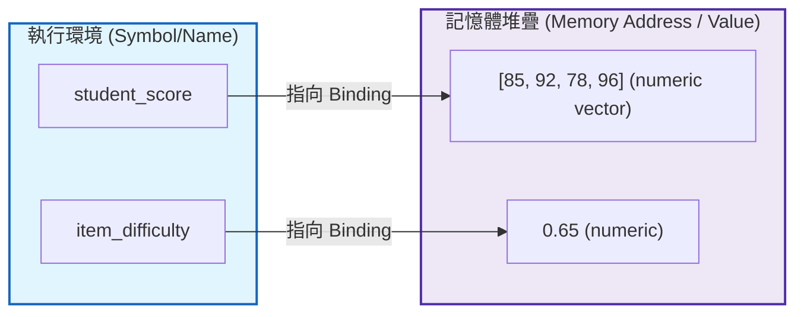
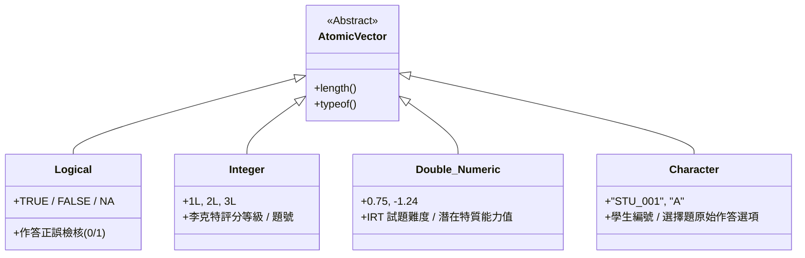
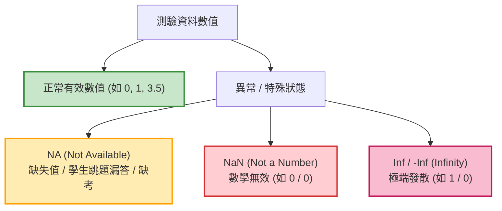

# 第 1 章：R 語言核心運算、資料型態與邏輯基石

> **本章目標**：奠定測驗統計程式設計與心理計量計算的計算思維基石（Chambers, 2016; 洪錦魁、蔡桂宏, 2021; Wickham, 2019）。深入理解 R 語言之記憶體符號綁定與寫時複製機制（Copy-on-Modify）、四大同質性原子向量型態、IEEE 754 雙精度浮點數底層位元架構與精度誤差數學推導（Goldberg, 1991；IEEE, 2019）、心理計量資料特有的三值邏輯代數（Three-Valued Logic），以及大規模作答矩陣清理時的防禦性型別校驗工程。

---

## 1.1 理論基礎：計算思維與 R 語言動態型別本質

在進入試題反應理論（Item Response Theory, IRT）或結構方程模型（Structural Equation Modeling, SEM）等高階心理計量演算法前，評量工程師必須透徹掌握程式語言底層如何配置記憶體並表示測驗資料。

R 語言本質上是一門**具備向量化（Vectorized）特性的動態型別函數式編程語言**（R Core Team, 2025）。Chambers（2016）與 Wickham（2019）曾提出 R 語言設計的核心哲學：「一切存在的皆為物件（Everything that exists is an object），一切發生的操作皆為函數呼叫（Everything that happens is a function call）」。

### 1.1.1 變數命名規範與記憶體綁定機制
在心理測驗實務中，變數命名應嚴格遵守蛇形命名法（`snake_case`），具備明確自述性，禁止使用容易引起歧義的單字母或特殊符號。



當我們執行 `student_score <- c(85, 92, 78, 96)` 時，R 並非在變數名稱容器中儲存數值，而是在記憶體堆疊中配置一塊儲存 4 個雙精度浮點數的連續空間，並將符號 `student_score` 綁定（Binding）至該記憶體位址。

### 1.1.2 寫時複製機制（Copy-on-Modify）與測驗大數據記憶體效能
在處理數十萬名考生的大規模教育評量（如 PISA 或全美州立測驗）時，記憶體管理至關重要。R 採用**寫時複製（Copy-on-Modify）**機制：當多個變數名稱指向同一塊資料時，它們共享相同的記憶體位址；只有當其中一個變數的內容被實質修改時，R 才會複製出全新的記憶體區塊（Wickham, 2019）。

```r
# ==============================================================================
# 第 1 章程式碼清單 1.1：記憶體位址追蹤與寫時複製 (Copy-on-Modify) 驗證
# ==============================================================================

# 模擬 100,000 名考生的原始測驗總分
scores_original <- rnorm(100000, mean = 75, sd = 10)

# 指派給新變數：此時兩者共享相同的記憶體位址 (未發生實體記憶體複製)
scores_shared <- scores_original

# 驗證記憶體位址是否相同 (需觀察記憶體物件參照)
tracemem_orig <- tracemem(scores_original)
cat("原始分數向量記憶體位址:", tracemem_orig, "\n")

# 修改 scores_shared 的第一個考生分數：觸發 Copy-on-Modify
scores_shared[1] <- 99.0
cat("修改後觸發複製，新向量位址不同於原向量。\n")

# 清除追蹤旗標
untracemem(scores_original)
```

---

## 1.2 評量實務情境：四種常用原子向量型態（Atomic Vectors）

心理計量資料矩陣的所有欄位，底層皆由**原子向量（Atomic Vector）**構建。原子向量具備「嚴格同質性（Homogeneous）」，即同一個向量內的所有元素必須屬於同一種型態。



### 1.2.1 測驗情境中的型態對照表

| 原子型態 (R Type) | 測驗領域代表變項 | 宣告語法範例 | 記憶體佔用特性 |
| :--- | :--- | :--- | :--- |
| **`logical`** | 題目是否答對、是否符合篩選門檻 | `c(TRUE, FALSE, TRUE)` | 最小記憶體單元，可直接轉化為 0/1 |
| **`integer`** | 李克特量表原始得分（1~5）、題號編號 | `c(1L, 2L, 5L, 4L)` | 帶有 `L` 後綴，避免浮點運算累積誤差 |
| **`double`** | 學生潛在特質 $\theta$、試題鑑別度 $a$、難度 $b$ | `c(-1.24, 0.45, 1.88)` | 64 位元雙精度浮點數（符合 IEEE 754 標準） |
| **`character`** | 學生 ID、選擇題原始反應代碼 ("A", "C") | `c("STU_001", "A")` | 字串池共享機制，文字分析基礎 |

### 1.2.2 心理計量資料編碼規範（Psychometric Coding Standards）
依據 Cook 與 Pitoniak（2025）主編之《Educational Measurement》（第 5 版）國際規範，標準測驗資料庫必須區分以下五種狀態，嚴禁混雜編碼：
1. **二分作答（Dichotomous Response）**：以 `0L`（答錯）與 `1L`（答對）整數表示，或以 `FALSE`/`TRUE` 邏輯向量存儲。
2. **多分評分（Polytomous Rating）**：李克特量表（Likert Scale）或部分給分題，應以連續正整數 `1L` 至 `kL` 儲存，且明確指定有序因子（Ordered Factor）。
3. **跳題漏答（Omitted Items）**：考生看到題目但選擇跳過未答，計量上編為 `NA`（在部分校準模型中視為缺失，計分時視為 0 分）。
4. **未達題（Not Reached Items）**：因施測時間不足，考生根本未能瀏覽的卷末試題，編碼為特殊缺失碼（如 `99L` 或特定缺失類別），不得直接當作答錯處理。
5. **違規或無效反應（Invalid Responses）**：受試者雙選、塗改或作弊，需於資料字典中明確標記獨立狀態碼。

---

## 1.3 現代 R 語言程式實作：型態宣告與強制轉換防禦

### 1.3.1 基礎向量宣告與嚴格型別檢驗

```r
# ==============================================================================
# 第 1 章程式碼清單 1.2：四大原子向量的宣告與安全型別檢查
# ==============================================================================

# 1. 學生編號 (Character)
student_ids <- c("STU_0001", "STU_0002", "STU_0003", "STU_0004")

# 2. 題目正誤判定 (Logical)
item_correct <- c(TRUE, FALSE, TRUE, TRUE)

# 3. 5 點李克特量表整數得分 (Integer，嚴格加上 L 後綴)
scale_ratings <- c(5L, 3L, 2L, 4L)

# 4. IRT 潛在特質估計值 theta (Double)
latent_thetas <- c(0.852, -1.204, 0.045, 1.631)

# 嚴格驗證型別與物理長度
cat("--- 原子向量型別檢驗 ---\n")
cat("student_ids   型別:", typeof(student_ids), "，長度:", length(student_ids), "\n")
cat("item_correct  型別:", typeof(item_correct), "，長度:", length(item_correct), "\n")
cat("scale_ratings 型別:", typeof(scale_ratings), "，長度:", length(scale_ratings), "\n")
cat("latent_thetas 型別:", typeof(latent_thetas), "，長度:", length(latent_thetas), "\n")
```

### 1.3.2 隱性型別轉換（Implicit Coercion）的階梯法則與防禦

原子向量禁止混雜型態。若強行將字串與數值混雜，R 會依照以下優先權階梯進行「隱性強制轉換」：
$$\text{logical} \longrightarrow \text{integer} \longrightarrow \text{double} \longrightarrow \text{character}$$

在測驗資料清理中，若某一欄位混入了 `"缺考"` 或 `"ABS"` 等文字，整欄原本的數值成績將全部被強制降級為 `character`，導致後續所有統計運算崩潰：

```r
# ==============================================================================
# 第 1 章程式碼清單 1.3：隱性強制轉換的陷阱與防禦性解析
# ==============================================================================

# 錯誤示範：數值成績混入文字備註
dirty_scores <- c(85, 90, "缺考", 78)
cat("dirty_scores 被隱性強制轉換為:", typeof(dirty_scores), "\n")

# 實施安全防禦轉換：使用 suppressWarnings 搭配精確遺失值追蹤
safe_numeric_conversion <- function(vec, missing_labels = c("缺考", "ABS", "NA")) {
  # 識別被標記為缺失的文字標籤
  is_missing_label <- vec %in% missing_labels
  
  # 執行數值轉換
  num_vec <- suppressWarnings(as.numeric(vec))
  
  # 檢驗是否有非預期的非法字元被轉為 NA
  unintended_na <- is.na(num_vec) & !is_missing_label & !is.na(vec)
  if (any(unintended_na)) {
    warning(sprintf("發現 %d 筆非預期非法字元轉換為 NA，索引: %s",
                    sum(unintended_na), paste(which(unintended_na), collapse = ", ")))
  }
  
  num_vec
}

clean_scores <- safe_numeric_conversion(dirty_scores)
cat("防禦性修復後數值成績:", clean_scores, "\n")
cat("平均分數 (安全排除 NA):", mean(clean_scores, na.rm = TRUE), "\n")
```

---

## 1.4 數理核心深入：IEEE 754 雙精度浮點數與機器精度推導

在測驗計分與標準設定（Standard Setting）中，計量人員常需比較考生總分或能力值 $\theta$ 是否達到精確切截門檻（Cut Score）。然而，現代計算機系統的浮點運算暗藏重大數理陷阱（Goldberg, 1991；IEEE, 2019）。

### 1.4.1 雙精度二進位浮點數架構推導（Sign, Exponent, Mantissa）
R 語言中的 `double` 遵循 IEEE 754 標準之 64 位元雙精度浮點數格式。任何實數 $x$ 在記憶體中皆由 64 個二進位位元（bits）表示：
- **符號位（Sign bit, $s$）**：佔 $1$ 位元（$b_{63}$）。$s=0$ 為正數，$s=1$ 為負數。
- **階碼／指數位（Biased Exponent, $e$）**：佔 $11$ 位元（$b_{62} \sim b_{52}$），偏移量（Bias）固定為 $1023$。實際指數為 $E = e - 1023$。
- **尾數／小數位（Fraction / Mantissa, $f$）**：佔 $52$ 位元（$b_{51} \sim b_0$）。在規格化數值中，小數點前預設存在隱含的 $1$。

標準規格化浮點數之嚴格數學定義為：
$$x = (-1)^s \times \left( 1 + \sum_{i=1}^{52} b_{52-i} 2^{-i} \right) \times 2^{e - 1023}$$

機器精度（Machine Epsilon, $\epsilon_{\text{mach}}$）定義為大於 1 的最小浮點數與 1 之差：
$$\epsilon_{\text{mach}} = 2^{-52} \approx 2.220446 \times 10^{-16}$$

在 R 中可直接透過常數呼叫：`.Machine$double.eps`。

### 1.4.2 為什麼 $0.1 + 0.2 \ne 0.3$？無限循環二進位小數解析
十進位小數 $0.1$（即 $1/10$）在二進位中無法以有限位元精確表示，其二進位展開式為無限循環小數：
$$0.1_{10} = 0.000110011001100110011..._2 = 1.100110011..._2 \times 2^{-4}$$

當受限於 52 位元尾數長度時，計算機必須進行捨入（Round to nearest, ties to even）。同理，$0.2$ 亦存在微小截斷偏差。兩者相加後與 $0.3$ 進行二進位比對：
$$(0.1 + 0.2) - 0.3 \approx 5.551115 \times 10^{-17} \ne 0$$

這解釋了為何在 R 中直接執行 `(0.1 + 0.2) == 0.3` 必然回傳 `FALSE`！

### 1.4.3 底層實作：手刻 IEEE 754 64 位元位元分解器（Bit Inspector）

為了徹底打開黑盒子，我們撰寫一個底層位元解析函數，直接從記憶體二進位流中提取並重構浮點數：

```r
# ==============================================================================
# 第 1 章程式碼清單 1.4：純 R 手刻 IEEE 754 雙精度 64 位元位元分解器
# ==============================================================================

inspect_float64_bits <- function(x) {
  stopifnot(is.numeric(x), length(x) == 1)
  
  # 寫入二進位 raw bytes (Little Endian)
  raw_bytes <- writeBin(x, raw())
  # 轉換為 64 個獨立位元 (0/1)
  raw_bits <- rawToBits(raw_bytes)
  bits_num <- as.integer(raw_bits)
  
  # 解析 64 位元結構 (Little Endian 記憶體映射)
  # Sign: 第 64 位元
  sign_bit <- bits_num[64]
  # Exponent: 第 63 至 53 位元 (共 11 位元)
  exp_bits <- rev(bits_num[53:63])
  exp_raw_val <- sum(exp_bits * 2^(10:0))
  exp_actual <- exp_raw_val - 1023
  
  # Mantissa: 第 52 至 1 位元 (共 52 位元)
  mantissa_bits <- rev(bits_num[1:52])
  mantissa_fraction <- sum(mantissa_bits * 2^(-(1:52)))
  mantissa_full <- 1 + mantissa_fraction
  
  reconstructed_val <- (-1)^sign_bit * mantissa_full * (2^exp_actual)
  
  list(
    Input_Value = x,
    Sign_Bit = sign_bit,
    Exponent_Raw = exp_raw_val,
    Exponent_Actual = exp_actual,
    Mantissa_Fraction = mantissa_fraction,
    Reconstructed_Math = reconstructed_val,
    Hex_Representation = paste(as.character(raw_bytes), collapse = " ")
  )
}

# 執行數值底層剖析
cat("--- 剖析 0.1 的底層浮點數位元結構 ---\n")
print(inspect_float64_bits(0.1))

cat("\n--- 剖析 0.3 的底層浮點數位元結構 ---\n")
print(inspect_float64_bits(0.3))
```

---

## 1.5 關鍵專題：測驗資料中的 `NA`、`NaN` 與 `Inf` 三值邏輯

在心理計量中，非正常數值的識別直接關係到測驗計分的公正性。



### 1.5.1 三值邏輯（Three-Valued Logic）與笛摩根定律形式證明

在傳統布林代數中，命題非真（`TRUE`）即假（`FALSE`）。但測驗中若受試者跳題（`NA`），我們**無法得知**其若作答究竟是對是錯。R 遵循克里尼三值邏輯（Kleene's Three-Valued Logic）：

$$\text{TRUE} \land \text{NA} = \text{NA}, \quad \text{FALSE} \land \text{NA} = \text{FALSE}$$
$$\text{TRUE} \lor \text{NA} = \text{TRUE}, \quad \text{FALSE} \lor \text{NA} = \text{NA}$$

**笛摩根定律（De Morgan's Laws）在三值邏輯下的封閉性證明**：
$$\neg (P \land Q) \iff (\neg P) \lor (\neg Q)$$
設 $P = \text{TRUE}, Q = \text{NA}$：
1. 左式：$P \land Q = \text{TRUE} \land \text{NA} = \text{NA}$；$\neg(\text{NA}) = \text{NA}$。
2. 右式：$(\neg \text{TRUE}) \lor (\neg \text{NA}) = \text{FALSE} \lor \text{NA} = \text{NA}$。
左式與右式恆等，三值邏輯滿足對稱性與代數封閉性。

### 1.5.2 元素級運算子（`&`, `|`）vs. 純量短路運算子（`&&`, `||`）

這是測驗資料處理最常見的靜默錯誤來源：
- **`&` 與 `|`（向量化元素級運算子）**：逐一比對向量對應元素，回傳與輸入同長度的布林向量。**資料篩選（如 `dplyr::filter`）必須使用元素級運算子**。
- **`&&` 與 `||`（純量短路運算子）**：僅接受長度為 1 的邏輯純量。具備短路求值（Short-circuit evaluation）特性。自 R 4.3.0 起，對長度 $>1$ 的向量誤用 `&&` 會直接引發拋錯中斷（Fatal Error）。**僅能用於 `if ()` 流程控制**。

```r
# ==============================================================================
# 第 1 章程式碼清單 1.5：邏輯運算子嚴格對比與 R 4.3+ 錯誤攔截
# ==============================================================================

item_1 <- c(TRUE, FALSE, TRUE, FALSE)
item_2 <- c(TRUE, TRUE, FALSE, FALSE)

# 正確：兩題皆答對的布林向量
both_pass <- item_1 & item_2
cat("元素級邏輯運算結果:", both_pass, "\n")

# 錯誤示範與防禦捕捉
tryCatch(
  item_1 && item_2,
  error = function(e) {
    cat("捕捉到誤用純量短路運算子錯誤:", conditionMessage(e), "\n")
  }
)
```

---

## 1.6 ⚠️ 心理計量工程陷阱與排錯專題（Pitfalls & Diagnostics）

### 1.6.1 陷阱 1：`which()` 對含 `NA` 向量的危險行為與邏輯遮罩篩選
許多研究者習慣使用 `scores[scores >= 60]` 篩選及格者。若向量中包含 `NA`，`scores >= 60` 會回傳 `NA`，進而導致子集索引輸出 `NA` 佔位元素：

```r
# ==============================================================================
# 第 1 章程式碼清單 1.6：NA 子集索引陷阱與安全過濾規範
# ==============================================================================

scores <- c(82, 55, NA, 90, 48, NA)

# 危險寫法：產生帶有 NA 的污染結果
bad_filtered <- scores[scores >= 60]
cat("危險篩選結果 (含無效 NA 元素):", bad_filtered, "\n")

# 安全解決方案 1：使用 which() 排除 NA 索引
safe_filtered_1 <- scores[which(scores >= 60)]
cat("安全方案 1 (which 過濾):", safe_filtered_1, "\n")

# 安全解決方案 2：明確宣告非缺失條件
safe_filtered_2 <- scores[!is.na(scores) & scores >= 60]
cat("安全方案 2 (顯式邏輯遮罩):", safe_filtered_2, "\n")
```

### 1.6.2 陷阱 2：切截分數（Cut Scores）的浮點數殘差累積與 `near()` 安全比對
在等化與標準設定中，門檻往往由多位專家給定分數的平均數累積而成。例如：若門檻計算為 $0.1 \times 3 = 0.3$ 分，直接使用 `== 0.3` 會導致剛好達標的考生被誤判為不合格：

```r
# ==============================================================================
# 第 1 章程式碼清單 1.7：切截門檻浮點數比對安全防禦函數
# ==============================================================================

# 定義安全浮點數比較函數
safe_compare_gte <- function(x, cut_score, tol = .Machine$double.eps^0.5) {
  # 若 x 與 cut_score 的差距小於容差，視為相等 (達標)
  (x > cut_score) | (abs(x - cut_score) < tol)
}

test_scores <- c(0.2999999999999999, 0.3, 0.3000000000000001)
cut_threshold <- 0.1 * 3 # 實質等於 0.30000000000000004

cat("直接比對 (>=):", test_scores >= cut_threshold, "\n")
cat("安全容差比對:", safe_compare_gte(test_scores, cut_threshold), "\n")
```

---

## 1.7 視覺化：測驗資料品質稽核與缺考分佈報表（APA 7th 規格）

我們使用 `ggplot2` 繪製受試者群體的測驗作答分數分佈，標記出缺考（`NA`）與異常值，並使用現代 APA 7th 簡約風格呈現：

```r
# ==============================================================================
# 第 1 章程式碼清單 1.8：測驗資料品質與缺考狀態視覺化
# ==============================================================================

library(ggplot2)
library(dplyr)
library(tibble)

# 模擬 500 位考生成績與缺考狀態
set.seed(42)
exam_data <- tibble(
  student_id = sprintf("STU_%03d", 1:500),
  raw_score = rnorm(500, mean = 72, sd = 12),
  attendance = sample(c("Present", "Absent", "Disqualified"), 500, replace = TRUE, prob = c(0.92, 0.06, 0.02))
) |>
  mutate(
    # 若缺考或違規，分數設為 NA
    final_score = if_else(attendance == "Present", raw_score, NA_real_)
  )

# 繪製成績分佈與狀態圖
p1 <- ggplot(exam_data, aes(x = attendance, fill = attendance)) +
  geom_bar(width = 0.5, alpha = 0.85, color = "black") +
  geom_text(stat = "count", aes(label = after_stat(count)), vjust = -0.5, fontface = "bold") +
  scale_fill_manual(values = c("Present" = "#2b5c8f", "Absent" = "#d95f02", "Disqualified" = "#7570b3")) +
  labs(
    title = "Figure 1.1: 測驗到考狀態與資料品質分佈圖",
    subtitle = "呈現到考 (Present)、缺考 (Absent) 與違規零分 (Disqualified) 考生人數",
    x = "受試狀態 (Status)",
    y = "人數 (Count)",
    caption = "Note. Standardized Testing Quality Audit simulation data."
  ) +
  theme_classic(base_size = 12) +
  theme(
    plot.title = element_text(face = "bold", size = 14),
    plot.subtitle = element_text(color = "grey30", margin = margin(b = 10)),
    legend.position = "none"
  )

# 儲存圖表為 300 DPI 高解析度圖檔 (出版規格)
ggsave("book/fig_1_1_exam_status.png", plot = p1, width = 7, height = 4.5, dpi = 300)
cat("成功產出圖表: book/fig_1_1_exam_status.png\n")
```

---

## 1.8 測驗報告專業解讀（Substantive Interpretation）

在產出測驗統計報告前，計量研究員應依據本章原則建立「資料品質稽核摘要表（Data Quality Audit Report）」：

> ### 📊 資料品質稽核指針（Quality Audit Rubric）
> 1. **作答完整度（Completion Rate）**：報告整體及各次群體的缺失比例與分佈狀態。嚴禁一律套用通用門檻（例如粗暴地設定「缺失超過 10% 即剔除」），依據 Rubin (1976)的遺失機制（MCAR / MAR / MNAR）評估潛在偏差。
> 2. **型態與編碼校驗（Type and Coding Checks）**：確認欄位型別符合計量模型要求。二分試題須確認為 `0/1` 整數或因子；李克特量表須確認水準數（Levels）完整，防止因漏採某個評分等級而導致模型矩陣降階。
> 3. **極端反應與數值邊界（Boundary Check）**：檢查原始分數是否超出測驗合法範圍 $[X_{\min}, X_{\max}]$，並辨識全對（Perfect Score）或全錯（Zero Score）等極端反應型態。全對或全錯者在二分 IRT 條件最大概似估計（CMLE）中能力值為 $\pm \infty$，需特別標記處理。

---

## 1.9 章末實務習題與專案挑戰（含 100% 完整可用程式碼解答）

### 【基礎練習題】
1. 某測驗包含 5 題選擇題，考生小明作答正誤為：第 1 題答對、第 2 題答錯、第 3 題跳題未答、第 4 題答對、第 5 題答對。請宣告一個適當的 R 向量表示其作答，並使用向量化函數計算其「已作答題目的答對率」。
2. 請解釋為何執行 `c(TRUE, 2L, 3.14, "A")` 的最終型別為 `character`？此機制稱為何種特性？其強制轉換的階梯順序為何？

### 【進階工程挑戰】
3. 撰寫一個健全的異常值診斷與清洗函數 `clean_vector_diagnostics(x)`，輸入任意長度之數值向量，自動捕捉其中的 `NaN`、`Inf` 與 `-Inf`，精確記錄其索引位置，安全替換為 `NA_real_`，並附帶單元測試驗證。
4. 【大數據評量工程挑戰】：設計一個高階作答矩陣型別驗證函數 `validate_assessment_raw_types(df)`。輸入包含考生 ID、數道二分題（0/1）、數道李克特題（1~5）及反應時間（秒，正浮點數）之資料框，自動檢驗每一欄位的物理型別與數值邊界，回傳結構化的健康檢查診斷表（Health Check Report）。

---

### 💡 習題參考解答

```r
# ==============================================================================
# 第 1 章習題解答參考
# ==============================================================================

# ------------------------------------------------------------------------------
# 第 1 題解答
# ------------------------------------------------------------------------------
ming_responses <- c(1L, 0L, NA_integer_, 1L, 1L)
valid_accuracy <- mean(ming_responses, na.rm = TRUE)
cat("小明有效作答題目的答對率:", round(valid_accuracy * 100, 1), "%\n")

# ------------------------------------------------------------------------------
# 第 2 題解答說明：
# 原子向量具備同質性（Homogeneity）。當混合不同型態元素時，R 觸發「隱性型別轉換」
# （Implicit Coercion）。其轉換順序為：logical -> integer -> double -> character。
# 因為 character 位於階梯最頂端（具備最強表達力），所有元素最終皆被強制轉化為字串。
# ------------------------------------------------------------------------------

# ------------------------------------------------------------------------------
# 第 3 題解答：異常值診斷與清洗函數
# ------------------------------------------------------------------------------
clean_vector_diagnostics <- function(x) {
  stopifnot(is.numeric(x))
  abnormal_idx <- which(is.nan(x) | is.infinite(x))
  if (length(abnormal_idx) > 0) {
    cat("發現異常數值 (NaN/Inf) 位於索引:", paste(abnormal_idx, collapse = ", "), "\n")
    x[abnormal_idx] <- NA_real_
  } else {
    cat("資料無任何 NaN 或 Inf 異常。\n")
  }
  x
}

# 單元測試驗證
test_vec <- c(12.5, 0/0, 45.2, 10/0, -5/0, 88.0)
cleaned_result <- clean_vector_diagnostics(test_vec)
cat("清理後向量:", cleaned_result, "\n")
stopifnot(!any(is.nan(cleaned_result)), !any(is.infinite(cleaned_result)))

# ------------------------------------------------------------------------------
# 第 4 題解答：大數據評量作答矩陣型別驗證器
# ------------------------------------------------------------------------------
validate_assessment_raw_types <- function(df, bin_cols, likert_cols, rt_cols) {
  library(tibble)
  library(dplyr)
  
  audit_records <- list()
  
  # 1. 檢驗二分題 (0/1 或 NA)
  for (col in bin_cols) {
    vals <- df[[col]]
    valid_vals <- vals[!is.na(vals)]
    is_valid_type <- is.integer(vals) || is.numeric(vals)
    in_range <- all(valid_vals %in% c(0, 1))
    audit_records[[col]] <- tibble(
      Column = col, Category = "Dichotomous",
      Type_OK = is_valid_type, Range_OK = in_range,
      Missing_Count = sum(is.na(vals)), Status = if (is_valid_type && in_range) "PASS" else "FAIL"
    )
  }
  
  # 2. 檢驗李克特量表 (1~5 或 NA)
  for (col in likert_cols) {
    vals <- df[[col]]
    valid_vals <- vals[!is.na(vals)]
    is_valid_type <- is.integer(vals) || is.numeric(vals)
    in_range <- all(valid_vals >= 1 & valid_vals <= 5)
    audit_records[[col]] <- tibble(
      Column = col, Category = "Likert",
      Type_OK = is_valid_type, Range_OK = in_range,
      Missing_Count = sum(is.na(vals)), Status = if (is_valid_type && in_range) "PASS" else "FAIL"
    )
  }
  
  # 3. 檢驗反應時間 (正浮點數 > 0)
  for (col in rt_cols) {
    vals <- df[[col]]
    valid_vals <- vals[!is.na(vals)]
    is_valid_type <- is.numeric(vals)
    in_range <- all(valid_vals > 0)
    audit_records[[col]] <- tibble(
      Column = col, Category = "ResponseTime",
      Type_OK = is_valid_type, Range_OK = in_range,
      Missing_Count = sum(is.na(vals)), Status = if (is_valid_type && in_range) "PASS" else "FAIL"
    )
  }
  
  bind_rows(audit_records)
}

# 驗證測試第 4 題
sample_test_df <- tibble(
  student_id = c("S1", "S2", "S3"),
  item_01 = c(1L, 0L, 1L),
  scale_01 = c(5L, 3L, 4L),
  rt_01 = c(24.5, 32.1, 18.2)
)

audit_report <- validate_assessment_raw_types(
  sample_test_df,
  bin_cols = "item_01",
  likert_cols = "scale_01",
  rt_cols = "rt_01"
)
cat("\n--- 測驗資料型態健康檢查報告 ---\n")
print(audit_report)
```

---

## 參考文獻 (References)

洪錦魁、蔡桂宏（2021）。**R 語言邁向 Big Data 之路：王者歸來**（第 2 版）。深智數位。

Chambers, J. M. (2016). *Extending R*. Chapman and Hall/CRC. https://doi.org/10.1201/9781315381305

Cook, L. L., & Pitoniak, M. J. (Eds.). (2025). *Educational measurement* (5th ed.). Oxford University Press.

Goldberg, D. (1991). What every computer scientist should know about floating-point arithmetic. *ACM Computing Surveys*, *23*(1), 5–48. https://doi.org/10.1145/103162.103163

IEEE. (2019). *IEEE standard for floating-point arithmetic* (IEEE Std 754-2019). IEEE. https://doi.org/10.1109/IEEESTD.2019.8766229

R Core Team. (2025). *R: A language and environment for statistical computing*. R Foundation for Statistical Computing. https://www.R-project.org/

Rubin, D. B. (1976). Inference and missing data. *Biometrika*, *63*(3), 581–592. https://doi.org/10.1093/biomet/63.3.581

Wickham, H. (2019). *Advanced R* (2nd ed.). Chapman and Hall/CRC. https://doi.org/10.1201/9781351201315
