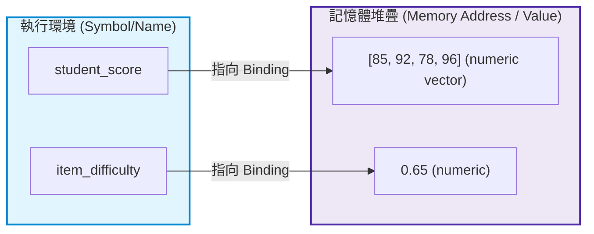
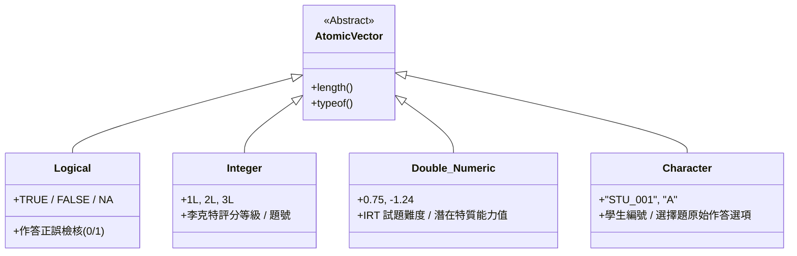
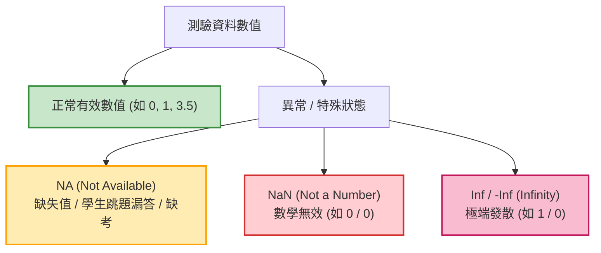
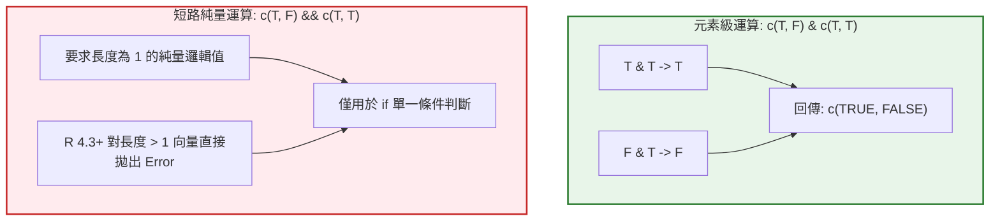

# 第 1 章：R 語言核心運算、資料型態與邏輯基石

> **本章目標**：建立測驗統計程式設計的基礎（洪錦魁、蔡桂宏，2021；Wickham, 2019）。理解 R 語言記憶體機制、四類原子資料型態、布林邏輯代數、浮點數精度問題（Goldberg, 1991），以及心理計量資料處理常遇到的 `NA` 三值邏輯。

---

## 1.1 理論基礎：計算思維與 R 語言動態型別本質

在進入複雜的心理計量模型（如試題反應理論 IRT 或結構方程模型 SEM）之前，程式設計者必須先理解電腦底層如何表示與處理測驗資料。

R 語言本質上是一門**具備向量化（Vectorized）特性的動態型別函數式編程語言**（R Core Team, 2025）。Chambers（2016）與 Wickham（2019）指出，在 R 中，「一切存在的皆為物件（Everything that exists is an object），一切發生的操作皆為函數呼叫（Everything that happens is a function call）」。

### 1.1.1 變數命名規範與記憶體綁定機制
在心理測驗實務中，變數命名應嚴格遵守蛇形命名法（`snake_case`），具備明確自述性，禁止使用容易引起歧義的單字母或特殊符號。



當我們執行 `student_score <- c(85, 92, 78, 96)` 時，R 是在記憶體中配置一塊儲存 4 個雙精度浮點數的空間，並將符號 `student_score` 指向該記憶體位址。

---

## 1.2 評量實務情境：四種常用原子向量型態（Atomic Vectors）

心理計量資料矩陣的所有欄位，底層皆由**原子向量（Atomic Vector）**構建。原子向量具備「同質性（Homogeneous）」，即同一個向量內的所有元素必須屬於同一種型態。

本章聚焦於常見的 `logical`、`integer`、`double` 與 `character`。R 也提供 `complex` 與 `raw` 原子型態，本書後續範例較少使用。



### 1.2.1 測驗情境中的型態對照表

| 原子型態 (R Type) | 測驗領域代表變項 | 宣告語法範例 | 記憶體佔用特性 |
| :--- | :--- | :--- | :--- |
| **`logical`** | 題目是否答對、是否符合篩選門檻 | `c(TRUE, FALSE, TRUE)` | 最小記憶體單元，可直接轉化為 0/1 |
| **`integer`** | 李克特量表原始得分（1~5）、題號編號 | `c(1L, 2L, 5L, 4L)` | 帶有 `L` 後綴，避免浮點運算誤差 |
| **`double`** | 學生潛在特質 $\theta$、試題鑑別度 $a$、難度 $b$ | `c(-1.24, 0.45, 1.88)` | 64 位元雙精度浮點數（符合 IEEE 754） |
| **`character`** | 學生 ID、選擇題原始反應代碼 ("A", "C") | `c("STU_001", "A")` | 字串池共享機制 |

---

## 1.3 現代 R 語言程式實作：型態宣告與強制轉換陷阱

### 1.3.1 基礎向量宣告與嚴格型別檢驗

我們撰寫一段標準代碼，展示四種原子向量的正確宣告方式與 `typeof()` 檢查：

```r
# ==============================================================================
# 第 1 章程式碼清單 1.1：四大原子向量的宣告與安全型別檢查
# ==============================================================================

# 1. 學生編號 (Character)
student_ids <- c("STU_0001", "STU_0002", "STU_0003", "STU_0004")

# 2. 題目正誤判定 (Logical)
item_correct <- c(TRUE, FALSE, TRUE, TRUE)

# 3. 5 點李克特量表整數得分 (Integer，嚴格加上 L 後綴)
scale_ratings <- c(5L, 3L, 2L, 4L)

# 4. IRT 潛在特質估計值 theta (Double)
latent_thetas <- c(0.852, -1.204, 0.045, 1.631)

# 驗證型別與長度
cat("--- 原子向量型別檢驗 ---\n")
cat("student_ids   型別:", typeof(student_ids), "，長度:", length(student_ids), "\n")
cat("item_correct  型別:", typeof(item_correct), "，長度:", length(item_correct), "\n")
cat("scale_ratings 型別:", typeof(scale_ratings), "，長度:", length(scale_ratings), "\n")
cat("latent_thetas 型別:", typeof(latent_thetas), "，長度:", length(latent_thetas), "\n")
```

### 1.3.2 隱性型別轉換（Implicit Coercion）的風險

原子向量不允許混合不同型態。若強行將字串與數值混雜，R 會依照以下優先順序進行「隱性強制轉換」：
$$\text{logical} \longrightarrow \text{integer} \longrightarrow \text{double} \longrightarrow \text{character}$$

在測驗資料清理中，若某一欄位混入了 `"缺考"` 或 `"ABS"` 等文字，整欄原本的數值成績將全部被強制降級為 `character`，導致所有數學運算報錯：

```r
# ==============================================================================
# 第 1 章程式碼清單 1.2：隱性強制轉換示範與安全解析
# ==============================================================================

# 錯誤範例：數值成績混入文字備註
dirty_scores <- c(85, 90, "缺考", 78)
cat("dirty_scores 型別被污染為:", typeof(dirty_scores), "\n")
# 此時執行 mean(dirty_scores) 會引發 Error: argument is not numeric or logical

# 轉換後檢查哪些原始值無法解析；不要直接隱藏轉換警告
clean_scores <- as.numeric(dirty_scores)
invalid_idx <- which(is.na(clean_scores) & !is.na(dirty_scores))
cat("無法解析的原始值索引:", invalid_idx, "\n")
cat("修復後 scores:", clean_scores, "\n")
cat("平均分數 (排除 NA):", mean(clean_scores, na.rm = TRUE), "\n")
```

---

## 1.4 關鍵專題：測驗資料中的 `NA`、`NaN` 與 `Inf`

在心理計量中，非正常數值的識別直接關係到測驗計分的公正性。



### 1.4.1 三值邏輯（Three-Valued Logic）與 `NA` 的真值表

在傳統布林代數中，命題非真（`TRUE`）即假（`FALSE`）。但測驗中若受試者未作答該題（狀態為 `NA`），我們**無法得知**該生若作答究竟會答對還是答錯。因此，R 語言遵循嚴格的三值邏輯：

$$\text{TRUE} \land \text{NA} = \text{NA}, \quad \text{FALSE} \land \text{NA} = \text{FALSE}$$
$$\text{TRUE} \lor \text{NA} = \text{TRUE}, \quad \text{FALSE} \lor \text{NA} = \text{NA}$$

**常見錯誤：切勿使用 `x == NA`**
因為 `NA` 代表未知，未知是否等於未知的結果仍為 `NA`，而非 `TRUE`。

```r
# ==============================================================================
# 第 1 章程式碼清單 1.3：NA 的三值邏輯檢驗與 is.na() 正確用法
# ==============================================================================

x <- NA

# 錯誤寫法：
cat("x == NA 的結果是:", x == NA, "(型別為:", typeof(x == NA), ")\n")

# 正確寫法：使用專用函數 is.na()
cat("is.na(x) 的結果是:", is.na(x), "\n")

# 測驗場景：篩選出答對且非跳題的學生
item_response <- c(1, 0, NA, 1, NA)
valid_correct <- !is.na(item_response) & (item_response == 1)
cat("有效答對者布林索引:", valid_correct, "\n")
```

---

## 1.5 布林邏輯運算子：元素級運算 vs. 純量短路運算

這是測驗統計程式中容易造成靜默錯誤（Silent Bug）的地方：

- **元素級運算子（`&`, `|`）**：對向量中的**每一個元素**逐一進行布林邏輯比對，回傳一個同等長度的布林向量。**在資料框篩選（`filter`）中必須使用此運算子**。
- **純量短路運算子（`&&`, `||`）**：僅接受**長度為 1 的純量邏輯值**，且具備短路求值（Short-circuit evaluation）特性（在早期 R 版本僅比對第 1 個元素，自 R 4.3.0 起對長度大於 1 的向量直接使用 `&&` 或 `||` 會直接拋出錯誤）。**僅能用於 `if` 條件控制流程中**。



```r
# ==============================================================================
# 第 1 章程式碼清單 1.4：& 與 && 的本質區別實戰
# ==============================================================================

# 假設兩題作答正誤向量
item_1 <- c(TRUE, FALSE, TRUE, FALSE)
item_2 <- c(TRUE, TRUE, FALSE, FALSE)

# 需求：找出兩題皆答對的學生 (正確使用元素級 &)
both_correct <- item_1 & item_2
cat("兩題皆答對的布林向量:", both_correct, "\n")

# 錯誤示範：若對長度 > 1 的向量誤用 && (R 4.3.0+ 直接拋出 Error)
tryCatch(
  item_1 && item_2,
  error = function(e) cat("誤用 && 捕捉到的錯誤:", conditionMessage(e), "\n")
)
```

---

## 1.6 浮點數精度陷阱與切截門檻比較安全規範

在測驗標準設定（Standard Setting）中，我們經常需要判定受試者總分是否達到切截分數（Cut Score，如 $60.0$ 分）。

在二進位浮點數系統（IEEE 754）中，許多十進位小數（如 $0.1$ 與 $0.2$）無法精確表示為有限位元的二進位小數（Goldberg, 1991；洪錦魁、蔡桂宏，2021）。

```r
# ==============================================================================
# 第 1 章程式碼清單 1.5：浮點數陷阱與安全門檻比較
# ==============================================================================

# 經典數值陷阱
val_a <- 0.1 + 0.2
val_b <- 0.3

cat("0.1 + 0.2 == 0.3 的結果是:", val_a == val_b, "\n")
cat("兩者實際數值差異 (Residual):", sprintf("%.20f", val_a - val_b), "\n")

# 測驗評量安全解決方案 1：Base R 的 all.equal / 容差比較
tolerance <- .Machine$double.eps^0.5
is_equal_safe <- abs(val_a - val_b) < tolerance
cat("安全容差比較結果:", is_equal_safe, "\n")

# 測驗評量安全解決方案 2：dplyr::near()
cat("dplyr::near() 比較結果:", dplyr::near(val_a, val_b), "\n")
```

---

## 1.7 視覺化：測驗資料異常值與特殊型態分佈圖

我們使用 `ggplot2` 繪製受試者群體的測驗作答分數分佈，標記出缺考（`NA`）與異常值，並使用現代 APA 7th 簡約風格呈現：

```r
# ==============================================================================
# 第 1 章程式碼清單 1.6：測驗資料品質與缺考狀態視覺化
# ==============================================================================

library(ggplot2)
library(dplyr)
library(tibble)

# 模擬 500 位考生成績與缺考狀態
set.seed(42)
exam_data <- tibble(
  student_id = sprintf("STU_%03d", 1:500),
  raw_score = rnorm(500, mean = 72, sd = 12),
  attendance = sample(c("Present", "Absent", "Disqualified"), 500, replace = TRUE, prob = c(0.92, 0.06, 0.02))
) |>
  mutate(
    # 若缺考或違規，分數設為 NA
    final_score = if_else(attendance == "Present", raw_score, NA_real_)
  )

# 繪製成績分佈與狀態圖
p1 <- ggplot(exam_data, aes(x = attendance, fill = attendance)) +
  geom_bar(width = 0.5, alpha = 0.85, color = "black") +
  geom_text(stat = "count", aes(label = after_stat(count)), vjust = -0.5, fontface = "bold") +
  scale_fill_manual(values = c("Present" = "#2b5c8f", "Absent" = "#d95f02", "Disqualified" = "#7570b3")) +
  labs(
    title = "Figure 1.1: 測驗到考狀態與資料品質分佈圖",
    subtitle = "呈現到考 (Present)、缺考 (Absent) 與違規零分 (Disqualified) 考生人數",
    x = "受試狀態 (Status)",
    y = "人數 (Count)",
    caption = "Note. Standardized Testing Quality Audit simulation data."
  ) +
  theme_classic(base_size = 12) +
  theme(
    plot.title = element_text(face = "bold", size = 14),
    plot.subtitle = element_text(color = "grey30", margin = margin(b = 10)),
    legend.position = "none"
  )

# 儲存圖表為 300 DPI 高解析度圖檔 (出版規格)
ggsave("book/fig_1_1_exam_status.png", plot = p1, width = 7, height = 4.5, dpi = 300)
cat("成功產出圖表: book/fig_1_1_exam_status.png\n")
```

---

## 1.8 測驗報告專業解讀（Substantive Interpretation）

在產出測驗統計報告前，計量研究員應依據本章原則建立「資料品質稽核摘要表（Data Quality Audit Report）」：

> ### 📊 資料品質稽核指針（Quality Audit Rubric）
> 1. **作答完整度（Completion Rate）**：報告整體及各群體的缺失比例與分布；$90\%$ 不是適用所有測驗的通用門檻。缺失比例本身也不能判定資料是否為 MCAR；只有在分析問題與方法適用時，才考慮相應的缺失機制診斷。
> 2. **型態與編碼校驗（Type and Coding Checks）**：依資料字典確認型態、合法值與缺失碼。二分作答可以用 `0/1` 數值或邏輯值表示，轉換前須確認模型套件的輸入要求。
> 3. **極端反應與數值邊界（Boundary Check）**：檢查分數是否超出合法範圍，並辨識全對、全錯等極端反應型態。不要僅因受試者全對或全錯就一律刪除；應依估計方法、模型診斷與研究目的判斷其處理方式。

---

## 1.9 章末實務習題與專案挑戰

### 【基礎練習題】
1. 某測驗包含 5 題選擇題，考生小明作答正誤為：第 1 題答對、第 2 題答錯、第 3 題跳題未答、第 4 題答對、第 5 題答對。請宣告一個適當的 R 向量表示其作答，並使用向量化函數計算其「已作答題目的答對率」。
2. 請解釋為何執行 `c(TRUE, 2L, 3.14, "A")` 的最終型別為 `character`？此機制稱為何種特性？

### 【進階工程挑戰】
3. 撰寫一段 R 程式碼，輸入任意長度的數值向量 `x`，檢驗其是否包含任何 `NaN`、`Inf` 或 `-Inf`。若包含，請精確印出該異常數值所在的索引位置（Index），並安全地將其置換為 `NA_real_`。

---

### 💡 習題參考解答

```r
# ==============================================================================
# 第 1 章習題解答參考
# ==============================================================================

# 第 1 題
ming_responses <- c(1L, 0L, NA_integer_, 1L, 1L)
valid_accuracy <- mean(ming_responses, na.rm = TRUE)
cat("小明有效作答題目的答對率:", round(valid_accuracy * 100, 1), "%\n")

# 第 3 題解答
clean_vector_diagnostics <- function(x) {
  stopifnot(is.numeric(x))
  abnormal_idx <- which(is.nan(x) | is.infinite(x))
  if (length(abnormal_idx) > 0) {
    cat("發現異常數值位於索引:", abnormal_idx, "\n")
    x[abnormal_idx] <- NA_real_
  } else {
    cat("資料無任何 NaN 或 Inf 異常。\n")
  }
  return(x)
}

# 測試
test_vec <- c(12.5, 0/0, 45.2, 10/0, -5/0, 88.0)
cleaned_vec <- clean_vector_diagnostics(test_vec)
cat("清理後向量:", cleaned_vec, "\n")
```

---

## 參考文獻 (References)

洪錦魁、蔡桂宏（2021）。**R 語言邁向 Big Data 之路：王者歸來**（第 2 版）。深智數位。

Chambers, J. M. (2016). *Extending R*. Chapman and Hall/CRC. https://doi.org/10.1201/9781315381305

Goldberg, D. (1991). What every computer scientist should know about floating-point arithmetic. *ACM Computing Surveys*, *23*(1), 5–48. https://doi.org/10.1145/103162.103163

R Core Team. (2025). *R: A language and environment for statistical computing*. R Foundation for Statistical Computing. https://www.R-project.org/

Wickham, H. (2019). *Advanced R* (2nd ed.). Chapman and Hall/CRC. https://doi.org/10.1201/9781351201315
