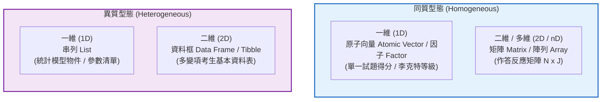
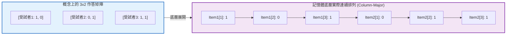
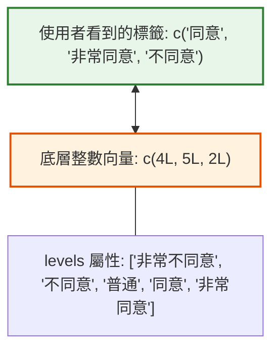
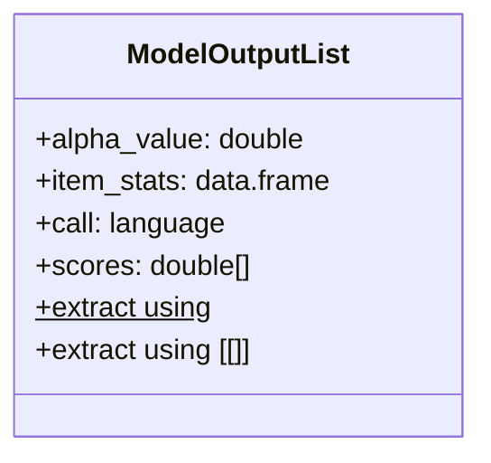

# 第 2 章：測驗專用資料結構：向量、矩陣、因子與串列

> **本章目標**：介紹心理計量與測驗資料的四類資料結構：原子向量、作答矩陣（Matrix）、李克特量表因子（Factor/Ordered Factor）與模型輸出容器串列（List）（洪錦魁、蔡桂宏，2021；Wickham, 2019）。說明 R 的欄優先（column-major）儲存機制、矩陣乘法在試題分析中的應用，以及因子轉換的數值錯誤。

---

## 2.1 理論基礎：R 語言物件模型的幾何與型態分流

在測驗評量中，資料結構的選擇直接決定了計算效率與記憶體安全性。根據 Wickham（2019）與 Wickham 等人（2023）的分類架構，R 語言的資料結構可依據「維度（Dimensions）」與「元素同質性（Homogeneity）」劃分為四大象限：



### 2.1.1 矩陣的物理結構：欄優先儲存（Column-Major Order）
在 R 記憶體中，二維矩陣本質上是一個**附加了維度屬性（`dim`）的一維向量**，並依「欄優先（column-major；先填第 1 欄，再填第 2 欄）」的順序連續存放於記憶體。



---

## 2.2 評量實務情境：因子（Factor）與李克特量表編碼陷阱

心理量表（如內在動機、自尊、焦慮）廣泛使用李克特五點量表（Likert, 1932）。在 R 中，類別變項與等級變項必須以**因子（Factor）**與**有序因子（Ordered Factor）**進行建模（洪錦魁、蔡桂宏，2021；陳新豐，2021）。

### 2.2.1 因子的雙重本質
因子表面上呈現為文字標籤（Labels），但其底層物理實體是**一組整數向量（Integers: 1, 2, 3...）加上水準對照表（`levels` 屬性）**。



### 2.2.2 常見陷阱：因子的直接數值轉換
若直接對文字因子執行 `as.numeric()`，R 回傳的是**因子水準的內部整數索引，而非文字代表的數值**。若因子水準包含非連續數字或排序錯置，將引發計分錯誤：

```r
# ==============================================================================
# 第 2 章程式碼清單 2.1：因子轉換數值的常見錯誤與正確做法
# ==============================================================================

# 情境：某題評分有 10, 20, 30 分三種等級，以字串建立因子
raw_ratings <- factor(c("20", "30", "10", "20"))

# 錯誤示範：直接 as.numeric()
bad_scores <- as.numeric(raw_ratings)
cat("錯誤：as.numeric(raw_ratings) 回傳內部索引值:", bad_scores, "\n")
# 結果為 2 3 1 2，原本的 20 分變成了 2 分

# 正確解法 1：先轉文字再轉數值 (Base R 標準做法)
safe_scores_base <- as.numeric(as.character(raw_ratings))
cat("正確做法 1 (as.character):", safe_scores_base, "\n")

# 正確解法 2：使用 levels 索引查表
safe_scores_levels <- as.numeric(levels(raw_ratings))[raw_ratings]
cat("正確做法 2 (levels 查表):", safe_scores_levels, "\n")
```

---

## 2.3 現代 R 語言程式實作：矩陣代數在試題分析中的應用

在古典測驗理論（CTT）中，計算受試者總分與各題通過率（難度 $P$ 值），若使用迴圈逐列逐欄加總，效率較低。利用矩陣代數運算，可以較快完成大量考生的計分。

設作答反應矩陣為 $\mathbf{X} \in \mathbb{R}^{N \times J}$（$N$ 位受試者，$J$ 道題目，元素 $x_{ij} \in \{0, 1\}$）：
1. **全體受試者總分向量** $\mathbf{S} \in \mathbb{R}^{N}$：
   $$\mathbf{S} = \mathbf{X} \mathbf{1}_J$$
   其中 $\mathbf{1}_J$ 為長度為 $J$ 的全 1 行向量。
2. **各題通過率（難度）向量** $\mathbf{P} \in \mathbb{R}^{J}$：
   $$\mathbf{P} = \frac{1}{N} \mathbf{1}_N^T \mathbf{X}$$

```r
# ==============================================================================
# 第 2 章程式碼清單 2.2：矩陣乘法於測驗快速計分與難度計算實務
# ==============================================================================

# 建立 5 位受試者 x 4 道題目的二分反應矩陣
X_mat <- matrix(
  c(1, 0, 1, 1, 0,  # Item 1
    1, 1, 0, 1, 1,  # Item 2
    0, 0, 1, 1, 0,  # Item 3
    1, 1, 1, 1, 1), # Item 4
  nrow = 5, ncol = 4, byrow = FALSE,
  dimnames = list(sprintf("Student_%d", 1:5), sprintf("Item_%d", 1:4))
)

cat("--- 原始作答矩陣 X ---\n")
print(X_mat)

N <- nrow(X_mat)
J <- ncol(X_mat)

# 1. 矩陣乘法求考生總分向量: S = X %*% 1_J
ones_J <- matrix(1, nrow = J, ncol = 1)
total_scores <- X_mat %*% ones_J
cat("\n考生總分向量 (矩陣乘法):\n")
print(total_scores)

# 2. 矩陣乘法求試題難度 P 值: P = (1_N^T %*% X) / N
ones_N <- matrix(1, nrow = N, ncol = 1)
item_difficulties <- (t(ones_N) %*% X_mat) / N
cat("\n各題通過率 P 值 (矩陣乘法):\n")
print(item_difficulties)

# 3. 與 Base R 內建 colMeans / rowSums 交叉檢定 (as.vector 會剝除名稱屬性，故比對 unname 後之數值)
stopifnot(identical(as.vector(total_scores), unname(rowSums(X_mat))))
stopifnot(identical(as.vector(item_difficulties), unname(colMeans(X_mat))))
cat("\n[驗證通過] 矩陣代數運算結果與 rowSums/colMeans 一致\n")
```

---

## 2.4 串列（List）：計量統計模型輸出物件的結構與提取

在 R 語言中，常見心理計量套件如 `psych`（Revelle, 2026）、`lavaan` 與 `mirt` 產出的模型配適結果，底層均以**串列（List）**或以其為基礎的 S3/S4 物件封裝（Wickham, 2019）。



### 2.4.1 單層括號 `[` vs. 雙層括號 `[[` 的本質區別
- `x[1]`：**取出子串列（Sub-list）**，仍然是一個包著元素的串列容器（類似「切下一節車廂」）。
- `x[[1]]` 或 `x$name`：**取出內容物實體（Content）**，拆開容器取出內部的向量或矩陣（類似「取出車廂內的乘客」）。

```r
# ==============================================================================
# 第 2 章程式碼清單 2.3：使用 psych 套件示範模型物件 List 之安全解析
# ==============================================================================

library(psych)

# 模擬 5 題量表作答資料
set.seed(123)
mock_scale_data <- data.frame(
  Q1 = sample(1:5, 100, replace = TRUE),
  Q2 = sample(1:5, 100, replace = TRUE),
  Q3 = sample(1:5, 100, replace = TRUE)
)

# 執行 Cronbach's Alpha 計算
alpha_res <- psych::alpha(mock_scale_data, warnings = FALSE)

cat("模型物件結構型別:", typeof(alpha_res), "，S3 類別:", class(alpha_res), "\n")
cat("模型頂層可存取的屬性名稱 (names):\n", paste(names(alpha_res), collapse = ", "), "\n\n")

# 精確提取信度估計值與信賴區間
raw_alpha <- alpha_res$total$raw_alpha
std_alpha <- alpha_res$total$`std.alpha`

cat(sprintf("精確提取信度值 -> 原始 Alpha: %.4f, 標準化 Alpha: %.4f\n", raw_alpha, std_alpha))
```

---

## 2.5 視覺化：李克特量表各構面等級百分比分佈圖

針對李克特多等級量表，常用的視覺化方式是**百分比堆疊結構圖**。我們使用 `ggplot2` 繪製內在動機題項的等級分佈：

```r
# ==============================================================================
# 第 2 章程式碼清單 2.4：李克特量表各題作答分佈圖表
# ==============================================================================

library(ggplot2)
library(dplyr)
library(tidyr)
library(forcats)

# 載入全書示範資料集
assessment_raw <- read.csv("book/data/assessment_data.csv")

# 挑選前 5 題情意量表題 (scale_01 ~ scale_05)
likert_plot_df <- assessment_raw |>
  select(scale_01:scale_05) |>
  pivot_longer(
    cols = everything(),
    names_to = "Item",
    values_to = "Rating"
  ) |>
  mutate(
    Rating_Factor = factor(
      Rating,
      levels = 1:5,
      labels = c("非常不同意 (1)", "不同意 (2)", "普通 (3)", "同意 (4)", "非常同意 (5)"),
      ordered = TRUE
    ),
    Item = fct_recode(Item,
      "題1: 學習樂趣" = "scale_01",
      "題2: 主動探索" = "scale_02",
      "題3: 感到枯燥 (反向)" = "scale_03",
      "題4: 深入探究" = "scale_04",
      "題5: 投入時間" = "scale_05"
    )
  ) |>
  count(Item, Rating_Factor) |>
  group_by(Item) |>
  mutate(Percent = n / sum(n) * 100) |>
  ungroup()

# 繪製 APA 7th 等級百分比堆疊圖
p2 <- ggplot(likert_plot_df, aes(x = Item, y = Percent, fill = Rating_Factor)) +
  geom_col(position = "fill", width = 0.65, color = "white", linewidth = 0.4) +
  scale_y_continuous(labels = scales::percent_format(scale = 1)) +
  scale_fill_brewer(palette = "RdYlBu", direction = 1) +
  coord_flip() +
  labs(
    title = "Figure 2.1: 學習動機量表各題項反應等級百分比結構圖",
    subtitle = "N = 1,000 位受試者，呈現五點李克特等級反應之相對百分比",
    x = "評量題項 (Scale Items)",
    y = "百分比 (Percentage)",
    fill = "作答反應水準",
    caption = "Note. Educational Assessment Standard Dataset simulation."
  ) +
  theme_classic(base_size = 12) +
  theme(
    legend.position = "bottom",
    legend.title = element_text(face = "bold", size = 10),
    plot.title = element_text(face = "bold", size = 13),
    axis.text.y = element_text(face = "bold", color = "black")
  ) +
  guides(fill = guide_legend(reverse = TRUE))

# 輸出圖表
ggsave("book/fig_2_1_likert_distribution.png", plot = p2, width = 8, height = 4.8, dpi = 300)
cat("成功產出圖表: book/fig_2_1_likert_distribution.png\n")
```

---

## 2.6 測驗報告專業解讀（Substantive Interpretation）

在李克特量表與二分題分析報告中，研究員需依據資料結構特性向教學現場回饋：

> ### 📝 實務解讀指南
> 1. **反向題的極化現象檢核**：如圖 2.1 所示，`題3: 感到枯燥 (反向)` 的作答分佈若呈現顯著的相反偏態（低分集中），證明反向題有效達成了「防止受試者刻板作答（Response Set）」的設計目標。
> 2. **極端等級天花板效應（Ceiling Effect）**：若某一題的「非常同意」超過 $60\%$，代表該題鑑別度可能偏低，在編製標準化量表時應考慮提高題目的構面門檻。

---

## 2.7 章末實務習題與專案挑戰

### 【基礎練習題】
1. 請建立一個 $10 \times 5$ 的隨機二分矩陣（模擬 10 位考生在 5 道題目的作答 $0/1$），並使用矩陣乘法求出這 10 位考生的平均答對題數。
2. 某問卷將年級記錄為文字向量 `grades <- c("高三", "高一", "高二", "高三", "高一")`。請將其轉換為正確的有序因子（Ordered Factor），使高中三個年級具備嚴格的 `高一 < 高二 < 高三` 邏輯比較能力。

### 【進階工程挑戰】
3. 撰寫一個安全解析函數 `extract_model_fit(model_object)`，該函數接收一個包含統計結果的任意巢狀 List 物件。若該物件包含名為 `fit_indices` 的子元素，則提取該元素並轉化為單一列的 `tibble`；若不存在，則拋出具備詳細說明的錯誤訊息，避免程式直接以原生錯誤中斷。

---

### 💡 習題參考解答

```r
# ==============================================================================
# 第 2 章習題解答參考
# ==============================================================================

# 第 1 題
set.seed(99)
mock_mat <- matrix(sample(c(0, 1), 50, replace = TRUE), nrow = 10, ncol = 5)
ones_vec <- matrix(1, nrow = 5, ncol = 1)
student_scores <- (mock_mat %*% ones_vec)[, 1]
cat("10 位考生的平均答對題數:", mean(student_scores), "\n")

# 第 2 題
grades <- c("高三", "高一", "高二", "高三", "高一")
grade_factor <- factor(grades, levels = c("高一", "高二", "高三"), ordered = TRUE)
cat("年級因子比較檢驗 (高三 > 高一):", grade_factor[1] > grade_factor[2], "\n")

# 第 3 題解答
extract_model_fit <- function(model_object) {
  if (!is.list(model_object)) {
    stop("傳入之物件必須為 list 結構。", call. = FALSE)
  }
  if (!"fit_indices" %in% names(model_object)) {
    stop("該模型物件未包含 'fit_indices' 欄位，請檢查模型估計步驟是否收斂。", call. = FALSE)
  }
  fit_val <- model_object[["fit_indices"]]
  return(tibble::as_tibble_row(fit_val))
}

# 測試
test_model_good <- list(model_name = "CFA_1Factor", fit_indices = c(CFI = 0.965, RMSEA = 0.042))
cat("成功提取之模型適配度指標:\n")
print(extract_model_fit(test_model_good))
```

---

## 參考文獻 (References)

洪錦魁、蔡桂宏（2021）。**R 語言邁向 Big Data 之路：王者歸來**（第 2 版）。深智數位。

陳新豐（2021）。**R 語言：量表編製、統計分析與試題反應理論**（第 2 版）。五南圖書。

Likert, R. (1932). A technique for the measurement of attitudes. *Archives of Psychology*, *22*(140), 1–55.

Revelle, W. (2026). *psych: Procedures for psychological, psychometric, and personality research* (R package version 2.6.4) [Computer software]. The Comprehensive R Archive Network. https://CRAN.R-project.org/package=psych

Wickham, H. (2019). *Advanced R* (2nd ed.). Chapman and Hall/CRC. https://doi.org/10.1201/9781351201315

Wickham, H., Çetinkaya-Rundel, M., & Grolemund, G. (2023). *R for data science: Import, tidy, transform, visualize, and model data* (2nd ed.). O'Reilly Media.
