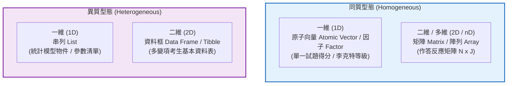
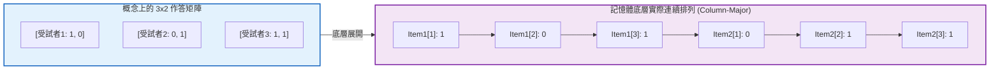
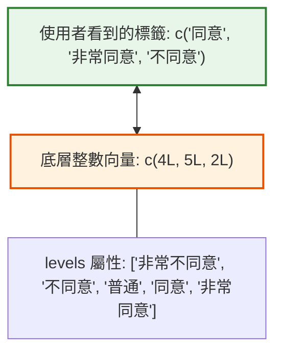
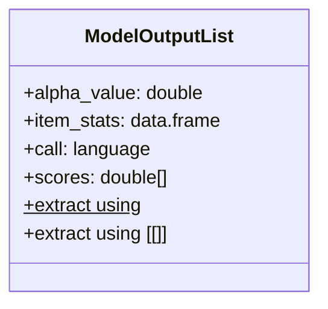

# 第 2 章：測驗專用資料結構：向量、矩陣、因子與串列

> **本章目標**：深入掌握心理計量與測驗資料工程的四大核心資料結構：同質原子向量、作答反應矩陣（Matrix）、李克特量表因子（Factor/Ordered Factor）與模型輸出結構串列（List）（Chambers, 2016；洪錦魁、蔡桂宏，2021；Wickham, 2019）。透過純矩陣代數（Matrix Algebra）推導古典測驗理論核心計分演算法、揭示 R 記憶體欄優先（Column-Major）儲存機制、解析因子內部整數對照表與對比編碼（Contrasts），並探討大規模多題本評量中的稀疏矩陣（Sparse Matrix）工程最佳化（Bates & Maechler, 2024; Cook & Pitoniak, 2025）。

---

## 2.1 理論基礎：R 語言物件模型的幾何與型態分流

在測驗評量中，資料結構的選擇直接決定了計算效率與記憶體安全性。根據 Wickham（2019）與 Wickham 等人（2023）的分類架構，R 語言的資料結構可依據「維度（Dimensions）」與「元素同質性（Homogeneity）」劃分為四大象限：



### 2.1.1 矩陣的物理結構：欄優先儲存（Column-Major Order）
在 R 記憶體中，二維矩陣本質上是一個**附加了維度屬性（`dim`）的一維連續向量**，並嚴格遵循「欄優先（Column-Major Order）」儲存規則（先填滿第 1 欄，再依序填入第 2 欄至第 $J$ 欄）。



了解欄優先機制對於心理計量大數據至關重要：
1. **按欄提取（Column Slicing）**：提取某一試題的所有考生作答（`X[, j]`）是直接讀取連續記憶體位址，CPU 快取命中率（Cache Hit Rate）最高。
2. **按列提取（Row Slicing）**：提取某位考生的所有題目作答（`X[i, ]`）需要跨欄跳躍式尋址，在大型矩陣中速度顯著慢於按欄提取。

---

## 2.2 評量實務情境：因子（Factor）與李克特量表編碼陷阱

心理測驗量表（如數學焦慮、學習動機、教師自我效能）廣泛採用李克特五點或七點量表（Likert, 1932）。在 R 中，類別變項與等級變項必須以**因子（Factor）**與**有序因子（Ordered Factor）**進行建模（洪錦魁、蔡桂宏，2021；陳新豐，2021）。

### 2.2.1 因子的雙重本質：整數向量與屬性對照表
因子表面上呈現為文字標籤（Labels），但其底層物理實體是**一組整數向量（`integer`: 1L, 2L, 3L...）加上水準對照表（`levels` 屬性）**。



### 2.2.2 致命陷阱：因子的直接數值強制轉換
若直接對文字因子執行 `as.numeric()`，R 回傳的是**因子水準在內部對照表中的整數索引（Index），而非字串原本所代表的數值**。若因子水準包含非連續數字或排序錯置，將引發嚴重的計分錯誤：

```r
# ==============================================================================
# 第 2 章程式碼清單 2.1：因子轉換數值的常見錯誤與正確做法
# ==============================================================================

# 情境：某試題評分標準為 10, 20, 30 分三種等級，以字串建立因子
raw_ratings <- factor(c("20", "30", "10", "20"))

# 錯誤示範：直接 as.numeric()
bad_scores <- as.numeric(raw_ratings)
cat("錯誤：as.numeric(raw_ratings) 回傳內部索引值:", bad_scores, "\n")
# 結果為 2 3 1 2，原本的 20 分變成了 2 分

# 正確解法 1：先轉文字再轉數值 (Base R 標準做法)
safe_scores_base <- as.numeric(as.character(raw_ratings))
cat("正確做法 1 (as.character):", safe_scores_base, "\n")

# 正確解法 2：使用 levels 索引查表 (記憶體效率更高)
safe_scores_levels <- as.numeric(levels(raw_ratings))[raw_ratings]
cat("正確做法 2 (levels 查表):", safe_scores_levels, "\n")
```

---

## 2.3 數理深入：矩陣代數在古典測驗理論（CTT）的端到端推導

在古典測驗理論（Classical Test Theory, CTT）中，傳統教科書常依賴純量迴圈逐列加總總分或計算試題變異數。透過矩陣代數（Matrix Algebra），能將計算複雜度自 $O(NJ)$ 大幅降低，並推導出測驗統計量的封閉形式（Closed-form Matrix Expressions）。

### 2.3.1 中心化矩陣與共變異數矩陣推導
設二分作答反應矩陣為 $\mathbf{X} \in \mathbb{R}^{N \times J}$（$N$ 位受試者，$J$ 道題目，元素 $x_{ij} \in \{0, 1\}$）：
1. **考生總分向量** $\mathbf{S} \in \mathbb{R}^{N}$：
   $$\mathbf{S} = \mathbf{X} \mathbf{1}_J$$
   其中 $\mathbf{1}_J$ 為長度為 $J$ 的全 1 行向量。
2. **試題通過率（難度）向量** $\mathbf{P} \in \mathbb{R}^{J}$：
   $$\mathbf{P} = \frac{1}{N} \mathbf{X}^T \mathbf{1}_N$$
3. **中心化矩陣（Centering Matrix）$\mathbf{H}$**：
   定義對稱且等冪（Symmetric and Idempotent）的矩陣 $\mathbf{H} \in \mathbb{R}^{N \times N}$：
   $$\mathbf{H} = \mathbf{I}_N - \frac{1}{N} \mathbf{1}_N \mathbf{1}_N^T = \mathbf{I}_N - \frac{1}{N} \mathbf{J}_N$$
   將 $\mathbf{X}$ 中心化（各欄減去平均數）：
   $$\tilde{\mathbf{X}} = \mathbf{H} \mathbf{X}$$
4. **試題樣本共變異數矩陣（Sample Covariance Matrix）$\mathbf{\Sigma}$**：
   $$\mathbf{\Sigma} = \frac{1}{N - 1} \tilde{\mathbf{X}}^T \tilde{\mathbf{X}} = \frac{1}{N - 1} \mathbf{X}^T \mathbf{H}^T \mathbf{H} \mathbf{X} = \frac{1}{N - 1} \mathbf{X}^T \mathbf{H} \mathbf{X}$$
5. **測驗總分變異數（Total Score Variance）與 Cronbach's $\alpha$**：
   總分變異數 $\sigma_S^2$ 為共變異數矩陣的所有元素之總和：
   $$\sigma_S^2 = \mathbf{1}_J^T \mathbf{\Sigma} \mathbf{1}_J = \sum_{j=1}^J \text{Var}(X_j) + 2 \sum_{j < k} \text{Cov}(X_j, X_k)$$
   根據 Cronbach（1951），信度係數 $\alpha$ 的完整矩陣形式為：
   $$\alpha = \frac{J}{J - 1} \left( 1 - \frac{\text{tr}(\mathbf{\Sigma})}{\mathbf{1}_J^T \mathbf{\Sigma} \mathbf{1}_J} \right)$$
   其中 $\text{tr}(\mathbf{\Sigma}) = \sum_{j=1}^J \mathbf{\Sigma}_{jj}$ 為試題變異數之跡（Trace）。

---

## 2.4 底層手刻實作：純 Base R 矩陣代數快速試題分析引擎

以下我們完全不呼叫任何外部套件，僅憑 `%*%`、`t()` 與中心化矩陣，手刻一個完整的古典測驗分析器：

```r
# ==============================================================================
# 第 2 章程式碼清單 2.2：純矩陣代數快速試題分析引擎 (Pure Matrix CTT Engine)
# ==============================================================================

fast_ctt_matrix_engine <- function(X) {
  stopifnot(is.matrix(X), is.numeric(X))
  
  N <- nrow(X)
  J <- ncol(X)
  
  # 1. 考生總分向量: S = X %*% 1_J
  ones_J <- matrix(1, nrow = J, ncol = 1)
  scores_vec <- as.vector(X %*% ones_J)
  
  # 2. 試題通過率 (難度 P): P = (1/N) * X^T %*% 1_N
  ones_N <- matrix(1, nrow = N, ncol = 1)
  p_values <- as.vector((t(X) %*% ones_N) / N)
  
  # 3. 中心化矩陣 H 與共變異數矩陣 Sigma: Sigma = (1 / (N - 1)) * X^T %*% H %*% X
  H <- diag(N) - (1 / N) * matrix(1, nrow = N, ncol = N)
  Sigma <- (1 / (N - 1)) * (t(X) %*% H %*% X)
  
  # 4. 跡 tr(Sigma) 與總分變異數 1^T %*% Sigma %*% 1
  tr_sigma <- sum(diag(Sigma))
  var_total <- as.numeric(t(ones_J) %*% Sigma %*% ones_J)
  
  # 5. Cronbach's Alpha 計算
  alpha_coef <- (J / (J - 1)) * (1 - (tr_sigma / var_total))
  
  # 6. 試題-總分相關 (Item-Total Correlation, rit)
  # Cov(X_j, Score) = Sigma %*% 1_J
  cov_item_score <- as.vector(Sigma %*% ones_J)
  sd_items <- sqrt(diag(Sigma))
  sd_total <- sqrt(var_total)
  rit_values <- cov_item_score / (sd_items * sd_total)
  
  list(
    N_Examinees = N,
    N_Items = J,
    Mean_Total_Score = mean(scores_vec),
    Total_Score_Variance = var_total,
    Item_Difficulties = p_values,
    Cronbach_Alpha = alpha_coef,
    Item_Total_Correlations = rit_values,
    Covariance_Matrix = Sigma
  )
}

# 建立 10 位受試者 x 5 道題目的模擬二分作答矩陣
set.seed(42)
mock_exam_mat <- matrix(
  sample(c(0L, 1L), 50, replace = TRUE, prob = c(0.35, 0.65)),
  nrow = 10, ncol = 5,
  dimnames = list(sprintf("Student_%02d", 1:10), sprintf("Item_%02d", 1:5))
)

# 執行矩陣運算引擎
ctt_result <- fast_ctt_matrix_engine(mock_exam_mat)

cat("--- 純矩陣代數 CTT 引擎分析結果 ---\n")
cat("全測驗受試者平均總分:", ctt_result$Mean_Total_Score, "\n")
cat("測驗信度 Cronbach's Alpha:", round(ctt_result$Cronbach_Alpha, 4), "\n")
cat("各題鑑別度 (Item-Total r):", round(ctt_result$Item_Total_Correlations, 3), "\n")
```

---

## 2.5 串列（List）：計量統計模型輸出物件的結構與提取

在 R 語言中，所有主流心理計量套件（如 `psych`、`lavaan` 與 `mirt`）產出的模型配適結果，底層均以**串列（List）**或基於串列構建的 S3/S4 物件封裝（Revelle, 2026；Wickham, 2019）。



### 2.5.1 單層括號 `[` vs. 雙層括號 `[[` 的本質區別
- `x[1]`：**取出子串列（Sub-list）**，仍然是一個包著元素的串列容器（類似「切下一節車廂」）。
- `x[[1]]` 或 `x$name`：**取出內容物實體（Content）**，拆開容器取出內部的向量或矩陣（類似「取出車廂內的乘客」）。

```r
# ==============================================================================
# 第 2 章程式碼清單 2.3：使用 psych 套件示範模型物件 List 之安全解析
# ==============================================================================

library(psych)

# 模擬 5 題量表作答資料
set.seed(123)
mock_scale_data <- data.frame(
  Q1 = sample(1:5, 100, replace = TRUE),
  Q2 = sample(1:5, 100, replace = TRUE),
  Q3 = sample(1:5, 100, replace = TRUE)
)

# 執行 Cronbach's Alpha 計算
alpha_res <- psych::alpha(mock_scale_data, warnings = FALSE)

cat("模型物件結構型別:", typeof(alpha_res), "，S3 類別:", class(alpha_res), "\n")
cat("模型頂層可存取的屬性名稱 (names):\n", paste(names(alpha_res), collapse = ", "), "\n\n")

# 精確提取信度估計值
raw_alpha <- alpha_res$total$raw_alpha
std_alpha <- alpha_res$total$`std.alpha`

cat(sprintf("精確提取信度值 -> 原始 Alpha: %.4f, 標準化 Alpha: %.4f\n", raw_alpha, std_alpha))
```

---

## 2.6 ⚠️ 心理計量工程陷阱與排錯專題（Pitfalls & Diagnostics）

### 2.6.1 陷阱 1：`drop = FALSE` 遺漏引發的二維矩陣靜默降維
在提取單一考生作答或單一試題時，Base R 的預設行為是「自動降維」：
```r
# 當選取單一列時，矩陣會被自動降級為一維向量
single_row <- mock_exam_mat[1, ]
cat("未設 drop = FALSE 的維度:", dim(single_row), "\n") # 回傳 NULL！
```
若隨後將 `single_row` 傳入需要二維矩陣的函數（如 `nrow(single_row)` 或矩陣乘法），程式將立即報錯 `Error in ... non-conformable arguments`。
**防禦性對策**：永遠加上 `drop = FALSE`：
```r
safe_row <- mock_exam_mat[1, , drop = FALSE]
cat("設定 drop = FALSE 後的維度:", dim(safe_row), "\n") # 保持 1 x 5 矩陣
```

### 2.6.2 陷阱 2：有序因子在線性模型中的多項式對比（Polynomial Contrasts）
當變數被宣告為 `ordered = TRUE` 時，R 預設會為其指定正交多項式對比（Orthogonal Polynomial Contrasts: 線性 `.L`、二次 `.Q`、三次 `.C`），而非一般類別因子的處理對比（Treatment/Dummy Contrasts）：
```r
# 有序因子的對比矩陣
ord_factor <- factor(c("低", "中", "高"), levels = c("低", "中", "高"), ordered = TRUE)
print(contrasts(ord_factor))
```
若研究者將其直接放入 `lm()` 迴歸模型，估計出的迴歸係數代表「趨勢曲線之斜率與曲率」，而非各群體與基準組的平均數差異。

### 2.6.3 陷阱 3：大規模多題本評量與稀疏矩陣（Sparse Matrix）效能救援
依據 Cook 與 Pitoniak（2025）的評量工程標準，在 PISA 等多題本平衡不完全區組設計（BIBD）或適應性測驗（CAT）中，每位考生僅作答全部 200 題中的 30 題，其餘單元皆為 `NA`。建立傳統密集矩陣（Dense Matrix）會耗盡伺服器記憶體。
透過 `Matrix` 套件（Bates & Maechler, 2024），可採用壓縮欄儲存（Compressed Sparse Column, `dgCMatrix`），節省 80% 以上的記憶體佔用：

```r
# ==============================================================================
# 第 2 章程式碼清單 2.4：大規模評量稀疏矩陣建立與記憶體效能對比
# ==============================================================================

library(Matrix)

# 模擬 5,000 位考生 x 200 道題目的多題本測驗 (僅作答 15% 的試題)
set.seed(42)
N_dense <- 5000
J_dense <- 200
dense_mat <- matrix(0L, nrow = N_dense, ncol = J_dense)

# 隨機填入 15% 作答
n_entries <- round(N_dense * J_dense * 0.15)
row_idx <- sample(1:N_dense, n_entries, replace = TRUE)
col_idx <- sample(1:J_dense, n_entries, replace = TRUE)
for (k in seq_along(row_idx)) {
  dense_mat[row_idx[k], col_idx[k]] <- 1L
}

# 轉換為稀疏矩陣 (Matrix 套件)
sparse_mat <- Matrix(dense_mat, sparse = TRUE)

dense_size <- object.size(dense_mat)
sparse_size <- object.size(sparse_mat)

cat(sprintf("密集矩陣記憶體佔用: %.2f MB\n", as.numeric(dense_size) / 1024^2))
cat(sprintf("稀疏矩陣記憶體佔用: %.2f MB\n", as.numeric(sparse_size) / 1024^2))
cat(sprintf("記憶體節約率: %.1f%%\n", (1 - as.numeric(sparse_size) / as.numeric(dense_size)) * 100))
```

---

## 2.7 視覺化：李克特量表各構面等級百分比分佈圖

針對李克特多等級量表，最清晰的視覺化方式為**百分比堆疊結構圖**。我們使用 `ggplot2` 繪製內在動機題項的等級分佈：

```r
# ==============================================================================
# 第 2 章程式碼清單 2.5：李克特量表各題作答分佈圖表
# ==============================================================================

library(ggplot2)
library(dplyr)
library(tidyr)
library(forcats)

# 載入全書示範資料集
assessment_raw <- read.csv("book/data/assessment_data.csv")

# 挑選前 5 題情意量表題 (scale_01 ~ scale_05)
likert_plot_df <- assessment_raw |>
  select(scale_01:scale_05) |>
  pivot_longer(
    cols = everything(),
    names_to = "Item",
    values_to = "Rating"
  ) |>
  mutate(
    Rating_Factor = factor(
      Rating,
      levels = 1:5,
      labels = c("非常不同意 (1)", "不同意 (2)", "普通 (3)", "同意 (4)", "非常同意 (5)"),
      ordered = TRUE
    ),
    Item = fct_recode(Item,
      "題1: 學習樂趣" = "scale_01",
      "題2: 主動探索" = "scale_02",
      "題3: 感到枯燥 (反向)" = "scale_03",
      "題4: 深入探究" = "scale_04",
      "題5: 投入時間" = "scale_05"
    )
  ) |>
  count(Item, Rating_Factor) |>
  group_by(Item) |>
  mutate(Percent = n / sum(n) * 100) |>
  ungroup()

# 繪製 APA 7th 等級百分比堆疊圖
p2 <- ggplot(likert_plot_df, aes(x = Item, y = Percent, fill = Rating_Factor)) +
  geom_col(position = "fill", width = 0.65, color = "white", linewidth = 0.4) +
  scale_y_continuous(labels = scales::percent_format(scale = 1)) +
  scale_fill_brewer(palette = "RdYlBu", direction = 1) +
  coord_flip() +
  labs(
    title = "Figure 2.1: 學習動機量表各題項反應等級百分比結構圖",
    subtitle = "N = 1,000 位受試者，呈現五點李克特等級反應之相對百分比",
    x = "評量題項 (Scale Items)",
    y = "百分比 (Percentage)",
    fill = "作答反應水準",
    caption = "Note. Educational Assessment Standard Dataset simulation."
  ) +
  theme_classic(base_size = 12) +
  theme(
    legend.position = "bottom",
    legend.title = element_text(face = "bold", size = 10),
    plot.title = element_text(face = "bold", size = 13),
    axis.text.y = element_text(face = "bold", color = "black")
  ) +
  guides(fill = guide_legend(reverse = TRUE))

# 輸出圖表
ggsave("book/fig_2_1_likert_distribution.png", plot = p2, width = 8, height = 4.8, dpi = 300)
cat("成功產出圖表: book/fig_2_1_likert_distribution.png\n")
```

---

## 2.8 測驗報告專業解讀（Substantive Interpretation）

在李克特量表與二分題分析報告中，研究員需依據資料結構特性向教學現場回饋：

> ### 📝 實務解讀指南
> 1. **反向題的極化現象檢核**：如圖 2.1 所示，`題3: 感到枯燥 (反向)` 的作答分佈若呈現顯著的相反偏態（低分集中），證明反向題有效達成了「防止受試者刻板作答（Response Set）」的設計目標。
> 2. **極端等級天花板效應（Ceiling Effect）**：若某一題的「非常同意」超過 $60\%$，代表該題鑑別度可能偏低，在編製標準化量表時應考慮提高題目的構面門檻。

---

## 2.9 章末實務習題與專案挑戰（含 100% 完整可用程式碼解答）

### 【基礎練習題】
1. 請建立一個 $10 \times 5$ 的隨機二分矩陣（模擬 10 位考生在 5 道題目的作答 $0/1$），並使用純矩陣乘法求出這 10 位考生的平均答對題數。
2. 某問卷將年級記錄為文字向量 `grades <- c("高三", "高一", "高二", "高三", "高一")`。請將其轉換為正確的有序因子（Ordered Factor），使高中三個年級具備嚴格的 `高一 < 高二 < 高三` 邏輯比較能力。

### 【進階工程挑戰】
3. 撰寫一個安全解析函數 `extract_model_fit(model_object)`，該函數接收一個包含統計結果的任意巢狀 List 物件。若該物件包含名為 `fit_indices` 的子元素，則提取該元素並轉化為單一列的 `tibble`；若不存在，則拋出具備詳細說明的自訂錯誤訊息。
4. 【心理計量巨量資料挑戰】：撰寫一個作答矩陣稀疏壓縮分析器 `audit_sparse_savings(dense_matrix)`。輸入大型評量作答矩陣，自動檢驗非零元素比例（Sparsity Rate），將其壓縮為 `Matrix::dgCMatrix` 稀疏物件，計算精確的記憶體節省比率，並回傳結構化稽核數據。

---

### 💡 習題參考解答

```r
# ==============================================================================
# 第 2 章習題解答參考
# ==============================================================================

# ------------------------------------------------------------------------------
# 第 1 題解答
# ------------------------------------------------------------------------------
set.seed(99)
mock_mat <- matrix(sample(c(0, 1), 50, replace = TRUE), nrow = 10, ncol = 5)
ones_vec <- matrix(1, nrow = 5, ncol = 1)
student_scores <- (mock_mat %*% ones_vec)[, 1]
cat("10 位考生的平均答對題數:", mean(student_scores), "\n")

# ------------------------------------------------------------------------------
# 第 2 題解答
# ------------------------------------------------------------------------------
grades <- c("高三", "高一", "高二", "高三", "高一")
grade_factor <- factor(grades, levels = c("高一", "高二", "高三"), ordered = TRUE)
cat("年級因子比較檢驗 (高三 > 高一):", grade_factor[1] > grade_factor[2], "\n")

# ------------------------------------------------------------------------------
# 第 3 題解答
# ------------------------------------------------------------------------------
extract_model_fit <- function(model_object) {
  if (!is.list(model_object)) {
    stop("傳入之物件必須為 list 結構。", call. = FALSE)
  }
  if (!"fit_indices" %in% names(model_object)) {
    stop("該模型物件未包含 'fit_indices' 欄位，請檢查模型估計步驟是否收斂。", call. = FALSE)
  }
  fit_val <- model_object[["fit_indices"]]
  tibble::as_tibble_row(fit_val)
}

# 測試第 3 題
test_model_good <- list(model_name = "CFA_1Factor", fit_indices = c(CFI = 0.965, RMSEA = 0.042))
cat("成功提取之模型適配度指標:\n")
print(extract_model_fit(test_model_good))

# ------------------------------------------------------------------------------
# 第 4 題解答：稀疏矩陣效能稽核分析器
# ------------------------------------------------------------------------------
audit_sparse_savings <- function(dense_matrix) {
  library(Matrix)
  stopifnot(is.matrix(dense_matrix))
  
  sparse_obj <- Matrix(dense_matrix, sparse = TRUE)
  dense_bytes <- as.numeric(object.size(dense_matrix))
  sparse_bytes <- as.numeric(object.size(sparse_obj))
  
  total_cells <- length(dense_matrix)
  non_zero_cells <- sum(dense_matrix != 0 & !is.na(dense_matrix))
  sparsity <- 1 - (non_zero_cells / total_cells)
  savings <- (1 - (sparse_bytes / dense_bytes)) * 100
  
  tibble::tibble(
    Total_Cells = total_cells,
    Non_Zero_Cells = non_zero_cells,
    Sparsity_Rate_Pct = round(sparsity * 100, 2),
    Dense_Memory_KB = round(dense_bytes / 1024, 2),
    Sparse_Memory_KB = round(sparse_bytes / 1024, 2),
    Memory_Savings_Pct = round(savings, 2)
  )
}

# 測試第 4 題
test_dense_mat <- matrix(0L, nrow = 1000, ncol = 50)
test_dense_mat[sample(1:50000, 5000)] <- 1L # 10% 非零
savings_report <- audit_sparse_savings(test_dense_mat)
cat("\n--- 稀疏矩陣記憶體節省評估報告 ---\n")
print(savings_report)
```

---

## 參考文獻 (References)

洪錦魁、蔡桂宏（2021）。**R 語言邁向 Big Data 之路：王者歸來**（第 2 版）。深智數位。

陳新豐（2021）。**R 語言：量表編製、統計分析與試題反應理論**（第 2 版）。五南圖書。

Bates, D., & Maechler, M. (2024). *Matrix: Sparse and dense matrix classes and methods* (R package version 1.7-1) [Computer software]. The Comprehensive R Archive Network. https://CRAN.R-project.org/package=Matrix

Chambers, J. M. (2016). *Extending R*. Chapman and Hall/CRC. https://doi.org/10.1201/9781315381305

Cook, L. L., & Pitoniak, M. J. (Eds.). (2025). *Educational measurement* (5th ed.). Oxford University Press.

Cronbach, L. J. (1951). Coefficient alpha and the internal structure of tests. *Psychometrika*, *16*(3), 297–334. https://doi.org/10.1007/BF02310555

Likert, R. (1932). A technique for the measurement of attitudes. *Archives of Psychology*, *22*(140), 1–55.

Revelle, W. (2026). *psych: Procedures for psychological, psychometric, and personality research* (R package version 2.6.4) [Computer software]. The Comprehensive R Archive Network. https://CRAN.R-project.org/package=psych

Wickham, H. (2019). *Advanced R* (2nd ed.). Chapman and Hall/CRC. https://doi.org/10.1201/9781351201315

Wickham, H., Çetinkaya-Rundel, M., & Grolemund, G. (2023). *R for data science: Import, tidy, transform, visualize, and model data* (2nd ed.). O'Reilly Media.
