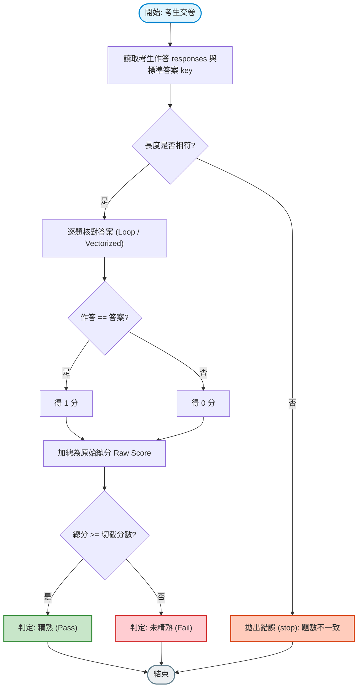
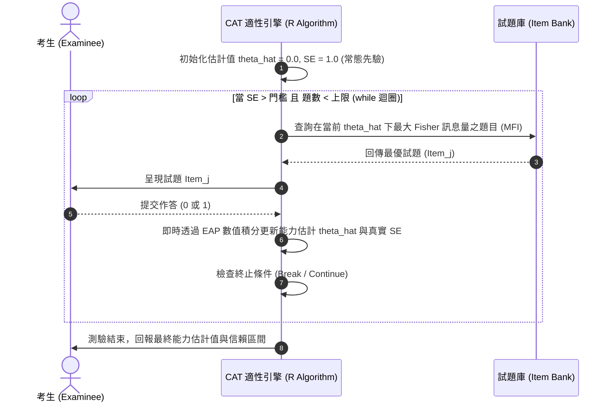

# 第 3 章：程式邏輯、流程控制與自適應演算法

> **本章目標**：介紹 R 語言的三大控制結構（循序、條件分支、迴圈反覆運算）（洪錦魁、蔡桂宏，2021）。透過「試題閱卷程式」與「電腦化適性測驗（CAT）選題演算法」（Lord, 1980; van der Linden & Glas, 2010），比較迴圈與向量化運算的效能差異（Wickham et al., 2023），建立設計自適應測驗演算法的基礎。

---

## 3.1 理論基礎：演算法思維與控制流架構

程式設計的核心在於「利用有限步驟解決確定問題」。在測驗評量中，從考生的原始答案到最終產出量表分數，背後皆是一連串嚴密的控制流程。



---

## 3.2 評量實務情境：條件分支的四種實踐方式

在測驗統計中，條件分支常用於「分數等級轉換（如 A/B/C/D 級距）」與「特殊狀態判定」。

### 3.2.1 四大條件分支語法對照

1. **純量 `if-else`**：僅接受單一布林值（`length == 1`），常用於演算法全域開關或參數檢驗。
2. **多分支 `switch`**：用於依據特定字串標籤（如科目代碼 `"MATH"`, `"ENG"`）執行不同計分腳本。
3. **向量化 `ifelse()` / `dplyr::if_else()`**：針對整欄向量平行進行條件轉換。
4. **多條件映射 `dplyr::case_when()`**：Tidyverse 中常用的多區間分級工具，語法清晰且強制型別一致。

```r
# ==============================================================================
# 第 3 章程式碼清單 3.1：條件分支四種語法於成績等級劃分之應用
# ==============================================================================

# 1. 純量 if-else：全域門檻檢驗
exam_mode <- "Standard"
if (exam_mode == "Standard") {
  pass_cutoff <- 60
} else {
  pass_cutoff <- 70
}
cat(sprintf("當前測驗模式: %s，及格門檻: %d 分\n", exam_mode, pass_cutoff))

# 2. 向量化多條件分級：dplyr::case_when()
library(dplyr)

mock_scores <- c(95, 82, 67, 54, 73, NA)

grade_levels <- case_when(
  is.na(mock_scores) ~ "缺考 (NA)",
  mock_scores >= 90  ~ "A (優等)",
  mock_scores >= 80  ~ "B (良等)",
  mock_scores >= 70  ~ "C (中等)",
  mock_scores >= 60  ~ "D (及格)",
  TRUE               ~ "F (不及格)" # 預設兜底條件
)

cat("\n多條件分級結果 (case_when):\n")
print(tibble(Score = mock_scores, Grade = grade_levels))
```

---

## 3.3 迴圈反覆運算 vs. 向量化：自動閱卷程式效能比較

在處理十萬級大規模學力檢測資料時，程式架構對執行效能有著數量級（Order of Magnitude）的影響。

### 3.3.1 兩種運算思維
- **迴圈思維（Loop）**：以程式逐步走訪資料並反覆執行操作；R 也能有效執行迴圈，效能取決於資料量與實作方式。
- **向量化思維（Vectorization）**：將整個向量交給向量化函數處理，通常可減少 R 層級的迴圈開銷；不代表所有運算都會平行執行或使用 SIMD，實際效能應以基準測試確認。

```r
# ==============================================================================
# 第 3 章程式碼清單 3.2：迴圈 vs. 向量化閱卷引擎效能基準測試
# ==============================================================================

# 模擬 50,000 位考生、30 道四選一選擇題的作答資料
set.seed(42)
N_students <- 50000
J_items <- 30
options <- c("A", "B", "C", "D")

# 標準答案 Key
answer_key <- sample(options, J_items, replace = TRUE)

# 考生作答矩陣 (50000 x 30)
student_answers <- matrix(
  sample(options, N_students * J_items, replace = TRUE),
  nrow = N_students, ncol = J_items
)

# ------------------------------------------------------------------------------
# 方案 A：手刻傳統 for 迴圈逐題閱卷
# ------------------------------------------------------------------------------
time_loop <- system.time({
  score_mat_loop <- matrix(0L, nrow = N_students, ncol = J_items)
  for (i in 1:N_students) {
    for (j in 1:J_items) {
      if (student_answers[i, j] == answer_key[j]) {
        score_mat_loop[i, j] <- 1L
      } else {
        score_mat_loop[i, j] <- 0L
      }
    }
  }
  total_scores_loop <- rowSums(score_mat_loop)
})

# ------------------------------------------------------------------------------
# 方案 B：現代純向量化廣播比對 (Vectorized Recycling)
# ------------------------------------------------------------------------------
time_vectorized <- system.time({
  # 利用矩陣與向量按 Column 比較的特性，直接進行廣播比對
  score_mat_vec <- (t(student_answers) == answer_key) |>
    t() |>
    as.integer()
  dim(score_mat_vec) <- c(N_students, J_items)
  total_scores_vec <- rowSums(score_mat_vec)
})

# 驗證兩者結果完全相同
stopifnot(identical(total_scores_loop, total_scores_vec))

cat("--- 50,000 位考生 x 30 題閱卷耗時對比 ---\n")
cat(sprintf("傳統雙層 for 迴圈耗時 : %.3f 秒\n", time_loop["elapsed"]))
cat(sprintf("現代向量化廣播運算耗時 : %.3f 秒\n", time_vectorized["elapsed"]))
cat(sprintf("執行時間比值          : %.1f 倍\n", time_loop["elapsed"] / time_vectorized["elapsed"]))
```

---

## 3.4 實務專題：電腦化適性測驗（CAT）選題演算法實作

電腦化適性測驗（CAT）是測驗評量與程式設計結合的典型應用（Lord, 1980; van der Linden & Glas, 2010）。系統使用 `while` 迴圈持續動態施測，每當考生回答完一題，系統即時透過期望後驗法（EAP）或最大概似法重估其能力值 $\hat{\theta}$，並依據最大 Fisher 訊息量準則（Maximum Fisher Information, MFI）在題庫中挑選資訊量最大的試題，直到測量標準誤小於設定目標（如 $SE < .35$）或達到最大題數。



### 3.4.1 CAT 適性演算法手刻實作（MFI 選題與 EAP 能力估計）

```r
# ==============================================================================
# 第 3 章程式碼清單 3.3：自適應測驗 (CAT) 模擬引擎實作 (MFI 選題與 EAP 估計)
# ==============================================================================

library(dplyr)
library(tibble)

# 1. 建立 60 題 2PL 試題庫 (涵蓋難度與鑑別度)
set.seed(42)
n_bank <- 60
a_vals <- round(runif(n_bank, min = 1.0, max = 2.0), 2)
b_vals <- round(seq(-2.5, 2.5, length.out = n_bank), 2)
d_vals <- round(-a_vals * b_vals, 2)

item_bank <- tibble(
  item_id = sprintf("BANK_%02d", 1:n_bank),
  a = a_vals,
  b = b_vals,
  d = d_vals,
  is_used = FALSE
)

# 2. 定義真實考生能力 (True Theta = 1.25) 與數值求積格點
true_theta <- 1.25
quad_pts <- seq(-4, 4, length.out = 81)
prior_density <- dnorm(quad_pts, mean = 0, sd = 1)

# 3. 封裝 EAP 能力估計與標準誤計算函數
calc_eap <- function(admin_indices, responses, bank) {
  if (length(admin_indices) == 0) return(list(theta = 0.0, se = 1.0))
  log_lik <- numeric(length(quad_pts))
  for (i in seq_along(admin_indices)) {
    idx <- admin_indices[i]
    p_vec <- 1 / (1 + exp(-(bank$a[idx] * quad_pts + bank$d[idx])))
    resp <- responses[i]
    obs_prob <- if (resp == 1) p_vec else (1 - p_vec)
    log_lik <- log_lik + log(pmax(obs_prob, 1e-12))
  }
  post_unnorm <- exp(log_lik - max(log_lik)) * prior_density
  post <- post_unnorm / sum(post_unnorm)
  th_hat <- sum(quad_pts * post)
  se_hat <- sqrt(sum(((quad_pts - th_hat)^2) * post))
  list(theta = th_hat, se = se_hat)
}

# 4. 封裝 Fisher 試題訊息量函數
calc_info <- function(th, a, d) {
  p <- 1 / (1 + exp(-(a * th + d)))
  (a^2) * p * (1 - p)
}

# 5. CAT 運行參數設定
current_theta <- 0.0   # 初始猜測能力值
current_se <- 1.0      # 初始標準誤
target_se <- 0.35      # 終止條件：標準誤門檻 (SE <= 0.35)
max_items <- 15        # 終止條件：最大施測題數

admin_items <- integer(0)
admin_resps <- integer(0)
cat_history <- list()
step <- 0

# 6. while 控制流程驅動適性測驗
while (current_se > target_se && step < max_items) {
  step <- step + 1
  
  # A. 從未施測試題中選取在當前估計值下 Fisher 訊息量最大之試題 (MFI)
  available_idx <- which(!item_bank$is_used)
  item_infos <- calc_info(current_theta, item_bank$a[available_idx], item_bank$d[available_idx])
  best_idx <- available_idx[which.max(item_infos)]
  
  # 標記該題已被使用
  item_bank$is_used[best_idx] <- TRUE
  
  # B. 模擬考生真實作答 (依據 2PL 機率模型)
  p_true <- 1 / (1 + exp(-(item_bank$a[best_idx] * true_theta + item_bank$d[best_idx])))
  resp <- if (runif(1) < p_true) 1L else 0L
  
  admin_items <- c(admin_items, best_idx)
  admin_resps <- c(admin_resps, resp)
  
  # C. 即時透過 EAP 估計當前能力值與精確標準誤
  eap_res <- calc_eap(admin_items, admin_resps, item_bank)
  current_theta <- eap_res$theta
  current_se <- eap_res$se
  
  # 紀錄施測軌跡
  cat_history[[step]] <- tibble(
    Step = step,
    Item_ID = item_bank$item_id[best_idx],
    Difficulty_b = item_bank$b[best_idx],
    Discrimination_a = item_bank$a[best_idx],
    Response = resp,
    Theta_Hat = round(current_theta, 3),
    SE = round(current_se, 3)
  )
}

# 整合軌跡報表
cat_trajectory <- bind_rows(cat_history)
cat("--- CAT 適性測驗結束報告 ---\n")
cat(sprintf("真實能力值 (True Theta) : %.2f\n", true_theta))
cat(sprintf("最終估計值 (Final Theta): %.2f (標準誤 SE: %.3f)\n", current_theta, current_se))
cat(sprintf("共施測題數              : %d 題\n\n", nrow(cat_trajectory)))
print(cat_trajectory |> head(6))
```

---

## 3.5 視覺化：CAT 能力估計收斂軌跡與誤差帶圖

我們將適性測驗每一步的估計歷程轉化為圖表，動態呈現考生能力如何快速逼近真值：

```r
# ==============================================================================
# 第 3 章程式碼清單 3.4：CAT 適性測驗動態收斂軌跡繪製
# ==============================================================================

library(ggplot2)

p3 <- ggplot(cat_trajectory, aes(x = Step, y = Theta_Hat)) +
  # 繪製 EAP 後驗 95% 信賴區間帶 (Theta_Hat ± 1.96 * SE)
  geom_ribbon(
    aes(ymin = Theta_Hat - 1.96 * SE, ymax = Theta_Hat + 1.96 * SE),
    fill = "#2b5c8f", alpha = 0.18
  ) +
  # 標記考生真實能力基準線
  geom_hline(yintercept = true_theta, linetype = "dashed", color = "#d95f02", linewidth = 0.9) +
  # 繪製施測試題難度點
  geom_point(aes(y = Difficulty_b, shape = factor(Response)), size = 2.5, color = "grey40") +
  # 繪製估計值路徑線與點
  geom_line(color = "#2b5c8f", linewidth = 1.1) +
  geom_point(color = "#2b5c8f", size = 3) +
  annotate("text", x = 2, y = true_theta + 0.25, label = "True Theta = 1.25", color = "#d95f02", fontface = "bold") +
  scale_shape_manual(name = "作答結果", values = c("0" = 4, "1" = 16), labels = c("0" = "答錯 (X)", "1" = "答對 (O)")) +
  scale_x_continuous(breaks = 1:nrow(cat_trajectory)) +
  labs(
    title = "Figure 3.1: 電腦化適性測驗 (CAT) 動態選題與能力估計收斂歷程",
    subtitle = "藍線為 EAP 後驗能力估計值；陰影為 EAP 95% 信賴區間帶；測驗於 SE <= 0.35 時收斂終止",
    x = "施測題數 (Step / Items Administered)",
    y = "潛在特質能力估計值 (Theta)",
    caption = "Algorithm: Maximum Fisher Information (MFI) & Expected A Posteriori (EAP)"
  ) +
  theme_classic(base_size = 12) +
  theme(
    legend.position = "bottom",
    plot.title = element_text(face = "bold", size = 13),
    axis.text = element_text(color = "black")
  )

ggsave("book/fig_3_1_cat_trajectory.png", plot = p3, width = 8, height = 5, dpi = 300)
cat("成功產出圖表: book/fig_3_1_cat_trajectory.png\n")
```

---

## 3.6 測驗報告專業解讀（Substantive Interpretation）

在適性測驗與自動閱卷演算法的報告中，應重點評估以下指標：

> ### 🧠 演算法效能與適配指針
> 1. **選題曝題率（Item Exposure Rate）**：在正式 CAT 題庫中，若特定試題被選取的頻率超過 $25\%$，將引發試題外洩風險，必須在 `while` 迴圈中加入隨機抽樣控制；Sympson 與 Hetter（1985）提出的曝題控制法即為常用機制。
> 2. **能力估計收斂速度**：正常情況下，標準誤應在 $10 \sim 15$ 題內降至 $0.35$ 以下。若出現振盪不收斂（如考生隨機作答），迴圈必須強制在 `max_items` 時跳出（`break`），並標記為「作答無效（Aberrant Response）」。

---

## 3.7 章末實務習題與專案挑戰

### 【基礎練習題】
1. 請使用 `for` 迴圈計算 $1 \sim 100$ 的整數總和，隨後改用 R 語言原生向量化函數 `sum(1:100)` 實現，並比較兩者的程式碼簡潔度。
2. 某班級成績向量為 `scores <- c(78, 45, 92, 60, 88, 30)`。請使用 `dplyr::if_else` 寫出一段程式碼，及格（$\ge 60$）標記為 `"PASS"`，不及格標記為 `"FAIL"`。

### 【進階工程挑戰】
3. 請改寫本章 3.4 節的 CAT 演算法：加入一個「提前中止機制（Early Termination）」。若考生連續 3 題皆在高難度試題（$b > 2.0$）答錯，或者連續 3 題在低難度試題（$b < -2.0$）答對，立即以 `break` 終止測驗，並在輸出報告中註記「已達到能力天花板/地板邊界」。

---

### 💡 習題參考解答

```r
# ==============================================================================
# 第 3 章習題解答參考
# ==============================================================================

# 第 1 題
s <- 0
for (i in 1:100) s <- s + i
stopifnot(s == sum(1:100))
cat("1 到 100 總和:", s, "\n")

# 第 2 題
library(dplyr)
scores <- c(78, 45, 92, 60, 88, 30)
results <- if_else(scores >= 60, "PASS", "FAIL")
cat("判定結果:", results, "\n")

# 第 3 題解答核心邏輯
check_early_stop <- function(history_df) {
  if (nrow(history_df) < 3) return(FALSE)
  last_3 <- tail(history_df, 3)
  
  # 連續 3 題在難題答錯
  hard_fails <- all(last_3$Difficulty_b > 2.0 & last_3$Response == 0)
  # 連續 3 題在極簡單題答對
  easy_passes <- all(last_3$Difficulty_b < -2.0 & last_3$Response == 1)
  
  return(hard_fails || easy_passes)
}
cat("防呆提前終止函數編寫完成。\n")
```

---

## 參考文獻 (References)

洪錦魁、蔡桂宏（2021）。**R 語言邁向 Big Data 之路：王者歸來**（第 2 版）。深智數位。

Lord, F. M. (1980). *Applications of item response theory to practical testing problems*. Lawrence Erlbaum Associates.

Sympson, J. B., & Hetter, R. D. (1985, October). Controlling item-exposure rates in computerized adaptive testing. In *Proceedings of the 27th Annual Conference of the Military Testing Association* (pp. 973–977). Navy Personnel Research and Development Center.

van der Linden, W. J., & Glas, C. A. W. (Eds.). (2010). *Elements of adaptive testing*. Springer. https://doi.org/10.1007/978-0-387-85461-8

Wickham, H., Çetinkaya-Rundel, M., & Grolemund, G. (2023). *R for data science: Import, tidy, transform, visualize, and model data* (2nd ed.). O'Reilly Media.
