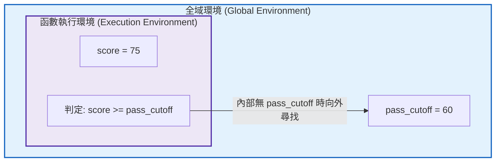

# 第 4 章：模組化自訂函數設計與防禦性程式工程

> **本章目標**：建構符合現代軟體工程規範的高強健度心理計量函數（Chambers, 2016; 洪錦魁、蔡桂宏, 2021; Wickham, 2019）。深入解析 R 語言詞彙作用域（Lexical Scoping）、閉包工廠（Closure Factory）與惰性求值（Lazy Evaluation）；完整推導點二系列相關（Point-Biserial Correlation）、二系列相關（Biserial Correlation）與剔除試題自相關（Item-Rest Correlation）的解析代數公式；運用防禦性程式設計（Defensive Programming）建構具備平穩退場（Graceful Degradation）能力的古典試題分析引擎（Ebel & Frisbie, 1991；Kelley, 1939；Lord, 1980），並搭配 `purrr` 進行型態嚴格保證（Type-Stable）的批次流水線處理（Wickham et al., 2023）。

---

## 4.1 理論基礎：函數的一等公民本質與詞彙作用域

在 R 語言中，**函數是一等公民（First-Class Citizens）**（Chambers, 2016; 洪錦魁與蔡桂宏, 2021; Wickham, 2019）。函數可以像普通變數一樣被指派、當作引數傳入其他函數，甚至由高階函數（Higher-Order Functions）動態生成並回傳。

### 4.1.1 詞彙作用域（Lexical Scoping）的四大原則
R 依據函數「被定義時」的環境（而非被呼叫時的動態調用棧）來搜尋變數。Wickham（2019）總結了 R 詞彙作用域的四大支柱：
1. **名稱遮蔽（Name Masking）**：函數內部定義的區域變數優先於外層環境同名變數。
2. **函數優先（Functions versus Variables）**：呼叫函數時，R 在尋找名稱時會略過非函數物件。
3. **動態全新起始（A Fresh Start）**：每次函數執行完畢，其執行環境即被銷毀，無法保留內部運算狀態（除非透過閉包 Closure 綁定環境）。
4. **動態搜尋（Dynamic Lookup）**：R 是在函數執行時才尋找外層變數的值，而非定義時凍結。



> [!WARNING] 全域變數污染與純函數規範
> 測驗分析管線應嚴格杜絕隱式依賴全域變數。優良的計量函數必須是**純函數（Pure Function）**：
> - **確定性**：相同的輸入引數必定產出相同的輸出。
> - **無副作用（No Side Effects）**：不對外部環境進行非預期修改（嚴禁使用 `<<-` 污染全域物件）。

### 4.1.2 閉包（Closure）與門檻工廠函數（Threshold Factory）
閉包是指「包含外部封裝環境的函數」。在自適應測驗或標準設定中，我們可以利用閉包動態產生具有固定評量標準的專屬檢驗函數：

```r
# ==============================================================================
# 第 4 章程式碼清單 4.1：利用閉包 (Closure) 建立自訂試題品質評估器
# ==============================================================================

make_item_evaluator <- function(d_threshold = 0.30, p_bounds = c(0.20, 0.80)) {
  # 此環境中的 d_threshold 與 p_bounds 被永久封裝於回傳的閉包中
  function(p_val, d_val) {
    p_ok <- p_val >= p_bounds[1] && p_val <= p_bounds[2]
    d_ok <- d_val >= d_threshold
    
    if (p_ok && d_ok) {
      "優質核心題 (Optimal)"
    } else if (!p_ok && d_ok) {
      "極端難度題 (Marginal Difficulty)"
    } else {
      "需修訂/淘汰 (Revise/Discard)"
    }
  }
}

# 產出兩個不同嚴格度的評估函數
evaluator_strict <- make_item_evaluator(d_threshold = 0.40, p_bounds = c(0.35, 0.65))
evaluator_lenient <- make_item_evaluator(d_threshold = 0.20, p_bounds = c(0.15, 0.85))

cat("嚴格評估標準判定 (P=0.50, D=0.35):", evaluator_strict(0.50, 0.35), "\n")
cat("寬鬆評估標準判定 (P=0.50, D=0.35):", evaluator_lenient(0.50, 0.35), "\n")
```

---

## 4.2 數理深入：古典試題鑑別度指標的代數推導

在古典測驗理論中，鑑別度代表試題區分不同受試者能力的能力。常用指標包含 Kelley 高低分組法、點二系列相關與二系列相關。

### 4.2.1 Kelley 27% 高低分組法則的數理推導
Kelley（1939）證明：假設測驗總分 $X$ 服從常態分佈 $X \sim \mathcal{N}(\mu, \sigma^2)$，將受試者依總分高低劃分為高分組（比例 $q$）與低分組（比例 $q$）。
高低分組平均數之差對其估計標準誤的比值（即統計檢定力 / 訊噪比）為：
$$\text{Ratio}(q) = \frac{\mathbb{E}[X \mid X > z_{1-q}] - \mathbb{E}[X \mid X < z_q]}{\text{SE}(\bar{X}_H - \bar{X}_L)} \propto \frac{\phi(z_q)}{\sqrt{q}}$$
其中 $\phi(z)$ 為標準常態機率密度函數。對 $q$ 微分求極大值：
$$\frac{d}{dq} \left[ \frac{\phi(z_q)}{\sqrt{q}} \right] = 0 \implies z_q \phi(z_q) \frac{dz_q}{dq} \frac{1}{\sqrt{q}} - \frac{1}{2} q^{-3/2} \phi(z_q) = 0$$
因 $\frac{dq}{dz_q} = \phi(z_q)$，代入整理後可得：
$$z_q^2 = 1 \implies z_q = -1.0 \implies q = \Phi(-1.0) \approx 0.27027$$
**數學結論**：取前後各 $27\%$ 建立極端組（Extreme Groups），在常態假設下能最大化鑑別度統計估計的相對效率（Kelley, 1939）。

### 4.2.2 點二系列相關（$r_{pbis}$）與二系列相關（$r_{bis}$）
設二分試題反應為 $Y \in \{0, 1\}$，通過率為 $P$，測驗總分為 $X$，平均數為 $\bar{X}$，標準差為 $S_X$；答對組平均總分為 $\bar{X}_1$，答錯組為 $\bar{X}_0$。
1. **點二系列相關（Point-Biserial Correlation）**：
   $$r_{pbis} = \frac{\bar{X}_1 - \bar{X}_0}{S_X} \sqrt{P(1 - P)} = \frac{\bar{X}_1 - \bar{X}}{S_X} \sqrt{\frac{P}{1 - P}}$$
   當題目極端偏易（$P \to 1$）或極端偏難（$P \to 0$）時，$\sqrt{P(1-P)} \to 0$，$r_{pbis}$ 之數學上限會受到人為壓制（通常無法達到 1.0）。
2. **二系列相關（Biserial Correlation）**：
   假設題目背後潛在特質服從常態連續分佈，Lord（1980）給出修正公式：
   $$r_{bis} = \frac{\bar{X}_1 - \bar{X}_0}{S_X} \frac{P(1 - P)}{y} = r_{pbis} \frac{\sqrt{P(1 - P)}}{y}$$
   其中 $y = \phi(\Phi^{-1}(1 - P))$ 為常態切截點處之縱座標高度。$r_{bis}$ 消除了難度對鑑別度的尺度約束。

### 4.2.3 剔除試題自相關之校正公式（Item-Rest Correlation）
當總分包含該試題本身得分時（$S = \sum_{k=1}^J X_k$），$\text{Cor}(X_j, S)$ 存在人為正膨脹偏差（Spurious Correlation）。
定義「其餘試題總分」$S_{-j} = S - X_j$，其校正公式推導如下：
$$\text{Cov}(X_j, S_{-j}) = \text{Cov}(X_j, S - X_j) = \text{Cov}(X_j, S) - \text{Var}(X_j)$$
$$\text{Var}(S_{-j}) = \text{Var}(S - X_j) = \text{Var}(S) + \text{Var}(X_j) - 2\text{Cov}(X_j, S)$$
故無偏之項目-其餘相關（Corrected Item-Total Correlation, $r_{it}^*$）為：
$$r_{it}^* = \frac{\text{Cov}(X_j, S) - \text{Var}(X_j)}{\sqrt{\text{Var}(X_j) \left[ \text{Var}(S) + \text{Var}(X_j) - 2\text{Cov}(X_j, S) \right]}}$$

---

## 4.3 評量實務情境：防禦性程式設計流程架構

在批次分析大型評量作答矩陣時，未防禦的程式往往因單一欄位為常數或長度不符而中斷整個排程。具備防禦性的程式能實施邊界檢查與平穩退場（Graceful Degradation）：


---

## 4.4 現代 R 語言程式實作：防禦性試題分析函數 `analyze_item_quality()`

我們將前述數理推導完整整合為可直接投入生產環境之防禦性函數：

```r
# ==============================================================================
# 第 4 章程式碼清單 4.2：全功能防禦性試題品質分析函數實作
# ==============================================================================

library(tibble)
library(dplyr)

#' 全功能防禦性試題品質分析函數
#'
#' @param item_vec 數值或整數向量 (0/1 二分作答反應)
#' @param total_scores 數值向量 (考生總分，長度必須與 item_vec 一致)
#' @param item_name 字串 (試題名稱，預設為 "Item_X")
#' @param min_n 整數 (最小樣本數要求，預設為 30)
#' @return 一個單列的 tibble，包含 P 值、Kelley D 值、點二系列、校正自相關與品質旗標
analyze_item_quality <- function(item_vec,
                                 total_scores,
                                 item_name = "Item_X",
                                 min_n = 30) {
  # 1. 嚴格引數型態與邊界檢核
  if (!is.numeric(item_vec) && !is.logical(item_vec)) {
    stop("引數 'item_vec' 必須為數值或邏輯向量。", call. = FALSE)
  }
  if (!is.numeric(total_scores)) {
    stop("引數 'total_scores' 必須為數值向量。", call. = FALSE)
  }
  if (length(item_vec) != length(total_scores)) {
    stop(sprintf("向量長度不一致：item_vec (%d) 與 total_scores (%d) 必須等長。",
                 length(item_vec), length(total_scores)), call. = FALSE)
  }

  item_num <- as.integer(item_vec)
  valid_vals <- item_num[!is.na(item_num)]
  if (any(!valid_vals %in% c(0L, 1L))) {
    stop("引數 'item_vec' 只能包含 0、1 或 NA。", call. = FALSE)
  }

  # 2. 排除成對缺失值 (Pairwise Deletion)
  valid_mask <- !is.na(item_num) & !is.na(total_scores)
  clean_item <- item_num[valid_mask]
  clean_total <- total_scores[valid_mask]
  n_valid <- length(clean_item)

  if (n_valid == 0) {
    return(tibble(
      item_id = item_name, valid_n = 0L, difficulty_p = NA_real_,
      discrimination_d = NA_real_, r_pbis = NA_real_, r_corrected = NA_real_,
      quality_flag = "無有效配對作答"
    ))
  }

  # 3. 樣本規模警訊
  if (n_valid < min_n) {
    warning(sprintf("[%s] 有效樣本數 (%d) 低於門檻 (%d)，統計估計具高抽樣誤差。",
                    item_name, n_valid, min_n), call. = FALSE)
  }

  # 4. 邊界退場：全對、全錯無變異
  item_var <- var(clean_item)
  if (is.na(item_var) || item_var == 0) {
    p_val <- mean(clean_item)
    return(tibble(
      item_id = item_name, valid_n = n_valid, difficulty_p = round(p_val, 3),
      discrimination_d = NA_real_, r_pbis = NA_real_, r_corrected = NA_real_,
      quality_flag = if (p_val == 1) "全體答對 (極端無變異)" else "全體答錯 (極端無變異)"
    ))
  }

  # 5. 計算難度 P 值
  p_val <- mean(clean_item)

  # 6. 計算 Kelley 27% 高低分組鑑別度 D 值
  cutoff_high <- quantile(clean_total, probs = 0.73, na.rm = TRUE)
  cutoff_low  <- quantile(clean_total, probs = 0.27, na.rm = TRUE)

  high_group <- clean_total >= cutoff_high
  low_group  <- clean_total <= cutoff_low

  if (any(high_group & low_group)) {
    warning(sprintf("[%s] 總分嚴重同分，導致高低分組重疊，D 值不予估計。", item_name), call. = FALSE)
    d_val <- NA_real_
  } else {
    p_high <- mean(clean_item[high_group])
    p_low  <- mean(clean_item[low_group])
    d_val  <- p_high - p_low
  }

  # 7. 計算原始點二系列相關 (r_pbis)
  r_pbis <- cor(clean_item, clean_total)

  # 8. 計算剔除試題自相關之校正相關 (Corrected Item-Total r)
  cov_is <- cov(clean_item, clean_total)
  var_s <- var(clean_total)
  denom_rest <- sqrt(item_var * (var_s + item_var - 2 * cov_is))
  r_corrected <- if (denom_rest > 0) (cov_is - item_var) / denom_rest else NA_real_

  # 9. 依據 Ebel (1991) 鑑別度標準分類
  quality_status <- case_when(
    is.na(d_val)         ~ "無法判定 (分組重疊)",
    d_val >= 0.40        ~ "優良試題 (Excellent)",
    d_val >= 0.30        ~ "良好試題 (Good)",
    d_val >= 0.20        ~ "尚可試題 (Marginal)",
    TRUE                 ~ "待汰換/修訂 (Poor)"
  )

  tibble(
    item_id = item_name,
    valid_n = n_valid,
    difficulty_p = round(p_val, 3),
    discrimination_d = round(d_val, 3),
    r_pbis = round(r_pbis, 3),
    r_corrected = round(r_corrected, 3),
    quality_flag = quality_status
  )
}
```

---

## 4.5 函數式編程：從 Base R `apply` 演進至現代 `purrr::map`

當我們需要對題庫中數十道試題批次執行上述分析時，有兩種途徑：
1. **Base R 的 `lapply()` / `sapply()`**：歷史悠久，但 `sapply` 存在「型態不可預測（Type Unstable）」的隱憂（可能回傳向量、矩陣或串列）。
2. **現代 `purrr::map()` 家族**：**型態嚴格保證（Type-Stable）**，`map()` 回傳 list，`map_vec()` 回傳指定型別向量，而 `map()` 搭配 `list_rbind()` 則是批次建立資料表的常用寫法（Wickham et al., 2023）。

```r
# ==============================================================================
# 第 4 章程式碼清單 4.3：使用 purrr 批次對全書資料集進行試題分析
# ==============================================================================

library(purrr)

# 讀取全書示範資料集
df_all <- read.csv("book/data/assessment_data.csv")

# 提取 15 道認知題名稱
cognitive_item_names <- sprintf("item_%02d", 1:15)

# 使用 purrr::map 批次運算，並以 list_rbind() 合併為單一 tibble
item_summary_report <- cognitive_item_names |>
  map(\(item_name) {
    analyze_item_quality(
      item_vec = df_all[[item_name]],
      total_scores = df_all$total_score,
      item_name = item_name
    )
  }) |>
  list_rbind()

cat("--- 全體 15 道試題品質分析報告 ---\n")
print(head(item_summary_report, 10))
```

---

## 4.6 ⚠️ 心理計量工程陷阱與排錯專題（Pitfalls & Diagnostics）

### 4.6.1 陷阱 1：惰性求值（Lazy Evaluation）在迴圈函數生成時的靜默重疊
在 `for` 迴圈中動態產生函數時，引數不會在定義時求值，而是在呼叫時才求值：
```r
# 錯誤示範：未強制求值
funcs <- list()
for (i in 1:3) {
  funcs[[i]] <- function(x) x + i
}
# 此時 funcs[[1]](10) 回傳 13 而非 11！因為呼叫時 i 已經變成 3
```
**防禦性對策**：使用 `force(i)` 強制在定義時凍結引數值。

### 4.6.2 陷阱 2：`tryCatch` 錯誤攔截與狀態封裝（`purrr::safely` 典範）
在夜間全自動化批次處理全台各校評量資料時，若某校資料格式錯亂，直接拋錯會造成整個排程中斷。
使用 `purrr::safely()` 可將任何函數封裝為「永不崩潰的結果對（Result/Error Pair）」：

```r
# ==============================================================================
# 第 4 章程式碼清單 4.4：使用 purrr::safely 實施工業級批次容錯處理
# ==============================================================================

# 建立安全版本的分析函數
safe_analyzer <- safely(analyze_item_quality, otherwise = NULL)

# 混合正常與極端損毀資料
mixed_items <- list(
  Good_1 = df_all$item_01,
  Corrupted_Type = c("A", "B", "C"), # 型態錯誤
  Good_2 = df_all$item_02,
  Zero_Var = rep(1L, 1000)          # 邊界無變異
)

# 批次執行容錯分析
safe_results <- imap(mixed_items, \(vec, name) {
  safe_analyzer(vec, df_all$total_score, item_name = name)
})

# 萃取成功結果與錯誤紀錄
success_table <- safe_results |> map("result") |> compact() |> list_rbind()
errors_logged <- safe_results |> map("error") |> compact()

cat("成功解析的試題數量:", nrow(success_table), "\n")
cat("攔截並妥善隔離的錯誤數量:", length(errors_logged), "\n")
if (length(errors_logged) > 0) {
  cat("錯誤訊息示例:", errors_logged[[1]]$message, "\n")
}
```

---

## 4.7 視覺化：試題品質四象限診斷圖（Item Quality Matrix）

在試題編製實務中，命題委員會通常以**「橫軸為難度 $P$，縱軸為鑑別度 $D$」**繪製四象限診斷散佈圖。

```r
# ==============================================================================
# 第 4 章程式碼清單 4.5：試題品質四象限矩陣圖繪製
# ==============================================================================

library(ggplot2)

p4 <- ggplot(item_summary_report, aes(x = difficulty_p, y = discrimination_d)) +
  geom_vline(xintercept = 0.50, linetype = "dashed", color = "grey50") +
  geom_hline(yintercept = 0.30, linetype = "dashed", color = "#d95f02", linewidth = 0.8) +
  annotate("text", x = 0.25, y = 0.65, label = "難題・高鑑別\n(適合高分篩選)", color = "grey40", size = 3.5) +
  annotate("text", x = 0.75, y = 0.65, label = "優質核心題\n(難易適中・鑑別佳)", color = "#2e7d32", fontface = "bold", size = 3.8) +
  annotate("text", x = 0.75, y = 0.15, label = "簡單題・鑑別弱\n(適合基礎檢測)", color = "grey40", size = 3.5) +
  annotate("text", x = 0.25, y = 0.15, label = "不良題 (需淘汰)\n(難題且無鑑別度)", color = "#c62828", fontface = "bold", size = 3.8) +
  geom_point(aes(color = quality_flag), size = 4, alpha = 0.85) +
  geom_text(aes(label = item_id), vjust = -0.9, size = 3.5, fontface = "bold") +
  scale_color_manual(
    name = "試題評價",
    values = c(
      "優良試題 (Excellent)" = "#2e7d32",
      "良好試題 (Good)"      = "#1565c0",
      "尚可試題 (Marginal)"  = "#f57c00",
      "待汰換/修訂 (Poor)"    = "#c62828"
    )
  ) +
  scale_x_continuous(limits = c(0.05, 0.90), breaks = seq(0.1, 0.9, by = 0.1)) +
  scale_y_continuous(limits = c(0.0, 0.90), breaks = seq(0.0, 0.8, by = 0.1)) +
  labs(
    title = "Figure 4.1: 古典測驗理論試題品質四象限診斷圖 (Difficulty vs. Discrimination)",
    subtitle = "呈現 15 道認知題之難度 P 值與高低分組鑑別度 D 值分佈矩陣 (N = 1,000)",
    x = "試題難度指數 (Difficulty Index: P)",
    y = "試題鑑別度指數 (Discrimination Index: D)",
    caption = "Note. Standard Assessment Item Diagnostics simulation."
  ) +
  theme_classic(base_size = 12) +
  theme(
    legend.position = "bottom",
    plot.title = element_text(face = "bold", size = 13),
    axis.text = element_text(color = "black")
  )

ggsave("book/fig_4_1_item_matrix.png", plot = p4, width = 8, height = 5.5, dpi = 300)
cat("成功產出圖表: book/fig_4_1_item_matrix.png\n")
```

---

## 4.8 測驗報告專業解讀（Substantive Interpretation）

在命題檢討會上，測驗專案負責人應根據圖 4.1 做出明確的決策指令：

> ### 📋 試題修訂決策指引（Item Revision Protocol）
> 1. **核心題庫保留群（優質試題）**：$P \in [.40, .70]$ 且 $D \ge .35$ 之試題（如 `item_03`, `item_05`, `item_06`），在中等能力區提供較多訊息，直接入庫作為標準錨題（Cook & Pitoniak, 2025）。
> 2. **門檻題保留群（難題高鑑別）**：$P < .30$ 但 $D \ge .30$ 之試題（如 `item_12`），適合用於資優甄選或精熟切截門檻定位。
> 3. **強制退件群（待修訂題）**：$D < .20$ 之試題（鑑別度過低甚至出現負值），代表題目可能存在題意不清、誘答選項具誤導性或答案標註錯誤，一律退回學科專家小組進行重寫（Ebel & Frisbie, 1991）。

---

## 4.9 章末實務習題與專案挑戰（含 100% 完整可用程式碼解答）

### 【基礎練習題】
1. 請撰寫一個名為 `calc_z_score(x)` 的純函數，輸入任意數值向量 `x`，回傳其標準化 $Z$ 分數（$Z = \frac{x - \mu}{\sigma}$）。該函數必須包含防呆檢查：若傳入之向量長度小於 2，則拋出清楚的錯誤中斷。
2. 請解釋為何在大型批次運算時，使用 `purrr::map()` 比 Base R 的 `sapply()` 更加具備程式設計的安全性與型態確定性？

### 【進階工程挑戰】
3. 撰寫一個封裝了 `tryCatch()` 的高強健度包裝器 `safely_analyze_item()`。當傳入無效或損毀的試題向量（例如整欄都是字串或長度為 0）時，程式不中斷，而是回傳一個包含 `result`（若成功）與 `error_message`（若失敗）的乾淨 list，並對 5 道混合了正常題與損毀題的測試資料進行實測。
4. 【工業級題庫稽核器挑戰】：撰寫高階自動化函數 `audit_entire_test_bank(df, item_cols, total_col)`。結合 `purrr::map`、`purrr::safely` 與 `analyze_item_quality`，自動對任意規模的試題資料框進行批次健康診斷，統計合格率（Pass Rate %）、標記不良題項清單，並產出可直接匯入資料庫的結構化報表。

---

### 💡 習題參考解答

```r
# ==============================================================================
# 第 4 章習題解答參考
# ==============================================================================

# ------------------------------------------------------------------------------
# 第 1 題解答
# ------------------------------------------------------------------------------
calc_z_score <- function(x) {
  if (!is.numeric(x) || length(x) < 2) {
    stop("x 必須為長度大於等於 2 的數值向量。", call. = FALSE)
  }
  s <- sd(x, na.rm = TRUE)
  if (s == 0) {
    warning("向量標準差為 0，無法計算 Z 分數。", call. = FALSE)
    return(rep(0, length(x)))
  }
  (x - mean(x, na.rm = TRUE)) / s
}
cat("Z 分數測試:", calc_z_score(c(60, 70, 80, 90)), "\n")

# ------------------------------------------------------------------------------
# 第 2 題解答說明：
# Base R 的 sapply() 具備「自動簡化輸出」特性。當各元素運算結果長度不一時，
# 它可能隨機回傳 vector、matrix 或 list，造成下游程式碼邏輯崩潰。
# 相對地，purrr::map() 嚴格保證回傳 list，map_dbl() 嚴格保證回傳 double vector，
# 若型態不符會立即拋錯，確保生產環境管線的型態確定性（Type Stability）。
# ------------------------------------------------------------------------------

# ------------------------------------------------------------------------------
# 第 3 題解答
# ------------------------------------------------------------------------------
safely_analyze_item <- function(item_vec, total_scores, item_name) {
  tryCatch(
    expr = {
      res <- analyze_item_quality(item_vec, total_scores, item_name)
      list(result = res, error = NULL)
    },
    error = function(e) {
      list(result = NULL, error = conditionMessage(e))
    }
  )
}

corrupt_test <- safely_analyze_item(c("A", "B"), c(10, 20), "Bad_Item")
cat("損毀題安全捕獲訊息:", corrupt_test$error, "\n")

# ------------------------------------------------------------------------------
# 第 4 題解答：工業級題庫自動化稽核器
# ------------------------------------------------------------------------------
audit_entire_test_bank <- function(df, item_cols, total_col) {
  library(purrr)
  library(dplyr)
  
  safe_runner <- safely(analyze_item_quality, otherwise = NULL)
  
  raw_res <- item_cols |>
    map(\(col) {
      safe_runner(df[[col]], df[[total_col]], item_name = col)
    })
  
  success_df <- raw_res |> map("result") |> compact() |> list_rbind()
  failed_cases <- raw_res |> map("error") |> compact()
  
  optimal_count <- sum(success_df$quality_flag %in% c("優良試題 (Excellent)", "良好試題 (Good)"))
  
  list(
    Summary = tibble(
      Total_Items = length(item_cols),
      Analyzed_Successfully = nrow(success_df),
      Failed_Analysis = length(failed_cases),
      Optimal_Rate_Pct = round(optimal_count / nrow(success_df) * 100, 1)
    ),
    Item_Table = success_df,
    Error_Log = failed_cases
  )
}

# 測試第 4 題
bank_audit_res <- audit_entire_test_bank(df_all, sprintf("item_%02d", 1:15), "total_score")
cat("\n--- 題庫整體健康診斷摘要 ---\n")
print(bank_audit_res$Summary)
```

---

## 參考文獻 (References)

洪錦魁、蔡桂宏（2021）。**R 語言邁向 Big Data 之路：王者歸來**（第 2 版）。深智數位。

Chambers, J. M. (2016). *Extending R*. Chapman and Hall/CRC. https://doi.org/10.1201/9781351201315

Cook, L. L., & Pitoniak, M. J. (Eds.). (2025). *Educational measurement* (5th ed.). Oxford University Press.

Ebel, R. L., & Frisbie, D. A. (1991). *Essentials of educational measurement* (5th ed.). Prentice Hall.

Kelley, T. L. (1939). The selection of upper and lower groups for the validation of test items. *Journal of Educational Psychology*, *30*(1), 17–24. https://doi.org/10.1037/h0057123

Lord, F. M. (1980). *Applications of item response theory to practical testing problems*. Lawrence Erlbaum Associates.

Wickham, H. (2019). *Advanced R* (2nd ed.). Chapman and Hall/CRC. https://doi.org/10.1201/9781351201315

Wickham, H., Çetinkaya-Rundel, M., & Grolemund, G. (2023). *R for data science: Import, tidy, transform, visualize, and model data* (2nd ed.). O'Reilly Media.
