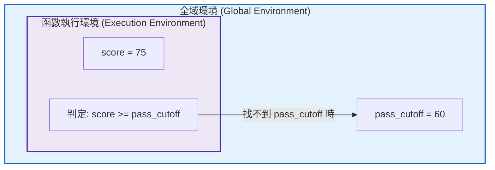
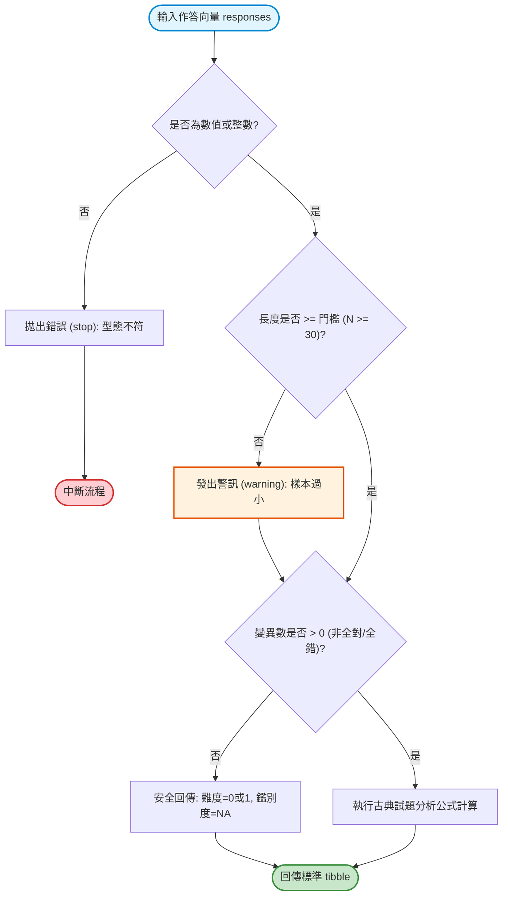

# 第 4 章：模組化自訂函數設計與防禦性程式工程

> **本章目標**：學習可重用、可防錯的函數寫法（洪錦魁、蔡桂宏，2021；Wickham, 2019）。說明 R 語言詞彙作用域（Lexical Scoping）、閉包（Closure）與惰性求值（Lazy Evaluation）。運用防禦性程式設計（Defensive Programming）撰寫試題品質分析函數（Ebel & Frisbie, 1991; Kelley, 1939），並搭配 `purrr` 進行批次處理（Wickham et al., 2023）。

---

## 4.1 理論基礎：函數的一等公民本質與詞彙作用域

在 R 語言中，**函數是一等公民（First-Class Citizens）**（Wickham, 2019）。函數可以像普通變數一樣被指派、當作引數傳入其他函數，甚至由其他函數動態生成並回傳。

### 4.1.1 詞彙作用域（Lexical Scoping）
R 依據函數「被定義時」的環境（而不是被呼叫時的環境）來搜尋變數。



> [!WARNING] 全域變數污染陷阱
> 函數內部應避免隱式讀取全域變數。優良的測驗函數必須是**純函數（Pure Function）**：相同的輸入引數必定產出相同的輸出，且不對外部環境產生任何副作用（No Side Effects）。

---

## 4.2 評量實務情境：防禦性程式設計（Defensive Programming）

在自動化處理全校或全國數萬名學生的評量資料時，資料往往充滿「髒資料」：例如某考場全部缺考（全為 `NA`）、某題答案印刷錯誤導致全體答錯（零變異數 Variance = 0）、或受試者人數小於 10 人。

未經防禦的代碼會直接拋出原生錯誤中斷整個分析管線；具備防禦性的程式則能**攔截例外、平穩降級（Graceful Degradation），並提供清晰的診斷訊息**。



---

## 4.3 現代 R 語言程式實作：試題分析函數 `analyze_item_quality()`

我們親手實作一個標準的試題分析函數（Ebel & Frisbie, 1991; Kelley, 1939），計算：
1. **試題難度（通過率 $P$）**：
   $$P = \frac{R}{N}$$
2. **高低分組鑑別度指數（$D$ 值）**：依據總分取前 $27\%$（高分組 $H$）與後 $27\%$（低分組 $L$）（Kelley, 1939）：
   $$D = P_H - P_L$$
3. **點二系列相關（Point-Biserial Correlation, $r_{pbis}$）**：題項得分與總分之皮爾森積差相關（$r_{pbis} \ge .30$ 常作為理想參考值）。

```r
# ==============================================================================
# 第 4 章程式碼清單 4.1：防禦性試題分析函數實作
# ==============================================================================

library(tibble)
library(dplyr)

#' 單一試題品質分析函數
#'
#' @param item_vec 數值或整數向量 (0/1 二分作答反應)
#' @param total_scores 數值向量 (考生總分，長度必須與 item_vec 一致)
#' @param item_name 字串 (試題名稱，預設為 "Item_X")
#' @param min_n 整數 (最小樣本數要求，預設為 30)
#' @return 一個單列的 tibble，包含 P 值、D 值、點二系列相關與品質診斷
analyze_item_quality <- function(item_vec,
                                 total_scores,
                                 item_name = "Item_X",
                                 min_n = 30) {
  # 1. 防禦性前置型態與長度檢核
  if (!is.numeric(item_vec)) {
    stop("引數 'item_vec' 必須為數值或整數向量。", call. = FALSE)
  }
  if (!is.numeric(total_scores)) {
    stop("引數 'total_scores' 必須為數值向量。", call. = FALSE)
  }
  if (any(!is.na(item_vec) & !(item_vec %in% c(0, 1)))) {
    stop("引數 'item_vec' 只能包含 0、1 或 NA。", call. = FALSE)
  }
  if (length(item_vec) != length(total_scores)) {
    stop(sprintf("長度不一致：item_vec (%d) 與 total_scores (%d) 必須等長。",
                 length(item_vec), length(total_scores)), call. = FALSE)
  }

  # 2. 排除缺失值配對 (Pairwise deletion for valid calculation)
  valid_mask <- !is.na(item_vec) & !is.na(total_scores)
  clean_item <- item_vec[valid_mask]
  clean_total <- total_scores[valid_mask]
  n_valid <- length(clean_item)

  if (n_valid == 0) {
    return(tibble(
      item_id = item_name,
      valid_n = 0L,
      difficulty_p = NA_real_,
      discrimination_d = NA_real_,
      point_biserial = NA_real_,
      quality_flag = "無有效配對作答"
    ))
  }

  # 3. 樣本數檢核
  if (n_valid < min_n) {
    warning(sprintf("[%s] 有效樣本數 (%d) 低於最小門檻 (%d)，統計估計可能不穩定。",
                    item_name, n_valid, min_n), call. = FALSE)
  }

  # 4. 邊界情況防禦：全對、全錯或無變異
  item_var <- var(clean_item)
  if (is.na(item_var) || item_var == 0) {
    p_val <- mean(clean_item)
    return(tibble(
      item_id = item_name,
      valid_n = n_valid,
      difficulty_p = round(p_val, 3),
      discrimination_d = NA_real_,
      point_biserial = NA_real_,
      quality_flag = if (p_val == 1) "全體答對 (極端無變異)" else "全體答錯 (極端無變異)"
    ))
  }

  # 5. 計算試題難度 (P 值)
  p_val <- mean(clean_item)

  # 6. 計算高低分組鑑別度 (D 值，前後 27% 法則)
  cutoff_high <- quantile(clean_total, probs = 0.73, na.rm = TRUE)
  cutoff_low  <- quantile(clean_total, probs = 0.27, na.rm = TRUE)

  high_group <- clean_total >= cutoff_high
  low_group  <- clean_total <= cutoff_low
  if (any(high_group & low_group)) {
    # 分數大量同分時，兩個切點可能重疊；不把同一受試者同時放入兩組
    warning(sprintf("[%s] 高低分組切點因同分而重疊，鑑別度 D 不予估計。", item_name), call. = FALSE)
    d_val <- NA_real_
  } else {
    p_high <- mean(clean_item[high_group])
    p_low  <- mean(clean_item[low_group])
    d_val  <- p_high - p_low
  }

  # 7. 計算點二系列相關 (r_pbis，校正自相關：以扣除該題後的其餘總分計算)
  rest_total <- clean_total - clean_item
  r_pbis <- cor(clean_item, rest_total)

  # 8. 試題品質自動標記 (依據 Ebel 鑑別度標準)
  quality_status <- case_when(
    is.na(d_val)  ~ "無法判定 (高低分組重疊)",
    d_val >= 0.40 ~ "優良試題 (Excellent)",
    d_val >= 0.30 ~ "良好試題 (Good)",
    d_val >= 0.20 ~ "尚可試題 (Marginal)",
    TRUE          ~ "待汰換/修訂 (Poor)"
  )

  # 回傳結構化 tibble
  tibble(
    item_id = item_name,
    valid_n = n_valid,
    difficulty_p = round(p_val, 3),
    discrimination_d = round(d_val, 3),
    point_biserial = round(r_pbis, 3),
    quality_flag = quality_status
  )
}
```

---

## 4.4 函數式編程：從 Base R `apply` 演進至現代 `purrr::map`

當我們需要對題庫中數十道試題批次執行上述分析時，有兩種途徑：

1. **Base R 的 `lapply()` / `sapply()`**：歷史悠久，但 `sapply` 存在「型態不可預測（Type Unstable）」的隱憂（可能回傳向量、矩陣或串列）。
2. **現代 `purrr::map()` 家族**：**型態嚴格保證（Type-Stable）**，`map()` 回傳 list，`map_vec()` 回傳指定型別向量，而 `map()` 搭配 `list_rbind()` 則是批次建立資料表的常用寫法。

```r
# ==============================================================================
# 第 4 章程式碼清單 4.2：使用 purrr 批次對全書資料集進行試題分析
# ==============================================================================

library(purrr)

# 讀取全書示範資料集
df_all <- read.csv("book/data/assessment_data.csv")

# 提取 15 道認知題名稱
cognitive_item_names <- sprintf("item_%02d", 1:15)

# 使用 purrr::map 批次運算，並以 list_rbind() 合併為單一 tibble
item_summary_report <- cognitive_item_names |>
  map(\(item_name) {
    analyze_item_quality(
      item_vec = df_all[[item_name]],
      total_scores = df_all$total_score,
      item_name = item_name
    )
  }) |>
  list_rbind()

cat("--- 全體 15 道試題品質分析報告 ---\n")
print(item_summary_report, n = 15)
```

---

## 4.5 視覺化：試題品質四象限診斷圖（Item Quality Matrix）

在試題編製實務中，命題委員會通常以**「橫軸為難度 $P$，縱軸為鑑別度 $D$」**繪製四象限診斷散佈圖。

```r
# ==============================================================================
# 第 4 章程式碼清單 4.3：試題品質四象限矩陣圖繪製
# ==============================================================================

library(ggplot2)

p4 <- ggplot(item_summary_report, aes(x = difficulty_p, y = discrimination_d)) +
  # 繪製四象限參考門檻線 (難度 0.5，鑑別度 0.3)
  geom_vline(xintercept = 0.50, linetype = "dashed", color = "grey50") +
  geom_hline(yintercept = 0.30, linetype = "dashed", color = "#d95f02", linewidth = 0.8) +
  # 標記四個象限文字
  annotate("text", x = 0.25, y = 0.65, label = "難題・高鑑別\n(適合高分篩選)", color = "grey40", size = 3.5) +
  annotate("text", x = 0.75, y = 0.65, label = "優質核心題\n(難易適中・鑑別佳)", color = "#2e7d32", fontface = "bold", size = 3.8) +
  annotate("text", x = 0.75, y = 0.15, label = "簡單題・鑑別弱\n(適合基礎檢測)", color = "grey40", size = 3.5) +
  annotate("text", x = 0.25, y = 0.15, label = "不良題 (需淘汰)\n(難題且無鑑別度)", color = "#c62828", fontface = "bold", size = 3.8) +
  # 繪製散佈點與標籤
  geom_point(aes(color = quality_flag), size = 4, alpha = 0.85) +
  geom_text(aes(label = item_id), vjust = -0.9, size = 3.5, fontface = "bold") +
  scale_color_manual(
    name = "試題評價",
    values = c(
      "優良試題 (Excellent)" = "#2e7d32",
      "良好試題 (Good)"      = "#1565c0",
      "尚可試題 (Marginal)"  = "#f57c00",
      "待汰換/修訂 (Poor)"    = "#c62828"
    )
  ) +
  scale_x_continuous(limits = c(0.05, 0.90), breaks = seq(0.1, 0.9, by = 0.1)) +
  scale_y_continuous(limits = c(0.0, 0.90), breaks = seq(0.0, 0.8, by = 0.1)) +
  labs(
    title = "Figure 4.1: 古典測驗理論試題品質四象限診斷圖 (Difficulty vs. Discrimination)",
    subtitle = "呈現 15 道認知題之難度 P 值與高低分組鑑別度 D 值分佈矩陣 (N = 1,000)",
    x = "試題難度指數 (Difficulty Index: P)",
    y = "試題鑑別度指數 (Discrimination Index: D)",
    caption = "Note. Standard Assessment Item Diagnostics simulation."
  ) +
  theme_classic(base_size = 12) +
  theme(
    legend.position = "bottom",
    plot.title = element_text(face = "bold", size = 13),
    axis.text = element_text(color = "black")
  )

ggsave("book/fig_4_1_item_matrix.png", plot = p4, width = 8, height = 5.5, dpi = 300)
cat("成功產出圖表: book/fig_4_1_item_matrix.png\n")
```

---

## 4.6 測驗報告專業解讀（Substantive Interpretation）

在命題檢討會上，測驗專案負責人應根據圖 4.1 做出明確的決策指令：

> ### 📋 試題修訂決策指引（Item Revision Protocol）
> 1. **核心題庫保留群（優質試題）**：$P \in [.40, .70]$ 且 $D \ge .35$ 之試題（如 `item_03`, `item_05`, `item_06`），在中等能力區提供較多訊息，直接入庫作為標準錨題。
> 2. **門檻題保留群（難題高鑑別）**：$P < .30$ 但 $D \ge .30$ 之試題（如 `item_12`），適合用於資優甄選或精熟切截門檻定位。
> 3. **強制退件群（待修訂題）**：$D < .20$ 之試題（鑑別度過低甚至出現負值），代表題目可能存在題意不清、誘答選項具誤導性或答案標註錯誤，一律退回學科專家小組進行重寫。

---

## 4.7 章末實務習題與專案挑戰

### 【基礎練習題】
1. 請撰寫一個名為 `calc_z_score(x)` 的純函數，輸入任意數值向量 `x`，回傳其標準化 $Z$ 分數（$Z = \frac{x - \mu}{\sigma}$）。該函數必須包含防呆檢查：若傳入之向量長度小於 2，則拋出清楚的錯誤中斷。
2. 請解釋為何在大型批次運算時，使用 `purrr::map()` 比 Base R 的 `sapply()` 更加具備程式設計的安全性與型態確定性？

### 【進階工程挑戰】
3. 撰寫一個封裝了 `tryCatch()` 的高強健度包裝器 `safely_analyze_item()`。當傳入無效或損毀的試題向量（例如整欄都是字串或長度為 0）時，程式不中斷，而是回傳一個包含 `result`（若成功）與 `error_message`（若失敗）的乾淨 list，並對 5 道混合了正常題與損毀題的測試資料進行實測。

---

### 💡 習題參考解答

```r
# ==============================================================================
# 第 4 章習題解答參考
# ==============================================================================

# 第 1 題
calc_z_score <- function(x) {
  if (!is.numeric(x) || length(x) < 2) {
    stop("x 必須為長度大於等於 2 的數值向量。", call. = FALSE)
  }
  s <- sd(x, na.rm = TRUE)
  if (s == 0) {
    warning("向量標準差為 0，無法計算 Z 分數。", call. = FALSE)
    return(rep(0, length(x)))
  }
  (x - mean(x, na.rm = TRUE)) / s
}
cat("Z 分數測試:", calc_z_score(c(60, 70, 80, 90)), "\n")

# 第 3 題解答
safely_analyze_item <- function(item_vec, total_scores, item_name) {
  tryCatch(
    expr = {
      res <- analyze_item_quality(item_vec, total_scores, item_name)
      list(result = res, error = NULL)
    },
    error = function(e) {
      list(result = NULL, error = conditionMessage(e))
    }
  )
}

# 測試損毀題
corrupt_test <- safely_analyze_item(c("A", "B"), c(10, 20), "Bad_Item")
cat("損毀題安全捕獲訊息:", corrupt_test$error, "\n")
```

---

## 參考文獻 (References)

洪錦魁、蔡桂宏（2021）。**R 語言邁向 Big Data 之路：王者歸來**（第 2 版）。深智數位。

Ebel, R. L., & Frisbie, D. A. (1991). *Essentials of educational measurement* (5th ed.). Prentice Hall.

Kelley, T. L. (1939). The selection of upper and lower groups for the validation of test items. *Journal of Educational Psychology*, *30*(1), 17–24. https://doi.org/10.1037/h0057123

Wickham, H. (2019). *Advanced R* (2nd ed.). Chapman and Hall/CRC. https://doi.org/10.1201/9781351201315

Wickham, H., Çetinkaya-Rundel, M., & Grolemund, G. (2023). *R for data science: Import, tidy, transform, visualize, and model data* (2nd ed.). O'Reilly Media.
