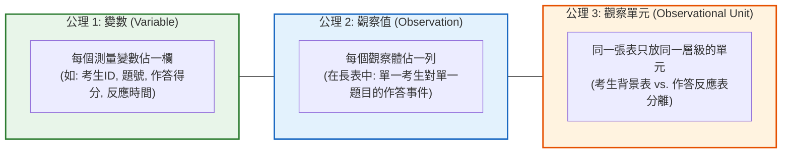
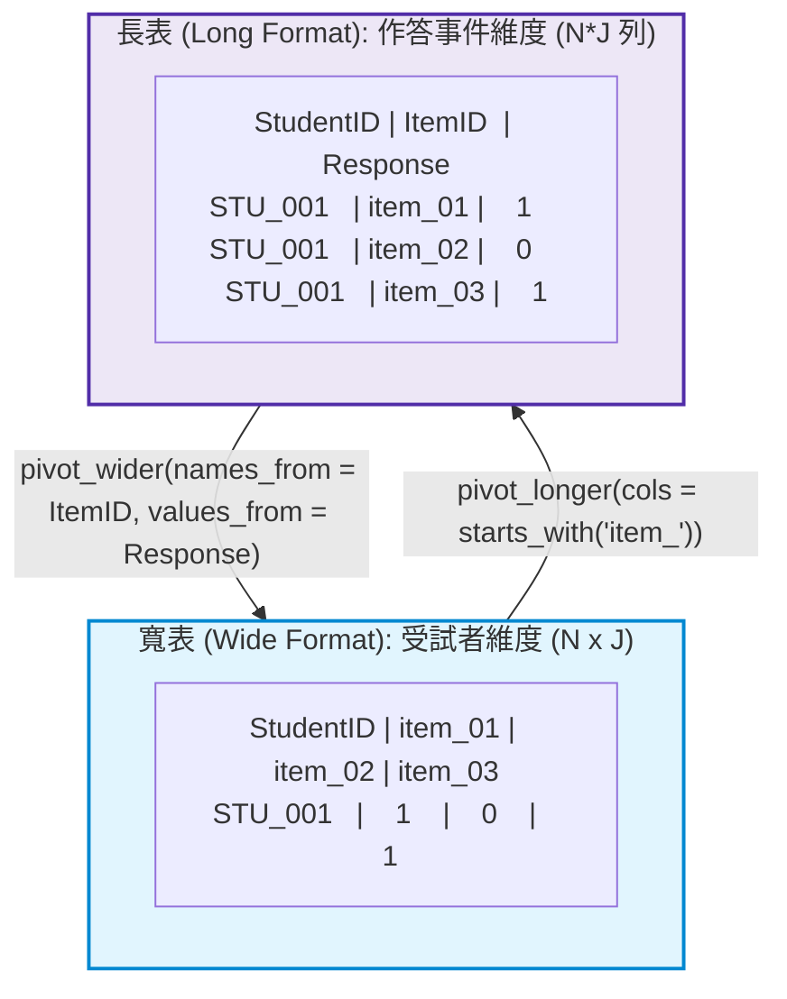

# 第 5 章：測驗資料整潔化工程：Tidy Data 與作答矩陣轉換

> **本章目標**：建構符合現代資料科學標準之評量資料前處理工程管線（Wickham, 2014; Wickham et al., 2023）。深入剖析 Tidy Data 三大公理在心理測驗中的幾何映射；依據 Rubin (1976)缺失機制（MCAR / MAR / MNAR）於測驗資料的數學意涵；掌握國際大型評量（如 PISA、TIMSS、NAEP）之「卷中跳題漏答（Omitted）」與「卷末未達題（Not Reached）」雙軌計分工程規程（Cook & Pitoniak, 2025；OECD, 2019）；透過 `tidyr` 與 `dplyr 1.1+`（`.by` 語法、`across()` 高階語法）實踐大規模作答矩陣塑形、反向題批次翻轉與反應時間（Response Times）特徵工程（van der Linden, 2006；Wise & Kong, 2005）。

---

## 5.1 理論基礎：Tidy Data 三大公理在測驗資料中的映射

在傳統測驗統計分析中，研究者經常在「每列為一位考生」與「每列為一道試題」之間產生認知混淆。Wickham（2014）提出的 **整潔資料（Tidy Data）** 為心理計量提供了統一的語意規範：



### 5.1.1 測驗資料的長寬形態切換邏輯
- **寬格式（Wide Format）**：每一列代表一位受試者，題號展開為欄位（如 `item_01` 至 `item_15`）。**適用於 IRT 參數估計、因素分析（CFA/EFA）與矩陣代數**。
- **長格式（Long Format）**：每一列代表「某位考生作答某一道題目」的單一作答事件。**適用於 `ggplot2` 視覺化、多層次模型（HLM）、IRT 局部相依性檢定與試題層次的資料彙整**。



---

## 5.2 數理深入：心理計量缺失值機制與國際評量雙軌處理規程

在評量資料中，缺失值並非單純的「資料遺失」，往往蘊含著受試者的認知策略與心理特質。

### 5.2.1 Rubin 三大缺失機制的數學形式化
設完整資料為 $\mathbf{Y} = (\mathbf{Y}_{\text{obs}}, \mathbf{Y}_{\text{mis}})$，缺失指示矩陣為 $\mathbf{M}$（$M_{ij} = 1$ 表缺失，$0$ 表觀察到）（Rubin, 1976）：
1. **完全隨機缺失（Missing Completely at Random, MCAR）**：
   $$P(\mathbf{M} \mid \mathbf{Y}_{\text{obs}}, \mathbf{Y}_{\text{mis}}, \boldsymbol{\phi}) = P(\mathbf{M} \mid \boldsymbol{\phi})$$
   缺失機率與考生作答表現、未作答題目的真值完全無關（如印刷隨機缺頁）。此時直接刪除缺失樣本不影響參數一致性。
2. **隨機缺失（Missing at Random, MAR）**：
   $$P(\mathbf{M} \mid \mathbf{Y}_{\text{obs}}, \mathbf{Y}_{\text{mis}}, \boldsymbol{\phi}) = P(\mathbf{M} \mid \mathbf{Y}_{\text{obs}}, \boldsymbol{\phi})$$
   缺失機率僅取決於已觀察到的變項（如高焦慮學生在時間壓力下更容易缺考後面題目，但給定焦慮量表分數後，缺失機率與試題本身無關）。現代全資訊最大概似法（FIML）在 MAR 下能產出無偏估計。
3. **非隨機缺失（Missing Not at Random, MNAR）**：
   $$P(\mathbf{M} \mid \mathbf{Y}_{\text{obs}}, \mathbf{Y}_{\text{mis}}, \boldsymbol{\phi}) \text{ 依賴於 } \mathbf{Y}_{\text{mis}}$$
   缺失機率取決於未作答題項本身（例如題目太難，考生因不會寫而主動放棄跳過）。在教育測驗中，**跳題往往高度屬於 MNAR**。

### 5.2.2 國際大型評量（PISA / TIMSS）雙軌計分規程
依據經濟合作暨發展組織（OECD, 2019）與 Cook 與 Pitoniak（2025）之標準，測驗資料工程必須嚴格區分兩類缺失：
1. **跳題漏答（Omitted Items）**：在受試者最後一道有效作答之前發生的空值。代表考生已瀏覽但未回答，反映出認知能力不足。
2. **卷末未達題（Not Reached Items）**：自受試者最後一道有效作答之後，連續至卷末的所有空值。代表受試者因測驗時間限制而「未能作答」。

**國際雙軌計分處理規範（Dual-Track Protocol）**：
- **軌道 1：試題參數校準階段（Item Calibration）**：
  在透過邊際最大概似法（MMLE）估計 IRT 試題參數時，未達題被視為「結構性未施測（Ignored / Structural Missing）」，**不參與概似函數連乘**。這避免了卷末試題因考生時間不足而被人為高估難度。
- **軌道 2：考生能力評定階段（Person Scoring）**：
  在結算受試者最終測驗分數與產出報告時，跳題與未達題**一律計為 0 分（Scored as Incorrect）**，以維護評量的公平性與測驗藍圖覆蓋率。

---

## 5.3 底層手刻實作：國際標準級作答缺失分類清洗管線

我們親手實作一個符合 PISA / TIMSS 國際標準的作答矩陣清理引擎，能自動將整卷作答精確標記為有效作答、跳題漏答與卷末未達：

```r
# ==============================================================================
# 第 5 章程式碼清單 5.1：國際標準大規模評量作答缺失自動分類清洗引擎
# ==============================================================================

library(tibble)
library(dplyr)

classify_assessment_missing <- function(df_wide, item_prefix = "item_") {
  item_cols <- names(df_wide)[startsWith(names(df_wide), item_prefix)]
  stopifnot(length(item_cols) > 0)
  
  resp_mat <- as.matrix(df_wide[, item_cols])
  N <- nrow(resp_mat)
  J <- ncol(resp_mat)
  
  # 建立分類狀態標記矩陣
  status_mat <- matrix("VALID", nrow = N, ncol = J, dimnames = dimnames(resp_mat))
  
  for (i in 1:N) {
    row_vals <- resp_mat[i, ]
    non_na_idx <- which(!is.na(row_vals))
    
    if (length(non_na_idx) == 0) {
      # 全卷缺考 (Absent)
      status_mat[i, ] <- "ABSENT"
    } else {
      last_valid <- max(non_na_idx)
      
      # 判定卷末未達題 (Not Reached): 最後一道有效作答之後的所有 NA
      if (last_valid < J) {
        status_mat[i, (last_valid + 1):J] <- "NOT_REACHED"
      }
      
      # 判定卷中跳題漏答 (Omitted): 最後一道有效作答之前的 NA
      if (last_valid > 1) {
        omitted_pos <- which(is.na(row_vals[1:(last_valid - 1)]))
        if (length(omitted_pos) > 0) {
          status_mat[i, omitted_pos] <- "OMITTED"
        }
      }
    }
  }
  
  # 產出雙軌計分矩陣
  # 軌道 1: 校準矩陣 (Calibration Track: Not Reached 轉為 NA, Omitted 轉為 0)
  calib_mat <- resp_mat
  calib_mat[status_mat == "OMITTED"] <- 0
  calib_mat[status_mat == "NOT_REACHED"] <- NA
  calib_mat[status_mat == "ABSENT"] <- NA
  
  # 軌道 2: 考生計分矩陣 (Scoring Track: 全部未作答一律計 0 分)
  scoring_mat <- resp_mat
  scoring_mat[status_mat == "OMITTED"] <- 0
  scoring_mat[status_mat == "NOT_REACHED"] <- 0
  scoring_mat[status_mat == "ABSENT"] <- NA
  
  list(
    Status_Classification = as_tibble(status_mat),
    Calibration_Matrix = as_tibble(calib_mat),
    Scoring_Matrix = as_tibble(scoring_mat)
  )
}

# 測試示範資料
mock_assess_df <- tibble(
  student_id = c("STU_1", "STU_2", "STU_3"),
  item_01 = c(1, 0, NA),
  item_02 = c(NA, 1, NA), # STU_1 跳題
  item_03 = c(1, 1, NA),
  item_04 = c(NA, 1, NA), # STU_1 未達題
  item_05 = c(NA, 0, NA)  # STU_1 未達題; STU_3 全缺考
)

cleaned_pipeline <- classify_assessment_missing(mock_assess_df)

cat("--- 試題作答缺失狀態分類結果 ---\n")
print(cleaned_pipeline$Status_Classification)

cat("\n--- 軌道 1: IRT 參數校準專用矩陣 (未達題視為結構性 NA) ---\n")
print(cleaned_pipeline$Calibration_Matrix)

cat("\n--- 軌道 2: 考生結算成績專用矩陣 (跳題與未達一律給 0 分) ---\n")
print(cleaned_pipeline$Scoring_Matrix)
```

---

## 5.4 評量實務情境：反向題批次翻轉與代數推導

在心理量表編製中，研究者通常穿插反向題（Reverse-Worded Items）以防範受試者的刻板回應偏誤（Response Bias）。

### 5.4.1 反向計分的線性尺度變換公式
設李克特量表之合法整數區間為 $[X_{\min}, X_{\max}]$（例如 5 點量表為 $[1, 5]$）。
反向題翻轉的數學本質為「以中點為基準的點反射變換」：
$$X_{\text{rev}} = (X_{\max} + X_{\min}) - X_{\text{orig}}$$
若量表尺度為 $1 \sim 5$，則 $X_{\text{rev}} = (5 + 1) - X_{\text{orig}} = 6 - X_{\text{orig}}$；若為 $0 \sim 4$，則 $X_{\text{rev}} = 4 - X_{\text{orig}}$。

在全書貫穿資料集 `assessment_data.csv` 中，`scale_03`（學習感到枯燥）與 `scale_08`（自認缺乏數理天份）即為反向題。我們使用現代 `across()` 進行批次安全翻轉：

```r
# ==============================================================================
# 第 5 章程式碼清單 5.2：量表反向題批次安全重編碼與檢驗
# ==============================================================================

library(dplyr)
library(tibble)

# 載入全書示範資料集
df_raw <- read.csv("book/data/assessment_data.csv") |> as_tibble()

negative_items <- c("scale_03", "scale_08")

# 檢視反向題翻轉前平均數
cat("--- 反向翻轉前：原始平均數 (與正向題尺度相反) ---\n")
print(df_raw |> summarise(across(all_of(negative_items), \(x) mean(x, na.rm = TRUE))))

# 使用 across() 進行批次點反射變換
df_clean_scale <- df_raw |>
  mutate(
    across(
      all_of(negative_items),
      \(x) 6L - as.integer(x),
      .names = "{.col}_recoded"
    )
  )

# 驗證翻轉結果
cat("\n--- 反向翻轉後：翻轉欄位平均數 (與正向題尺度同步) ---\n")
print(df_clean_scale |> summarise(across(ends_with("_recoded"), \(x) mean(x, na.rm = TRUE))))
```

---

## 5.5 現代 R 語言程式實作：長寬格式轉換與 `.by` 現代分組彙整

### 5.5.1 使用 `pivot_longer()` 萃取試題層級指標
當我們需要依據性別、學校類型分別計算各題的通過率時，長格式搭配 `dplyr 1.1+` 的 `.by` 語法能以最高資訊密度完成運算：

```r
# ==============================================================================
# 第 5 章程式碼清單 5.3：寬轉長格式與現代 .by 分組彙整
# ==============================================================================

library(tidyr)
library(dplyr)

# 1. 寬轉長：將 15 道認知題轉化為作答事件長表
cognitive_long <- df_raw |>
  select(student_id, gender, school_type, item_01:item_15) |>
  pivot_longer(
    cols = starts_with("item_"),
    names_to = "item_id",
    names_prefix = "item_",
    values_to = "response"
  ) |>
  mutate(item_number = as.integer(item_id))

cat("--- 長格式資料結構預覽 (前 6 列) ---\n")
print(head(cognitive_long, 6))

# 2. 現代 .by 分組彙整：計算「性別 x 試題」層次之有效作答數與通過率
gender_item_diff <- cognitive_long |>
  summarise(
    valid_n = sum(!is.na(response)),
    pass_rate = mean(response, na.rm = TRUE),
    .by = c(gender, item_number)
  ) |>
  arrange(item_number, gender)

cat("\n--- 現代 .by 分組計算結果 (前 6 列) ---\n")
print(head(gender_item_diff, 6))
```

### 5.5.2 逆向轉回寬表：`pivot_wider()` 產出性別試題差異矩陣

```r
# ==============================================================================
# 第 5 章程式碼清單 5.4：使用 pivot_wider() 產出試題性別差異對比表
# ==============================================================================

gender_comparison_wide <- gender_item_diff |>
  select(item_number, gender, pass_rate) |>
  pivot_wider(
    names_from = gender,
    names_prefix = "PassRate_",
    values_from = pass_rate
  ) |>
  mutate(
    Diff_M_minus_F = round(PassRate_M - PassRate_F, 3)
  )

cat("--- 性別通過率對比寬表 (檢視第 15 題顯著差異) ---\n")
print(head(gender_comparison_wide, 10))
```

---

## 5.6 ⚠️ 心理計量工程陷阱與排錯專題（Pitfalls & Diagnostics）

### 5.6.1 陷阱 1：`pivot_longer()` 欄位型別不相容引發靜默字串化
若作答資料在寬表時，其中一題被誤儲存為字串（如 `"1"`、`"0"`），而其餘題目為整數。`pivot_longer` 會依據型別階梯自動將**整部長表的作答欄位全部降級為 `character`**！
**防禦性對策**：在執行 `pivot_longer` 前，必須先使用 `stopifnot(all(sapply(df[item_cols], is.numeric)))` 驗證所有目標欄位型別一致。

### 5.6.2 陷阱 2：分組統計中缺失類別的遺漏與 `tidyr::complete()`
在分析「年級 x 班級 x 試題通過率」時，若某個班級無人答對第 12 題，`summarise()` 會直接略過該細格（Cell），造成下游報表缺少該列。
**防禦性對策**：使用 `tidyr::complete(gender, item_number, fill = list(pass_rate = 0, valid_n = 0))` 自動填補笛卡兒積缺漏。

---

## 5.7 視覺化：作答反應時間（Response Times）題項箱形圖

利用整潔的長格式資料，我們能以 `ggplot2` 繪製出 15 道題目作答時間的分佈與極端值：

```r
# ==============================================================================
# 第 5 章程式碼清單 5.5：作答反應時間長型資料小提琴與箱形圖
# ==============================================================================

library(ggplot2)

# 將反應時間欄位 (rt_01 ~ rt_15) 轉為長格式
rt_long <- df_raw |>
  select(student_id, rt_01:rt_15) |>
  pivot_longer(
    cols = starts_with("rt_"),
    names_to = "item_id",
    names_prefix = "rt_",
    values_to = "response_time"
  ) |>
  mutate(item_label = sprintf("題 %02d", as.integer(item_id)))

# 繪製各題反應時間小提琴與箱形圖
p5 <- ggplot(rt_long, aes(x = item_label, y = response_time)) +
  geom_violin(fill = "#e1f5fe", color = "#0288d1", alpha = 0.6, trim = TRUE) +
  geom_boxplot(width = 0.22, fill = "white", color = "#1565c0", outlier.size = 1.2, outlier.alpha = 0.4) +
  scale_y_continuous(breaks = seq(0, 120, by = 20)) +
  labs(
    title = "Figure 5.1: 測驗各題作答反應時間分佈圖 (Response Time Diagnostics)",
    subtitle = "呈現 1,000 位受試者在 15 道題目之作答耗時 (秒) 小提琴與四分位數箱形分佈",
    x = "測驗題號 (Item)",
    y = "作答反應時間 (秒)",
    caption = "Note. Educational Assessment Process Data simulation."
  ) +
  theme_classic(base_size = 12) +
  theme(
    plot.title = element_text(face = "bold", size = 13),
    axis.text.x = element_text(angle = 45, hjust = 1, face = "bold")
  )

ggsave("book/fig_5_1_response_times.png", plot = p5, width = 8.5, height = 5, dpi = 300)
cat("成功產出圖表: book/fig_5_1_response_times.png\n")
```

---

## 5.8 測驗報告專業解讀（Substantive Interpretation）

資料整潔化後的報表能直接揭示關鍵的心理計量現象：

> ### ⏱️ 作答時間與行為診斷
> 1. **難度與耗時的對應關係**：如圖 5.1 所示，反應時間依 $|b|$ 曲線分佈，難度最高的 `題 12`（通過率約 $P = .08$）與最容易的 `題 01`（通過率約 $P = .87$）耗時均偏長，中等難度的 `題 06` 最短。依據 (van der Linden, 2006) 的研究，，對數常態反應時間模型（Log-Normal RT Model）能有效結合能力估計與作答速度。
> 2. **極端猜測異常識別（Rapid Guessing）**：若有受試者在多數試題的作答時間小於 $3$ 秒，可能存在「快速隨機猜測（Rapid Guessing Behavior）」（Wise & Kong, 2005）。在進行能力估計前，資料工程管線應將此類樣本標記或濾除。

---

## 5.9 章末實務習題與專案挑戰（含 100% 完整可用程式碼解答）

### 【基礎練習題】
1. 請載入 `assessment_data.csv`，將 10 題李克特量表（`scale_01` 至 `scale_10`）由寬格式轉為長格式，並計算每一題的「平均得分」與「標準差」。
2. 請使用 `dplyr::case_when()` 取代傳統的 `if-else`，寫出將代碼 `"M"` 轉為 `"男"`、`"F"` 轉為 `"女"` 的向量化管線。

### 【進階工程挑戰】
3. 在大型測驗中，考生在最後幾題常因時間不足而未作答。請設計一段 Tidyverse 資料工程管線：輸入寬格式作答表，自動判定每個考生的「最後一道有效作答題號」，並將其後續的連續 `NA` 標記為 `"未達題 (Not Reached)"`，而中間穿插的 `NA` 標記為 `"跳題漏答 (Omitted)"`。
4. 【作答時間濾除工程挑戰】：依據 Wise 與 Kong（2005）之門檻理論，設計一個自動化清洗函數 `filter_rapid_guessers(df, rt_prefix = "rt_", threshold_sec = 3)`。當考生在超過 30% 的題目作答時間少於 3 秒時，將該考生標記為 `"Rapid_Guesser"`，並產出清洗前後的樣本數損耗報告。

---

### 💡 習題參考解答

```r
# ==============================================================================
# 第 5 章習題解答參考
# ==============================================================================

# ------------------------------------------------------------------------------
# 第 1 題解答
# ------------------------------------------------------------------------------
library(tidyr)
library(dplyr)
df_all <- read.csv("book/data/assessment_data.csv")
scale_stats <- df_all |>
  select(scale_01:scale_10) |>
  pivot_longer(cols = everything(), names_to = "Scale_Item", values_to = "Score") |>
  summarise(
    Mean_Score = round(mean(Score, na.rm = TRUE), 2),
    SD_Score = round(sd(Score, na.rm = TRUE), 2),
    .by = Scale_Item
  )
cat("各題量表平均數與標準差 (前 5 題):\n")
print(head(scale_stats, 5))

# ------------------------------------------------------------------------------
# 第 2 題解答
# ------------------------------------------------------------------------------
gender_cn <- case_when(
  df_all$gender[1:5] == "M" ~ "男",
  df_all$gender[1:5] == "F" ~ "女",
  .default = NA_character_
)
cat("中文性別對照:", gender_cn, "\n")

# ------------------------------------------------------------------------------
# 第 3 題解答：未達題 vs 跳題漏答判讀管線
# ------------------------------------------------------------------------------
pipeline_res <- classify_assessment_missing(df_all |> select(student_id, item_01:item_15))
cat("\n全書資料集缺失分類前 3 位考生狀態:\n")
print(head(pipeline_res$Status_Classification, 3))

# ------------------------------------------------------------------------------
# 第 4 題解答：快速隨機猜測 (Rapid Guessing) 識別濾除函數
# ------------------------------------------------------------------------------
filter_rapid_guessers <- function(df, rt_prefix = "rt_", threshold_sec = 3) {
  rt_data <- df |> select(starts_with(rt_prefix))
  n_items <- ncol(rt_data)
  
  # 計算每位考生小於門檻的題數比例
  rapid_proportions <- rowMeans(rt_data < threshold_sec, na.rm = TRUE)
  
  df_flagged <- df |>
    mutate(
      Rapid_Guess_Ratio = round(rapid_proportions, 3),
      Is_Rapid_Guesser = rapid_proportions >= 0.30
    )
  
  n_total <- nrow(df)
  n_rapid <- sum(df_flagged$Is_Rapid_Guesser)
  
  list(
    Data_Clean = df_flagged |> filter(!Is_Rapid_Guesser),
    Audit_Report = tibble(
      Total_Examinees = n_total,
      Rapid_Guessers_Count = n_rapid,
      Retention_Rate_Pct = round((n_total - n_rapid) / n_total * 100, 2)
    )
  )
}

rapid_audit <- filter_rapid_guessers(df_all)
cat("\n--- 快速猜測行為濾除稽核報表 ---\n")
print(rapid_audit$Audit_Report)
```

---

## 參考文獻 (References)

Cook, L. L., & Pitoniak, M. J. (Eds.). (2025). *Educational measurement* (5th ed.). Oxford University Press.

OECD. (2019). *PISA 2018 technical report*. OECD Publishing.

Rubin, D. B. (1976). Inference and missing data. *Biometrika*, *63*(3), 581–592. https://doi.org/10.1093/biomet/63.3.581

van der Linden, W. J. (2006). A lognormal model for response times on test items. *Journal of Educational and Behavioral Statistics*, *31*(2), 181–204. https://doi.org/10.3102/10769986031002181

Wickham, H. (2014). Tidy data. *Journal of Statistical Software*, *59*(10), 1–23. https://doi.org/10.18637/jss.v059.i10

Wickham, H., Çetinkaya-Rundel, M., & Grolemund, G. (2023). *R for data science: Import, tidy, transform, visualize, and model data* (2nd ed.). O'Reilly Media.

Wise, S. L., & Kong, X. (2005). Response time effort: A new measure of examinee motivation in computer-based tests. *Applied Measurement in Education*, *18*(2), 163–183. https://doi.org/10.1207/s15324818ame1802_2
