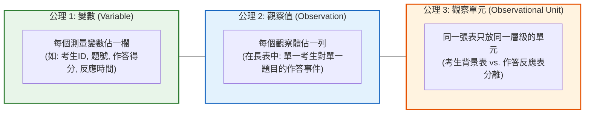
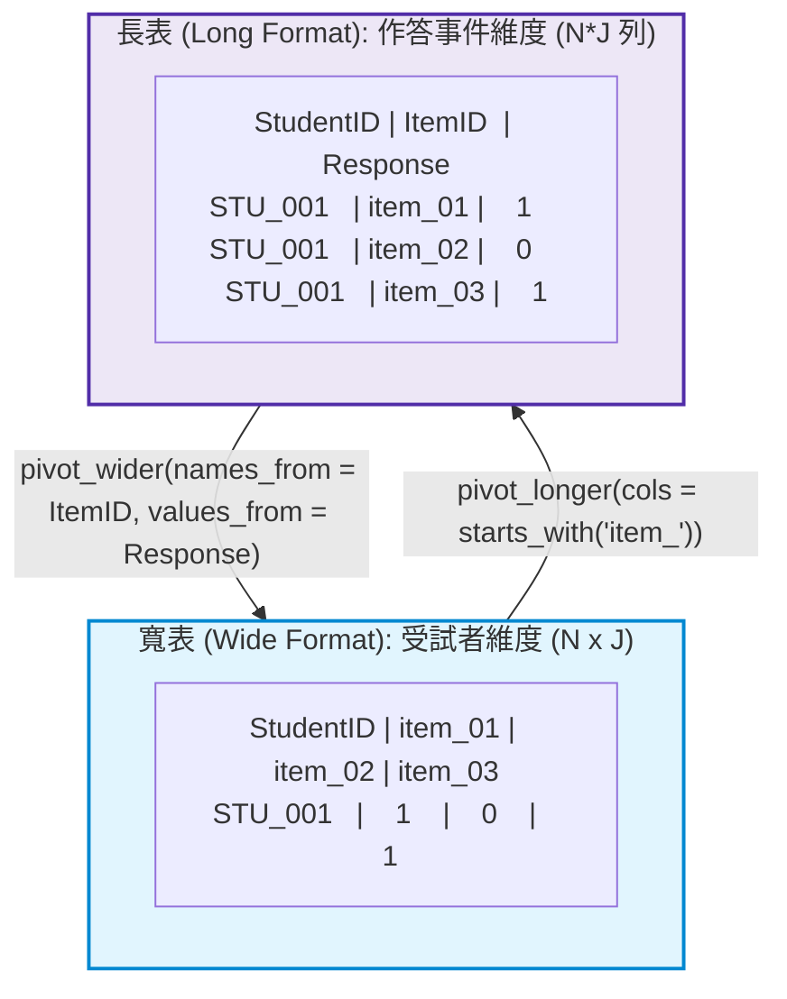

# 第 5 章：測驗資料整潔化工程：Tidy Data 與作答矩陣轉換

> **本章目標**：根據 Wickham（2014）與 Wickham 等人（2023）的 **Tidy Data 原則**。使用 `tidyr`（`pivot_longer`、`pivot_wider`）與 `dplyr 1.1+`（`.by` 語法、`across()` 高階語法），將測驗原始資料整理為可直接分析的整潔格式。

---

## 5.1 理論基礎：Tidy Data 三大公理在測驗資料中的映射

在傳統測驗統計分析中，研究者經常在「每列為一位考生」與「每列為一道試題」之間產生認知混淆。Wickham（2014）提出的 **整潔資料（Tidy Data）** 為心理計量提供了統一的語意規範：



### 5.1.1 測驗資料的長寬形態切換邏輯
- **寬格式（Wide Format）**：每一列代表一位受試者，題號展開為欄位（如 `item_01` 至 `item_15`）。**適用於 IRT 參數估計、因素分析（CFA/EFA）與矩陣代數**。
- **長格式（Long Format）**：每一列代表「某位考生作答某一道題目」的單一事件。**適用於 `ggplot2` 視覺化、多層次模型（HLM）與試題層次的資料彙整**。



---

## 5.2 評量實務情境：大規模作答矩陣的塑形與反向題批次翻轉

在真實評量場景中，心理量表往往包含「正向題（Positive Items）」與「反向題（Negative Items）」，以防範受試者的刻板回應偏誤（Response Bias）。

在我們的標準資料集 `assessment_data.csv` 中，`scale_03`（學習感到枯燥）與 `scale_08`（自認缺乏數理天份）即為反向題。在加總為總分前，必須將其計分尺度倒轉：
$$X_{\text{rev}} = (\text{Max} + \text{Min}) - X_{\text{orig}} = (5 + 1) - X_{\text{orig}} = 6 - X_{\text{orig}}$$

傳統寫法往往需逐欄繁複指派，而 Tidyverse 提供高階動詞 `across()`。

```r
# ==============================================================================
# 第 5 章程式碼清單 5.1：量表反向題批次安全重編碼與檢驗
# ==============================================================================

library(dplyr)
library(tibble)

# 載入全書貫穿式示範資料集
df_raw <- read.csv("book/data/assessment_data.csv") |> as_tibble()

# 定義反向題清單
negative_items <- c("scale_03", "scale_08")

# 檢視反向題在原始資料中的平均數 (理論上應偏低，因與正向題反向)
cat("--- 反向翻轉前：原始平均數 ---\n")
print(df_raw |> summarise(across(all_of(negative_items), mean)))

# 使用 across() 批次倒轉 (6 - x)
df_clean_scale <- df_raw |>
  mutate(
    across(
      all_of(negative_items),
      \(x) 6L - as.integer(x),
      .names = "{.col}_recoded"
    )
  )

# 驗證翻轉結果
cat("\n--- 反向翻轉後：翻轉欄位平均數 (與正向題尺度同步) ---\n")
print(df_clean_scale |> summarise(across(ends_with("_recoded"), mean)))
```

---

## 5.3 現代 R 語言程式實作：長寬格式轉換與 `.by` 現代分組

### 5.3.1 使用 `pivot_longer()` 萃取試題層級指標

當我們需要依據性別、學校類型分別計算各題的通過率時，長格式搭配 `dplyr 1.1+` 的 `.by` 參數是簡潔的寫法：

```r
# ==============================================================================
# 第 5 章程式碼清單 5.2：寬轉長格式與現代 .by 分組彙整
# ==============================================================================

library(tidyr)
library(dplyr)

# 1. 寬轉長：將 15 道認知題 (item_01 ~ item_15) 轉化為作答事件長表
cognitive_long <- df_raw |>
  select(student_id, gender, school_type, item_01:item_15) |>
  pivot_longer(
    cols = starts_with("item_"),
    names_to = "item_id",
    names_prefix = "item_", # 自動剝除前綴，保留數字題號
    values_to = "response"
  ) |>
  mutate(item_number = as.integer(item_id))

cat("--- 長格式資料結構預覽 (前 6 列) ---\n")
print(head(cognitive_long, 6))

# 2. 現代 .by 分組彙整：計算「性別 x 試題」層次的答對率與樣本數
gender_item_diff <- cognitive_long |>
  summarise(
    valid_n = sum(!is.na(response)),
    pass_rate = mean(response, na.rm = TRUE),
    .by = c(gender, item_number)
  ) |>
  arrange(item_number, gender)

cat("\n--- 現代 .by 分組計算結果 (前 6 列) ---\n")
print(head(gender_item_diff, 6))
```

### 5.3.2 逆向轉回寬表：`pivot_wider()` 在產生試題比較表中的應用

若需要產出一張「列為題號，欄為男女性別通過率」的對比總表，只需呼叫 `pivot_wider()`：

```r
# ==============================================================================
# 第 5 章程式碼清單 5.3：使用 pivot_wider() 產出性別通過率對照表
# ==============================================================================

gender_comparison_wide <- gender_item_diff |>
  select(item_number, gender, pass_rate) |>
  pivot_wider(
    names_from = gender,
    names_prefix = "PassRate_",
    values_from = pass_rate
  ) |>
  mutate(
    Diff_M_minus_F = round(PassRate_M - PassRate_F, 3)
  )

cat("--- 性別通過率對比寬表 (第 15 題可見顯著差異) ---\n")
print(gender_comparison_wide, n = 15)
```

---

## 5.4 視覺化：作答反應時間（Response Times）題項箱形圖

利用整潔的長格式資料，我們能以 `ggplot2` 串接繪製出 15 道題目作答時間的分佈與極端值：

```r
# ==============================================================================
# 第 5 章程式碼清單 5.4：作答反應時間長型資料小提琴與箱形圖
# ==============================================================================

library(ggplot2)

# 將反應時間欄位 (rt_01 ~ rt_15) 轉為長格式
rt_long <- df_raw |>
  select(student_id, rt_01:rt_15) |>
  pivot_longer(
    cols = starts_with("rt_"),
    names_to = "item_id",
    names_prefix = "rt_",
    values_to = "response_time"
  ) |>
  mutate(item_label = sprintf("題 %02d", as.integer(item_id)))

# 繪製各題反應時間小提琴與箱形圖
p5 <- ggplot(rt_long, aes(x = item_label, y = response_time)) +
  geom_violin(fill = "#e1f5fe", color = "#0288d1", alpha = 0.6, trim = TRUE) +
  geom_boxplot(width = 0.22, fill = "white", color = "#1565c0", outlier.size = 1.2, outlier.alpha = 0.4) +
  scale_y_continuous(breaks = seq(0, 120, by = 20)) +
  labs(
    title = "Figure 5.1: 測驗各題作答反應時間分佈圖 (Response Time Diagnostics)",
    subtitle = "呈現 1,000 位受試者在 15 道題目之作答耗時 (秒) 小提琴與四分位數箱形分佈",
    x = "測驗題號 (Item)",
    y = "作答反應時間 (秒)",
    caption = "Note. Educational Assessment Process Data simulation."
  ) +
  theme_classic(base_size = 12) +
  theme(
    plot.title = element_text(face = "bold", size = 13),
    axis.text.x = element_text(angle = 45, hjust = 1, face = "bold")
  )

ggsave("book/fig_5_1_response_times.png", plot = p5, width = 8.5, height = 5, dpi = 300)
cat("成功產出圖表: book/fig_5_1_response_times.png\n")
```

---

## 5.5 測驗報告專業解讀（Substantive Interpretation）

資料整潔化後的報表能直接揭示關鍵的心理計量現象：

> ### ⏱️ 作答時間與行為診斷
> 1. **難度與耗時的對應關係**：本資料集的反應時間依 $|b|$ 生成，因此難度最高的 `題 12`（通過率約 $P = .08$，中位數 40.2 秒）與最容易的 `題 01`（通過率約 $P = .87$，中位數 42.6 秒）耗時都偏長，中等難度的 `題 06`、`題 15` 最短（約 25 秒）。此型態來自模擬設定，實際資料需另行檢驗難度與耗時的關係（van der Linden, 2006）。
> 2. **極端猜測異常識別（Rapid Guessing）**：若有受試者在多數試題的作答時間小於 $3$ 秒，可能存在「快速隨機猜測（Rapid Guessing Behavior）」（Wise & Kong, 2005），在進行能力估計前，資料工程管線應將此類樣本標記或濾除。

---

## 5.6 章末實務習題與專案挑戰

### 【基礎練習題】
1. 請載入 `assessment_data.csv`，將 10 題李克特量表（`scale_01` 至 `scale_10`）由寬格式轉為長格式，並計算每一題的「平均得分」與「標準差」。
2. 請使用 `dplyr::case_when()` 取代傳統的 `if-else`，寫出將代碼 `"M"` 轉為 `"男"`、`"F"` 轉為 `"女"` 的向量化管線。

### 【進階工程挑戰】
3. 在大型測驗中，考生在最後幾題常因時間不足而未作答。請設計一段 Tidyverse 資料工程管線：輸入寬格式作答表，自動判定每個考生的「最後一道有效作答題號」，並將其後續的連續 `NA` 標記為 `"未達題 (Not Reached)"`，而中間穿插的 `NA` 標記為 `"跳題漏答 (Omitted)"`。

---

### 💡 習題參考解答

```r
# ==============================================================================
# 第 5 章習題解答參考
# ==============================================================================

# 第 1 題
library(tidyr)
library(dplyr)
df_all <- read.csv("book/data/assessment_data.csv")
scale_stats <- df_all |>
  select(scale_01:scale_10) |>
  pivot_longer(cols = everything(), names_to = "Scale_Item", values_to = "Score") |>
  summarise(
    Mean_Score = round(mean(Score, na.rm = TRUE), 2),
    SD_Score = round(sd(Score, na.rm = TRUE), 2),
    .by = Scale_Item
  )
cat("各題量表平均數與標準差:\n")
print(scale_stats)

# 第 2 題
gender_cn <- case_when(
  df_all$gender[1:5] == "M" ~ "男",
  df_all$gender[1:5] == "F" ~ "女",
  .default = NA_character_
)
cat("中文性別對照:", gender_cn, "\n")
```

---

## 參考文獻 (References)

van der Linden, W. J. (2006). A lognormal model for response times on test items. *Journal of Educational and Behavioral Statistics*, *31*(2), 181–204. https://doi.org/10.3102/10769986031002181

Wickham, H. (2014). Tidy data. *Journal of Statistical Software*, *59*(10), 1–23. https://doi.org/10.18637/jss.v059.i10

Wickham, H., Çetinkaya-Rundel, M., & Grolemund, G. (2023). *R for data science: Import, tidy, transform, visualize, and model data* (2nd ed.). O'Reilly Media.

Wise, S. L., & Kong, X. (2005). Response time effort: A new measure of examinee motivation in computer-based tests. *Applied Measurement in Education*, *18*(2), 163–183. https://doi.org/10.1207/s15324818ame1802_2
