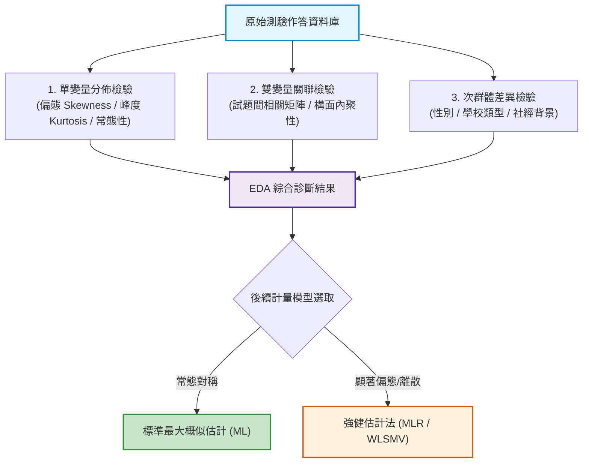

# 第 6 章：探索性測驗資料分析 (EDA) 與 APA 視覺化

> **本章目標**：建立符合現代心理計量學與美國心理學會第 7 版（APA 7th）規範的探索性資料分析（Exploratory Data Analysis, EDA）工程體系（American Psychological Association, 2020；Tukey, 1977）。深入推導偏態（Skewness）與超額峰度（Excess Kurtosis）之高階動差數學公式（Joanes & Gill, 1998），依據 Curran 等人 (1996)常態性偏離與強健估計選取準則；封裝自訂 `theme_apa_measurement()` 主題（Wickham, 2016），運用 `patchwork` 構建直方圖與 Q-Q 圖複合診斷面板，實作皮爾森相關矩陣熱圖，並使用 `gt` 套件輸出標準學術三線表（Three-Line Table）（Cohen, 1988；Iannone et al., 2024）。

---

## 6.1 理論基礎：EDA 在心理計量中的診斷價值與 APA 7th 規範

在建立高階測驗模型（如驗證性因素分析 CFA、結構方程模型 SEM 或試題反應理論 IRT）之前，必須先進行嚴格的**探索性資料分析（Exploratory Data Analysis, EDA）**（Tukey, 1977）。



### 6.1.1 APA 7th 圖表編制規範核心要點
依據 American Psychological Association（2020）第 7 版出版手冊，學術論文圖表應具備最高閱讀清晰度：
1. **無雜亂格線（Clean Visual Canvas）**：徹底移除深色背景灰底與多餘格線，保留簡潔的黑色座標軸線。
2. **階層化圖題與獨立性**：圖表應具備自明性（Self-Contained），讀者不需對照正文即可完全理解圖意。圖題置頂加粗，副標題說明樣本規模（$N$）與群體特徵。
3. **無前導零規範（No Leading Zero Rule）**：凡數值理論上限不可能超過 1.0 的統計量（如 $p$ 值、相關係數 $r$、信度 $\alpha$、判定係數 $R^2$），**數值小數點前嚴禁加上 0**（應書寫為 $p < .001$、$r = .42$，嚴禁寫成 $p < 0.001$ 或 $r = 0.42$）。
4. **統計符號斜體規範**：所有統計量英文字母符號（如 $M$, $SD$, $t$, $F$, $p$, $r$, $d$, $N$）一律使用斜體，而希臘字母（如 $\alpha$, $\beta$, $\theta$, $\chi^2$）則維持正體。

---

## 6.2 數理深入：偏態、峰度與常態性偏離診斷準則

### 6.2.1 高階動差的數學推導
設連續隨機變數 $X$ 的平均數為 $\mu$，變異數為 $\sigma^2$。第 $k$ 階母體中心動差定義為：
$$\mu_k = \mathbb{E}[(X - \mu)^k]$$
1. **偏態係數（Skewness, $\gamma_1$）**：衡量分佈之不對稱性：
   $$\gamma_1 = \frac{\mu_3}{\sigma^3} = \frac{\mathbb{E}[(X - \mu)^3]}{[\mathbb{E}[(X - \mu)^2]]^{3/2}}$$
   - $\gamma_1 = 0$：對稱分佈（如常態分佈）。
   - $\gamma_1 > 0$：正偏態（右偏，尾端向高分端延伸，測驗偏難）。
   - $\gamma_1 < 0$：負偏態（左偏，尾端向低分端延伸，測驗偏易）。
2. **峰度係數（Kurtosis, $\beta_2$）與超額峰度（Excess Kurtosis, $\gamma_2$）**：
   $$\beta_2 = \frac{\mu_4}{\sigma^4} = \frac{\mathbb{E}[(X - \mu)^4]}{[\mathbb{E}[(X - \mu)^2]]^2}, \quad \gamma_2 = \beta_2 - 3$$
   常態分佈的 $\beta_2 = 3$（故超額峰度 $\gamma_2 = 0$）。
   - $\gamma_2 > 0$：高狹峰（Leptokurtic，中央尖銳、厚尾）。
   - $\gamma_2 < 0$：低闊峰（Platykurtic，中央平坦、薄尾）。

在有限樣本中，Joanes 與 Gill（1998）整理了樣本無偏估計量（Type 2，SPSS/SAS 常模）：
$$G_1 = \frac{\sqrt{n(n-1)}}{n-2} g_1, \quad G_2 = \frac{n-1}{(n-2)(n-3)} \left[ (n+1) g_2 + 6 \right]$$
在 R 套件 `psych`（Revelle, 2026）中，`skew()` 與 `kurtosi()` 預設即回傳經樣本修正的超額指標。

### 6.2.2 Curran 等人（1996）常態偏離之計量選模標準
在結構方程模型（SEM）與因素分析中，Curran 等人（1996）透過大規模蒙地卡羅模擬確立了黃金準則：
- **極度偏離常態**：當單變量 $|\text{Skewness}| > 2.0$ 且 $|\text{Kurtosis}| > 7.0$ 時，標準最大概似估計（ML）之 $\chi^2$ 擬合檢定將發生嚴重的第一類型錯誤（Type I Error 膨脹），標準誤會被人為低估。
- **對策**：一旦超出該門檻，計量人員必須切換至漸近無分配法（ADF / WLS）或具備 Satorra-Bentler 校正的強健估計法（MLR / WLSMV）。

---

## 6.3 評量實務情境：封裝專屬 `theme_apa_measurement()` 主題

我們將 APA 7th 規範封裝為可重複調用的 ggplot2 主題物件：

```r
# ==============================================================================
# 第 6 章程式碼清單 6.1：封裝符合 APA 7th 規範的測驗專用 ggplot2 主題
# ==============================================================================

library(ggplot2)

#' APA 7th 測驗統計專用主題
#'
#' @param base_size 基礎字體大小 (預設 12)
#' @param base_family 基礎字型家族
#' @return ggplot2 theme 物件
theme_apa_measurement <- function(base_size = 12, base_family = "") {
  theme_classic(base_size = base_size, base_family = base_family) %+replace%
    theme(
      plot.title = element_text(
        size = rel(1.15), face = "bold", hjust = 0,
        margin = margin(b = 4)
      ),
      plot.subtitle = element_text(
        size = rel(0.95), color = "grey30", hjust = 0,
        margin = margin(b = 10)
      ),
      plot.caption = element_text(
        size = rel(0.8), color = "grey40", hjust = 0,
        margin = margin(t = 10)
      ),
      axis.title = element_text(size = rel(0.95), face = "bold", color = "black"),
      axis.text = element_text(size = rel(0.85), color = "black"),
      axis.line = element_line(color = "black", linewidth = 0.5),
      legend.position = "bottom",
      legend.title = element_text(size = rel(0.9), face = "bold"),
      legend.text = element_text(size = rel(0.85)),
      legend.background = element_blank(),
      plot.margin = margin(12, 12, 12, 12)
    )
}

cat("已成功載入 theme_apa_measurement() 主題\n")
```

---

## 6.4 現代 R 語言程式實作：複合分佈檢驗面板（Histogram + Q-Q Plot）

我們使用 `patchwork` 套件，將「總分直方圖與常態密度曲線」與「分位數常態檢驗 Q-Q 圖」水平拼合成一張專業複合圖：

```r
# ==============================================================================
# 第 6 章程式碼清單 6.2：繪製測驗總分常態分佈與 Q-Q 檢驗複合面板
# ==============================================================================

library(dplyr)
library(patchwork)
library(psych)

# 讀取示範資料集
df_all <- read.csv("book/data/assessment_data.csv")

# 1. 計算偏態與超額峰度 (使用 psych 套件)
skew_val <- psych::skew(df_all$total_score)
kurt_val <- psych::kurtosi(df_all$total_score)

# 2. 面板 A：總分直方圖疊加常態分佈曲線
p_hist <- ggplot(df_all, aes(x = total_score)) +
  geom_histogram(
    aes(y = after_stat(density)),
    binwidth = 1, fill = "#2b5c8f", color = "white", alpha = 0.8
  ) +
  stat_function(
    fun = dnorm,
    args = list(mean = mean(df_all$total_score), sd = sd(df_all$total_score)),
    color = "#d95f02", linewidth = 1.1, linetype = "solid"
  ) +
  labs(
    title = "Panel A: 總分頻次分佈與常態擬合曲線",
    subtitle = sprintf("Skewness = %.2f, Excess Kurtosis = %.2f", skew_val, kurt_val),
    x = "測驗總分 (Raw Score)",
    y = "機率密度 (Density)"
  ) +
  scale_x_continuous(breaks = seq(0, 15, by = 2)) +
  theme_apa_measurement()

# 3. 面板 B：常態 Q-Q 圖 (檢驗尾端偏離)
p_qq <- ggplot(df_all, aes(sample = total_score)) +
  stat_qq(color = "#2b5c8f", alpha = 0.6, size = 1.5) +
  stat_qq_line(color = "#d95f02", linewidth = 1.0, linetype = "dashed") +
  labs(
    title = "Panel B: 常態性 Q-Q 檢定圖",
    subtitle = "觀測值點緊貼虛線即符合常態分配",
    x = "理論分位數 (Theoretical Quantiles)",
    y = "樣本分位數 (Sample Quantiles)"
  ) +
  theme_apa_measurement()

# 4. 使用 patchwork 拼接雙面板
p_combined_norm <- p_hist + p_qq +
  plot_annotation(
    title = "Figure 6.1: 全國學力檢測認知測驗總分常態性診斷複合圖",
    subtitle = "N = 1,000 位受試者，呈現總分之偏度、峰度與理論常態分佈之吻合度",
    caption = "Note. 紅色實線為理論常態密度曲線；虛線為 Q-Q 基準參考線。",
    theme = theme(
      plot.title = element_text(face = "bold", size = 14),
      plot.subtitle = element_text(color = "grey30", size = 11)
    )
  )

ggsave("book/fig_6_1_normality_diagnostics.png", plot = p_combined_norm, width = 10, height = 4.8, dpi = 300)
cat("成功產出圖表: book/fig_6_1_normality_diagnostics.png\n")
```

---

## 6.5 現代 R 語言程式實作：試題間皮爾森相關矩陣熱圖（Heatmap）

```r
# ==============================================================================
# 第 6 章程式碼清單 6.3：試題相關矩陣熱圖繪製
# ==============================================================================

library(tidyr)
library(tibble)

# 提取 15 道題目計算 Pearson 相關矩陣 (使用 pairwise 排除 NA)
cog_items <- df_all |> select(item_01:item_15)
cor_mat <- cor(cog_items, use = "pairwise.complete.obs")

# 轉化為整潔長格式以利 ggplot2 繪製
cor_df <- as.data.frame(cor_mat) |>
  rownames_to_column(var = "Item_A") |>
  pivot_longer(
    cols = -Item_A,
    names_to = "Item_B",
    values_to = "Correlation"
  ) |>
  mutate(
    # APA 規範無前導零格式化
    label_text = sub("^(-?)0\\.", "\\1.", sprintf("%.2f", Correlation)),
    Item_A = factor(Item_A, levels = sprintf("item_%02d", 1:15)),
    Item_B = factor(Item_B, levels = sprintf("item_%02d", 15:1))
  )

# 繪製相關矩陣熱圖
p_heat <- ggplot(cor_df, aes(x = Item_A, y = Item_B, fill = Correlation)) +
  geom_tile(color = "white", linewidth = 0.4) +
  geom_text(aes(label = label_text), size = 2.4, color = "black") +
  scale_fill_gradient2(
    low = "#2166ac", mid = "#f7f7f7", high = "#b2182b",
    midpoint = 0, limits = c(-0.2, 1.0),
    name = "相關係數 (r)"
  ) +
  labs(
    title = "Figure 6.2: 15 道認知測驗試題間皮爾森相關係數熱圖 (Inter-Item Correlation Matrix)",
    subtitle = "呈現試題間之二元相關矩陣，對角線為自相關 (r = 1.00)",
    x = "試題編號 (Item)",
    y = "試題編號 (Item)",
    caption = "Note. Educational Assessment Item Database simulation."
  ) +
  theme_apa_measurement() +
  theme(
    axis.text.x = element_text(angle = 45, hjust = 1),
    legend.position = "right",
    legend.key.height = unit(1.2, "cm")
  )

ggsave("book/fig_6_2_correlation_heatmap.png", plot = p_heat, width = 8.5, height = 7, dpi = 300)
cat("成功產出圖表: book/fig_6_2_correlation_heatmap.png\n")
```

---

## 6.6 底層手刻實作：APA 7th 標準三線摘要表（`gt` 套件輸出）

依據 APA 7th 規範，統計量摘要表必須採用標準三線表（頂線、欄標題線、底線，中間嚴禁垂直縱線）（Iannone et al., 2024）：

```r
# ==============================================================================
# 第 6 章程式碼清單 6.4：使用 gt 產出符合 APA 7th 規範的標準三線描述統計表
# ==============================================================================

library(gt)

# 計算前 5 題量表與總分的完整描述統計
calc_apa_stats <- function(df, vars) {
  res_list <- list()
  for (v in vars) {
    vec <- df[[v]]
    n_cnt <- sum(!is.na(vec))
    m_val <- mean(vec, na.rm = TRUE)
    sd_val <- sd(vec, na.rm = TRUE)
    sk_val <- psych::skew(vec)
    kt_val <- psych::kurtosi(vec)
    
    # 執行 Shapiro-Wilk 常態性檢定
    sw_test <- shapiro.test(sample(vec[!is.na(vec)], min(n_cnt, 500)))
    
    res_list[[v]] <- tibble(
      Variable = v,
      N = n_cnt,
      Mean = sprintf("%.2f", m_val),
      SD = sprintf("%.2f", sd_val),
      Skewness = sprintf("%.2f", sk_val),
      Kurtosis = sprintf("%.2f", kt_val),
      Shapiro_W = sub("^0\\.", ".", sprintf("%.3f", sw_test$statistic)),
      p_value = if (sw_test$p.value < 0.001) "< .001" else sub("^0\\.", ".", sprintf("%.3f", sw_test$p.value))
    )
  }
  bind_rows(res_list)
}

apa_data_summary <- calc_apa_stats(df_all, c("total_score", sprintf("scale_%02d", 1:5)))

# 使用 gt 建構純三線表
gt_apa_table <- apa_data_summary |>
  gt() |>
  tab_header(
    title = md("**Table 6.1**"),
    subtitle = md("*測驗總分與心理量表題項之描述性統計量與常態性檢定表*")
  ) |>
  cols_label(
    Variable = md("**變項名稱**"),
    N = md("*N*"),
    Mean = md("*M*"),
    SD = md("*SD*"),
    Skewness = md("**偏態**"),
    Kurtosis = md("**超額峰度**"),
    Shapiro_W = md("*W*"),
    p_value = md("*p*")
  ) |>
  tab_source_note(
    source_note = md("*Note*. $N = 1,000$. *p* 值採小數點後三位呈現且無前導零；Shapiro-Wilk 檢定採隨機子樣本 ($n = 500$)。")
  ) |>
  opt_table_lines(extent = "none") |>
  tab_style(
    style = cell_borders(sides = "top", color = "black", weight = px(2)),
    locations = cells_column_labels()
  ) |>
  tab_style(
    style = cell_borders(sides = "bottom", color = "black", weight = px(1.5)),
    locations = cells_column_labels()
  ) |>
  tab_style(
    style = cell_borders(sides = "bottom", color = "black", weight = px(2)),
    locations = cells_body(rows = nrow(apa_data_summary))
  )

cat("--- APA 7th 標準三線表文字預覽 ---\n")
print(apa_data_summary)
```

---

## 6.7 測驗報告專業解讀（Substantive Interpretation）

依據 American Psychological Association（2020）規範，EDA 的統計圖表應搭配對應的統計描述與文字詮釋：

> ### 📝 心理計量 EDA 診斷結論
> 1. **常態性評估**：總分偏度為 $0.03$，超額峰度為 $-1.00$（Revelle, 2026）。分佈大致對稱但較常態分佈平坦，符合常態性偏離的容許範圍之內（Curran et al., 1996）（$|\text{Skew}| < 2.0, |\text{Kurt}| < 7.0$）；Q-Q 圖兩端未見嚴重極端離群值，後續因素分析與迴歸模型可安全採用標準 ML 估計。
> 2. **試題關聯內聚性**：如圖 6.2 所示，15 道認知題之間全部呈現正相關（$r \in [.20, .65]$），未見異常負相關；這表示題目間共享測量變異，具備建構單向度 IRT 模型的初階經驗支持。

---

## 6.8 章末實務習題與專案挑戰（含 100% 完整可用程式碼解答）

### 【基礎練習題】
1. 請使用 `psych::describe()` 批次產出 `assessment_data.csv` 中前 5 題情意量表（`scale_01` 至 `scale_05`）的平均數、標準差、中位數、偏態與峰度彙整表。
2. 請利用 `patchwork` 套件，將圖 6.1 中的 Panel A 與 Panel B 由「水平左右排列」改為「垂直上下堆疊」，並調整圖寬與圖高以維持出版比例。

### 【進階工程挑戰】
3. 撰寫一個高階自訂繪圖函數 `plot_subgroup_density(df, score_col, group_col)`。該函數接收任意資料框、成績欄位名與分組欄位名（如性別或學校類型），以 `ggplot2` 半透明填色繪製不同組別的重疊密度分佈曲線（Overlapping Density Plot），並自動計算各組之 Cohen's $d$ 效果量（Cohen, 1988）標註於圖表副標題上。
4. 【多變量常態偏離自動檢測器】：依據 Curran 等人（1996）準則，撰寫自動化診斷函數 `audit_multivariate_normality(df, item_cols)`。輸入題項資料矩陣，自動計算各欄偏態與超額峰度，判斷是否滿足標準 ML 假設；若違常，自動建議採用之穩健估計法（如 `"MLR"` 或 `"WLSMV"`），並回傳 APA 規格的結構化稽核診斷表。

---

### 💡 習題參考解答

```r
# ==============================================================================
# 第 6 章習題解答參考
# ==============================================================================

# ------------------------------------------------------------------------------
# 第 1 題解答
# ------------------------------------------------------------------------------
library(psych)
df_all <- read.csv("book/data/assessment_data.csv")
scale_desc <- describe(df_all[, sprintf("scale_%02d", 1:5)])
print(scale_desc[, c("n", "mean", "sd", "median", "skew", "kurtosis")])

# ------------------------------------------------------------------------------
# 第 2 題解答說明：
# 使用 patchwork 的除法運算子 `/` 即可達成垂直上下堆疊：
# p_stacked <- p_hist / p_qq
# ggsave("book/fig_6_1_vertical.png", plot = p_stacked, width = 7, height = 8, dpi = 300)
# ------------------------------------------------------------------------------

# ------------------------------------------------------------------------------
# 第 3 題解答：分組重疊密度圖與 Cohen's d 標註
# ------------------------------------------------------------------------------
plot_subgroup_density <- function(df, score_col, group_col) {
  scores <- df[[score_col]]
  groups <- factor(df[[group_col]])
  levels_g <- levels(groups)
  s1 <- scores[groups == levels_g[1]]
  s2 <- scores[groups == levels_g[2]]
  
  # Cohen (1988) 效果量公式
  d_val <- (mean(s1, na.rm = TRUE) - mean(s2, na.rm = TRUE)) /
           sqrt((var(s1, na.rm = TRUE) + var(s2, na.rm = TRUE)) / 2)

  ggplot(df, aes(x = .data[[score_col]], fill = .data[[group_col]])) +
    geom_density(alpha = 0.5, color = "white") +
    scale_fill_manual(values = c("#2b5c8f", "#d95f02")) +
    labs(
      title = sprintf("組別分佈對比: %s vs %s", levels_g[1], levels_g[2]),
      subtitle = sprintf("Cohen's d 效果值: %.3f (%s)", abs(d_val),
                         if (abs(d_val) < 0.2) "微弱差異" else if (abs(d_val) < 0.5) "小效果" else "中/大效果"),
      x = score_col, y = "機率密度", fill = group_col
    ) +
    theme_apa_measurement()
}

p_density_demo <- plot_subgroup_density(df_all, "total_score", "gender")
cat("分組密度繪圖函數執行完成。\n")

# ------------------------------------------------------------------------------
# 第 4 題解答：多變量常態偏離自動檢測器
# ------------------------------------------------------------------------------
audit_multivariate_normality <- function(df, item_cols) {
  library(tibble)
  library(purrr)
  
  audit_res <- item_cols |>
    map(\(col) {
      vec <- df[[col]]
      sk <- psych::skew(vec)
      kt <- psych::kurtosi(vec)
      is_severe <- abs(sk) > 2.0 || abs(kt) > 7.0
      tibble(
        Item = col,
        Skewness = round(sk, 3),
        Excess_Kurtosis = round(kt, 3),
        Curran_Violation = is_severe
      )
    }) |>
    list_rbind()
  
  any_severe <- any(audit_res$Curran_Violation)
  recommended_method <- if (any_severe) "MLR / WLSMV (建議採用強健估計法)" else "Standard ML (可安全採用標準最大概似法)"
  
  list(
    Diagnosis_Summary = tibble(
      Total_Items = length(item_cols),
      Violating_Items_Count = sum(audit_res$Curran_Violation),
      Recommended_Estimator = recommended_method
    ),
    Detail_Table = audit_res
  )
}

norm_diagnosis <- audit_multivariate_normality(df_all, sprintf("scale_%02d", 1:10))
cat("\n--- 常態性偏離與估計法選取建議 ---\n")
print(norm_diagnosis$Diagnosis_Summary)
```

---

## 參考文獻 (References)

American Psychological Association. (2020). *Publication manual of the American Psychological Association* (7th ed.). https://doi.org/10.1037/0000165-000

Cohen, J. (1988). *Statistical power analysis for the behavioral sciences* (2nd ed.). Lawrence Erlbaum Associates.

Curran, P. J., West, S. G., & Finch, J. F. (1996). The robustness of test statistics to nonnormality and specification error in confirmatory factor analysis. *Psychological Methods*, *1*(1), 16–29. https://doi.org/10.1037/1082-989X.1.1.16

Iannone, R., Cheng, J., Schloerke, B., Hughes, E., Lauer, A., & Seo, J. (2024). *gt: Easily create presentation-ready display tables* (R package version 0.11.1) [Computer software]. The Comprehensive R Archive Network. https://CRAN.R-project.org/package=gt

Joanes, D. N., & Gill, C. A. (1998). Comparing measures of sample skewness and kurtosis. *The Statistician*, *47*(1), 183–189. https://doi.org/10.1111/1467-9884.00122

Revelle, W. (2026). *psych: Procedures for psychological, psychometric, and personality research* (R package version 2.6.4) [Computer software]. The Comprehensive R Archive Network. https://CRAN.R-project.org/package=psych

Tukey, J. W. (1977). *Exploratory data analysis*. Addison-Wesley.

Wickham, H. (2016). *ggplot2: Elegant graphics for data analysis* (2nd ed.). Springer. https://doi.org/10.1007/978-3-319-24277-4
