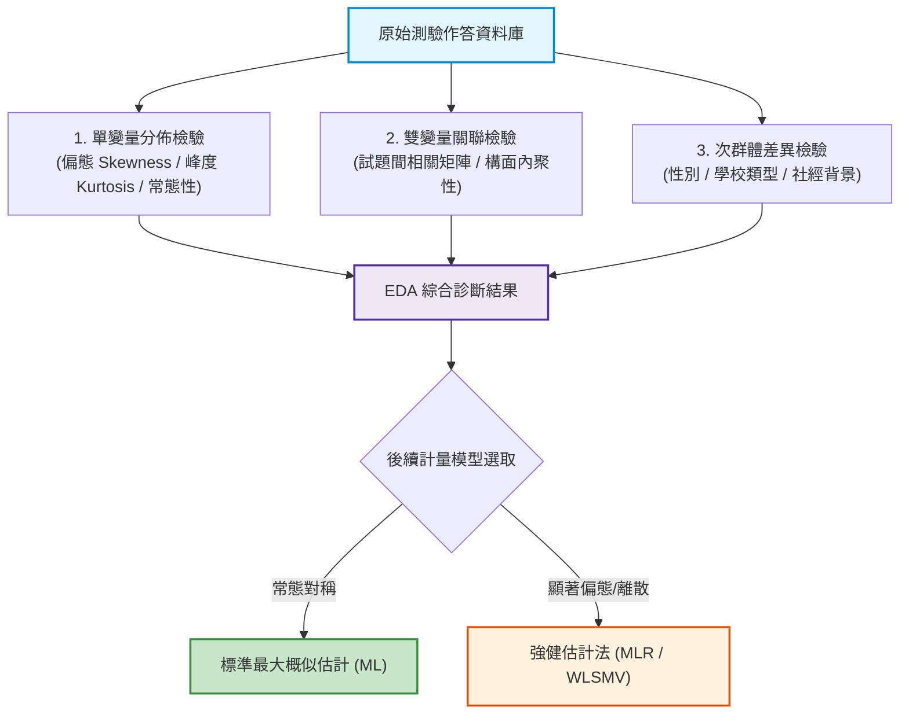

# 第 6 章：探索性測驗資料分析 (EDA) 與 APA 視覺化

> **本章目標**：介紹探索性資料分析（EDA）（Tukey, 1977）方法與美國心理學會第 7 版圖表規範（American Psychological Association, 2020）。掌握自訂 `ggplot2` 主題（Wickham, 2016）、使用 `patchwork` 組合多面板複合圖，並繪製測驗總分分佈、Q-Q 常態檢驗圖與試題相關矩陣熱圖。

---

## 6.1 理論基礎：EDA 在心理計量中的診斷價值與 APA 7th 規範

在建立測驗模型（如因素分析或 IRT）之前，需先進行**探索性資料分析（Exploratory Data Analysis, EDA）**（Tukey, 1977）。



### 6.1.1 圖表清晰度與 APA 第七版呈現提醒

American Psychological Association（2020）第 7 版規範的是論文圖表的編號、標題、圖說與註記等呈現方式，並未規定特定的 `ggplot2` 主題或固定字級。以下是本書採用的清晰度設計原則，不應解讀為 APA 的逐條官方規定；正式稿仍須依出版格式安排圖號、標題與註記。

1. **無雜亂格線**：移除深色背景與多餘縱橫格線（保留簡潔軸線）。
2. **標題資訊完整**：圖題需清楚描述圖表內容；圖號、標題及圖說依出版格式放置，不以圖內標題取代正式圖題。
3. **字體大小階層化**：圖中文字應易讀，實際字級依版面尺寸與出版格式調整。
4. **色票具備高對比度且對色盲友善**：優先採用 Viridis 或 ColorBrewer 調和色。
5. **底部附註（Note）**：清楚交代樣本數（$N$）、資料來源與指標簡寫定義。

---

## 6.2 評量實務情境：封裝專屬 `theme_apa_measurement()` 主題

為了避免在每次呼叫 `ggplot()` 時重複撰寫冗長的 `theme()` 程式碼，我們封裝一個可全局重用的 APA 測驗專用主題：

```r
# ==============================================================================
# 第 6 章程式碼清單 6.1：封裝符合 APA 7th 規範的測驗專用 ggplot2 主題
# ==============================================================================

library(ggplot2)

#' APA 7th 測驗統計專用主題
#'
#' @param base_size 基礎字體大小 (預設 12)
#' @param base_family 基礎字型家族
#' @return ggplot2 theme 物件
theme_apa_measurement <- function(base_size = 12, base_family = "") {
  theme_classic(base_size = base_size, base_family = base_family) %+replace%
    theme(
      # 圖表標題與副標題 (APA 規範置頂加粗)
      plot.title = element_text(
        size = rel(1.15), face = "bold", hjust = 0,
        margin = margin(b = 4)
      ),
      plot.subtitle = element_text(
        size = rel(0.95), color = "grey30", hjust = 0,
        margin = margin(b = 10)
      ),
      plot.caption = element_text(
        size = rel(0.8), color = "grey40", hjust = 0,
        margin = margin(t = 10)
      ),
      # 座標軸線與標籤
      axis.title = element_text(size = rel(0.95), face = "bold", color = "black"),
      axis.text = element_text(size = rel(0.85), color = "black"),
      axis.line = element_line(color = "black", linewidth = 0.5),
      # 圖例 (預設置底以擴展繪圖橫寬)
      legend.position = "bottom",
      legend.title = element_text(size = rel(0.9), face = "bold"),
      legend.text = element_text(size = rel(0.85)),
      legend.background = element_blank(),
      # 面板留白邊界
      plot.margin = margin(12, 12, 12, 12)
    )
}

cat("已載入 theme_apa_measurement() 主題\n")
```

---

## 6.3 現代 R 語言程式實作：複合分佈檢驗面板（Histogram + Q-Q Plot）

我們使用 `patchwork` 套件，將「總分直方圖與常態密度曲線」與「分位數常態檢驗 Q-Q 圖」水平拼合成一張專業複合圖：

```r
# ==============================================================================
# 第 6 章程式碼清單 6.2：繪製測驗總分常態分佈與 Q-Q 檢驗複合面板
# ==============================================================================

library(dplyr)
library(patchwork)

# 讀取示範資料集
df_all <- read.csv("book/data/assessment_data.csv")

# 1. 計算偏態與峰度 (使用 psych 套件)
skew_val <- psych::skew(df_all$total_score)
kurt_val <- psych::kurtosi(df_all$total_score)

# 2. 面板 A：總分直方圖疊加常態分佈曲線
p_hist <- ggplot(df_all, aes(x = total_score)) +
  geom_histogram(
    aes(y = after_stat(density)),
    binwidth = 1, fill = "#2b5c8f", color = "white", alpha = 0.8
  ) +
  stat_function(
    fun = dnorm,
    args = list(mean = mean(df_all$total_score), sd = sd(df_all$total_score)),
    color = "#d95f02", linewidth = 1.1, linetype = "solid"
  ) +
  labs(
    title = "Panel A: 總分頻次分佈與常態擬合曲線",
    subtitle = sprintf("Skewness = %.2f, Kurtosis = %.2f", skew_val, kurt_val),
    x = "測驗總分 (Raw Score)",
    y = "機率密度 (Density)"
  ) +
  scale_x_continuous(breaks = seq(0, 15, by = 2)) +
  theme_apa_measurement()

# 3. 面板 B：常態 Q-Q 圖 (檢驗尾端偏離)
p_qq <- ggplot(df_all, aes(sample = total_score)) +
  stat_qq(color = "#2b5c8f", alpha = 0.6, size = 1.5) +
  stat_qq_line(color = "#d95f02", linewidth = 1.0, linetype = "dashed") +
  labs(
    title = "Panel B: 常態性 Q-Q 檢定圖",
    subtitle = "觀測值點緊貼虛線即符合常態分配",
    x = "理論分位數 (Theoretical Quantiles)",
    y = "樣本分位數 (Sample Quantiles)"
  ) +
  theme_apa_measurement()

# 4. 使用 patchwork 拼接雙面板
p_combined_norm <- p_hist + p_qq +
  plot_annotation(
    title = "Figure 6.1: 全國學力檢測認知測驗總分常態性診斷複合圖",
    subtitle = "N = 1,000 位受試者，呈現總分之偏度、峰度與理論常態分佈之吻合度",
    caption = "Note. 紅色實線為理論常態密度曲線；虛線為 Q-Q 基準參考線。",
    theme = theme(
      plot.title = element_text(face = "bold", size = 14),
      plot.subtitle = element_text(color = "grey30", size = 11)
    )
  )

ggsave("book/fig_6_1_normality_diagnostics.png", plot = p_combined_norm, width = 10, height = 4.8, dpi = 300)
cat("成功產出圖表: book/fig_6_1_normality_diagnostics.png\n")
```

---

## 6.4 現代 R 語言程式實作：試題間皮爾森相關矩陣熱圖（Heatmap）

試題相關矩陣可作為因素分析前的探索工具。正相關有助於檢視題項是否共享變異，但相關係數落在特定區間並不足以證明單向度；仍須搭配理論、因素分析與其他模型診斷。負相關則值得檢查反向題重編碼、資料編碼及題意，但不必然代表資料錯誤。

```r
# ==============================================================================
# 第 6 章程式碼清單 6.3：試題相關矩陣熱圖繪製
# ==============================================================================

library(tidyr)
library(tibble)

# 提取 15 道題目計算 Pearson 相關矩陣 (使用 pairwise 排除 NA)
cog_items <- df_all |> select(item_01:item_15)
cor_mat <- cor(cog_items, use = "pairwise.complete.obs")

# 轉化為整潔長格式以利 ggplot2 繪製
cor_df <- as.data.frame(cor_mat) |>
  rownames_to_column(var = "Item_A") |>
  pivot_longer(
    cols = -Item_A,
    names_to = "Item_B",
    values_to = "Correlation"
  ) |>
  mutate(
    # 格式化數值保留兩位小數
    label_text = sprintf("%.2f", Correlation),
    # 題號有序化
    Item_A = factor(Item_A, levels = sprintf("item_%02d", 1:15)),
    Item_B = factor(Item_B, levels = sprintf("item_%02d", 15:1)) # 逆序使對角線方向端正
  )

# 繪製相關矩陣熱圖
p_heat <- ggplot(cor_df, aes(x = Item_A, y = Item_B, fill = Correlation)) +
  geom_tile(color = "white", linewidth = 0.4) +
  geom_text(aes(label = label_text), size = 2.4, color = "black") +
  scale_fill_gradient2(
    low = "#2166ac", mid = "#f7f7f7", high = "#b2182b",
    midpoint = 0, limits = c(-0.2, 1.0),
    name = "相關係數 (r)"
  ) +
  labs(
    title = "Figure 6.2: 15 道認知測驗試題間皮爾森相關係數熱圖 (Inter-Item Correlation Matrix)",
    subtitle = "呈現試題間之二元相關矩陣，對角線為自相關 (r = 1.00)",
    x = "試題編號 (Item)",
    y = "試題編號 (Item)",
    caption = "Note. Educational Assessment Item Database simulation."
  ) +
  theme_apa_measurement() +
  theme(
    axis.text.x = element_text(angle = 45, hjust = 1),
    legend.position = "right",
    legend.key.height = unit(1.2, "cm")
  )

ggsave("book/fig_6_2_correlation_heatmap.png", plot = p_heat, width = 8.5, height = 7, dpi = 300)
cat("成功產出圖表: book/fig_6_2_correlation_heatmap.png\n")
```

---

## 6.5 測驗報告專業解讀（Substantive Interpretation）

依據 American Psychological Association（2020）規範，EDA 的統計圖表應搭配對應的統計描述與文字詮釋：

> ### 📝 心理計量 EDA 診斷結論
> 1. **常態性評估**：總分偏度為 $0.03$，峰度為 $-1.00$，其中 `psych::kurtosi()`（Revelle, 2026）回傳超額峰度。分佈大致對稱但較常態分配平坦，峰度落在常見的 $\pm 1$ 經驗範圍邊界上（Curran et al., 1996）；Q-Q 圖兩端若偏離基準線，後續 CFA 可考慮採用 MLR 等穩健估計。
> 2. **試題關聯內聚性**：如圖 6.2 所示，15 道認知題之間多為正相關，未見負相關；這表示題目間存在共享變異，但不能單憑相關矩陣確認單向度。是否適合進行 Rasch／2PL IRT 建模，仍須檢查因素結構、局部獨立性及模型適配度。

---

## 6.6 章末實務習題與專案挑戰

### 【基礎練習題】
1. 請使用 `psych::describe()` 批次產出 `assessment_data.csv` 中前 5 題情意量表（`scale_01` 至 `scale_05`）的平均數、標準差、中位數、偏態與峰度彙整表。
2. 請利用 `patchwork` 套件，將圖 6.1 中的 Panel A 與 Panel B 由「水平左右排列」改為「垂直上下堆疊」，並調整圖寬與圖高以維持出版比例。

### 【進階工程挑戰】
3. 撰寫一個高階自訂繪圖函數 `plot_subgroup_density(df, score_col, group_col)`。該函數接收任意資料框、成績欄位名與分組欄位名（如性別或學校類型），以 `ggplot2` 半透明填色繪製不同組別的重疊密度分佈曲線（Overlapping Density Plot），並自動計算各組之 Cohen's $d$ 效果量（Cohen, 1988）標註於圖表副標題上。

---

### 💡 習題參考解答

```r
# ==============================================================================
# 第 6 章習題解答參考
# ==============================================================================

# 第 1 題
library(psych)
df_all <- read.csv("book/data/assessment_data.csv")
scale_desc <- describe(df_all[, sprintf("scale_%02d", 1:5)])
print(scale_desc[, c("n", "mean", "sd", "median", "skew", "kurtosis")])

# 第 3 題解答
plot_subgroup_density <- function(df, score_col, group_col) {
  # 計算兩組 Cohen's d
  scores <- df[[score_col]]
  groups <- factor(df[[group_col]])
  levels_g <- levels(groups)
  s1 <- scores[groups == levels_g[1]]
  s2 <- scores[groups == levels_g[2]]
  d_val <- (mean(s1, na.rm = TRUE) - mean(s2, na.rm = TRUE)) /
           sqrt((var(s1, na.rm = TRUE) + var(s2, na.rm = TRUE)) / 2)

  ggplot(df, aes(x = .data[[score_col]], fill = .data[[group_col]])) +
    geom_density(alpha = 0.5, color = "white") +
    scale_fill_manual(values = c("#2b5c8f", "#d95f02")) +
    labs(
      title = sprintf("組別分佈對比: %s vs %s", levels_g[1], levels_g[2]),
      subtitle = sprintf("Cohen's d 效果值: %.3f", d_val),
      x = score_col, y = "密度"
    ) +
    theme_classic()
}
cat("分組密度繪圖函數編寫完成。\n")
```

---

## 參考文獻 (References)

American Psychological Association. (2020). *Publication manual of the American Psychological Association* (7th ed.). https://doi.org/10.1037/0000165-000

Cohen, J. (1988). *Statistical power analysis for the behavioral sciences* (2nd ed.). Lawrence Erlbaum Associates.

Curran, P. J., West, S. G., & Finch, J. F. (1996). The robustness of test statistics to nonnormality and specification error in confirmatory factor analysis. *Psychological Methods*, *1*(1), 16–29. https://doi.org/10.1037/1082-989X.1.1.16

Revelle, W. (2026). *psych: Procedures for psychological, psychometric, and personality research* (R package version 2.6.4) [Computer software]. The Comprehensive R Archive Network. https://CRAN.R-project.org/package=psych

Tukey, J. W. (1977). *Exploratory data analysis*. Addison-Wesley.

Wickham, H. (2016). *ggplot2: Elegant graphics for data analysis* (2nd ed.). Springer. https://doi.org/10.1007/978-3-319-24277-4
