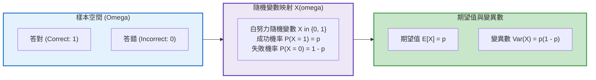

# 第 7 章：測驗統計的機率論基石與隨機模擬

> **本章目標**：根據陳旭昇（2019）與 DeGroot 與 Schervish（2012）的機率論架構。從隨機變數、機率質量函數（PMF）、二項分配與常態分配出發，透過 R 語言蒙地卡羅模擬（Metropolis & Ulam, 1949），檢驗大數法則（LLN）與中央極限定理（CLT）在測驗總分分佈上的表現（Lord & Novick, 1968）。

---

## 7.1 理論基礎：測驗情境中的機率空間與隨機變數

在現代教育與心理測驗中，任何一個受試者的作答反應均被視為一個**隨機變數（Random Variable）**（Lord & Novick, 1968；陳旭昇，2019）。



### 7.1.1 二項分配（Binomial Distribution）在選擇題計分中的本質
設一份測驗包含 $J$ 道獨立的四選一單選題，若某位考生完全不具備該領域能力，全憑隨機猜測（猜對機率 $p = .25$）。其猜對總題數 $X$ 服從二項分配：
$$X \sim \text{Binomial}(J, p)$$
其機率質量函數（Probability Mass Function, PMF）為：
$$P(X = k) = \binom{J}{k} p^k (1 - p)^{J - k}, \quad k = 0, 1, \dots, J$$

其理論期望值與變異數分別為：
$$E(X) = J \cdot p, \quad \text{Var}(X) = J \cdot p(1 - p)$$

---

## 7.2 評量實務情境：隨機猜測通過測驗的機率有多大？

在標準化測驗中，常見 20 題四選一選擇題（及格標準為答對 12 題，即 $60\%$）。

許多家長或教師常有疑慮：「完全不念書的學生會不會憑運氣猜到及格？」透過 R 語言的累積機率函數 `pbinom()`，可以計算此事件的機率：

```r
# ==============================================================================
# 第 7 章程式碼清單 7.1：二項分配猜測機率精確計算
# ==============================================================================

J_items <- 20       # 總題數
p_guess <- 0.25     # 四選一隨機猜對機率
pass_cutoff <- 12   # 及格門檻 (答對 >= 12 題)

# 1. 期望猜對題數與標準差
mu_guess <- J_items * p_guess
sd_guess <- sqrt(J_items * p_guess * (1 - p_guess))
cat(sprintf("20 題隨機猜測之期望答對題數: %.1f 題 (標準差: %.2f 題)\n", mu_guess, sd_guess))

# 2. 計算猜對 12 題以上的機率 P(X >= 12) = 1 - P(X <= 11)
prob_pass_by_guess <- pbinom(pass_cutoff - 1, size = J_items, prob = p_guess, lower.tail = FALSE)

cat(sprintf("純憑隨機猜測達到及格 (>= 12 題) 的極端機率為: %.6f (約 %.4f%%)\n",
            prob_pass_by_guess, prob_pass_by_guess * 100))
# 約 0.0935%；不是 0.0009%
```

---

## 7.3 數理模擬：中央極限定理（CLT）如何支撐測驗總分常態假定

心理計量學常用的定理之一是**中央極限定理（Central Limit Theorem, CLT）**（DeGroot & Schervish, 2012；陳旭昇，2019）：

> **定理陳述**：設受試者在各試題上的作答反應 $X_1, X_2, \dots, X_J$ 為獨立同分佈（或弱相依）之隨機變數，其平均數為 $\mu_j$、變異數為 $\sigma_j^2$。當測驗題數 $J$ 充分大時，考生的總分 $S_J = \sum_{j=1}^J X_j$ 之抽樣分佈將漸近收斂於常態分配：
> $$S_J \xrightarrow{d} \mathcal{N}\left(\sum_{j=1}^J \mu_j, \sum_{j=1}^J \sigma_j^2\right)$$

我們使用蒙地卡羅法（Metropolis & Ulam, 1949）模擬：即使每題的通過率呈現極端偏斜（例如困難的二元分佈），隨著測驗題數由 $5$ 題增加至 $40$ 題，總分分佈是如何逐漸接近常態分配。

```r
# ==============================================================================
# 第 7 章程式碼清單 7.2：中央極限定理（CLT）蒙地卡羅大規模模擬
# ==============================================================================

library(tibble)
library(dplyr)
library(purrr)

set.seed(2026)
n_sim_students <- 10000 # 模擬一萬名考生
item_lengths <- c(5, 10, 20, 40)

# 模擬極端偏斜題庫 (平均通過率僅 0.20 的困難試題)
clt_sim_results <- item_lengths |>
  map(\(J) {
    # 每一位考生隨機作答 J 題
    scores <- rbinom(n = n_sim_students, size = J, prob = 0.20)
    # 標準化為 Z 分數
    z_scores <- (scores - mean(scores)) / sd(scores)
    tibble(
      num_items = sprintf("題數 J = %02d", J),
      raw_score = scores,
      z_score = z_scores
    )
  }) |>
  list_rbind()

cat("CLT 模擬完成，總筆數:", nrow(clt_sim_results), "\n")
```

---

## 7.4 視覺化：二項分佈質量圖與 CLT 漸進收斂面板

我們結合兩張專業圖表，展示機率理論在測驗統計中的具體視覺呈現：

```r
# ==============================================================================
# 第 7 章程式碼清單 7.3：二項猜測分佈與 CLT 收斂繪圖
# ==============================================================================

library(ggplot2)

# 1. 繪製 20 題隨機猜測之二項機率質量分佈圖 (PMF)
binom_df <- tibble(
  k = 0:20,
  prob = dbinom(k, size = 20, prob = 0.25),
  is_pass = k >= 12
)

p_binom <- ggplot(binom_df, aes(x = k, y = prob, fill = is_pass)) +
  geom_col(width = 0.7, color = "black", linewidth = 0.3) +
  scale_fill_manual(
    name = "及格判定",
    values = c("FALSE" = "#2b5c8f", "TRUE" = "#d95f02"),
    labels = c("FALSE" = "不及格 (< 12 題)", "TRUE" = "及格 (>= 12 題)")
  ) +
  scale_x_continuous(breaks = 0:20) +
  scale_y_continuous(labels = scales::percent_format(accuracy = 1)) +
  labs(
    title = "Figure 7.1: 20 題四選一選擇題「隨機純猜測」之二項機率質量分佈 (Binomial PMF)",
    subtitle = "期望猜對 5 題；及格門檻 (>= 12 題) 位於右側極端尾部 (機率趨近於零)",
    x = "猜對題數 (Number of Correct Guesses: k)",
    y = "理論機率 (Probability)",
    caption = "Binomial Parameters: J = 20, p = 0.25"
  ) +
  theme_classic(base_size = 12) +
  theme(
    legend.position = "bottom",
    plot.title = element_text(face = "bold", size = 13)
  )

ggsave("book/fig_7_1_binomial_pmf.png", plot = p_binom, width = 8, height = 4.8, dpi = 300)
cat("成功產出圖表: book/fig_7_1_binomial_pmf.png\n")

# 2. 繪製 CLT 隨測驗題數增加向常態收斂之多面分佈圖 (Faceting)
p_clt <- ggplot(clt_sim_results, aes(x = z_score)) +
  geom_histogram(
    aes(y = after_stat(density)),
    bins = 30, fill = "#2b5c8f", color = "white", alpha = 0.75
  ) +
  stat_function(
    fun = dnorm, args = list(mean = 0, sd = 1),
    color = "#d95f02", linewidth = 1.0, linetype = "solid"
  ) +
  facet_wrap(~num_items, nrow = 2) +
  labs(
    title = "Figure 7.2: 測驗題數對總分常態收斂性之中央極限定理 (CLT) 模擬檢驗",
    subtitle = "紅色實線為標準常態分佈 N(0, 1) 理論曲線；隨題數由 5 題增至 40 題，分佈逐漸趨近常態",
    x = "標準化分數 (Z-Score)",
    y = "機率密度 (Density)",
    caption = "Simulation: N = 10,000 examinees per condition, Item difficulty p = 0.20"
  ) +
  theme_classic(base_size = 12) +
  theme(
    strip.background = element_rect(fill = "#f0f0f0", color = "black"),
    strip.text = element_text(face = "bold", size = 11),
    plot.title = element_text(face = "bold", size = 13)
  )

ggsave("book/fig_7_2_clt_convergence.png", plot = p_clt, width = 8.5, height = 6, dpi = 300)
cat("成功產出圖表: book/fig_7_2_clt_convergence.png\n")
```

---

## 7.5 測驗報告專業解讀（Substantive Interpretation）

依據機率論與大數法則，評量專家可對測驗效度提出關鍵保證：

> ### ⚖️ 評量命題之機率論指針
> 1. **測驗長度（Test Length）與常態穩定性**：如圖 7.2 所示，當測驗題數少於 $10$ 題時，總分呈現明顯的離散與右偏；題數增至 40 題時，分佈已接近常態。此模擬支持「題數較多時常態近似較合理」，但所需題數仍取決於試題難度分佈與用途，不宜以單一題數作為通則。
> 2. **選擇題猜測機率**：在題目彼此獨立、每題猜對率皆為 $0.25$ 的假設下，20 題四選一測驗純猜達到 12 題的機率約為 $0.0935\%$。這項計算可作為風險資訊之一，但不能單獨決定及格標準；實際標準仍須依測驗目的與標準設定程序建立。

---

## 7.6 章末實務習題與專案挑戰

### 【基礎練習題】
1. 某證照考試包含 40 題五選一選擇題（猜對率 $p = .20$）。請計算：考生完全隨機猜測時，答對題數剛好等於 8 題的精確機率，以及答對題數大於等於 24 題（及格）的累積機率。
2. 試使用 `rnorm()` 生成 1,000 個服從常態分佈 $\mathcal{N}(70, 10^2)$ 的成績樣本，並計算其樣本平均數與樣本標準差，驗證是否符合母體參數。

### 【進階工程挑戰】
3. 撰寫一個名為 `simulate_mastery_probability(n_items, p_cut, guess_prob = 0.25, n_reps = 50000)` 的蒙地卡羅估算函數，模擬 $50,000$ 名未具備相關能力的猜測考生，精確計算其在給定題數與及格門檻下「誤判及格（False Mastery Rate / Type I Error）」的機率，並回傳結構化報表。

---

### 💡 習題參考解答

```r
# ==============================================================================
# 第 7 章習題解答參考
# ==============================================================================

# 第 1 題
prob_exact_8 <- dbinom(8, size = 40, prob = 0.20)
prob_pass_24 <- pbinom(23, size = 40, prob = 0.20, lower.tail = FALSE)
cat(sprintf("40 題猜對剛好 8 題機率: %.4f\n", prob_exact_8))
cat(sprintf("40 題猜到及格 (>=24 題) 機率: %.10f\n", prob_pass_24))

# 第 3 題解答
simulate_mastery_probability <- function(n_items, p_cut, guess_prob = 0.25, n_reps = 50000) {
  cutoff_items <- ceiling(n_items * p_cut)
  sim_scores <- rbinom(n_reps, size = n_items, prob = guess_prob)
  false_mastery_count <- sum(sim_scores >= cutoff_items)
  false_mastery_rate <- false_mastery_count / n_reps
  
  tibble::tibble(
    Total_Items = n_items,
    Cutoff_Score = cutoff_items,
    Cutoff_Percent = p_cut,
    Simulated_Type_I_Error = false_mastery_rate
  )
}
print(simulate_mastery_probability(n_items = 30, p_cut = 0.60))
```

---

## 參考文獻 (References)

陳旭昇（2019）。**機率與統計推論：R 語言的應用**。東華書局。

DeGroot, M. H., & Schervish, M. J. (2012). *Probability and statistics* (4th ed.). Addison-Wesley.

Lord, F. M., & Novick, M. R. (1968). *Statistical theories of mental test scores*. Addison-Wesley.

Metropolis, N., & Ulam, S. (1949). The Monte Carlo method. *Journal of the American Statistical Association*, *44*(247), 335–341. https://doi.org/10.1080/01621459.1949.10483310
