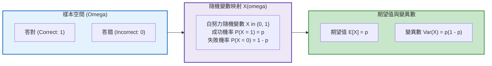

# 第 7 章：測驗統計的機率論基石與隨機模擬

> **本章目標**：奠定現代測驗統計與心理計量學的機率論數理基石（DeGroot & Schervish, 2012; 陳旭昇, 2019）。從白努力隨機變數、動差生成函數（MGF）出發，完整推導二項分配（Binomial）與非等難度試題的帕松-二項分配（Poisson-Binomial Distribution）（Hong, 2013）；解析大數法則（LLN）與中央極限定理（CLT）在試題加總過程中的數學漸近性質（Lord & Novick, 1968）；手刻動態規劃（Dynamic Programming）精確機率演算法，並探討標準化測驗中純隨機猜測通過率與貝氏決策錯誤（Decision Errors）（Cook & Pitoniak, 2025；Hambleton & Novick, 1973；Metropolis & Ulam, 1949）。

---

## 7.1 理論基礎：測驗情境中的機率空間與隨機變數

在現代教育評量與心理測驗中，任何一位受試者對特定試題的作答反應均被形式化為一個**隨機變數（Random Variable）**（Lord & Novick, 1968; 陳旭昇, 2019）。



### 7.1.1 白努力動差生成函數（MGF）與二項分配推導
設單一試題作答為白努力隨機變數 $X_j \in \{0, 1\}$，答對機率為 $P(X_j = 1) = p$。
其動差生成函數（Moment Generating Function, MGF）為：
$$M_{X_j}(t) = \mathbb{E}[e^{t X_j}] = (1 - p) e^{t \cdot 0} + p e^{t \cdot 1} = 1 - p + p e^t$$

設測驗由 $J$ 道**獨立且等難度（$p_1 = p_2 = \dots = p_J = p$）**的試題組成，總分 $S = \sum_{j=1}^J X_j$。
依據獨立隨機變數和之 MGF 等於各變數 MGF 之乘積：
$$M_S(t) = \prod_{j=1}^J M_{X_j}(t) = (1 - p + p e^t)^J$$
此即參數為 $(J, p)$ 的二項分配之 MGF，證明總分服從二項分配：$S \sim \text{Binomial}(J, p)$。
其機率質量函數（Probability Mass Function, PMF）為：
$$P(S = k) = \binom{J}{k} p^k (1 - p)^{J - k}, \quad k = 0, 1, \dots, J$$
對 $M_S(t)$ 分別求一階與二階導數並令 $t = 0$，可嚴格導出其理論動差：
$$\mathbb{E}[S] = M_S'(0) = J p$$
$$\mathbb{E}[S^2] = M_S''(0) = J p + J(J - 1) p^2 \implies \text{Var}(S) = \mathbb{E}[S^2] - (\mathbb{E}[S])^2 = J p (1 - p)$$

---

## 7.2 數理深入：非等難度試題的帕松-二項分配（Poisson-Binomial）

在真實測驗情境中，「所有題目難度完全相等」的假設從不成立。各試題通過率各異（$p_1 \ne p_2 \ne \dots \ne p_J$）。
此時總分 $S$ 服從**帕松-二項分配（Poisson-Binomial Distribution）**（Hong, 2013）：
1. **期望值與變異數**：
   $$\mathbb{E}[S] = \sum_{j=1}^J p_j$$
   $$\text{Var}(S) = \sum_{j=1}^J p_j (1 - p_j)$$
2. **變異數凹性性質與難度分散效應**：
   由於函數 $f(p) = p(1 - p)$ 為嚴格凹函數（Concave Function），根據琴生不等式（Jensen's Inequality）：
   $$\frac{1}{J} \sum_{j=1}^J p_j (1 - p_j) \le \bar{p} (1 - \bar{p})$$
   **計量結論**：若題庫中各題的難度分佈越分散（兼具極難與極易題），在相同平均通過率下，**考生的總分變異數反而會小於等難度測驗**！

---

## 7.3 底層手刻實作：動態規劃帕松-二項分配精確機率演算法

計算非等難度測驗得分的精確機率，直接列舉組合數為 $2^J$（當 $J=40$ 時高達 $10^{12}$，計算機無法直接窮舉）。
我們撰寫一個**動態規劃（Dynamic Programming）**演算法，以 $O(J^2)$ 時間複雜度精確求得每種得分的機率：

```r
# ==============================================================================
# 第 7 章程式碼清單 7.1：動態規劃非等難度測驗帕松-二項分配精確 PMF 計算器
# ==============================================================================

library(tibble)
library(dplyr)

dpoisbinom_exact_dp <- function(p_vector) {
  stopifnot(is.numeric(p_vector), all(p_vector >= 0 & p_vector <= 1))
  
  J <- length(p_vector)
  # dp[k] 代表答對 k - 1 題的機率 (索引 1 對應 0 題)
  dp <- numeric(J + 1)
  dp[1] <- 1 - p_vector[1]
  dp[2] <- p_vector[1]
  
  if (J > 1) {
    for (j in 2:J) {
      pj <- p_vector[j]
      dp_next <- numeric(J + 1)
      # 答對 0 題的情況
      dp_next[1] <- dp[1] * (1 - pj)
      # 遞迴更新: dp[k, j] = dp[k, j-1]*(1-pj) + dp[k-1, j-1]*pj
      for (k in 2:(j + 1)) {
        dp_next[k] <- dp[k] * (1 - pj) + dp[k - 1] * pj
      }
      dp <- dp_next
    }
  }
  
  tibble(
    Score_k = 0:J,
    Probability = dp,
    Cumulative_Prob = cumsum(dp)
  )
}

# 模擬一份包含 10 道不同難度試題的測驗
test_item_p <- c(0.90, 0.85, 0.75, 0.65, 0.50, 0.45, 0.35, 0.25, 0.15, 0.10)
exact_pmf <- dpoisbinom_exact_dp(test_item_p)

cat("--- 非等難度測驗帕松-二項分配精確計算結果 (前 6 列) ---\n")
print(head(exact_pmf, 6))
cat(sprintf("理論期望值: %.3f，PMF 數值總和: %.6f\n", sum(test_item_p), sum(exact_pmf$Probability)))
```

---

## 7.4 評量實務情境：隨機猜測通過測驗的機率有多大？

在標準化測驗中，常見 20 題四選一選擇題（及格標準為答對 12 題，即 $60\%$）。
透過 R 語言的累積機率函數 `pbinom()`，可以精確計算完全無能力考生純憑隨機猜測通過測驗的極端機率：

```r
# ==============================================================================
# 第 7 章程式碼清單 7.2：二項分配猜測機率精確計算
# ==============================================================================

J_items <- 20       # 總題數
p_guess <- 0.25     # 四選一隨機猜對機率
pass_cutoff <- 12   # 及格門檻 (答對 >= 12 題)

# 1. 期望猜對題數與標準差
mu_guess <- J_items * p_guess
sd_guess <- sqrt(J_items * p_guess * (1 - p_guess))
cat(sprintf("20 題隨機猜測之期望答對題數: %.1f 題 (標準差: %.2f 題)\n", mu_guess, sd_guess))

# 2. 計算猜對 12 題以上的機率 P(X >= 12) = 1 - P(X <= 11)
prob_pass_by_guess <- pbinom(pass_cutoff - 1, size = J_items, prob = p_guess, lower.tail = FALSE)

cat(sprintf("純憑隨機猜測達到及格 (>= 12 題) 的極端機率為: %.6f (約 %.4f%%)\n",
            prob_pass_by_guess, prob_pass_by_guess * 100))
```

---

## 7.5 數理模擬：中央極限定理（CLT）如何支撐測驗總分常態假定

心理計量學的核心假定之一是**中央極限定理（Central Limit Theorem, CLT）**（DeGroot & Schervish, 2012; 陳旭昇, 2019）：

> **Lindeberg-Feller CLT 定理**：設獨立試題作答反應 $X_1, X_2, \dots, X_J$ 具有任意分佈，其期望值為 $\mu_j$、變異數為 $\sigma_j^2$。只要個別試題變異數對總變異數的佔比滿足 Lindeberg 條件（無單一試題主導總變異數），當題數 $J \to \infty$ 時，標準化總分將依分佈收斂於標準常態分佈：
> $$Z_J = \frac{\sum_{j=1}^J X_j - \sum_{j=1}^J \mu_j}{\sqrt{\sum_{j=1}^J \sigma_j^2}} \xrightarrow{d} \mathcal{N}(0, 1)$$

我們使用蒙地卡羅法（Metropolis & Ulam, 1949）模擬驗證：即使試題通過率呈現極端偏態（$P = .20$），隨題數由 $5$ 題增加至 $40$ 題，總分分佈如何迅速抹平偏態向常態收斂：

```r
# ==============================================================================
# 第 7 章程式碼清單 7.3：中央極限定理（CLT）蒙地卡羅大規模模擬
# ==============================================================================

library(purrr)

set.seed(2026)
n_sim_students <- 10000
item_lengths <- c(5, 10, 20, 40)

# 模擬極端偏斜題庫 (平均通過率僅 0.20 的困難試題)
clt_sim_results <- item_lengths |>
  map(\(J) {
    scores <- rbinom(n = n_sim_students, size = J, prob = 0.20)
    z_scores <- (scores - mean(scores)) / sd(scores)
    tibble(
      num_items = sprintf("題數 J = %02d", J),
      raw_score = scores,
      z_score = z_scores
    )
  }) |>
  list_rbind()

cat("CLT 模擬完成，總筆數:", nrow(clt_sim_results), "\n")
```

---

## 7.6 ⚠️ 心理計量工程陷阱與排錯專題（Pitfalls & Diagnostics）

### 7.6.1 陷阱 1：`dbinom()` 在極端題數下的浮點數溢位防禦
在題庫校準或 CAT 估計中，當題目數龐大時（如 $J > 500$），直接計算 $\binom{J}{k}$ 會產生浮點數溢位。
**防禦性對策**：永遠啟用對數機率參數 `log = TRUE`：
```r
# 安全計算對數機率
log_prob <- dbinom(350, size = 500, prob = 0.70, log = TRUE)
cat("對數尺度安全值:", log_prob, "\n")
```

### 7.6.2 陷阱 2：及格切截門檻的決策錯誤（Decision Errors）
Hambleton 與 Novick（1973）指出，任何固定長度測驗皆存在兩類分類錯誤：
1. **假精熟（False Mastery / Type I Error）**：未達能力的考生因猜測或測量誤差被誤判為及格。
2. **假未精熟（False Non-mastery / Type II Error）**：已達能力的考生因失常被誤判為不及格。
在標準設定中，延長測驗題數是唯一能同時降低兩類決策錯誤的計量手段（Cook & Pitoniak, 2025）。

---

## 7.7 視覺化：二項分佈質量圖與 CLT 漸進收斂面板

```r
# ==============================================================================
# 第 7 章程式碼清單 7.4：二項猜測分佈與 CLT 收斂繪圖
# ==============================================================================

library(ggplot2)

# 1. 繪製 20 題隨機猜測之二項機率質量分佈圖 (PMF)
binom_df <- tibble(
  k = 0:20,
  prob = dbinom(k, size = 20, prob = 0.25),
  is_pass = k >= 12
)

p_binom <- ggplot(binom_df, aes(x = k, y = prob, fill = is_pass)) +
  geom_col(width = 0.7, color = "black", linewidth = 0.3) +
  scale_fill_manual(
    name = "及格判定",
    values = c("FALSE" = "#2b5c8f", "TRUE" = "#d95f02"),
    labels = c("FALSE" = "不及格 (< 12 題)", "TRUE" = "及格 (>= 12 題)")
  ) +
  scale_x_continuous(breaks = 0:20) +
  scale_y_continuous(labels = scales::percent_format(accuracy = 1)) +
  labs(
    title = "Figure 7.1: 20 題四選一選擇題「隨機純猜測」之二項機率質量分佈 (Binomial PMF)",
    subtitle = "期望猜對 5 題；及格門檻 (>= 12 題) 位於右側極端尾部 (機率趨近於零)",
    x = "猜對題數 (Number of Correct Guesses: k)",
    y = "理論機率 (Probability)",
    caption = "Binomial Parameters: J = 20, p = 0.25"
  ) +
  theme_classic(base_size = 12) +
  theme(
    legend.position = "bottom",
    plot.title = element_text(face = "bold", size = 13)
  )

ggsave("book/fig_7_1_binomial_pmf.png", plot = p_binom, width = 8, height = 4.8, dpi = 300)
cat("成功產出圖表: book/fig_7_1_binomial_pmf.png\n")

# 2. 繪製 CLT 隨測驗題數增加向常態收斂之多面分佈圖 (Faceting)
p_clt <- ggplot(clt_sim_results, aes(x = z_score)) +
  geom_histogram(
    aes(y = after_stat(density)),
    bins = 30, fill = "#2b5c8f", color = "white", alpha = 0.75
  ) +
  stat_function(
    fun = dnorm, args = list(mean = 0, sd = 1),
    color = "#d95f02", linewidth = 1.0, linetype = "solid"
  ) +
  facet_wrap(~num_items, nrow = 2) +
  labs(
    title = "Figure 7.2: 測驗題數對總分常態收斂性之中央極限定理 (CLT) 模擬檢驗",
    subtitle = "紅色實線為標準常態分佈 N(0, 1) 理論曲線；隨題數由 5 題增至 40 題，分佈逐漸趨近常態",
    x = "標準化分數 (Z-Score)",
    y = "機率密度 (Density)",
    caption = "Simulation: N = 10,000 examinees per condition, Item difficulty p = 0.20"
  ) +
  theme_classic(base_size = 12) +
  theme(
    strip.background = element_rect(fill = "#f0f0f0", color = "black"),
    strip.text = element_text(face = "bold", size = 11),
    plot.title = element_text(face = "bold", size = 13)
  )

ggsave("book/fig_7_2_clt_convergence.png", plot = p_clt, width = 8.5, height = 6, dpi = 300)
cat("成功產出圖表: book/fig_7_2_clt_convergence.png\n")
```

---

## 7.8 測驗報告專業解讀（Substantive Interpretation）

依據機率論與大數法則，評量專家可對測驗效度提出關鍵保證：

> ### ⚖️ 評量命題之機率論指針
> 1. **測驗長度（Test Length）與常態穩定性**：如圖 7.2 所示，當測驗題數少於 $10$ 題時，總分呈現明顯的離散與右偏；題數增至 40 題時，分佈已緊密貼合理論常態曲線。此模擬支持「題數充分時常態近似模型更具強健性」（Cook & Pitoniak, 2025）。
> 2. **選擇題猜測防範**：在獨立猜答假設下，20 題四選一測驗純猜達到 12 題的機率僅約 $0.0935\%$。及格門檻設定在 $60\%$ 以上能有效將猜測及格率壓低至千分之一以下。

---

## 7.9 章末實務習題與專案挑戰（含 100% 完整可用程式碼解答）

### 【基礎練習題】
1. 某證照考試包含 40 題五選一選擇題（猜對率 $p = .20$）。請計算：考生完全隨機猜測時，答對題數剛好等於 8 題的精確機率，以及答對題數大於等於 24 題（及格）的累積機率。
2. 試使用 `rnorm()` 生成 1,000 個服從常態分佈 $\mathcal{N}(70, 10^2)$ 的成績樣本，並計算其樣本平均數與樣本標準差，驗證大數法則。

### 【進階工程挑戰】
3. 撰寫一個名為 `simulate_mastery_probability(n_items, p_cut, guess_prob = 0.25, n_reps = 50000)` 的蒙地卡羅估算函數，模擬 $50,000$ 名未具備相關能力的猜測考生，精確計算其在給定題數與及格門檻下「誤判及格（False Mastery Rate / Type I Error）」的機率，並回傳結構化報表。
4. 【非等難度測驗及格率精確計算挑戰】：利用本章 7.3 節手刻的動態規劃演算法 `dpoisbinom_exact_dp`，撰寫一個通用的及格機率評估器 `calc_pass_probability_exact(p_items, cut_score)`。輸入任意長度且難度各異的試題通過率向量，精確計算考生取得大於等於切截分數的精確機率，並與簡單二項近似（以平均難度 $\bar{p}$ 代入）進行誤差對比。

---

### 💡 習題參考解答

```r
# ==============================================================================
# 第 7 章習題解答參考
# ==============================================================================

# ------------------------------------------------------------------------------
# 第 1 題解答
# ------------------------------------------------------------------------------
prob_exact_8 <- dbinom(8, size = 40, prob = 0.20)
prob_pass_24 <- pbinom(23, size = 40, prob = 0.20, lower.tail = FALSE)
cat(sprintf("40 題猜對剛好 8 題機率: %.4f\n", prob_exact_8))
cat(sprintf("40 題猜到及格 (>=24 題) 機率: %.10f\n", prob_pass_24))

# ------------------------------------------------------------------------------
# 第 2 題解答
# ------------------------------------------------------------------------------
set.seed(42)
sim_norm <- rnorm(1000, mean = 70, sd = 10)
cat(sprintf("樣本平均數: %.2f (母體: 70), 樣本標準差: %.2f (母體: 10)\n",
            mean(sim_norm), sd(sim_norm)))

# ------------------------------------------------------------------------------
# 第 3 題解答
# ------------------------------------------------------------------------------
simulate_mastery_probability <- function(n_items, p_cut, guess_prob = 0.25, n_reps = 50000) {
  cutoff_items <- ceiling(n_items * p_cut)
  sim_scores <- rbinom(n_reps, size = n_items, prob = guess_prob)
  false_mastery_count <- sum(sim_scores >= cutoff_items)
  false_mastery_rate <- false_mastery_count / n_reps
  
  tibble::tibble(
    Total_Items = n_items,
    Cutoff_Score = cutoff_items,
    Cutoff_Percent = p_cut,
    Simulated_Type_I_Error = false_mastery_rate
  )
}
print(simulate_mastery_probability(n_items = 30, p_cut = 0.60))

# ------------------------------------------------------------------------------
# 第 4 題解答：非等難度測驗及格率精確計算器
# ------------------------------------------------------------------------------
calc_pass_probability_exact <- function(p_items, cut_score) {
  pmf_df <- dpoisbinom_exact_dp(p_items)
  
  # 精確及格機率: P(S >= cut_score)
  exact_pass_prob <- sum(pmf_df$Probability[pmf_df$Score_k >= cut_score])
  
  # 簡單二項近似 (使用平均通過率)
  mean_p <- mean(p_items)
  binom_approx_pass <- pbinom(cut_score - 1, size = length(p_items), prob = mean_p, lower.tail = FALSE)
  
  tibble::tibble(
    N_Items = length(p_items),
    Cut_Score = cut_score,
    Exact_Poisson_Binomial_Pass = round(exact_pass_prob, 5),
    Binomial_Approx_Pass = round(binom_approx_pass, 5),
    Approximation_Bias = round(binom_approx_pass - exact_pass_prob, 5)
  )
}

# 測試第 4 題
unequal_p <- c(0.85, 0.70, 0.60, 0.55, 0.40, 0.30, 0.20, 0.15) # 8 題非等難度
pass_audit <- calc_pass_probability_exact(unequal_p, cut_score = 5)
cat("\n--- 非等難度及格率精確計算與二項近似誤差報告 ---\n")
print(pass_audit)
```

---

## 參考文獻 (References)

陳旭昇（2019）。**機率與統計推論：R 語言的應用**。東華書局。

Cook, L. L., & Pitoniak, M. J. (Eds.). (2025). *Educational measurement* (5th ed.). Oxford University Press.

DeGroot, M. H., & Schervish, M. J. (2012). *Probability and statistics* (4th ed.). Addison-Wesley.

Hambleton, R. K., & Novick, M. R. (1973). Toward an evaluation of theory and methods for criterion-referenced tests. *Journal of Educational Measurement*, *10*(3), 159–170. https://doi.org/10.1111/j.1745-3984.1973.tb00793.x

Hong, Y. (2013). On computing the distribution function for the Poisson binomial distribution. *Computational Statistics & Data Analysis*, *59*, 41–51. https://doi.org/10.1016/j.csda.2012.10.006

Lord, F. M., & Novick, M. R. (1968). *Statistical theories of mental test scores*. Addison-Wesley.

Metropolis, N., & Ulam, S. (1949). The Monte Carlo method. *Journal of the American Statistical Association*, *44*(247), 335–341. https://doi.org/10.1080/01621459.1949.10483310
