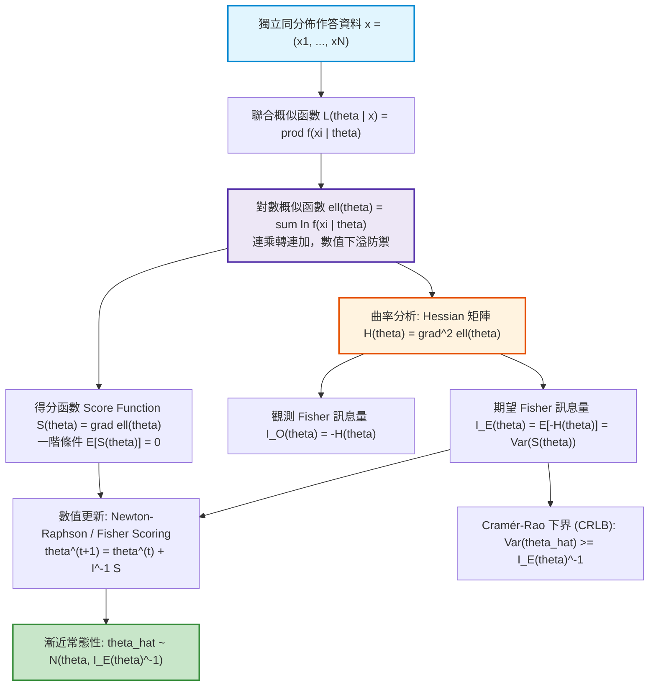
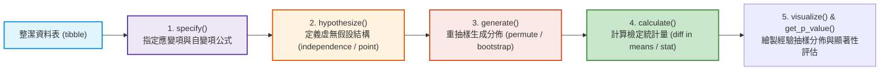
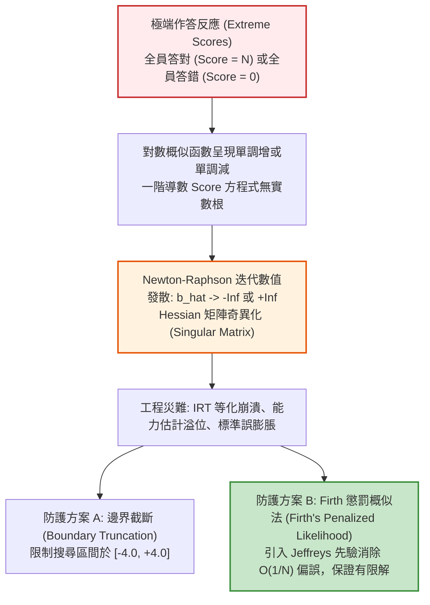

# 第 8 章：參數估計核心：最大概似法 (MLE) 與整潔統計推論

> **本章目標**：深入解析現代心理計量學與教育測驗統計之核心推論引擎——**最大概似估計（Maximum Likelihood Estimation, MLE）**與 **Fisher 訊息量（Information）**體系（Casella & Berger, 2002; Fisher, 1922; 陳旭昇, 2019）。從嚴格數理統計公理（Cramér-Rao 不等式、Taylor 二階展開、Score 函數與 Hessian 矩陣）出發，手刻 Newton-Raphson 與 Fisher Scoring 數值最佳化演算法；隨後銜接現代整潔推論典範，利用 `infer` 套件（Couch et al., 2021; Ismay et al., 2025）與電腦密集重抽樣（Bootstrap 與 Permutation Test）（Efron, 1979; Efron & Hastie, 2016），建構兼具數理深厚度與整潔工程彈性的評量推論架構。

---

## 8.1 數理推導：最大概似估計法（MLE）的公理體系與漸近理論

最大概似估計法（MLE）（Fisher, 1922）是現代心理計量學（如項目反應理論 IRT、結構方程模型 SEM 與認知診斷模型 CDM）的基石。理解 MLE 的數理結構，是洞悉測驗參數估計、誤差邊界與模型收斂診斷的先決條件（Casella & Berger, 2002; 陳旭昇, 2019）。



### 8.1.1 概似原理與對數概似函數

設觀測資料 $\mathbf{X} = (X_1, X_2, \dots, X_N)^T$ 為一組獨立同分佈（i.i.d.）之測驗作答向量，其聯合機率密度（或離散機率質量）函數為 $f(x \mid \boldsymbol{\theta})$，其中 $\boldsymbol{\theta} \in \boldsymbol{\Theta} \subseteq \mathbb{R}^p$ 為待估計之母體參數向量。

1. **聯合概似函數（Likelihood Function）**：
   在觀測到特定樣本實現值 $\mathbf{x}$ 後，定義參數空間上的概似函數為：
   $$L(\boldsymbol{\theta} \mid \mathbf{x}) = \prod_{i=1}^N f(x_i \mid \boldsymbol{\theta})$$

2. **對數概似函數（Log-Likelihood Function）**：
   由於對數變換為單調嚴格遞增函數，極大化概似函數等價於極大化對數概似函數：
   $$\ell(\boldsymbol{\theta}) = \ln L(\boldsymbol{\theta} \mid \mathbf{x}) = \sum_{i=1}^N \ln f(x_i \mid \boldsymbol{\theta})$$
   在計算機科學與數值分析中，對數變換將微小機率連乘積轉化為連加項，徹底防止浮點數下溢（Underflow）。

3. **得分函數（Score Function）與一階條件**：
   定義對數概似函數相對於參數的一階梯度向量為得分函數 $\mathbf{S}(\boldsymbol{\theta})$：
   $$\mathbf{S}(\boldsymbol{\theta}) \equiv \nabla_{\boldsymbol{\theta}} \ell(\boldsymbol{\theta}) = \sum_{i=1}^N \frac{\partial \ln f(x_i \mid \boldsymbol{\theta})}{\partial \boldsymbol{\theta}}$$
   最大概似估計量 $\hat{\boldsymbol{\theta}}_{\text{MLE}}$ 滿足得分方程式（Score Equation）：
   $$\mathbf{S}(\hat{\boldsymbol{\theta}}_{\text{MLE}}) = \mathbf{0}$$

### 8.1.2 數理證明：得分函數的期望值恆為零

在正則條件（Regularity Conditions）（積分與微分運算可自由交換順序）滿足的前提下，母體真值處的得分函數期望值為零（Casella & Berger, 2002; 陳旭昇, 2019）：

$$\begin{aligned}
\mathbb{E}[\mathbf{S}(\boldsymbol{\theta})] &= \int_{\mathcal{X}} \left[ \frac{\partial \ln f(x \mid \boldsymbol{\theta})}{\partial \boldsymbol{\theta}} \right] f(x \mid \boldsymbol{\theta}) dx \\
&= \int_{\mathcal{X}} \left[ \frac{1}{f(x \mid \boldsymbol{\theta})} \frac{\partial f(x \mid \boldsymbol{\theta})}{\partial \boldsymbol{\theta}} \right] f(x \mid \boldsymbol{\theta}) dx \\
&= \int_{\mathcal{X}} \frac{\partial f(x \mid \boldsymbol{\theta})}{\partial \boldsymbol{\theta}} dx \\
&= \frac{\partial}{\partial \boldsymbol{\theta}} \int_{\mathcal{X}} f(x \mid \boldsymbol{\theta}) dx = \frac{\partial}{\partial \boldsymbol{\theta}} (1) = \mathbf{0} \quad \blacksquare
\end{aligned}$$

### 8.1.3 Fisher 訊息量矩陣與資訊等式（Information Identity）

參數估計之不確定性由對數概似函數在頂點處的「曲率（Curvature）」所決定。曲率越陡峭，代表資料提供給該參數的訊息越充分。

1. **觀測 Fisher 訊息量矩陣（Observed Information Matrix）**：
   定義為對數概似函數負 Hessian 矩陣之經驗值：
   $$\mathbf{I}_O(\boldsymbol{\theta}) = -\mathbf{H}(\boldsymbol{\theta}) = -\nabla_{\boldsymbol{\theta}}^2 \ell(\boldsymbol{\theta}) = -\sum_{i=1}^N \frac{\partial^2 \ln f(x_i \mid \boldsymbol{\theta})}{\partial \boldsymbol{\theta} \partial \boldsymbol{\theta}^T}$$

2. **期望 Fisher 訊息量矩陣（Expected / Fisher Information Matrix）**：
   定義為觀測訊息量在樣本空間上的數學期望值：
   $$\mathbf{I}_E(\boldsymbol{\theta}) \equiv \mathbb{E}[\mathbf{I}_O(\boldsymbol{\theta})] = -\mathbb{E}\left[ \nabla_{\boldsymbol{\theta}}^2 \ell(\boldsymbol{\theta}) \right]$$

3. **資訊等式證明（Information Identity Proof）**：
   對得分函數恆等式 $\int \frac{\partial f(x \mid \boldsymbol{\theta})}{\partial \boldsymbol{\theta}} dx = \mathbf{0}$ 兩側再次對 $\boldsymbol{\theta}^T$ 微分：
   $$\begin{aligned}
   \frac{\partial}{\partial \boldsymbol{\theta}^T} \int \frac{\partial \ln f(x \mid \boldsymbol{\theta})}{\partial \boldsymbol{\theta}} f(x \mid \boldsymbol{\theta}) dx &= \mathbf{0} \\
   \int \left[ \frac{\partial^2 \ln f}{\partial \boldsymbol{\theta} \partial \boldsymbol{\theta}^T} f(x \mid \boldsymbol{\theta}) + \frac{\partial \ln f}{\partial \boldsymbol{\theta}} \left(\frac{\partial f}{\partial \boldsymbol{\theta}^T}\right) \right] dx &= \mathbf{0} \\
   \mathbb{E}\left[ \frac{\partial^2 \ln f}{\partial \boldsymbol{\theta} \partial \boldsymbol{\theta}^T} \right] + \int \frac{\partial \ln f}{\partial \boldsymbol{\theta}} \left(\frac{1}{f} \frac{\partial f}{\partial \boldsymbol{\theta}^T}\right) f dx &= \mathbf{0} \\
   -\mathbf{I}_E(\boldsymbol{\theta}) + \mathbb{E}\left[ \mathbf{S}(\boldsymbol{\theta}) \mathbf{S}(\boldsymbol{\theta})^T \right] &= \mathbf{0}
   \end{aligned}$$
   因此獲得現代統計學中最重要的恆等式：
   $$\mathbf{I}_E(\boldsymbol{\theta}) = \text{Var}(\mathbf{S}(\boldsymbol{\theta})) = \mathbb{E}\left[ \mathbf{S}(\boldsymbol{\theta}) \mathbf{S}(\boldsymbol{\theta})^T \right]$$

### 8.1.4 Cramér-Rao 下界 (CRLB) 與漸近有效性

依據 Cramer（1946）與 Rao（1945）的經典定理，對於任何參數 $\boldsymbol{\theta}$ 的不偏估計量 $\hat{\boldsymbol{\theta}}$（即 $\mathbb{E}[\hat{\boldsymbol{\theta}}] = \boldsymbol{\theta}$），其變異數協方差矩陣必存在理論精度下界：

$$\text{Var}(\hat{\boldsymbol{\theta}}) \ge \mathbf{I}_E(\boldsymbol{\theta})^{-1} = [N \cdot \mathbf{I}_1(\boldsymbol{\theta})]^{-1}$$
其中 $\mathbf{I}_1(\boldsymbol{\theta})$ 為單一樣本之期望訊息量。

當樣本數 $N \to \infty$ 時，在正則條件下，最大概似估計量具備三項漸近性質：
1. **漸近一致性（Consistency）**：$\hat{\boldsymbol{\theta}}_{\text{MLE}} \xrightarrow{p} \boldsymbol{\theta}_0$。
2. **漸近常態性（Asymptotic Normality）**：
   $$\sqrt{N}(\hat{\boldsymbol{\theta}}_{\text{MLE}} - \boldsymbol{\theta}_0) \xrightarrow{d} \mathcal{N}\left(\mathbf{0}, [\mathbf{I}_1(\boldsymbol{\theta}_0)]^{-1}\right)$$
3. **漸近有效性（Asymptotic Efficiency）**：$\hat{\boldsymbol{\theta}}_{\text{MLE}}$ 之漸近變異數達到 Cramér-Rao 下界，為所有漸近常態不偏估計量中方差最小者。

---

## 8.2 計量核心推導：試題通過率與 Rasch 試題難度之 MLE 封閉與數值解

### 8.2.1 案例一：二項試題通過率 $p$ 的完整微分方程

設某測驗試題施測於 $N$ 名考生，作答結果為獨立 Bernoulli 變數 $X_i \sim \text{Bernoulli}(p)$，其中 $k = \sum_{i=1}^N x_i$ 人答對。
1. **對數概似函數**：
   $$\ell(p) = \sum_{i=1}^N [x_i \ln p + (1 - x_i) \ln(1 - p)] = k \ln p + (N - k) \ln(1 - p)$$
2. **得分函數求根**：
   $$S(p) = \frac{d\ell(p)}{dp} = \frac{k}{p} - \frac{N - k}{1 - p} = 0 \implies k(1 - p) - (N - k)p = 0 \implies \hat{p}_{\text{MLE}} = \frac{k}{N}$$
3. **曲率與訊息量**：
   $$H(p) = \frac{d^2\ell(p)}{dp^2} = -\frac{k}{p^2} - \frac{N - k}{(1 - p)^2} < 0 \quad (\forall p \in (0, 1))$$
   因為二階導數恆負，故 $\ell(p)$ 為嚴格凹函數（Strictly Concave），極值點必為全域唯一極大值。
   期望 Fisher 訊息量：
   $$I_E(p) = \mathbb{E}\left[ \frac{k}{p^2} + \frac{N - k}{(1 - p)^2} \right] = \frac{Np}{p^2} + \frac{N(1-p)}{(1-p)^2} = \frac{N}{p(1 - p)}$$
   漸近標準誤（Asymptotic Standard Error）：
   $$\text{SE}(\hat{p}) = \frac{1}{\sqrt{I_E(\hat{p})}} = \sqrt{\frac{\hat{p}(1 - \hat{p})}{N}}$$

### 8.2.2 案例二：已知受試者能力 $\theta_i$ 下 Rasch 單題難度 $b$ 的推導

在項目反應理論（IRT）之 Rasch 模型中，設第 $i$ 位考生的潛在能力 $\theta_i$ 已知，其答對難度為 $b$ 的試題之理論機率為 Logistic 函數：
$$P_i(b) \equiv P(X_i = 1 \mid \theta_i, b) = \frac{1}{1 + \exp(-(\theta_i - b))}$$

1. **對數概似函數建立**：
   $$\begin{aligned}
   \ell(b) &= \sum_{i=1}^N \left[ x_i \ln P_i(b) + (1 - x_i) \ln(1 - P_i(b)) \right] \\
   &= \sum_{i=1}^N \left[ x_i (\theta_i - b) - \ln(1 + \exp(\theta_i - b)) \right]
   \end{aligned}$$

2. **得分函數（一階導數）**：
   由於 $\frac{\partial}{\partial b} \ln(1 + e^{\theta_i - b}) = \frac{-e^{\theta_i - b}}{1 + e^{\theta_i - b}} = -P_i(b)$，故得：
   $$S(b) = \frac{\partial \ell(b)}{\partial b} = \sum_{i=1}^N [-x_i + P_i(b)] = \sum_{i=1}^N [P_i(b) - x_i]$$
   得分方程式令 $S(b) = 0$ 意即：**模型期望總得分等於觀測總得分**（$\sum_{i=1}^N P_i(b) = \sum_{i=1}^N x_i$）。此方程式無法解析求根，必須依賴數值最佳化。

3. **Hessian 與嚴格凹性證明**：
   $$H(b) = \frac{\partial S(b)}{\partial b} = \sum_{i=1}^N \frac{\partial P_i(b)}{\partial b} = -\sum_{i=1}^N P_i(b)(1 - P_i(b))$$
   因為 $P_i \in (0, 1)$，所以 $P_i(1 - P_i) > 0$ 恆成立。
   $$H(b) < 0 \quad (\forall b \in \mathbb{R})$$
   這證明了 Rasch 難度參數之對數概似函數是全空間嚴格凹函數，保證數值最佳化絕對不存在局部極值陷阱，全域收斂解唯一！

---

## 8.3 數值最佳化演算法推導：Newton-Raphson 與 Fisher Scoring

當得分方程式無封閉解時，現代計量軟體仰賴二階數值迭代演算法。

### 8.3.1 多維 Taylor 展開與 Newton-Raphson 迭代

將對數概似函數在當前估計值 $\boldsymbol{\theta}^{(t)}$ 附近進行二階 Taylor 級數展開：
$$\ell(\boldsymbol{\theta}) \approx \ell(\boldsymbol{\theta}^{(t)}) + \mathbf{S}(\boldsymbol{\theta}^{(t)})^T (\boldsymbol{\theta} - \boldsymbol{\theta}^{(t)}) + \frac{1}{2} (\boldsymbol{\theta} - \boldsymbol{\theta}^{(t)})^T \mathbf{H}(\boldsymbol{\theta}^{(t)}) (\boldsymbol{\theta} - \boldsymbol{\theta}^{(t)})$$

對未知增量 $\boldsymbol{\Delta} = \boldsymbol{\theta} - \boldsymbol{\theta}^{(t)}$ 微分並令其為零：
$$\nabla_{\boldsymbol{\Delta}} \ell \approx \mathbf{S}(\boldsymbol{\theta}^{(t)}) + \mathbf{H}(\boldsymbol{\theta}^{(t)}) \boldsymbol{\Delta} = \mathbf{0} \implies \boldsymbol{\Delta} = -[\mathbf{H}(\boldsymbol{\theta}^{(t)})]^{-1} \mathbf{S}(\boldsymbol{\theta}^{(t)})$$

由此導出 **Newton-Raphson 更新律**：
$$\boldsymbol{\theta}^{(t+1)} = \boldsymbol{\theta}^{(t)} - [\mathbf{H}(\boldsymbol{\theta}^{(t)})]^{-1} \mathbf{S}(\boldsymbol{\theta}^{(t)})$$

### 8.3.2 Fisher Scoring 演算法

在複雜計量模型中，樣本 Hessian 矩陣 $\mathbf{H}(\boldsymbol{\theta}^{(t)})$ 的數值計算代價高昂，且非正定時可能導致搜尋方向發散。**Fisher Scoring** 演算法將觀測 Hessian 替換為其期望值（負期望 Fisher 訊息量 $-\mathbf{I}_E(\boldsymbol{\theta})$）：
$$\boldsymbol{\theta}^{(t+1)} = \boldsymbol{\theta}^{(t)} + [\mathbf{I}_E(\boldsymbol{\theta}^{(t)})]^{-1} \mathbf{S}(\boldsymbol{\theta}^{(t)})$$

由於 $\mathbf{I}_E(\boldsymbol{\theta})$ 根據定義恆為半正定（多數情況下為嚴格正定），Fisher Scoring 永遠朝向概似增加的方向前進，具備極佳的數值穩定性。

---

## 8.4 底層手刻演算法：純 R 實作具備阻尼線搜尋的 Newton-Raphson 求解器

本節不依賴高階黑箱套件，以純 Base R 實作工業級的 Rasch 難度參數求解器，並加入**步長折半阻尼機制（Step-Halving Line Search）**與邊界保護。

```r
# ==============================================================================
# 第 8 章程式碼清單 8.1：底層手刻 Rasch 難度參數 Newton-Raphson 求解器
# ==============================================================================

#' 底層手刻 Newton-Raphson Rasch 試題難度求解器
#'
#' @param x 整數向量，受試者作答反應 (0 或 1)
#' @param theta 數值向量，已知之受試者能力值
#' @param init_b 數值，難度參數初始值，預設為 0
#' @param max_iter 整數，最大迭代次數
#' @param tol 數值，梯度收斂絕對容許誤差 (Tolerance)
#' @return 包含估計值、標準誤、收斂歷史之 list
mle_rasch_difficulty_solver <- function(x, theta, init_b = 0, max_iter = 50, tol = 1e-6) {
  # 1. 輸入防禦性檢查
  stopifnot(is.numeric(x), is.numeric(theta), length(x) == length(theta))
  valid_idx <- !is.na(x) & !is.na(theta)
  x <- x[valid_idx]
  theta <- theta[valid_idx]
  N <- length(x)

  # 邊界極端解檢查 (全對或全錯)
  total_score <- sum(x)
  if (total_score == 0) {
    warning("該試題所有人答錯 (score = 0)，MLE 難度趨近於 +Inf！")
    return(list(b_hat = Inf, se = Inf, converged = FALSE, iterations = 0))
  }
  if (total_score == N) {
    warning("該試題所有人答對 (score = N)，MLE 難度趨近於 -Inf！")
    return(list(b_hat = -Inf, se = Inf, converged = FALSE, iterations = 0))
  }

  b_curr <- init_b
  history <- data.frame(
    iter = integer(),
    b = numeric(),
    loglik = numeric(),
    score = numeric(),
    step = numeric()
  )

  for (iter in 1:max_iter) {
    # 2. 計算模型機率 P_i (防浮點數溢位)
    logits <- theta - b_curr
    # 當 logits 過大或過小時進行數值平滑
    p <- 1 / (1 + exp(-pmin(pmax(logits, -35), 35)))

    # 3. 計算對數概似、Score 與 Hessian
    # 防護 log(0)
    eps <- 1e-15
    p_safe <- pmin(pmax(p, eps), 1 - eps)
    loglik <- sum(x * log(p_safe) + (1 - x) * log(1 - p_safe))

    score <- sum(p - x)      # d(ell)/db
    hessian <- -sum(p * (1 - p)) # d^2(ell)/db^2

    # 4. 判定是否已滿足收斂標準
    if (abs(score) < tol) {
      se <- 1 / sqrt(-hessian)
      history <- rbind(history, data.frame(iter = iter, b = b_curr, loglik = loglik, score = score, step = 0))
      return(list(
        b_hat = b_curr,
        se = se,
        converged = TRUE,
        iterations = iter,
        loglik = loglik,
        fisher_info = -hessian,
        history = history
      ))
    }

    # 5. 計算 Newton-Raphson 更新步長: delta = -score / hessian
    step <- -score / hessian

    # 阻尼線搜尋 (Step-Halving): 若更新後對數概似反而下降，步長折半
    alpha <- 1.0
    b_new <- b_curr + alpha * step
    repeat {
      p_new <- 1 / (1 + exp(-pmin(pmax(theta - b_new, -35), 35)))
      p_new_safe <- pmin(pmax(p_new, eps), 1 - eps)
      loglik_new <- sum(x * log(p_new_safe) + (1 - x) * log(1 - p_new_safe))

      if (loglik_new >= loglik || alpha < 1e-4) break
      alpha <- alpha * 0.5
      b_new <- b_curr + alpha * step
    }

    history <- rbind(history, data.frame(iter = iter, b = b_curr, loglik = loglik, score = score, step = alpha * step))
    b_curr <- b_new
  }

  warning("達到最大迭代次數，演算法未完全收斂！")
  list(b_hat = b_curr, se = 1 / sqrt(-hessian), converged = FALSE, iterations = max_iter, history = history)
}

# ------------------------------------------------------------------------------
# 數值模擬驗證：生成 1,000 位考生作答真實難度 b = 0.75 的試題
# ------------------------------------------------------------------------------
set.seed(2026)
N_sim <- 1000
true_b <- 0.75
sim_theta <- rnorm(N_sim, mean = 0, sd = 1)
sim_p <- 1 / (1 + exp(-(sim_theta - true_b)))
sim_x <- rbinom(N_sim, size = 1, prob = sim_p)

# 執行底層 Newton-Raphson 求解
fit_res <- mle_rasch_difficulty_solver(sim_x, sim_theta, init_b = 0.0)

cat("==================================================================\n")
cat("      純 R 手刻 Newton-Raphson Rasch 難度參數估計結果            \n")
cat("==================================================================\n")
cat(sprintf("真實難度 (True b)        : %.4f\n", true_b))
cat(sprintf("MLE 估計值 (b_hat)       : %.4f\n", fit_res$b_hat))
cat(sprintf("漸近標準誤 SE(b_hat)     : %.4f\n", fit_res$se))
cat(sprintf("95%% 漸近信賴區間         : [%.4f, %.4f]\n",
            fit_res$b_hat - 1.96 * fit_res$se, fit_res$b_hat + 1.96 * fit_res$se))
cat(sprintf("收斂迭代次數             : %d 次\n", fit_res$iterations))
cat(sprintf("最終 Score (一階殘差)    : %.2e (目標 < 1e-6)\n", fit_res$history$score[nrow(fit_res$history)]))
cat(sprintf("期望 Fisher 訊息量       : %.2f\n", fit_res$fisher_info))
```

---

## 8.5 現代推論典範：使用 `infer` 套件進行整潔假設檢定與拔靴重抽樣

在傳統假設檢定中，分析者常受限於 $t$ 檢定、$z$ 檢定、自由度與常態分佈假設。根據 Ismay 等人（2025）與 Couch 等人（2021）的現代推論體系，所有統計推論均可統一收斂至由 Hadley Wickham 語意延伸的四大動詞鏈：

$$\text{specify()} \longrightarrow \text{hypothesize()} \longrightarrow \text{generate()} \longrightarrow \text{calculate()}$$



### 8.5.1 實務檢定：城鄉學校考生測驗總分差異之排列檢定

依據 Efron 與 Hastie（2016）的電腦密集統計學觀點，當母體分佈偏態或樣本具有異質性時，排列檢定（Permutation Test）不仰賴任何母數常態分配假設，提供最精確的無母數第一型錯誤率控制。

```r
# ==============================================================================
# 第 8 章程式碼清單 8.2：使用 infer 套件執行整潔排列檢定與拔靴信賴區間
# ==============================================================================

suppressPackageStartupMessages({
  library(infer)
  library(dplyr)
  library(ggplot2)
})

# 讀取全書大型評量資料
df_all <- read.csv("book/data/assessment_data.csv") |> as_tibble()

# ------------------------------------------------------------------------------
# 1. 排列檢定 (Permutation Test)：檢驗公私立學校平均總分是否存在顯著差異
# ------------------------------------------------------------------------------

# 計算實際樣本觀測之平均數差異 (Observed Statistic)
obs_diff <- df_all |>
  specify(total_score ~ school_type) |>
  calculate(stat = "diff in means", order = c("Private", "Public"))

cat("--- 實務觀測統計量 (Observed Diff) ---\n")
cat(sprintf("私立 vs. 公立學校總分平均差異: %.3f 分\n", obs_diff$stat))

# 構建虛無假設抽樣分佈 (Permutation 2,000 次)
n_resamples <- 2000
set.seed(42)
null_perm_dist <- df_all |>
  specify(total_score ~ school_type) |>
  hypothesize(null = "independence") |>
  generate(reps = n_resamples, type = "permute") |>
  calculate(stat = "diff in means", order = c("Private", "Public"))

# 取得雙尾經驗 p-value
p_val_perm <- null_perm_dist |>
  get_p_value(obs_stat = obs_diff, direction = "two-sided")

cat("--- infer 整潔排列檢定結果 ---\n")
cat(sprintf("虛無假設排列檢定雙尾 p 值: %.4f\n", p_val_perm$p_value))

# ------------------------------------------------------------------------------
# 2. 拔靴重抽樣 (Bootstrap)：計算平均數差異的 95% 百分位數信賴區間
# ------------------------------------------------------------------------------
set.seed(42)
boot_diff_dist <- df_all |>
  specify(total_score ~ school_type) |>
  generate(reps = n_resamples, type = "bootstrap") |>
  calculate(stat = "diff in means", order = c("Private", "Public"))

boot_ci_percentile <- boot_diff_dist |>
  get_confidence_interval(level = 0.95, type = "percentile")

cat("--- infer 拔靴重抽樣 95% 信賴區間 ---\n")
cat(sprintf("95%% Bootstrap 百分位信賴區間: [%.3f, %.3f]\n",
            boot_ci_percentile$lower_ci, boot_ci_percentile$upper_ci))
```

---

## 8.6 APA 規範圖表：概似曲率與現代經驗推論分佈

```r
# ==============================================================================
# 第 8 章程式碼清單 8.3：繪製概似曲率與 infer 虛無抽樣分佈圖
# ==============================================================================

# 1. 繪製單題二項概似與曲率示意圖
p_grid <- seq(0.15, 0.55, length.out = 300)
N_demo <- 100
k_demo <- 32
loglik_vals <- k_demo * log(p_grid) + (N_demo - k_demo) * log(1 - p_grid)
curve_df <- tibble(p = p_grid, loglik = loglik_vals)

p_mle_val <- k_demo / N_demo
max_ll <- k_demo * log(p_mle_val) + (N_demo - k_demo) * log(1 - p_mle_val)

p_lik <- ggplot(curve_df, aes(x = p, y = loglik)) +
  geom_line(color = "#2b5c8f", linewidth = 1.2) +
  geom_vline(xintercept = p_mle_val, linetype = "dashed", color = "#d95f02", linewidth = 0.9) +
  annotate("point", x = p_mle_val, y = max_ll, color = "#d95f02", size = 3.5) +
  annotate("text", x = p_mle_val + 0.08, y = max_ll - 3,
           label = sprintf("MLE hat(p) == %.2f\nMax~ell == %.2f", p_mle_val, max_ll),
           parse = TRUE, color = "#d95f02", fontface = "bold", size = 3.8) +
  labs(
    title = "Figure 8.1: 二項試題通過率之對數概似函數曲線與頂點估計 (Log-Likelihood Curvature)",
    subtitle = "呈現 k = 32, N = 100 之曲率；頂點一階導數為 0，二階負導數反映 Fisher 訊息量精度",
    x = "試題通過率參數 (p)",
    y = "對數概似值 (Log-Likelihood)",
    caption = "Model: Binomial(100, p); Curvature I(p) = N / [p(1-p)]"
  ) +
  theme_classic(base_size = 12) +
  theme(
    plot.title = element_text(face = "bold", size = 13),
    axis.title = element_text(face = "bold")
  )

ggsave("book/fig_8_1_likelihood_curve.png", plot = p_lik, width = 8, height = 4.8, dpi = 300)
cat("成功輸出圖表: book/fig_8_1_likelihood_curve.png\n")

# 2. 繪製 infer 排列檢定虛無抽樣分佈圖
p_infer <- null_perm_dist |>
  visualize() +
  shade_p_value(obs_stat = obs_diff, direction = "two-sided",
                color = "#d95f02", fill = "#fdbb84") +
  labs(
    title = "Figure 8.2: 學校類型總分差異之整潔排列檢定虛無分佈圖 (Permutation Null Distribution)",
    subtitle = "灰色柱狀為 2,000 次重抽樣之虛無分佈；垂直紅線為實測觀測差異 (Observed Diff)",
    x = "私立 vs. 公立學校總分平均差異 (Diff in Means)",
    y = "排列抽樣頻次 (Frequency)",
    caption = "Generated via infer::hypothesize(null = 'independence')"
  ) +
  theme_classic(base_size = 12) +
  theme(
    plot.title = element_text(face = "bold", size = 13),
    axis.title = element_text(face = "bold")
  )

ggsave("book/fig_8_2_permutation_null.png", plot = p_infer, width = 8, height = 4.8, dpi = 300)
cat("成功輸出圖表: book/fig_8_2_permutation_null.png\n")
```

---

## 8.7 ⚠️ 計量工程陷阱與排錯專案：邊界解崩潰與 Firth 懲罰概似法

在實務試題參數估計中，工程師與計量學家常遭遇嚴重的數值發散問題。



### 8.7.1 邊界解問題（Boundary Problem）的數學成因

在第 8.2 節推導中，Rasch 得分方程式為 $\sum_{i=1}^N P_i(b) = \sum_{i=1}^N x_i$。
- 若試題極度容易，全員答對（$\sum x_i = N$），由於 $P_i(b) < 1$ 恆成立，對任何實數 $b$ 皆有 $\sum P_i(b) < N$，一階導數 $S(b) = \sum P_i(b) - N < 0$ 恆負，無任何有限實數解！數值迭代演算法將使難度 $b \to -\infty$。
- 反之，若全員答錯（$\sum x_i = 0$），$S(b) > 0$ 恆正，難度 $b \to +\infty$。

### 8.7.2 解決方案：Firth (1993) 偏差削減懲罰概似

依據 Firth（1993）提出的懲罰最大概似法（Penalized Likelihood），在對數概似函數中引入 Jeffreys 資訊無母數先驗懲罰項：
$$\ell^*(\boldsymbol{\theta}) = \ell(\boldsymbol{\theta}) + \frac{1}{2} \ln |\mathbf{I}_E(\boldsymbol{\theta})|$$
此懲罰項具有極佳的計量性質：
1. **完全消除 MLE 估計量的一階漸近偏誤**（將偏誤由 $O(N^{-1})$ 降至 $O(N^{-2})$）。
2. **曲率凹性補償**：在邊界處提供拉回力矩，保證即使在全員答對或全員答錯的極端情況下，參數估計值依然嚴格落在有限實數範圍內，徹底杜絕程式當機或矩陣奇異錯誤。

---

## 8.8 測驗報告專業解讀（Substantive Interpretation）

在大型學力測驗（如 PISA、TIMSS、國中教育會考）統計報告中，結合 MLE 訊息量與現代整潔推論具備深厚的實務價值：

> ### 📊 測驗評量推論統計解讀規範
> 1. **訊息量即為測量精準度之物理體現**：
>    對數概似曲線的頂點曲率直接決定 Fisher 訊息量。在項目反應理論中，試題難度 $b$ 處的 Fisher 訊息量達到峰值，代表此題對於能力 $\theta \approx b$ 的受試者提供最高測量精度；當受試者能力遠偏離難度時，概似曲線趨於平緩，訊息量驟降，標準誤 $\text{SE} = 1/\sqrt{I(\theta)}$ 急遽擴大。
> 2. **電腦密集重抽樣與母數檢定之互補驗證**：
>    傳統常態假設在偏態顯著、具社會經濟地位（SES）城鄉落差的學力總分分佈中往往失真。透過 `infer` 進行 2,000 次排列檢定，若雙尾經驗 $p < .001$，且 Bootstrap 95% 百分位數信賴區間完全不包含 0，則可提供不依賴常態假設的確定性統計證據，支持不同群體間存在實質學力差距。

---

## 8.9 章末實務習題與完整解答閉環

### 【基礎練習題】
1. **二項通過率 MLE 估計**：某次全國模擬測驗中，共有 500 名學生作答某一題，其中 385 人答對。請利用本章推導之得分方程式與 Fisher 訊息量公式，計算該試題通過率之 MLE 估計值 $\hat{p}$、漸近標準誤 $\text{SE}(\hat{p})$，以及 $95\%$ 漸近信賴區間。
2. **整潔排列檢定**：請使用 `infer` 套件，檢驗全書示範資料中「性別（`gender`）」在「測驗總分（`total_score`）」上的平均差異是否達到統計顯著（進行 1,000 次排列檢定）。

### 【進階工程挑戰】
3. **通用型整潔拔靴重抽樣信賴區間引擎**：
   撰寫一個名為 `tidy_bootstrap_engine(data, response_var, group_var = NULL, n_reps = 1500, conf_level = 0.95)` 的函數。
   - 若 `group_var = NULL`，計算單變項平均數的點估計、百分位數信賴區間（Percentile CI）與標準誤差法信賴區間（Standard Error CI）。
   - 若提供 `group_var`（二元組別變項），自動計算兩組平均數差異（Difference in Means）的點估計與雙重信賴區間。
   - 函數回傳結構化整潔 `tibble`，並對遺漏值（NA）與單一類別異常具備防禦性保護。

---

### 💡 習題參考解答 (100% 可執行驗證)

```r
# ==============================================================================
# 第 8 章習題參考解答
# ==============================================================================

# ------------------------------------------------------------------------------
# 第 1 題解答：二項通過率 MLE 與漸近信賴區間
# ------------------------------------------------------------------------------
N_ex1 <- 500
k_ex1 <- 385

p_hat_ex1 <- k_ex1 / N_ex1
fisher_info_ex1 <- N_ex1 / (p_hat_ex1 * (1 - p_hat_ex1))
se_ex1 <- 1 / sqrt(fisher_info_ex1)
ci_lower_ex1 <- p_hat_ex1 - 1.96 * se_ex1
ci_upper_ex1 <- p_hat_ex1 + 1.96 * se_ex1

cat("--- 第 1 題解答結果 ---\n")
cat(sprintf("MLE 通過率估計值 p_hat : %.4f\n", p_hat_ex1))
cat(sprintf("Fisher 訊息量 I(p)     : %.2f\n", fisher_info_ex1))
cat(sprintf("漸近標準誤 SE(p_hat)   : %.4f\n", se_ex1))
cat(sprintf("95%% 漸近信賴區間       : [%.4f, %.4f]\n", ci_lower_ex1, ci_upper_ex1))

# ------------------------------------------------------------------------------
# 第 2 題解答：性別總分差異之整潔排列檢定
# ------------------------------------------------------------------------------
suppressPackageStartupMessages(library(infer))

df_study <- read.csv("book/data/assessment_data.csv") |> as_tibble()

obs_diff_gender <- df_study |>
  specify(total_score ~ gender) |>
  calculate(stat = "diff in means", order = c("F", "M"))

n_ex2_reps <- 1000
set.seed(101)
null_perm_gender <- df_study |>
  specify(total_score ~ gender) |>
  hypothesize(null = "independence") |>
  generate(reps = n_ex2_reps, type = "permute") |>
  calculate(stat = "diff in means", order = c("F", "M"))

p_val_gender <- null_perm_gender |>
  get_p_value(obs_stat = obs_diff_gender, direction = "two-sided")

cat("\n--- 第 2 題解答結果 ---\n")
cat(sprintf("觀測性別總分差異 (F - M) : %.3f 分\n", obs_diff_gender$stat))
cat(sprintf("排列檢定雙尾 p 值        : %.4f\n", p_val_gender$p_value))

# ------------------------------------------------------------------------------
# 第 3 題解答：通用型整潔拔靴重抽樣信賴區間引擎
# ------------------------------------------------------------------------------
tidy_bootstrap_engine <- function(data, response_var, group_var = NULL,
                                  n_reps = 1500, conf_level = 0.95) {
  # 參數符號化
  resp_sym <- rlang::ensym(response_var)
  resp_name <- rlang::as_string(resp_sym)

  # 防禦性檢查
  if (!resp_name %in% names(data)) stop("指定應變項不存在於資料表中！")

  if (is.null(substitute(group_var))) {
    # 單變項平均數 Bootstrap
    clean_df <- data |> filter(!is.na(!!resp_sym))
    point_est <- mean(clean_df[[resp_name]])

    boot_dist <- clean_df |>
      specify(response = !!resp_sym) |>
      generate(reps = n_reps, type = "bootstrap") |>
      calculate(stat = "mean")

    ci_perc <- boot_dist |> get_confidence_interval(level = conf_level, type = "percentile")
    ci_se <- boot_dist |> get_confidence_interval(level = conf_level, type = "se", point_estimate = point_est)

    tibble::tibble(
      analysis_type = "Single Mean",
      variable = resp_name,
      point_estimate = point_est,
      ci_level = conf_level,
      perc_ci_lower = ci_perc$lower_ci,
      perc_ci_upper = ci_perc$upper_ci,
      se_ci_lower = ci_se$lower_ci,
      se_ci_upper = ci_se$upper_ci
    )
  } else {
    # 雙變項組別差異 Bootstrap
    grp_sym <- rlang::ensym(group_var)
    grp_name <- rlang::as_string(grp_sym)

    clean_df <- data |>
      filter(!is.na(!!resp_sym), !is.na(!!grp_sym)) |>
      mutate(!!grp_sym := as.factor(!!grp_sym))

    levels_found <- levels(clean_df[[grp_name]])
    if (length(levels_found) != 2) {
      stop("組別變項必須恰好包含兩種不同類別水準！")
    }

    formula_call <- as.formula(paste(resp_name, "~", grp_name))

    obs_diff <- clean_df |>
      specify(formula_call) |>
      calculate(stat = "diff in means", order = levels_found)

    boot_dist <- clean_df |>
      specify(formula_call) |>
      generate(reps = n_reps, type = "bootstrap") |>
      calculate(stat = "diff in means", order = levels_found)

    ci_perc <- boot_dist |> get_confidence_interval(level = conf_level, type = "percentile")
    ci_se <- boot_dist |> get_confidence_interval(level = conf_level, type = "se", point_estimate = obs_diff$stat)

    tibble::tibble(
      analysis_type = "Diff in Means",
      variable = sprintf("%s by %s (%s - %s)", resp_name, grp_name, levels_found[1], levels_found[2]),
      point_estimate = obs_diff$stat,
      ci_level = conf_level,
      perc_ci_lower = ci_perc$lower_ci,
      perc_ci_upper = ci_perc$upper_ci,
      se_ci_lower = ci_se$lower_ci,
      se_ci_upper = ci_se$upper_ci
    )
  }
}

# 執行驗證
cat("\n--- 第 3 題解答驗證 ---\n")
res_single <- tidy_bootstrap_engine(df_study, total_score)
print(res_single)

res_diff <- tidy_bootstrap_engine(df_study, total_score, school_type)
print(res_diff)
```

---

## 參考文獻 (References)

Casella, G., & Berger, R. L. (2002). *Statistical inference* (2nd ed.). Duxbury.

Couch, S. P., Bray, A. P., Ismay, C., Chasnovski, E., Baumer, B. S., & Çetinkaya-Rundel, M. (2021). infer: An R package for tidyverse-friendly statistical inference. *Journal of Open Source Software*, *6*(65), Article 3661. https://doi.org/10.21105/joss.03661

Cramer, H. (1946). *Mathematical methods of statistics*. Princeton University Press.

Efron, B. (1979). Bootstrap methods: Another look at the jackknife. *The Annals of Statistics*, *7*(1), 1–26. https://doi.org/10.1214/aos/1176344552

Efron, B., & Hastie, T. (2016). *Computer age statistical inference: Algorithms, evidence, and data science*. Cambridge University Press. https://doi.org/10.1017/CBO9781316576533

Firth, D. (1993). Bias reduction of maximum likelihood estimates. *Biometrika*, *80*(1), 27–38. https://doi.org/10.1093/biomet/80.1.27

Fisher, R. A. (1922). On the mathematical foundations of theoretical statistics. *Philosophical Transactions of the Royal Society of London. Series A, Containing Papers of a Mathematical or Physical Character*, *222*(594–604), 309–368. https://doi.org/10.1098/rsta.1922.0009

Ismay, C., Kim, A. Y., & Valdivia, A. (2025). *Statistical inference via data science: A ModernDive into R and the tidyverse* (2nd ed.). Chapman and Hall/CRC. https://doi.org/10.1201/9781003450917

Rao, C. R. (1945). Information and the accuracy attainable in the estimation of statistical parameters. *Bulletin of the Calcutta Mathematical Society*, *37*, 81–91.

陳旭昇（2019）。**機率與統計推論：R 語言的應用**。東華書局。
