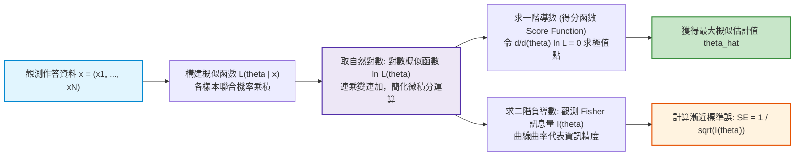
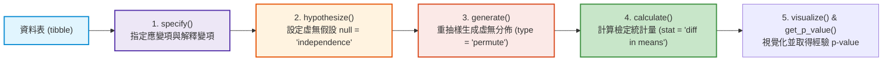

# 第 8 章：參數估計核心：最大概似法 (MLE) 與整潔統計推論

> **本章目標**：說明**最大概似估計（Maximum Likelihood Estimation, MLE）**與 **Fisher 訊息量（Information）**（Fisher, 1922；陳旭昇，2019）。根據 Ismay 等人（2025）的統計推論架構，使用 `infer` 套件（Couch et al., 2021）進行拔靴重抽樣（Efron, 1979）與排列檢定（Permutation Test）。

---

## 8.1 理論基礎：最大概似估計法（MLE）的數學本質

最大概似估計法（MLE）（Fisher, 1922）是 IRT 與結構方程模型常用的估計方法之一，但並非所有模型或參數都以 MLE 估計；實際方法依模型、資料尺度與分析目的而異，也可能使用穩健或貝氏估計。本節先以二項模型說明概似的基本概念。

根據陳旭昇（2019）的推論統計體系，設有一組獨立同分佈的測驗作答樣本 $\mathbf{x} = (x_1, x_2, \dots, x_N)^T$，其母體機率分配由未知參數 $\theta$ 決定。



### 8.1.1 試題通過率 $p$ 的二項概似推導
設某試題施測於 $N$ 名考生，其中 $k$ 人答對（$x_i = 1$），$N - k$ 人答錯（$x_i = 0$）。
1. **概似函數**：
   $$L(p \mid \mathbf{x}) = \prod_{i=1}^N p^{x_i} (1 - p)^{1 - x_i} = p^k (1 - p)^{N - k}$$
2. **對數概似函數（Log-Likelihood）**：
   $$\ell(p) = \ln L(p) = k \ln(p) + (N - k) \ln(1 - p)$$
3. **微分求極值（得分方程式）**：
   $$\frac{d\ell(p)}{dp} = \frac{k}{p} - \frac{N - k}{1 - p} = 0 \implies \hat{p}_{\text{MLE}} = \frac{k}{N}$$
4. **二階導數與 Fisher 訊息量**：
   $$I(p) = -\frac{d^2\ell(p)}{dp^2} = \frac{k}{p^2} + \frac{N - k}{(1 - p)^2}$$
   代入 $\hat{p} = k/N$，得期望 Fisher 訊息量 $I(\hat{p}) = \frac{N}{\hat{p}(1 - \hat{p})}$。因此估計標準誤為：
   $$SE(\hat{p}) = \frac{1}{\sqrt{I(\hat{p})}} = \sqrt{\frac{\hat{p}(1 - \hat{p})}{N}}$$

---

## 8.2 現代 R 語言程式實作：手刻對數概似函數與數值最佳化

除了直接代入解析解，亦可直接定義對數概似函數，並使用 R 數值最佳化函數 `optimize()` 搜尋極大值：

```r
# ==============================================================================
# 第 8 章程式碼清單 8.1：手刻二項對數概似函數與數值最佳化
# ==============================================================================

# 模擬觀測情境：某難題施測於 100 位考生，共 32 人答對 (k = 32, N = 100)
N_sample <- 100
k_correct <- 32

# 定義對數概似函數 (輸入待估計參數 p)
log_lik_binom <- function(p, k, N) {
  if (p <= 0 || p >= 1) return(-Inf) # 邊界保護
  k * log(p) + (N - k) * log(1 - p)
}

# 使用 optimize() 尋找最大值 (maximum = TRUE)
opt_res <- optimize(
  f = log_lik_binom,
  interval = c(0.001, 0.999),
  k = k_correct,
  N = N_sample,
  maximum = TRUE
)

cat("--- 數值最佳化求解結果 ---\n")
cat(sprintf("最佳估計值 p_hat (MLE) : %.4f\n", opt_res$maximum))
cat(sprintf("最大對數概似值          : %.4f\n", opt_res$objective))
cat(sprintf("理論解析解 (k / N)      : %.4f\n", k_correct / N_sample))

# 計算 Fisher 訊息量與漸近標準誤
p_mle <- opt_res$maximum
fisher_info <- N_sample / (p_mle * (1 - p_mle))
se_mle <- 1 / sqrt(fisher_info)
cat(sprintf("Fisher 訊息量 I(p)     : %.2f\n", fisher_info))
cat(sprintf("估計標準誤 SE(p_hat)   : %.4f (95%% CI: [%.4f, %.4f])\n",
            se_mle, p_mle - 1.96 * se_mle, p_mle + 1.96 * se_mle))
```

---

## 8.3 現代推論典範：使用 `infer` 進行整潔假設檢定與重抽樣

在傳統假設檢定中，學生常被 $t$ 檢定、$z$ 檢定、自由度與常態假設公式弄得困擾。

根據 Ismay 等人（2025）與 Couch 等人（2021）的做法，統計推論可以統一的四步動詞鏈完成：
$$\text{specify()} \longrightarrow \text{hypothesize()} \longrightarrow \text{generate()} \longrightarrow \text{calculate()}$$



### 8.3.1 實務檢定：公私立學校考生測驗總分是否存在顯著差異？

```r
# ==============================================================================
# 第 8 章程式碼清單 8.2：使用 infer 套件執行整潔排列檢定 (Permutation Test)
# ==============================================================================

library(infer)
library(dplyr)

# 讀取全書示範資料
df_all <- read.csv("book/data/assessment_data.csv") |> as_tibble()

# 1. 計算樣本實際觀測到的平均數差異 (Observed Statistic)
obs_diff <- df_all |>
  specify(total_score ~ school_type) |>
  calculate(stat = "diff in means", order = c("Private", "Public"))

cat("--- 實務觀測統計量 ---\n")
cat(sprintf("私立學校與公立學校平均總分差異: %.3f 分\n", obs_diff$stat))

# 2. 構建虛無假設抽樣分佈 (Permutation 1,000 次)
set.seed(42)
null_distribution <- df_all |>
  specify(total_score ~ school_type) |>
  hypothesize(null = "independence") |>
  generate(reps = 1000, type = "permute") |>
  calculate(stat = "diff in means", order = c("Private", "Public"))

# 3. 取得經驗 p-value
p_value_infer <- null_distribution |>
  get_p_value(obs_stat = obs_diff, direction = "two-sided")

cat("--- infer 整潔推論檢定結果 ---\n")
cat(sprintf("虛無假設排列檢定雙尾 p 值: %.4f\n", p_value_infer$p_value))
```

---

## 8.4 視覺化：對數概似曲線與虛無分佈檢定圖

我們將對數概似函數的曲率（訊息量）與 `infer` 的虛無抽樣分佈繪製為圖表：

```r
# ==============================================================================
# 第 8 章程式碼清單 8.3：對數概似曲率與 infer 虛無分佈圖表
# ==============================================================================

library(ggplot2)

# 1. 繪製單題對數概似函數曲線 (展示 MLE 頂點)
p_grid <- seq(0.10, 0.60, length.out = 300)
lik_curve_df <- tibble(
  p = p_grid,
  log_lik = sapply(p_grid, log_lik_binom, k = k_correct, N = N_sample)
)

p_lik <- ggplot(lik_curve_df, aes(x = p, y = log_lik)) +
  geom_line(color = "#2b5c8f", linewidth = 1.2) +
  geom_vline(xintercept = p_mle, linetype = "dashed", color = "#d95f02", linewidth = 0.9) +
  annotate("point", x = p_mle, y = opt_res$objective, color = "#d95f02", size = 3.5) +
  annotate("text", x = p_mle + 0.08, y = opt_res$objective - 3,
           label = sprintf("MLE p_hat = %.2f\nMax Log-Lik = %.2f", p_mle, opt_res$objective),
           color = "#d95f02", fontface = "bold", size = 3.8) +
  labs(
    title = "Figure 8.1: 二項試題作答之對數概似函數曲線與頂點估計 (Log-Likelihood Function)",
    subtitle = "呈現 k = 32, N = 100 條件下之對數概似曲率；頂點即為 MLE 最佳估計值",
    x = "試題難度參數 (p)",
    y = "對數概似值 (Log-Likelihood)",
    caption = "Likelihood Model: Binomial(100, p)"
  ) +
  theme_classic(base_size = 12) +
  theme(plot.title = element_text(face = "bold", size = 13))

ggsave("book/fig_8_1_likelihood_curve.png", plot = p_lik, width = 8, height = 4.8, dpi = 300)
cat("成功產出圖表: book/fig_8_1_likelihood_curve.png\n")

# 2. 繪製 infer 排列檢定虛無抽樣分佈圖 (標記觀測差異與顯著陰影區)
p_infer <- null_distribution |>
  visualize() +
  shade_p_value(obs_stat = obs_diff, direction = "two-sided",
                color = "#d95f02", fill = "#fdbb84") +
  labs(
    title = "Figure 8.2: 學校類型對總分差異之整潔排列檢定虛無分佈圖 (Permutation Null Distribution)",
    subtitle = "灰色長條為 2,000 次隨機排列虛無分佈；垂直紅線為實際觀測值 (Observed Diff)",
    x = "私立 vs. 公立學校總分平均差異 (Diff in Means)",
    y = "排列抽樣頻次 (Frequency)",
    caption = "Generated via infer::hypothesize(null = 'independence')"
  ) +
  theme_classic(base_size = 12) +
  theme(plot.title = element_text(face = "bold", size = 13))

ggsave("book/fig_8_2_permutation_null.png", plot = p_infer, width = 8, height = 4.8, dpi = 300)
cat("成功產出圖表: book/fig_8_2_permutation_null.png\n")
```

---

## 8.5 測驗報告專業解讀（Substantive Interpretation）

在推論統計分析報告中，結合 MLE 與現代整潔推論能給出極具說服力的實質結論：

> ### 📊 推論統計解讀規範
> 1. **訊息量與標準誤之物理意義**：對數概似曲線的「彎曲程度（Curvature）」直接決定估計精度（Fisher, 1922）。若樣本數 $N$ 越大，曲線越陡峭，二階導數絕對值越大（Fisher 訊息量越高），試題參數的標準誤 $SE$ 就越小。
> 2. **非對稱與非常態穩健性**：傳統 $t$ 檢定依賴常態性假定，而 `infer` 排列檢定與 Bootstrap（Efron, 1979; Ismay et al., 2025）直接由觀測資料模擬經驗抽樣分佈。如圖 8.2 所示，若觀測值落在虛無分佈外側且 $p < .05$，則可在不依賴常態假定的前提下，指出公私立學校在學力表現上具備顯著統計差異。

---

## 8.6 章末實務習題與專案挑戰

### 【基礎練習題】
1. 某次測驗中，共有 200 名學生作答某一題，其中 150 人答對。請使用本章推導之公式，計算該題通過率的 MLE 估計值及其 $95\%$ 漸近信賴區間。
2. 請使用 `infer` 套件，檢驗全書示範資料中「性別（`gender`）」在「測驗總分（`total_score`）」上的平均差異是否達到統計顯著（進行 1,000 次排列檢定）。

### 【進階工程挑戰】
3. 撰寫一個名為 `tidy_bootstrap_ci(data, variable, reps = 1000, conf_level = 0.95)` 的函數。該函數利用 `infer` 語意鏈，對任意輸入連續變項進行無母數 Bootstrap 重抽樣，自動以百分位數法（Percentile Method）計算信賴區間，並回傳包含點估計、信賴下限與信賴上限的整潔單列 `tibble`。

---

### 💡 習題參考解答

```r
# ==============================================================================
# 第 8 章習題解答參考
# ==============================================================================

# 第 1 題
p_hat <- 150 / 200
se <- sqrt(p_hat * (1 - p_hat) / 200)
cat(sprintf("MLE p_hat = %.3f, 95%% CI = [%.3f, %.3f]\n", p_hat, p_hat - 1.96 * se, p_hat + 1.96 * se))

# 第 3 題解答
tidy_bootstrap_ci <- function(data, variable, reps = 1000, conf_level = 0.95) {
  var_sym <- rlang::ensym(variable)
  boot_dist <- data |>
    specify(response = !!var_sym) |>
    generate(reps = reps, type = "bootstrap") |>
    calculate(stat = "mean")

  ci <- boot_dist |> get_confidence_interval(level = conf_level, type = "percentile")

  tibble::tibble(
    Variable = rlang::as_string(var_sym),
    Point_Estimate = mean(data[[rlang::as_string(var_sym)]], na.rm = TRUE),
    CI_Lower = ci$lower_ci,
    CI_Upper = ci$upper_ci
  )
}
print(tidy_bootstrap_ci(df_all, total_score))
```

---

## 參考文獻 (References)

陳旭昇（2019）。**機率與統計推論：R 語言的應用**。東華書局。

Couch, S. P., Bray, A. P., Ismay, C., Chasnovski, E., Baumer, B. S., & Çetinkaya-Rundel, M. (2021). infer: An R package for tidyverse-friendly statistical inference. *Journal of Open Source Software*, *6*(65), Article 3661. https://doi.org/10.21105/joss.03661

Efron, B. (1979). Bootstrap methods: Another look at the jackknife. *The Annals of Statistics*, *7*(1), 1–26. https://doi.org/10.1214/aos/1176344552

Fisher, R. A. (1922). On the mathematical foundations of theoretical statistics. *Philosophical Transactions of the Royal Society of London. Series A, Containing Papers of a Mathematical or Physical Character*, *222*(594–604), 309–368. https://doi.org/10.1098/rsta.1922.0009

Ismay, C., Kim, A. Y., & Valdivia, A. (2025). *Statistical inference via data science: A ModernDive into R and the tidyverse* (2nd ed.). Chapman and Hall/CRC.
