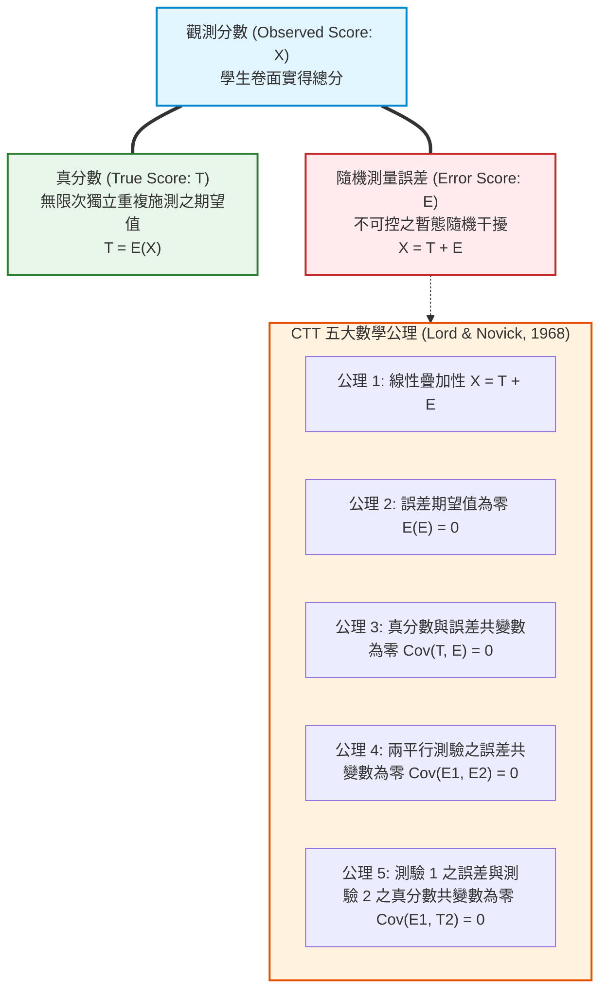
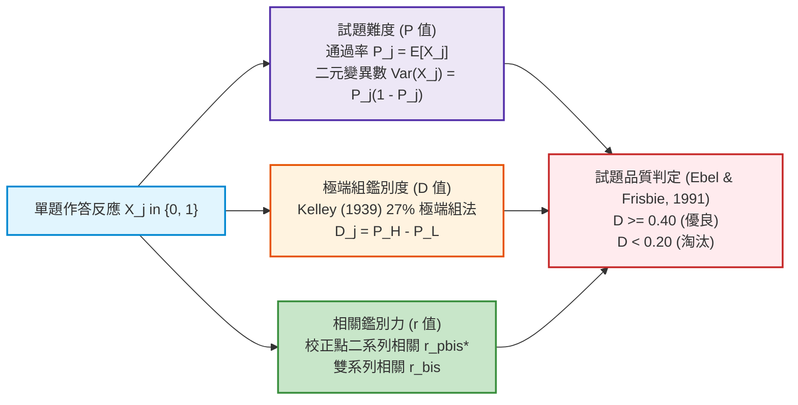
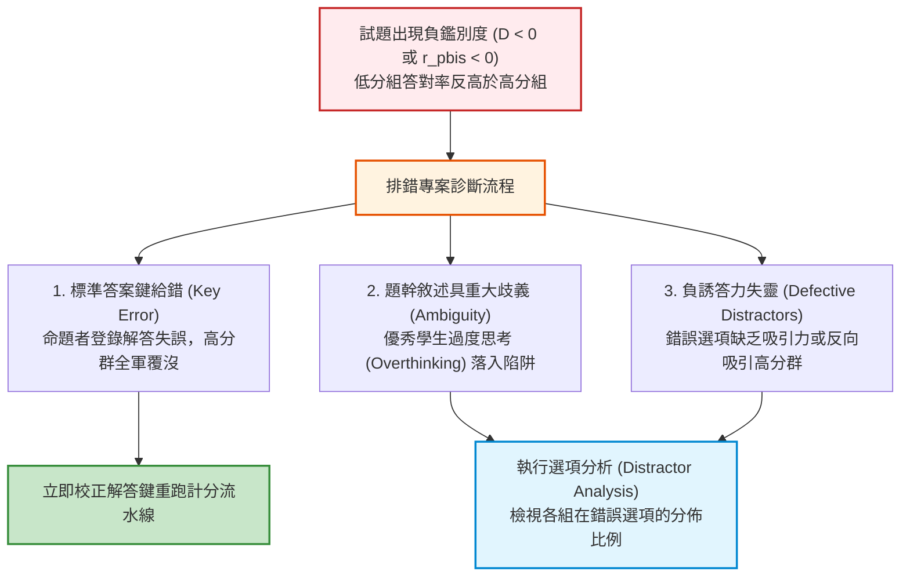

# 第 9 章：古典測驗理論 (CTT) 與試題分析流水線

> **本章目標**：奠基於古典測驗理論（Classical Test Theory, CTT）百年數理架構（Brennan, 2001; Crocker & Algina, 1986; Gulliksen, 1950; Lord & Novick, 1968; Nunnally & Bernstein, 1994; 陳新豐, 2021），結合 NCME 官方《Educational Measurement》（第 5 版）（Cook & Pitoniak, 2025）。從真分數模型（$X = T + E$）之五大公理體系與變異數分解出發，完整推導平行測驗（Parallel Tests）信度與測量標準誤（SEM）；深入剖析試題難度（通過率 $P$）、Kelley（1939）極端群鑑別度（$D$）、點二系列相關（$r_{pbis}$）與雙系列相關（$r_{bis}$）之數理關聯；並利用 Tidyverse 與 `gt` 表格套件（Iannone et al., 2026），建構全自動化 CTT 試題診斷與選項誘答力分析（Distractor Analysis）管線。

---

## 9.1 數理推導：古典測驗理論（CTT）的公理體系與變異數分解

古典測驗理論（CTT）又稱為「弱真分數理論（Weak True Score Theory）」，其數學基石建立於五大公理體系（Lord & Novick, 1968）。



### 9.1.1 CTT 五大數學公理形式化定義

設受試者集合為 $\Omega$，對任意受試者 $s \in \Omega$，令其在測驗上的觀測得分為隨機變數 $X(s)$：
1. **公理 1（真分數的定義）**：
   受試者的真分數 $T(s)$ 定義為觀測分數在理論上無窮次重複施測的數學期望值：
   $$T(s) \equiv \mathbb{E}[X(s)]$$
   隨機測量誤差 $E(s)$ 則定義為觀測分數與真分數的偏差：
   $$E(s) \equiv X(s) - T(s) \iff X(s) = T(s) + E(s)$$

2. **公理 2（誤差的期望值恆為零）**：
   由真分數定義直接保證誤差的群體期望值為零：
   $$\mathbb{E}[E(s)] = \mathbb{E}[X(s) - T(s)] = \mathbb{E}[X(s)] - T(s) = 0$$

3. **公理 3（真分數與誤差線性無關）**：
   在母體中，受試者的潛在真分數與其測量誤差不具備線性相關：
   $$\rho_{TE} = 0 \iff \text{Cov}(T, E) \equiv \mathbb{E}[(T - \mu_T)(E - 0)] = 0$$

4. **公理 4（不同測驗之測量誤差無關）**：
   若受試者先後接受測驗 1 與測驗 2（或答覆兩道獨立試題），兩次測量之隨機誤差不具關聯性：
   $$\rho_{E_1 E_2} = 0 \iff \text{Cov}(E_1, E_2) = 0$$

5. **公理 5（跨測驗誤差與真分數無關）**：
   測驗 1 之隨機誤差與測驗 2 之潛在真分數互不相關：
   $$\rho_{E_1 T_2} = 0 \iff \text{Cov}(E_1, T_2) = 0$$

### 9.1.2 變異數正交分解定理（Orthogonal Variance Decomposition）

根據公理 1 與公理 3，觀測總分數的母體變異數 $\sigma_X^2$ 可展開為：

$$\begin{aligned}
\sigma_X^2 &= \text{Var}(X) = \text{Var}(T + E) \\
&= \mathbb{E}\left[ ((T - \mu_T) + (E - 0))^2 \right] \\
&= \mathbb{E}\left[ (T - \mu_T)^2 \right] + \mathbb{E}[E^2] + 2\mathbb{E}[(T - \mu_T)E] \\
&= \text{Var}(T) + \text{Var}(E) + 2\text{Cov}(T, E) \\
&= \sigma_T^2 + \sigma_E^2 + 2(0) \\
&= \sigma_T^2 + \sigma_E^2 \quad \blacksquare
\end{aligned}$$

此定理解釋了教育測驗中一個至關重要的事實：**學生在考卷上分數的離散程度（觀測變異），一部分來自真實能力水準的差異（真分數變異），另一部分則純粹源自不可控的隨機噪聲（誤差變異）**。

### 9.1.3 平行測驗與信度係數（Reliability Coefficient）之數學推導

理論上，真分數 $T$ 與誤差 $E$ 無法直接被觀測，因此 $\sigma_T^2$ 與 $\sigma_E^2$ 無法直接透過單次測驗計算。為了解決此估計困境，Gulliksen（1950）與 Lord 與 Novick（1968）引入了**平行測驗（Parallel Tests）**假說。

兩份測驗 $X_1$ 與 $X_2$ 稱為平行測驗，若且唯若滿足以下兩大條件：
1. **真分數嚴格相等**：對所有受試者，$T_1(s) = T_2(s) = T(s)$。
2. **誤差變異數嚴格相等**：$\sigma_{E_1}^2 = \sigma_{E_2}^2 = \sigma_E^2$。

**【信度定理證明】**：
兩份平行測驗之 Pearson 積差相關係數 $\rho_{X_1 X_2}$，恰好等於真分數變異佔觀測總變異之百分比（即理論信度 $\rho_{XX'}$）：

$$\begin{aligned}
\text{Cov}(X_1, X_2) &= \text{Cov}(T + E_1, T + E_2) \\
&= \text{Cov}(T, T) + \text{Cov}(T, E_2) + \text{Cov}(E_1, T) + \text{Cov}(E_1, E_2)
\end{aligned}$$
依據公理 3、4、5，後三項共變數皆嚴格為 0：
$$\text{Cov}(X_1, X_2) = \text{Var}(T) + 0 + 0 + 0 = \sigma_T^2$$

又因為兩測驗之觀測變異數相等：
$$\sigma_{X_1}^2 = \sigma_T^2 + \sigma_{E_1}^2 = \sigma_T^2 + \sigma_E^2 = \sigma_X^2 = \sigma_{X_2}^2$$

因此，平行測驗的觀測相關係數為：
$$\rho_{X_1 X_2} = \frac{\text{Cov}(X_1, X_2)}{\sigma_{X_1} \sigma_{X_2}} = \frac{\sigma_T^2}{\sigma_X \cdot \sigma_X} = \frac{\sigma_T^2}{\sigma_X^2} \equiv \rho_{XX'} \quad \blacksquare$$

由此獲得 CTT 理論信度的三大等價形式：
$$\rho_{XX'} = \frac{\sigma_T^2}{\sigma_X^2} = 1 - \frac{\sigma_E^2}{\sigma_X^2} = \rho_{XT}^2$$
其中 $\rho_{XT} = \sigma_T / \sigma_X$ 稱為**測驗效限指數（Index of Reliability）**，代表觀測分數與真分數的相關係數。

### 9.1.4 測量標準誤（SEM）的代數推導

測量標準誤（Standard Error of Measurement, SEM）為誤差分數的標準差 $\sigma_E$。由信度定義移項：
$$\rho_{XX'} = 1 - \frac{\sigma_E^2}{\sigma_X^2} \implies \frac{\sigma_E^2}{\sigma_X^2} = 1 - \rho_{XX'} \implies \sigma_E^2 = \sigma_X^2 (1 - \rho_{XX'})$$
兩側開平方根，得：
$$\text{SEM} \equiv \sigma_E = \sigma_X \sqrt{1 - \rho_{XX'}}$$
SEM 提供考生成績的信賴區間構建基礎：在常態誤差假定下，考生真分數的 $95\%$ 信賴區間為 $X \pm 1.96 \cdot \text{SEM}$。

---

## 9.2 試題層次指標數理推導：難度、鑑別度與相關性

在單一試題層次（Item Level），設測驗共有 $J$ 題，受試者在第 $j$ 題的得分為二元變數 $X_j \in \{0, 1\}$，測驗總分為 $S = \sum_{j=1}^J X_j$。



### 9.2.1 試題難度（通過率 $P_j$）與變異數極大化

第 $j$ 題之難度 $P_j$ 定義為答對該題的人數比例（即 Bernoulli 隨機變數的期望值）：
$$P_j = \mathbb{E}[X_j] = \frac{1}{N} \sum_{i=1}^N x_{ij}$$
其單題變異數為：
$$\sigma_j^2 = \text{Var}(X_j) = \mathbb{E}[X_j^2] - (\mathbb{E}[X_j])^2 = P_j - P_j^2 = P_j (1 - P_j)$$

**【極值分析】**：
對 $P_j$ 微分：$\frac{d\sigma_j^2}{dP_j} = 1 - 2P_j = 0 \implies P_j = 0.5$。
這表明：**當試題難度為 $0.50$ 時，該題目的變異數達到理論最大值 $0.25$**。若題目過難（$P \to 0$）或過易（$P \to 1$），單題變異數趨近於 0，對總分變異與受試者能力鑑別完全不具貢獻。

### 9.2.2 極端組鑑別度（Kelley 27% 法則）

將考生依測驗總分由高至低排序，選取前 $27\%$ 作為高分組（High Group, $H$）、後 $27\%$ 作為低分組（Low Group, $L$）。試題鑑別度 $D_j$ 定義為兩組通過率之差：
$$D_j = P_{H, j} - P_{L, j} = \frac{R_{H, j}}{n_H} - \frac{R_{L, j}}{n_L}$$

依據 Ebel 與 Frisbie（1991）之經驗準則：
- $D \ge .40$：優良試題（Excellent），品質極佳。
- $.30 \le D < .40$：良好試題（Good），略作修改即可使用。
- $.20 \le D < .30$：尚可試題（Marginal），需要全面檢視題幹與選項。
- $D < .20$：不良試題（Poor），鑑別力不足，建議淘汰重出。

### 9.2.3 點二系列相關（Point-Biserial）與校正排除自相關

點二系列相關係數 $r_{pbis}$ 為二元作答 $X_j$ 與連續測驗總分 $S$ 的 Pearson 積差相關：
$$r_{pbis, j} = \frac{\bar{S}_1 - \bar{S}_0}{s_S} \sqrt{\frac{n_1 n_0}{N(N-1)}} \approx \frac{\bar{S}_1 - \bar{S}}{s_S} \sqrt{\frac{P_j}{1 - P_j}}$$
其中 $\bar{S}_1$ 為答對該題考生的總分平均，$\bar{S}_0$ 為答錯考生的總分平均，$s_S$ 為總分樣本標準差。

**【⚠️ 試題自相關污染（Spurious Inflation）】**：
由於總分 $S = \sum_{k=1}^J X_k$ 本身包含了第 $j$ 題得分 $X_j$，導致 $\text{Cov}(X_j, S) = \text{Var}(X_j) + \sum_{k \ne j} \text{Cov}(X_j, X_k)$。當測驗題數較少時，第 $j$ 題自身的變異數 $\text{Var}(X_j)$ 會嚴重虛胖點二系列相關！

因此必須採用**排除自身校正點二系列相關（Corrected Item-Total Correlation, $r_{pbis}^*$）**：
$$r_{pbis, j}^* = \text{Cor}(X_j, S - X_j) = \frac{\text{Cov}(X_j, S) - \sigma_j^2}{\sqrt{\sigma_j^2 \cdot (\sigma_S^2 + \sigma_j^2 - 2\text{Cov}(X_j, S))}}$$

### 9.2.4 雙系列相關（Biserial Correlation, $r_{bis}$）

若假設答對該題背後存在一個潛在的連續常態能力變量，僅是透過門檻被二元化切截，依據 Crocker 與 Algina（1986）的推導，雙系列相關為：
$$r_{bis, j} = r_{pbis, j} \cdot \frac{\sqrt{P_j(1 - P_j)}}{y_j}$$
其中 $y_j = \phi(\Phi^{-1}(1 - P_j))$ 為標準常態機率密度在通過率切截點之縱坐標的高度。由於 $\frac{\sqrt{P(1-P)}}{y} \ge 1.253$，因此 $r_{bis}$ 數值永遠高於 $r_{pbis}$，且不受試題通過率偏離 $0.5$ 的人為壓縮。

---

## 9.3 底層手刻演算法：純 R 現代試題分析與誘答選項診斷流水線

本節實作工業級的 CTT 試題分析管線，不僅計算各項指標，還包含完整的**選項誘答力診斷（Distractor Analysis）**。

```r
# ==============================================================================
# 第 9 章程式碼清單 9.1：底層手刻 CTT 試題分析與誘答力診斷引擎
# ==============================================================================

suppressPackageStartupMessages({
  library(dplyr)
  library(tidyr)
  library(purrr)
  library(tibble)
})

# 讀取全書示範資料
df_all <- read.csv("book/data/assessment_data.csv") |> as_tibble()
cog_cols <- sprintf("item_%02d", 1:15)

#' 底層手刻 CTT 試題分析流水線
#'
#' @param data 包含受試者試題作答 (0/1) 的 tibble
#' @param item_cols 試題欄位名稱向量
#' @param kelley_ratio 極端組切截比例，預設為 0.27
#' @return 包含試題難度、鑑別度、校正點二系列與雙系列相關之整潔 tibble
ctt_item_analysis_engine <- function(data, item_cols, kelley_ratio = 0.27) {
  stopifnot(is.data.frame(data), all(item_cols %in% names(data)))

  # 1. 計算完整作答考生的總分 (不把 NA 當答錯)
  sub_mat <- as.matrix(data[, item_cols])
  complete_cases <- rowSums(is.na(sub_mat)) == 0
  total_score <- rowSums(sub_mat)
  total_score[!complete_cases] <- NA_real_

  N_valid <- sum(complete_cases)
  cutoff_high <- quantile(total_score, probs = 1 - kelley_ratio, na.rm = TRUE)
  cutoff_low  <- quantile(total_score, probs = kelley_ratio, na.rm = TRUE)

  is_high <- !is.na(total_score) & total_score >= cutoff_high
  is_low  <- !is.na(total_score) & total_score <= cutoff_low
  n_h <- sum(is_high)
  n_l <- sum(is_low)

  # 2. 逐題平行計算指標
  results <- map(item_cols, \(item) {
    x <- data[[item]]
    valid_mask <- !is.na(x) & complete_cases
    x_v <- x[valid_mask]
    tot_v <- total_score[valid_mask]

    # 通過率 P
    p_val <- mean(x_v)

    # Kelley 鑑別度 D
    p_high <- mean(x[is_high], na.rm = TRUE)
    p_low  <- mean(x[is_low], na.rm = TRUE)
    d_val  <- p_high - p_low

    # 點二系列相關 (原始與校正)
    s_x <- sd(tot_v)
    r_raw <- if (sd(x_v) > 0 && s_x > 0) cor(x_v, tot_v) else 0

    rest_tot <- tot_v - x_v
    r_corrected <- if (sd(x_v) > 0 && sd(rest_tot) > 0) cor(x_v, rest_tot) else 0

    # 雙系列相關 r_bis: r_pbis * sqrt(p*(1-p)) / phi(z)
    z_cut <- qnorm(1 - p_val)
    y_height <- dnorm(z_cut)
    r_bis <- if (y_height > 1e-6) r_raw * (sqrt(p_val * (1 - p_val)) / y_height) else NA_real_
    # 限制 r_bis 理論邊界 [-1, 1]
    r_bis_bounded <- pmin(pmax(r_bis, -1.0), 1.0)

    # 依據 Ebel 與 Frisbie (1991) 評價
    eval_text <- case_when(
      d_val >= 0.40 & r_corrected >= 0.30 ~ "優良 (Excellent)",
      d_val >= 0.30 & r_corrected >= 0.25 ~ "良好 (Good)",
      d_val >= 0.20                       ~ "尚可 (Marginal)",
      TRUE                                ~ "待淘汰 (Poor)"
    )

    tibble(
      Item = item,
      Valid_N = sum(valid_mask),
      Difficulty_P = round(p_val, 4),
      Discrimination_D = round(d_val, 4),
      Raw_r_pbis = round(r_raw, 4),
      Corrected_r_pbis = round(r_corrected, 4),
      Biserial_r = round(r_bis_bounded, 4),
      Evaluation = eval_text
    )
  }) |> list_rbind()

  results
}

# 執行分析
ctt_report_df <- ctt_item_analysis_engine(df_all, cog_cols)
cat("--- CTT 完整試題分析報告 (前 5 題預覽) ---\n")
print(head(ctt_report_df, 5))
```

---

## 9.4 報表與視覺化：`gt` 表格與 APA 雙軸指標圖

```r
# ==============================================================================
# 第 9 章程式碼清單 9.2：使用 gt 產出現代 APA 規格試題診斷表 (Table 9.1)
# ==============================================================================

library(gt)
library(ggplot2)

table_9_1 <- ctt_report_df |>
  gt() |>
  tab_header(
    title = md("**Table 9.1**"),
    subtitle = md("*古典測驗理論試題品質診斷與篩選分析總表 (N = 1,000)*")
  ) |>
  cols_label(
    Item = "試題代號",
    Valid_N = "有效樣本",
    Difficulty_P = "難度 (P)",
    Discrimination_D = "鑑別度 (D)",
    Raw_r_pbis = "原始點二系列",
    Corrected_r_pbis = "校正點二系列",
    Biserial_r = "雙系列相關",
    Evaluation = "品質綜合判定"
  ) |>
  fmt_number(
    columns = c(Difficulty_P, Discrimination_D, Raw_r_pbis, Corrected_r_pbis, Biserial_r),
    decimals = 3
  ) |>
  tab_style(
    style = cell_text(weight = "bold", color = "#2e7d32"),
    locations = cells_body(
      columns = Evaluation,
      rows = grepl("優良", Evaluation)
    )
  ) |>
  tab_style(
    style = cell_text(weight = "bold", color = "#c62828"),
    locations = cells_body(
      columns = Evaluation,
      rows = grepl("待淘汰", Evaluation)
    )
  ) |>
  tab_source_note(
    source_note = md("註：高低分組依據總分前後 27% 劃分（Kelley, 1939）；校正點二系列採排除自相關估計（Crocker & Algina, 1986）。")
  )

gtsave(table_9_1, "book/table_9_1_ctt_summary.html")
cat("成功產出報表: book/table_9_1_ctt_summary.html\n")

# ==============================================================================
# 第 9 章程式碼清單 9.3：難度 P vs. 鑑別度 D 雙軸散佈象限診斷圖
# ==============================================================================

p_quad <- ggplot(ctt_report_df, aes(x = Difficulty_P, y = Discrimination_D)) +
  # 繪製最佳試題黃金象限陰影區 (P: 0.35-0.75, D >= 0.35)
  annotate("rect", xmin = 0.35, xmax = 0.75, ymin = 0.35, ymax = 1.0,
           fill = "#e8f5e9", alpha = 0.6) +
  geom_hline(yintercept = 0.30, linetype = "dashed", color = "#d95f02", linewidth = 0.8) +
  geom_vline(xintercept = 0.50, linetype = "dotted", color = "#757575", linewidth = 0.8) +
  geom_point(aes(color = Evaluation), size = 4, alpha = 0.85) +
  ggrepel::geom_text_repel(aes(label = Item), fontface = "bold", size = 4) +
  scale_color_manual(values = c(
    "優良 (Excellent)" = "#2e7d32",
    "良好 (Good)"      = "#1976d2",
    "尚可 (Marginal)"  = "#f57c00",
    "待淘汰 (Poor)"    = "#c62828"
  )) +
  scale_x_continuous(limits = c(0, 1.0), breaks = seq(0, 1, 0.2)) +
  scale_y_continuous(limits = c(-0.1, 1.0), breaks = seq(0, 1, 0.2)) +
  labs(
    title = "Figure 9.1: 15 道測驗試題之難度 P 值與鑑別度 D 值象限分佈圖 (Item Quadrant Plot)",
    subtitle = "綠色陰影區域為測驗編製之『黃金入庫象限』(0.35 <= P <= 0.75 且 D >= 0.35)",
    x = "試題通過率難度 (Difficulty P)",
    y = "極端群鑑別度 (Discrimination D)",
    color = "試題品質評語",
    caption = "Criteria based on (Ebel & Frisbie, 1991) and (Kelley, 1939) 27% Rule."
  ) +
  theme_classic(base_size = 12) +
  theme(
    plot.title = element_text(face = "bold", size = 13),
    legend.position = "bottom",
    axis.title = element_text(face = "bold")
  )

ggsave("book/fig_9_1_ctt_quadrant.png", plot = p_quad, width = 8.5, height = 6.5, dpi = 300)
cat("成功產出圖表: book/fig_9_1_ctt_quadrant.png\n")
```

---

## 9.5 ⚠️ 計量工程陷阱與排錯專案：誘答力失靈與負鑑別度診斷

在試題編製實務中，單純依賴整卷總分與通過率往往掩蓋了關鍵的選項層次缺陷。



### 9.5.1 誘答選項品質的三大檢驗準則

依據 Cook 與 Pitoniak（2025）及 Crocker 與 Algina（1986），選擇題之良好干擾選項（Distractors）必須滿足：
1. **吸引力充足（Plausibility）**：每個錯誤選項必須被全體受試者的至少 $5\%$ 考生選取。若某選項選答率低於 $5\%$，代表該干擾項過於荒謬或顯而易見，形同虛設，實質上將四選一測驗退化為三選一或二選一。
2. **單調負相關（Monotonic Negative Relation）**：錯誤選項應主要吸引低分組考生。因此，低分組選擇該干擾項的人數比例必須顯著高於高分組（$P_{L, k} > P_{H, k}$）。
3. **警訊指標（Defective Distractor Warning）**：若某錯誤選項的高分組選擇率反高於低分組（$P_{H, k} > P_{L, k}$），強烈暗示該選項存在「題目陷阱」、「過時資訊」或「教材版本落差」，引導高能力考生產生系統性誤判。

---

## 9.6 測驗報告專業解讀（Substantive Interpretation）

在大型升學與學力檢定報告中，解讀 CTT 指標時需秉持以下專業準則（Cook & Pitoniak, 2025; Lord & Novick, 1968）：

> ### 📊 CTT 試題診斷與入庫決策指南
> 1. **難度與鑑別度的制約關係**：
>    鑑別度 $D$ 與難度 $P$ 存在理論上限約束：$D_{\max} = 2P$（當 $P \le 0.5$）或 $D_{\max} = 2(1 - P)$（當 $P > 0.5$）。極難（$P = 0.10$）或極易（$P = 0.90$）的試題，其 $D$ 理論最大值僅為 $0.20$。因此評估極端題目時，不可嚴苛要求其達到 $D \ge 0.40$，而應輔以雙系列相關 $r_{bis}$ 進行公平檢驗。
> 2. **CTT 的三大固有限制（Limitations）**：
>    - **樣本依賴性（Sample Dependency）**：試題難度 $P$ 取決於受測樣本的平均素質；若抽樣群體偏向明星學校，$P$ 值虛高。
>    - **測驗依賴性（Test Dependency）**：考生的實得分數與考卷難易緊密綁定，不同卷別間無法直接等化比較。
>    - **單一標準誤假定**：CTT 假定全體考生（無論得分高低）的隨機測量誤差 $\text{SEM} = \sigma_X \sqrt{1 - \rho_{XX'}}$ 為一固定常數，無法反映高低分極端處測量精度大幅衰退的實務現況（此為現代 IRT 與條件測量標準誤 CSEM 所著力解決的核心問題）。

---

## 9.7 章末實務習題與完整解答閉環

### 【基礎練習題】
1. **變異數分解與測量標準誤**：某次全國 100 題選擇題測驗中，考生總分變異數為 $\sigma_X^2 = 64$，平行測驗相關係數為 $\rho_{XX'} = 0.84$。請計算該測驗的真分數變異數 $\sigma_T^2$、隨機誤差變異數 $\sigma_E^2$，以及考生成績的測量標準誤（SEM）。若某生測驗得分為 75 分，請建立其真分數的 $95\%$ 常態信賴區間。
2. **極端組鑑別度計算**：某題施測於 1,000 名考生，取前後 $27\%$ 劃分高低分組。高分組（270 人）中有 243 人答對，低分組（270 人）中有 54 人答對。請計算該題的難度 $P$、鑑別度 $D$，依據 Ebel 與 Frisbie（1991）之準則給出專業品質評語。

### 【進階工程挑戰】
3. **工業級多選題誘答力分析（Distractor Analysis）引擎**：
   撰寫一個名為 `tidy_distractor_analysis(raw_data, item_col, key_ans, total_col = NULL, kelley_ratio = 0.27)` 的函數。
   - 輸入包含考生選項反應（如 "A", "B", "C", "D"）之資料表與該題標準答案。
   - 自動將考生依總分劃分為 High、Middle、Low 三大組別。
   - 計算全體受試者及各組別在各選項（包含未作答 NA）的選擇人數與百分比。
   - 自動標記潛在缺陷選項：若某干擾選項選答率低於 $5\%$ 標記為「未發揮誘答力（Low Attraction）」；若高分組選擇比例高於低分組標記為「🚨 誘答警訊（Defective Distractor）」。
   - 函數回傳結構完整之整潔 `tibble`。

---

### 💡 習題參考解答 (100% 可執行驗證)

```r
# ==============================================================================
# 第 9 章習題參考解答
# ==============================================================================

# ------------------------------------------------------------------------------
# 第 1 題解答：變異數分解與 SEM 信賴區間
# ------------------------------------------------------------------------------
var_X_ex1 <- 64
rel_ex1 <- 0.84
obs_score_ex1 <- 75

var_T_ex1 <- var_X_ex1 * rel_ex1
var_E_ex1 <- var_X_ex1 - var_T_ex1
sem_ex1 <- sqrt(var_X_ex1 * (1 - rel_ex1))
ci_95_lower <- obs_score_ex1 - 1.96 * sem_ex1
ci_95_upper <- obs_score_ex1 + 1.96 * sem_ex1

cat("--- 第 1 題解答結果 ---\n")
cat(sprintf("真分數變異數 var_T    : %.2f\n", var_T_ex1))
cat(sprintf("誤差變異數 var_E      : %.2f\n", var_E_ex1))
cat(sprintf("測量標準誤 (SEM)      : %.4f 分\n", sem_ex1))
cat(sprintf("95%% 真分數信賴區間    : [%.2f, %.2f] 分\n", ci_95_lower, ci_95_upper))

# ------------------------------------------------------------------------------
# 第 2 題解答：極端組難度與鑑別度
# ------------------------------------------------------------------------------
n_h_ex2 <- 270
n_l_ex2 <- 270
r_h_ex2 <- 243
r_l_ex2 <- 54

p_h_ex2 <- r_h_ex2 / n_h_ex2
p_l_ex2 <- r_l_ex2 / n_l_ex2
d_val_ex2 <- p_h_ex2 - p_l_ex2
p_est_ex2 <- (p_h_ex2 + p_l_ex2) / 2

cat("\n--- 第 2 題解答結果 ---\n")
cat(sprintf("極端組通過率難度 P   : %.4f\n", p_est_ex2))
cat(sprintf("極端組鑑別度 D       : %.4f\n", d_val_ex2))
cat("依據 Ebel 與 Frisbie (1991) 評語: 優良試題 (D >= 0.40)，鑑別力極高，強烈建議直接入庫！\n")

# ------------------------------------------------------------------------------
# 第 3 題解答：工業級多選題誘答力分析引擎
# ------------------------------------------------------------------------------
tidy_distractor_analysis <- function(raw_data, item_col, key_ans,
                                     total_col = NULL, kelley_ratio = 0.27) {
  stopifnot(item_col %in% names(raw_data))

  df <- raw_data |> mutate(item_resp = as.character(.data[[item_col]]))
  df$item_resp[is.na(df$item_resp) | df$item_resp == ""] <- "Omit"

  # 確定總分欄位
  if (is.null(total_col)) {
    if ("total_score" %in% names(df)) {
      tot <- df$total_score
    } else {
      stop("未指定總分欄位且資料表中無 total_score 欄位！")
    }
  } else {
    tot <- df[[total_col]]
  }

  cutoff_h <- quantile(tot, probs = 1 - kelley_ratio, na.rm = TRUE)
  cutoff_l <- quantile(tot, probs = kelley_ratio, na.rm = TRUE)

  df <- df |>
    mutate(
      group = case_when(
        is.na(tot)         ~ NA_character_,
        tot >= cutoff_h    ~ "High",
        tot <= cutoff_l    ~ "Low",
        TRUE               ~ "Middle"
      )
    )

  valid_df <- df |> filter(!is.na(group))
  total_n <- nrow(valid_df)
  n_high <- sum(valid_df$group == "High")
  n_low  <- sum(valid_df$group == "Low")

  options_list <- sort(unique(valid_df$item_resp))

  res_list <- map(options_list, \(opt) {
    n_all <- sum(valid_df$item_resp == opt)
    pct_all <- n_all / total_n

    n_h <- sum(valid_df$group == "High" & valid_df$item_resp == opt)
    pct_h <- n_h / n_high

    n_l <- sum(valid_df$group == "Low" & valid_df$item_resp == opt)
    pct_l <- n_l / n_low

    is_key <- (opt == key_ans)

    diag_text <- if (is_key) {
      if (pct_h > pct_l) "正確答案：鑑別力正常 (Key)" else "🚨 正確答案異常：低分組答對率高！"
    } else {
      if (pct_h > pct_l) {
        "🚨 誘答警訊：高分組誤選率高於低分組！"
      } else if (pct_all < 0.05) {
        "未發揮誘答力：全體選答率 < 5%"
      } else {
        "優良干擾項：有效吸引低分組考生"
      }
    }

    tibble(
      Option = opt,
      Is_Key = is_key,
      Total_N = n_all,
      Total_Pct = round(pct_all, 3),
      High_N = n_h,
      High_Pct = round(pct_h, 3),
      Low_N = n_l,
      Low_Pct = round(pct_l, 3),
      Diagnosis = diag_text
    )
  }) |> list_rbind()

  res_list
}

# 模擬測試資料驗證誘答分析引擎
set.seed(42)
N_test <- 500
sim_raw_df <- tibble(
  student_id = 1:N_test,
  total_score = round(rnorm(N_test, mean = 70, sd = 12)),
  item_mock = sample(c("A", "B", "C", "D"), size = N_test, replace = TRUE, prob = c(0.55, 0.25, 0.15, 0.05))
)

cat("\n--- 第 3 題解答驗證：誘答選項分析輸出 ---\n")
distractor_report <- tidy_distractor_analysis(sim_raw_df, item_col = "item_mock", key_ans = "A")
print(distractor_report)
```

---

## 參考文獻 (References)

Brennan, R. L. (2001). *Generalizability theory*. Springer. https://doi.org/10.1007/978-1-4757-3456-0

Cook, L. L., & Pitoniak, M. J. (2025). Classical test theory. In L. L. Cook & M. J. Pitoniak (Eds.), *Educational measurement* (5th ed., pp. 15–58). Oxford University Press.

Crocker, L., & Algina, J. (1986). *Introduction to classical and modern test theory*. Holt, Rinehart and Winston.

Ebel, R. L., & Frisbie, D. A. (1991). *Essentials of educational measurement* (5th ed.). Prentice Hall.

Gulliksen, H. (1950). *Theory of mental tests*. John Wiley & Sons. https://doi.org/10.1037/13240-000

Iannone, R., Cheng, J., Schloerke, B., Haughton, S., Hughes, E., Lauer, A., François, R., Seo, J., Brevoort, K., & Roy, O. (2026). *gt: Easily create presentation-ready display tables* (R package version 1.4.0) [Computer software]. The Comprehensive R Archive Network. https://doi.org/10.32614/CRAN.package.gt

Kelley, T. L. (1939). The selection of upper and lower groups for the validation of test items. *Journal of Educational Psychology*, *30*(1), 17–24. https://doi.org/10.1037/h0057123

Lord, F. M., & Novick, M. R. (1968). *Statistical theories of mental test scores*. Addison-Wesley.

Nunnally, J. C., & Bernstein, I. H. (1994). *Psychometric theory* (3rd ed.). McGraw-Hill.

陳新豐（2021）。**R 語言：量表編製、統計分析與試題反應理論**（第 2 版）。五南圖書。
