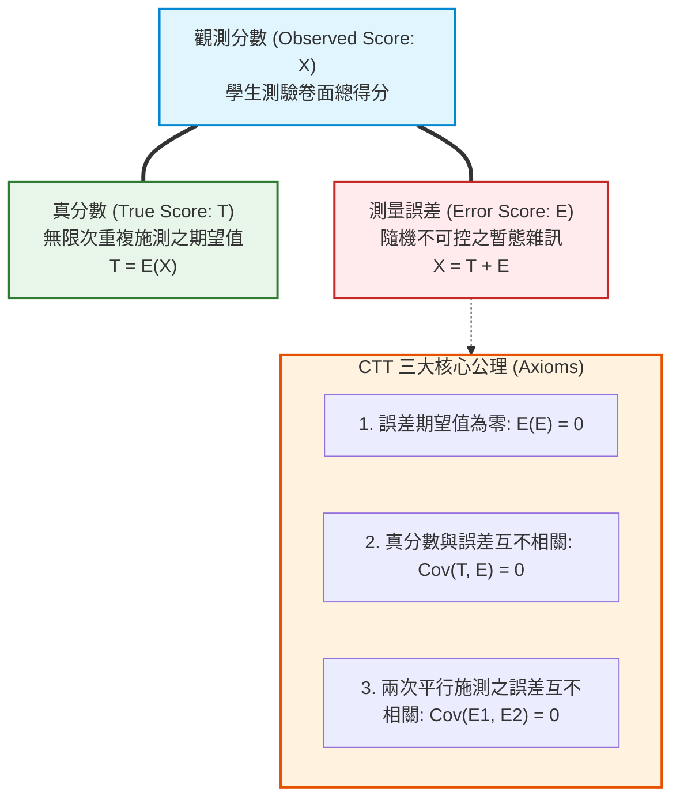

# 第 9 章：古典測驗理論 (CTT) 與試題分析流水線

> **本章目標**：根據 Lord 與 Novick（1968）、Crocker 與 Algina（1986）及 Cook 與 Pitoniak（2025）《Educational Measurement》（第 5 版）。從真分數模型（$X = T + E$）與變異數分解出發，說明試題難度（$P$ 值）、Kelley（1939）高低分組 $27\%$ 鑑別度（$D$ 值）與點二系列相關（$r_{pbis}$），並使用 Tidyverse 與 `gt` 套件（Iannone et al., 2026）建立試題分析管線。

---

## 9.1 理論基礎：古典測驗理論（CTT）數學公理與變異數分解

古典測驗理論（Classical Test Theory, CTT）（Lord & Novick, 1968; 陳新豐, 2021）歷經近百年的發展，仍是教育測驗與心理評量中常用的基礎。



### 9.1.1 變異數分解定理（Variance Decomposition）
基於公理 $\text{Cov}(T, E) = 0$，觀測分數的總變異數 $\sigma_X^2$ 可精確分解為真分數變異數 $\sigma_T^2$ 與隨機誤差變異數 $\sigma_E^2$ 之和：
$$\sigma_X^2 = \sigma_T^2 + \sigma_E^2$$

測驗的**信度（Reliability, $\rho_{XX'}$）**在理論上被定義為「真分數變異佔總觀測變異的百分比」：
$$\rho_{XX'} = \frac{\sigma_T^2}{\sigma_X^2} = 1 - \frac{\sigma_E^2}{\sigma_X^2}$$

---

## 9.2 試題分析指標（Item Analysis Statistics）

在試題層次，CTT 提供了三大核心指標來檢定每一道題目的計量品質：

### 9.2.1 試題難度（通過率 $P_j$）
第 $j$ 題的難度 $P_j$ 定義為答對該題的人數比例：
$$P_j = \frac{R_j}{N}$$
- $P_j$ 值越高，代表題目越簡單；$P_j$ 值越低，代表題目越困難。
- **最佳測驗總體資訊量難度**：常態分佈測驗中，試題平均難度維持在 $0.50 \sim 0.60$ 時，測驗總分的變異數最大，鑑別效果最佳。

### 9.2.2 高低分組極端群鑑別度（$D_j$ 值）
依據 Kelley（1939）的數理推導，當母體為常態分配時，選取測驗總分的前 $27\%$ 作為高分組（High Group, $H$）、後 $27\%$ 作為低分組（Low Group, $L$），能夠最大化極端群差異的檢定力（Statistical Power）：
$$D_j = P_{H, j} - P_{L, j} = \frac{R_{H, j}}{n_H} - \frac{R_{L, j}}{n_L}$$

- **Ebel 與 Frisbie（1991）鑑別度評估準則**：
  - $D \ge .40$：優良試題（無需修改）。
  - $.30 \le D < .40$：良好試題（少許修改或直接入庫）。
  - $.20 \le D < .30$：尚可試題（需實質修訂題幹或誘答選項）。
  - $D < .20$：不良試題（必須淘汰）。

### 9.2.3 點二系列相關（Point-Biserial Correlation, $r_{pbis}$）
衡量單一試題得分（$0/1$）與受試者總分（連續變數）的皮爾森相關（Crocker & Algina, 1986）。為了避免題目與自身總分產生的自相關膨脹（Spurious Inflation），必須採用**校正後點二系列相關（Corrected Item-Total Correlation）**：
$$r_{pbis, j}^* = \text{Cor}(X_j, S - X_j)$$
其中 $S$ 為考生總分。一般要求 $r_{pbis}^* \ge .25$。

---

## 9.3 現代 R 語言程式實作：自動化 CTT 試題分析管線

我們將這些計量指標整合成一段純粹的 Tidyverse 自動化管線，輸入原始作答表，全自動批次運算並產出診斷表：

```r
# ==============================================================================
# 第 9 章程式碼清單 9.1：自動化 CTT 試題分析流水線實作
# ==============================================================================

library(dplyr)
library(tidyr)
library(purrr)
library(tibble)

# 讀取全書示範資料
df_all <- read.csv("book/data/assessment_data.csv") |> as_tibble()

# 1. 僅對全題作答完整的考生計算總分，以便公平分組；不把漏答當成答錯
cog_cols <- sprintf("item_%02d", 1:15)
df_scored <- df_all |>
  mutate(
    total_raw = if_else(
      if_all(all_of(cog_cols), ~ !is.na(.x)),
      rowSums(across(all_of(cog_cols))),
      NA_real_
    )
  )

# 2. 定義 Kelley 27% 極端組切截點
cutoff_high <- quantile(df_scored$total_raw, probs = 0.73, na.rm = TRUE)
cutoff_low  <- quantile(df_scored$total_raw, probs = 0.27, na.rm = TRUE)

df_groups <- df_scored |>
  mutate(
    extreme_group = case_when(
      is.na(total_raw)         ~ NA_character_,
      total_raw >= cutoff_high ~ "High",
      total_raw <= cutoff_low  ~ "Low",
      TRUE                     ~ "Middle"
    )
  )

# 3. 批次計算 15 題之難度、鑑別度與校正後點二系列相關
ctt_pipeline_results <- cog_cols |>
  map(\(item) {
    x <- df_groups[[item]]
    tot <- df_groups$total_raw
    valid <- !is.na(x)
    group_valid <- valid & !is.na(df_groups$extreme_group)

    # 難度 P
    p_val <- mean(x[valid])

    # 鑑別度 D (前後 27%)
    p_high <- mean(x[group_valid & df_groups$extreme_group == "High"])
    p_low  <- mean(x[group_valid & df_groups$extreme_group == "Low"])
    d_val  <- p_high - p_low

    # 校正點二系列相關 (排除自身)
    rest_valid <- valid & !is.na(tot)
    rest_tot <- tot[rest_valid] - x[rest_valid]
    r_pbis <- cor(x[rest_valid], rest_tot)

    # 綜合評價
    status <- case_when(
      d_val >= 0.40 & r_pbis >= 0.30 ~ "優良 (Excellent)",
      d_val >= 0.30 & r_pbis >= 0.25 ~ "良好 (Good)",
      d_val >= 0.20                  ~ "尚可 (Marginal)",
      TRUE                           ~ "待淘汰 (Poor)"
    )

    tibble(
      Item = item,
      Valid_N = sum(valid),
      Difficulty_P = round(p_val, 3),
      Discrimination_D = round(d_val, 3),
      Corrected_r_pbis = round(r_pbis, 3),
      Evaluation = status
    )
  }) |>
  list_rbind()

cat("--- CTT 自動化試題分析流水線結果 ---\n")
print(ctt_pipeline_results, n = 15)
```

---

## 9.4 報表與視覺化：`gt` 表格與雙軸指標圖

### 9.4.1 使用 `gt` 套件產出 APA 規格試題診斷總表

```r
# ==============================================================================
# 第 9 章程式碼清單 9.2：使用 gt 產出 APA 試題診斷表 (Table 9.1)
# ==============================================================================

library(gt)

table_9_1 <- ctt_pipeline_results |>
  gt() |>
  tab_header(
    title = md("**Table 9.1**"),
    subtitle = md("*古典測驗理論試題品質診斷與篩選總表 (N = 1,000)*")
  ) |>
  cols_label(
    Item = "試題代號",
    Valid_N = "有效樣本",
    Difficulty_P = "難度 (P)",
    Discrimination_D = "鑑別度 (D)",
    Corrected_r_pbis = "校正點二系列 (r_pbis)",
    Evaluation = "品質綜合判定"
  ) |>
  tab_style(
    style = cell_text(weight = "bold", color = "#2e7d32"),
    locations = cells_body(
      columns = Evaluation,
      rows = grepl("優良", Evaluation)
    )
  ) |>
  tab_style(
    style = cell_text(weight = "bold", color = "#c62828"),
    locations = cells_body(
      columns = Evaluation,
      rows = grepl("待淘汰", Evaluation)
    )
  ) |>
  tab_source_note(
    source_note = md("註：高低分組依據總分前後 27% 劃分；點二系列相關採校正後排除自相關法估計。")
  )

# 儲存 HTML 預覽檔
gtsave(table_9_1, "book/table_9_1_ctt_summary.html")
cat("成功產出報表: book/table_9_1_ctt_summary.html\n")
```

### 9.4.2 繪製難度 vs. 鑑別度雙指標水平長條圖

```r
# ==============================================================================
# 第 9 章程式碼清單 9.3：難度與鑑別度雙指標水平對比圖繪製
# ==============================================================================

library(ggplot2)

plot_ctt_df <- ctt_pipeline_results |>
  select(Item, Difficulty_P, Discrimination_D) |>
  pivot_longer(cols = c(Difficulty_P, Discrimination_D), names_to = "Indicator", values_to = "Value") |>
  mutate(
    Indicator = factor(Indicator, levels = c("Difficulty_P", "Discrimination_D"),
                       labels = c("難度 (P 值)", "鑑別度 (D 值)")),
    Item = factor(Item, levels = rev(cog_cols)) # 逆序使 Item 01 置於上方
  )

p9 <- ggplot(plot_ctt_df, aes(x = Value, y = Item, fill = Indicator)) +
  geom_col(position = position_dodge(width = 0.7), width = 0.65, color = "black", linewidth = 0.3) +
  geom_vline(xintercept = 0.30, linetype = "dashed", color = "#d95f02", linewidth = 0.8) +
  annotate("text", x = 0.32, y = 2, label = "D = 0.30 良好門檻", color = "#d95f02", hjust = 0, fontface = "bold", size = 3.5) +
  scale_fill_manual(values = c("難度 (P 值)" = "#2b5c8f", "鑑別度 (D 值)" = "#6baed6")) +
  scale_x_continuous(limits = c(0, 1.0), breaks = seq(0, 1, by = 0.2)) +
  labs(
    title = "Figure 9.1: 15 道認知測驗試題之難度 P 值與鑑別度 D 值對照水平條形圖",
    subtitle = "呈現各題指標相對於 D >= 0.30 品質門檻之達成情況 (N = 1,000)",
    x = "指標數值 (Index Value)",
    y = "試題編號 (Item ID)",
    fill = "計量指標",
    caption = "Note. Classical Test Theory Pipeline Audit simulation."
  ) +
  theme_classic(base_size = 12) +
  theme(
    legend.position = "bottom",
    plot.title = element_text(face = "bold", size = 13),
    axis.text = element_text(color = "black")
  )

ggsave("book/fig_9_1_ctt_dual_bars.png", plot = p9, width = 8.5, height = 7, dpi = 300)
cat("成功產出圖表: book/fig_9_1_ctt_dual_bars.png\n")
```

---

## 9.5 測驗報告專業解讀（Substantive Interpretation）

依據 Cook 與 Pitoniak（2025）及 Ebel 與 Frisbie（1991）之試題分析建議，試題分析報告可給出以下具體處置：

> ### 🛠️ CTT 試題篩選與題庫入庫規範
> 1. **核心題目入庫**：依本資料的計算結果，`item_04`、`item_05`、`item_06`、`item_13`、`item_15` 的難度介於 $P = .48 \sim .64$，鑑別度 $D$ 介於 $.72 \sim .90$，可列為核心試題候選；其中 `item_15` 另需參考第 17 章的 DIF 結果。`item_12`（$P = .08$，$D = .24$）過難，建議修訂。
> 2. **CTT 的理論限制（Lord & Novick, 1968）**：
>    - **樣本依賴性（Sample-Dependent）**：試題難度 $P$ 取決於施測考生的能力水準（受試者聰明則 $P$ 偏高，受試者弱則 $P$ 偏低），並非試題本身的絕對物理屬性。
>    - **測驗依賴性（Test-Dependent）**：考生的總分取決於考卷的難易程度，無法跨測驗直接比較。
>    - **測量標準誤單一化**：CTT 假定全體考生的測量誤差完全相同（$\sigma_E$ 為常數），未反映不同分數區間測量精度的差異。這些限制是 IRT 發展的動機之一。

---

## 9.6 章末實務習題與專案挑戰

### 【基礎練習題】
1. 某次 50 題選擇題測驗中，考生總分的變異數為 $\sigma_X^2 = 36$，真分數變異數為 $\sigma_T^2 = 27$。請計算該測驗的 CTT 信度係數 $\rho_{XX'}$ 與隨機測量誤差變異數 $\sigma_E^2$。
2. 某試題在高分組（270 人）中有 216 人答對，在低分組（270 人）中有 81 人答對。請計算該試題的難度 $P$（以極端群估計）與鑑別度 $D$，依據 Ebel 與 Frisbie（1991）標準對該題品質進行評語。

### 【進階工程挑戰】
3. 撰寫一個名為 `distractor_analysis(df_raw_responses, df_keys, item_name)` 的函數。輸入原始未計分的考生作答選項（包含 "A", "B", "C", "D"）與標準答案，自動計算高分組、中分組、低分組在各個選項（正確答案與干擾選項）上的選擇人數比例，並檢核是否存在「高分組選擇比例顯著高於低分組的不良誘答選項」。

---

### 💡 習題參考解答

```r
# ==============================================================================
# 第 9 章習題解答參考
# ==============================================================================

# 第 1 題
var_X <- 36
var_T <- 27
var_E <- var_X - var_T
reliability <- var_T / var_X
cat(sprintf("信度係數 rho_XX = %.2f, 誤差變異數 var_E = %.2f\n", reliability, var_E))

# 第 2 題
p_high <- 216 / 270
p_low  <- 81 / 270
d_val  <- p_high - p_low
p_est  <- (p_high + p_low) / 2
cat(sprintf("極端組難度 P = %.2f, 鑑別度 D = %.2f -> 評語: 優良試題 (D >= 0.40)\n", p_est, d_val))
```

---

## 參考文獻 (References)

陳新豐（2021）。**R 語言：量表編製、統計分析與試題反應理論**（第 2 版）。五南圖書。

Cook, L. L., & Pitoniak, M. J. (Eds.). (2025). *Educational measurement* (5th ed.). Oxford University Press.

Crocker, L., & Algina, J. (1986). *Introduction to classical and modern test theory*. Holt, Rinehart and Winston.

Ebel, R. L., & Frisbie, D. A. (1991). *Essentials of educational measurement* (5th ed.). Prentice Hall.

Iannone, R., Cheng, J., Schloerke, B., Haughton, S., Hughes, E., Lauer, A., François, R., Seo, J., Brevoort, K., & Roy, O. (2026). *gt: Easily create presentation-ready display tables* (R package version 1.4.0) [Computer software]. The Comprehensive R Archive Network. https://doi.org/10.32614/CRAN.package.gt

Kelley, T. L. (1939). The selection of upper and lower groups for the validation of test items. *Journal of Educational Psychology*, *30*(1), 17–24. https://doi.org/10.1037/h0057123

Lord, F. M., & Novick, M. R. (1968). *Statistical theories of mental test scores*. Addison-Wesley.
