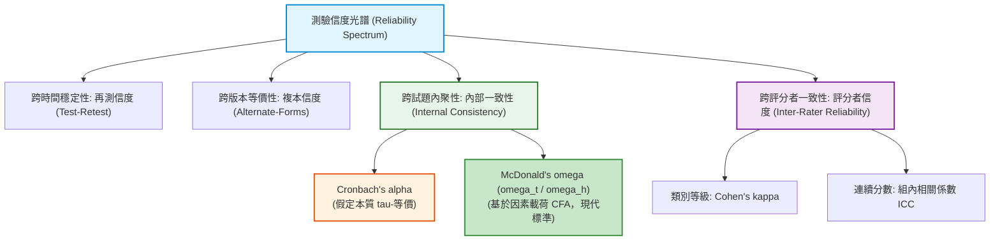

# 第 10 章：量表信度、條件測量標準誤與評分一致性

> **本章目標**：根據 Lee 與 Harris（2025）於《Educational Measurement》（第 5 版）之信度章節。推導 Cronbach's $\alpha$（Cronbach, 1951）、Spearman-Brown 公式（Brown, 1910; Spearman, 1910）與 McDonald's $\omega$ 分層信度（McDonald, 1999）。說明 $\tau$-等價假設的限制，並實作條件測量標準誤（CSEM）（Keats, 1957; Lord, 1984）與評分者間信度（ICC）（Shrout & Fleiss, 1979）。

---

## 10.1 理論基礎：測驗信度光譜與數學公理

信度（Reliability）代表測量結果的**一致性、穩定性與精確性（Consistency and Precision）**（Lee & Harris, 2025）。



### 10.1.1 Cronbach's $\alpha$ 係數公式推導
設測驗由 $J$ 道題項組成，考生總分為 $S = \sum_{j=1}^J X_j$。總分變異數 $\sigma_S^2$ 可展開為：
$$\sigma_S^2 = \sum_{j=1}^J \sigma_j^2 + 2 \sum_{j < k} \text{Cov}(X_j, X_k)$$

Cronbach（1951）提出的 $\alpha$ 係數公式為：
$$\alpha = \frac{J}{J - 1} \left(1 - \frac{\sum_{j=1}^J \sigma_j^2}{\sigma_S^2}\right)$$

> [!CAUTION] $\alpha$ 係數的關鍵假設：本質 $\tau$-等價（Essential Tau-Equivalence）
> 在常見單一構面模型下，$\alpha$ 的信度解讀需要本質 $\tau$-等價及誤差項等假設（Cronbach, 1951; McDonald, 1999）。當負荷不等或其他假設不成立時，$\alpha$ 不保證一定是信度的下界，也不一定只會低估；應搭配模型與資料條件解讀（Lee & Harris, 2025）。

### 10.1.2 現代常用標準：McDonald's $\omega$（分層信度）
McDonald（1999）提出以驗證性因素分析（CFA）的非標準化載荷 $\lambda_j$ 與殘差變異數 $\theta_j$ 為基礎的信度係數 $\omega_t$：
$$\omega_t = \frac{\left(\sum_{j=1}^J \lambda_j\right)^2}{\left(\sum_{j=1}^J \lambda_j\right)^2 + \sum_{j=1}^J \theta_j}$$
$\omega_t$ 不要求題目具有相同負荷，但仍仰賴所採因素模型與誤差假設。它是可考慮的信度估計之一，不宜稱為適用所有情況的單一「標準」；報告時應交代模型與估計方式。

---

## 10.2 測量標準誤（SEM）與條件測量標準誤（CSEM）

信度係數（$0 \sim 1$）是群體層次的相對指標，而**測量標準誤（Standard Error of Measurement, SEM）**則是落實到個人分數層次的絕對誤差指標：
$$\text{SEM} = \sigma_S \sqrt{1 - \rho_{XX'}}$$

考生真分數（True Score, $T$）的 $95\%$ 信賴區間為：
$$\text{CI}_{95\%} = \hat{S} \pm 1.96 \cdot \text{SEM}$$

### 10.2.1 條件測量標準誤（CSEM）
在真實測驗中，全域 SEM 是不切實際的簡化。考生在中間分數處（作答不確定性最高）與在接近滿分或零分處（答案幾乎一致）的測量精度完全不同。在二分試題測驗中，Keats（1957）與 Lord（1984）提出了多項式條件測量標準誤估計模型（see also Lee & Harris, 2025）：
$$\text{CSEM}(s) \approx \sqrt{\frac{s(J - s) - \sigma_S^2(1 - \rho_{XX'})}{J - 1}}$$
其中 $s$ 為考生的卷面得分，$J$ 為測驗題數。

---

## 10.3 現代 R 語言程式實作：Cronbach's $\alpha$ vs. McDonald's $\omega$

我們使用示範資料集中經反向題翻轉的情意量表（`scale_01` 至 `scale_10`），以 `psych` 套件（Revelle, 2026）與 `lavaan` 套件（Rosseel, 2012）執行信度分析。本量表包含兩個潛在向度：分向度一為內在動機（`scale_01` 至 `scale_05`），分向度二為自我效能（`scale_06` 至 `scale_10`）。依據現代測驗學標準（McDonald, 1999），多向度量表除了報告全量表外，更應分別報告各分向度的內部一致性與結構組合信度（Composite Reliability, CR）：

```r
# ==============================================================================
# 第 10 章程式碼清單 10.1：內部一致性信度、分向度信度與 CFA 組合信度流水線
# ==============================================================================

library(dplyr)
library(psych)
library(tibble)
library(lavaan)

# 讀取示範資料集
df_all <- read.csv("book/data/assessment_data.csv") |> as_tibble()

# 提取情意量表題項，並將 scale_03 與 scale_08 正確翻轉 (6 - x)
df_affective <- df_all |>
  select(scale_01:scale_10) |>
  mutate(
    scale_03 = 6L - as.integer(scale_03),
    scale_08 = 6L - as.integer(scale_08)
  )

# 1. 全量表 Cronbach's Alpha 與刪題信度
alpha_full <- psych::alpha(df_affective, check.keys = FALSE, warnings = FALSE)

cat("--- 全量表 Cronbach's Alpha 分析結果 ---\n")
cat(sprintf("原始 Alpha (Raw Alpha)        : %.4f\n", alpha_full$total$raw_alpha))
cat(sprintf("標準化 Alpha (Standardized)   : %.4f\n", alpha_full$total$`std.alpha`))
cat(sprintf("平均題間相關 (Average r)      : %.4f\n", alpha_full$total$average_r))

# 檢視刪題後信度 (Alpha-if-item-deleted) 與校正後題總相關 (r.drop)
cat("\n--- 刪題後信度與題總相關摘要 (前 4 題) ---\n")
item_rel_summary <- cbind(
  alpha_full$alpha.drop[1:4, c("raw_alpha", "std.alpha")],
  r.drop = alpha_full$item.stats[1:4, "r.drop"]
)
print(round(item_rel_summary, 4))

# 2. 分構面信度計算 (Subscale Reliabilities)
f1_items <- df_affective |> select(scale_01:scale_05)
f2_items <- df_affective |> select(scale_06:scale_10)

alpha_f1 <- psych::alpha(f1_items, check.keys = FALSE, warnings = FALSE)$total$raw_alpha
alpha_f2 <- psych::alpha(f2_items, check.keys = FALSE, warnings = FALSE)$total$raw_alpha

omega_f1 <- suppressWarnings(psych::omega(f1_items, nfactors = 1, plot = FALSE)$omega.tot)
omega_f2 <- suppressWarnings(psych::omega(f2_items, nfactors = 1, plot = FALSE)$omega.tot)

# 3. 結構方程模型 (CFA) 組合信度計算函數 (Composite Reliability; McDonald, 1999)
calc_cfa_composite_reliability <- function(data_subset, item_names) {
  model_syn <- paste0("F =~ ", paste(item_names, collapse = " + "))
  fit <- suppressWarnings(lavaan::cfa(model_syn, data = data_subset, std.lv = TRUE))
  pe <- parameterEstimates(fit)
  lambdas <- pe$est[pe$op == "=~"]
  thetas <- pe$est[pe$op == "~~" & pe$lhs %in% item_names]
  sum_l <- sum(lambdas)
  sum_t <- sum(thetas)
  sum_l^2 / (sum_l^2 + sum_t)
}

cfa_omega_f1 <- calc_cfa_composite_reliability(df_affective, sprintf("scale_%02d", 1:5))
cfa_omega_f2 <- calc_cfa_composite_reliability(df_affective, sprintf("scale_%02d", 6:10))

# 彙整結構化信度比較表
scale_comparison_df <- tibble(
  向度 = c("全量表 (scale_01 ~ scale_10)", "分構面一：內在動機 (scale_01 ~ scale_05)", "分構面二：自我效能 (scale_06 ~ scale_10)"),
  題數 = c(10L, 5L, 5L),
  `Cronbach Alpha` = round(c(alpha_full$total$raw_alpha, alpha_f1, alpha_f2), 3),
  `McDonald Omega` = round(c(suppressWarnings(psych::omega(df_affective, nfactors = 2, plot = FALSE)$omega.tot), omega_f1, omega_f2), 3),
  `CFA 組合信度` = c(NA_real_, round(cfa_omega_f1, 3), round(cfa_omega_f2, 3))
)

cat("\n--- 全量表與分構面信度指標彙總表 ---\n")
print(scale_comparison_df)
```

---

## 10.4 評分者間一致性信度（Inter-Rater Reliability）

在非選擇題（如作文、程式碼審查、口試）中，分數依賴多位評分員的主觀裁決，常採用組內相關係數（Intraclass Correlation Coefficient, ICC）評估評分者間信度（Shrout & Fleiss, 1979）。

```r
# ==============================================================================
# 第 10 章程式碼清單 10.2：組內相關係數 (ICC) 評分者信度實作
# ==============================================================================

# 模擬 50 篇申論題作文，由 3 位評分委員進行 1~10 分評定
set.seed(42)
true_essay_quality <- rnorm(50, mean = 6.5, sd = 1.5)

rater_1 <- round(pmin(pmax(true_essay_quality + rnorm(50, 0, 0.6), 1), 10), 1)
rater_2 <- round(pmin(pmax(true_essay_quality + rnorm(50, 0.3, 0.7), 1), 10), 1) # 評分稍嚴格
rater_3 <- round(pmin(pmax(true_essay_quality - rnorm(50, 0.2, 0.5), 1), 10), 1) # 評分稍寬鬆

rater_df <- tibble(Rater1 = rater_1, Rater2 = rater_2, Rater3 = rater_3)

# 呼叫 psych::ICC() 估計評分者組內相關係數
icc_res <- psych::ICC(rater_df)

cat("--- 評分者間一致性 ICC 診斷結果 ---\n")
# psych::ICC() 的列名是模型描述；此處查看 ICC2k（隨機評分者、絕對一致）
# 與 ICC3k（固定評分者、相對一致）的平均評分者估計。
print(icc_res$results[c("Average_random_raters", "Average_fixed_raters"),
                      c("type", "ICC", "F", "p", "lower bound", "upper bound")])
```

---

## 10.5 視覺化：條件測量標準誤（CSEM）與信賴區間漏斗圖

依據 Keats（1957）與 Lord（1984）模型，以下繪製測驗在各個卷面得分上的測量標準誤與 $95\%$ 真分數信賴帶：

```r
# ==============================================================================
# 第 10 章程式碼清單 10.3：條件測量標準誤 (CSEM) 與信賴帶繪製
# ==============================================================================

library(ggplot2)

# 認知測驗參數 (J = 15 題)
J_cog <- 15
scores_grid <- 0:J_cog
cog_scores <- df_all$total_score
sd_cog <- sd(cog_scores, na.rm = TRUE)
rel_cog <- psych::alpha(df_all[, sprintf("item_%02d", 1:15)], warnings = FALSE)$total$raw_alpha # 本資料約 0.87

# 計算各得分點之 CSEM (以 Keats/Lord 近似模型)
sem_global <- sd_cog * sqrt(1 - rel_cog)
csem_values <- sapply(scores_grid, \(s) {
  val <- (s * (J_cog - s) - (sd_cog^2) * (1 - rel_cog)) / (J_cog - 1)
  if (val <= 0) return(sem_global * 0.7) # 邊界平滑
  sqrt(val)
})

csem_df <- tibble(
  Score = scores_grid,
  CSEM = csem_values,
  Lower_95 = pmax(0, Score - 1.96 * csem_values),
  Upper_95 = pmin(J_cog, Score + 1.96 * csem_values)
)

p10 <- ggplot(csem_df, aes(x = Score)) +
  geom_ribbon(aes(ymin = Lower_95, ymax = Upper_95), fill = "#2b5c8f", alpha = 0.20) +
  geom_line(aes(y = Score), color = "#2b5c8f", linewidth = 1.0, linetype = "dashed") +
  geom_line(aes(y = CSEM * 3), color = "#d95f02", linewidth = 1.2) + # 放大尺度呈現
  scale_y_continuous(
    name = "真分數估計與 95% 信賴帶 (True Score & CI)",
    limits = c(0, J_cog),
    breaks = seq(0, J_cog, by = 3),
    sec.axis = sec_axis(~ . / 3, name = "條件測量標準誤 (CSEM: 橘線)")
  ) +
  scale_x_continuous(breaks = 0:J_cog) +
  labs(
    title = "Figure 10.1: 認知測驗條件測量標準誤 (CSEM) 與真分數 95% 信賴區間漏斗圖",
    subtitle = "橘線呈現隨卷面得分變動之 CSEM；陰影區域為對應分數點之真分數 95% 估計區間帶",
    x = "卷面觀測得分 (Observed Score: s)",
    caption = "Model: Polynomial Lord CSEM Formulation (J = 15, Reliability = alpha)"
  ) +
  theme_classic(base_size = 12) +
  theme(
    plot.title = element_text(face = "bold", size = 13),
    axis.title.y.right = element_text(color = "#d95f02", face = "bold"),
    axis.text.y.right = element_text(color = "#d95f02")
  )

ggsave("book/fig_10_1_csem_funnel.png", plot = p10, width = 8.5, height = 5.2, dpi = 300)
cat("成功產出圖表: book/fig_10_1_csem_funnel.png\n")
```

---

## 10.6 測驗報告專業解讀（Substantive Interpretation）

向學校、家長或教育行政單位呈現測驗結果時，信度與 CSEM 的解讀重點如下：

> ### 📢 信度與成績單解讀指引
> 1. **避免過度解讀單一分數（Over-interpretation）**：如圖 10.1 所示，一位獲得 $8$ 分的考生，其 CSEM 約為 $1.96$ 分，真分數的 $95\%$ 信賴區間約為 $[4.2, 11.8]$ 分。因此在評量成績單上，**不應以 1 分之差斷定兩位考生的學力高下**，成績單宜標註分數信賴區間帶（Band）。
> 2. **門檻設定點的誤差最小化**：若測驗主要用途為及格判定（如通過門檻為 8 分），試題題庫的難度分佈應盡可能集中在通過門檻附近，以壓縮切截點上的 CSEM，降低誤判率（False Classification）。

---

## 10.7 章末實務習題與專案挑戰

### 【基礎練習題】
1. 某包含 20 題的測驗，其 Cronbach's $\alpha$ 信度為 $.70$。若命題小組預計將測驗擴充為 60 題（題數變為原來的 3 倍，且新增試題與原題同質），請使用 Spearman-Brown 公式（Brown, 1910; Spearman, 1910）計算擴充後的預期信度 $\rho^*$。
2. 某考生在標準差 $\sigma_X = 15$、信度 $\rho_{XX'} = .84$ 的智力測驗中獲得 110 分。請計算該測驗的全域測量標準誤（SEM），並計算該生真智商分數的 $95\%$ 信賴區間。

### 【進階工程挑戰】
3. 請撰寫一個名為 `tidy_split_half_reliability(item_matrix, n_random_splits = 1000)` 的無母數信度模擬函數。該函數將題目隨機對半切分（Random Split-Half）1,000 次，每次計算兩半部總分的皮爾森相關並套用 Spearman-Brown 公式校正，最終輸出包含平均折半信度、標準誤以及 $95\%$ 經驗分位數信賴區間的整潔 `tibble`。

---

### 💡 習題參考解答

```r
# ==============================================================================
# 第 10 章習題解答參考
# ==============================================================================

# 第 1 題 (Spearman-Brown 預言公式)
k <- 3
alpha_orig <- 0.70
alpha_new <- (k * alpha_orig) / (1 + (k - 1) * alpha_orig)
cat(sprintf("擴充 3 倍題數後之預期信度: %.4f\n", alpha_new))

# 第 2 題
sem <- 15 * sqrt(1 - 0.84)
score_obs <- 110
ci_95 <- c(score_obs - 1.96 * sem, score_obs + 1.96 * sem)
cat(sprintf("SEM = %.2f, 95%% 信賴區間 = [%.2f, %.2f]\n", sem, ci_95[1], ci_95[2]))

# 第 3 題解答
tidy_split_half_reliability <- function(item_matrix, n_random_splits = 1000) {
  J <- ncol(item_matrix)
  stopifnot(J >= 4)
  half_J <- floor(J / 2)
  
  split_alphas <- replicate(n_random_splits, {
    shuffled_cols <- sample(1:J)
    part1 <- rowSums(item_matrix[, shuffled_cols[1:half_J], drop = FALSE])
    part2 <- rowSums(item_matrix[, shuffled_cols[(half_J + 1):J], drop = FALSE])
    r_half <- cor(part1, part2)
    (2 * r_half) / (1 + r_half)
  })
  
  tibble::tibble(
    Mean_Split_Half = mean(split_alphas),
    SE = sd(split_alphas),
    CI_Lower = quantile(split_alphas, 0.025),
    CI_Upper = quantile(split_alphas, 0.975)
  )
}
cat("隨機折半信度模擬函數編寫完成。\n")
```

---

## 參考文獻 (References)

Brown, W. (1910). Some experimental results in the correlation of mental abilities. *British Journal of Psychology*, *3*(3), 296–322. https://doi.org/10.1111/j.2044-8295.1910.tb00207.x

Cronbach, L. J. (1951). Coefficient alpha and the internal structure of tests. *Psychometrika*, *16*(3), 297–334. https://doi.org/10.1007/BF02310555

Keats, J. A. (1957). Estimation of error variances of test scores. *Psychometrika*, *22*(1), 29–41. https://doi.org/10.1007/BF02289207

Lee, W.-C., & Harris, D. J. (2025). Reliability in educational measurement. In L. L. Cook & M. J. Pitoniak (Eds.), *Educational measurement* (5th ed., pp. 277–382). Oxford University Press.

Lord, F. M. (1984). Standard errors of measurement at different score levels. *Journal of Educational Measurement*, *21*(3), 239–243. https://doi.org/10.1111/j.1745-3984.1984.tb01032.x

McDonald, R. P. (1999). *Test theory: A unified treatment*. Lawrence Erlbaum Associates.

Revelle, W. (2026). *psych: Procedures for psychological, psychometric, and personality research* (R package version 2.6.4) [Computer software]. The Comprehensive R Archive Network. https://CRAN.R-project.org/package=psych

Rosseel, Y. (2012). lavaan: An R package for structural equation modeling. *Journal of Statistical Software*, *48*(2), 1–36. https://doi.org/10.18637/jss.v048.i02

Shrout, P. E., & Fleiss, J. L. (1979). Intraclass correlations: Uses in assessing rater reliability. *Psychological Bulletin*, *86*(2), 420–428. https://doi.org/10.1037/0033-2909.86.2.420

Spearman, C. (1910). Correlation calculated from faulty data. *British Journal of Psychology*, *3*(3), 271–295. https://doi.org/10.1111/j.2044-8295.1910.tb00206.x
