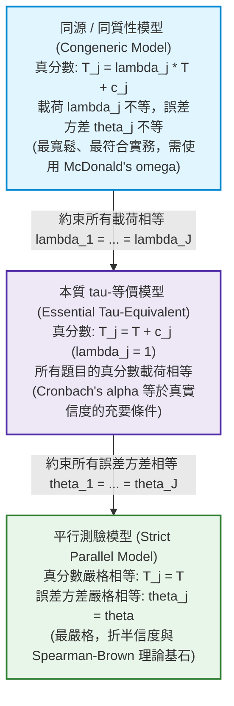
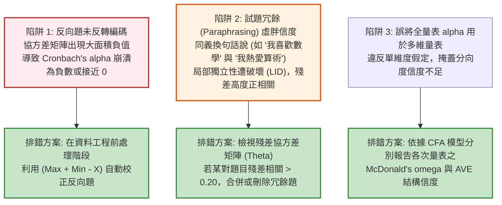

# 第 10 章：量表信度、條件測量標準誤與評分一致性

> **本章目標**：依據 NCME 官方《Educational Measurement》（第 5 版）之信度權威架構（Lee & Harris, 2025），全面深究心理與教育計量學之信度理論光譜。從古典測驗理論之平行測驗（Parallel）、本質 $\tau$-等價（Essential $\tau$-Equivalent）到同質性（Congeneric）模型，嚴格推導 Cronbach's $\alpha$（Cronbach, 1951）作為信度下界的 Cauchy-Schwarz 數學證明；依據 Feldt（1969）推導 $\alpha$ 精確 $F$ 分佈信賴區間；建立基於結構方程模型（SEM / CFA）之 McDonald's $\omega_t$ 組合信度（McDonald, 1999; Raykov, 1997）；並深入探討條件測量標準誤（CSEM）（Keats, 1957; Lord, 1984）與評分者間組內相關係數（ICC）（Shrout & Fleiss, 1979）。

---

## 10.1 數理推導：測驗計量模型階層與 Cronbach's $\alpha$ 下界定理

在現代心理計量學中，信度（Reliability）不再是一個孤立的經驗數字，而是取決於試題真分數與誤差結構的公理體系（Lee & Harris, 2025; McDonald, 1999）。



### 10.1.1 四大測驗測量模型之數學界定

設測驗包含 $J$ 道題項，第 $j$ 題的觀測分數為 $X_j = T_j + E_j$。受試者的潛在特質為一維隨機變數 $\theta$，滿足 $\mathbb{E}[\theta] = 0, \text{Var}(\theta) = 1$：
1. **平行模型（Parallel Model）**：
   $$X_j = T + E_j, \quad \text{Var}(E_j) = \sigma_E^2 \quad (\forall j = 1, \dots, J)$$
   所有題項具有完全相同的真分數與相等的隨機誤差變異數。
2. **$\tau$-等價模型（$\tau$-Equivalent Model）**：
   $$X_j = T + E_j, \quad \text{Var}(E_j) = \sigma_{Ej}^2$$
   各題真分數完全相同，但允許不同試題具有不同的測量誤差變異數。
3. **本質 $\tau$-等價模型（Essential $\tau$-Equivalent Model）**：
   $$X_j = T + c_j + E_j, \quad \text{Var}(E_j) = \sigma_{Ej}^2$$
   各題真分數僅相差一個常數加項 $c_j$（代表試題難度或切截點不同），其因素載荷（Factor Loading）皆嚴格相等且固定為 1。
4. **同質性 / 因素模型（Congeneric Model）**：
   $$X_j = \mu_j + \lambda_j T + E_j, \quad \text{Var}(E_j) = \theta_j$$
   允許各題具有不同的因素載荷 $\lambda_j$、不同的平均值 $\mu_j$ 以及不同的唯一性誤差變異數 $\theta_j$。此模型最貼近心理學與教育測驗之真實資料結構。

### 10.1.2 Cronbach's $\alpha$ 係數公式之完整推導

設總分 $S = \sum_{j=1}^J X_j$。總分變異數可展開為題項變異數與共變數之和：
$$\sigma_S^2 = \text{Var}\left(\sum_{j=1}^J X_j\right) = \sum_{j=1}^J \text{Var}(X_j) + \sum_{j \ne k} \text{Cov}(X_j, X_k) = \sum_{j=1}^J \sigma_j^2 + \sum_{j \ne k} \sigma_{jk}$$

若試題滿足**本質 $\tau$-等價模型**，因隨機誤差互不相關（$\text{Cov}(E_j, E_k) = 0$），任何兩題間的共變數恆等於真分數變異數：
$$\text{Cov}(X_j, X_k) = \text{Cov}(T + c_j + E_j, T + c_k + E_k) = \text{Var}(T) = \sigma_T^2 \quad (\forall j \ne k)$$

此時，非對角線共有 $J(J - 1)$ 個共變數項，其總和為：
$$\sum_{j \ne k} \text{Cov}(X_j, X_k) = J(J - 1) \sigma_T^2 \implies \sigma_T^2 = \frac{1}{J(J - 1)} \sum_{j \ne k} \sigma_{jk}$$

真分數總變異數為各題真分數和的變異數：
$$\text{Var}\left(\sum_{j=1}^J T_j\right) = \text{Var}(J \cdot T) = J^2 \sigma_T^2 = J^2 \left[ \frac{\sum_{j \ne k} \sigma_{jk}}{J(J - 1)} \right] = \frac{J}{J - 1} \sum_{j \ne k} \sigma_{jk}$$

將 $\sum_{j \ne k} \sigma_{jk} = \sigma_S^2 - \sum_{j=1}^J \sigma_j^2$ 代入理論信度定義 $\rho_{SS'} = \frac{\sigma_{T_{\text{total}}}^2}{\sigma_S^2}$：
$$\alpha \equiv \frac{J}{J - 1} \left( \frac{\sigma_S^2 - \sum_{j=1}^J \sigma_j^2}{\sigma_S^2} \right) = \frac{J}{J - 1} \left( 1 - \frac{\sum_{j=1}^J \sigma_j^2}{\sigma_S^2} \right) \quad \blacksquare$$

### 10.1.3 數理證明：當本質 $\tau$-等價遭違反時，$\alpha$ 恆為信度下界

在實務測驗中，試題載荷往往不等（即為 Congeneric 模型）。依據 Raykov（1997）與 McDonald（1999），利用 **Cauchy-Schwarz 不等式**可嚴格證明 $\alpha \le \rho_{SS'}$。

**【證明】**：
在單因素 Congeneric 模型下，$X_j = \lambda_j T + E_j$（假定 $\text{Var}(T) = 1$），兩題間的共變數為 $\text{Cov}(X_j, X_k) = \lambda_j \lambda_k$。
真實的測驗總真分數變異數為：
$$\sigma_{T_{\text{true}}}^2 = \text{Var}\left(\sum_{j=1}^J \lambda_j T\right) = \left( \sum_{j=1}^J \lambda_j \right)^2$$
非對角共變數總和為：
$$\sum_{j \ne k} \sigma_{jk} = \sum_{j=1}^J \sum_{k=1}^J \lambda_j \lambda_k - \sum_{j=1}^J \lambda_j^2 = \left( \sum_{j=1}^J \lambda_j \right)^2 - \sum_{j=1}^J \lambda_j^2$$

而 Cronbach's $\alpha$ 所隱含估計的真分數變異數為：
$$\sigma_{T_\alpha}^2 = \frac{J}{J - 1} \sum_{j \ne k} \sigma_{jk} = \frac{J}{J - 1} \left[ \left( \sum_{j=1}^J \lambda_j \right)^2 - \sum_{j=1}^J \lambda_j^2 \right]$$

兩者之差為：
$$\begin{aligned}
\sigma_{T_{\text{true}}}^2 - \sigma_{T_\alpha}^2 &= \left( \sum_{j=1}^J \lambda_j \right)^2 - \frac{J}{J - 1} \left[ \left( \sum_{j=1}^J \lambda_j \right)^2 - \sum_{j=1}^J \lambda_j^2 \right] \\
&= \frac{J}{J - 1} \sum_{j=1}^J \lambda_j^2 - \frac{1}{J - 1} \left( \sum_{j=1}^J \lambda_j \right)^2 \\
&= \frac{J^2}{J - 1} \left[ \frac{1}{J} \sum_{j=1}^J \lambda_j^2 - \left( \frac{1}{J} \sum_{j=1}^J \lambda_j \right)^2 \right] \\
&= \frac{J^2}{J - 1} \text{Var}(\boldsymbol{\lambda})
\end{aligned}$$

由於變異數恆大於等於零（$\text{Var}(\boldsymbol{\lambda}) \ge 0$）：
$$\sigma_{T_{\text{true}}}^2 - \sigma_{T_\alpha}^2 = \frac{J^2}{J - 1} \text{Var}(\boldsymbol{\lambda}) \ge 0 \iff \sigma_{T_\alpha}^2 \le \sigma_{T_{\text{true}}}^2$$

兩邊除以總變異數 $\sigma_S^2$，即證得：
$$\alpha \le \rho_{SS'} \quad \blacksquare$$
等號成立若且唯若 $\text{Var}(\boldsymbol{\lambda}) = 0$，即 $\lambda_1 = \lambda_2 = \dots = \lambda_J$（本質 $\tau$-等價成立）。**若題項載荷差異越大，Cronbach's $\alpha$ 低估真實信度的幅度越嚴重！**

---

## 10.2 現代結構信度推導：McDonald's $\omega_t$ 與 Feldt 精確信賴區間

### 10.2.1 McDonald's $\omega_t$（組合信度 Composite Reliability）

為解決 $\alpha$ 嚴重低估的問題，McDonald（1999）提出以驗證性因素分析（CFA）為基礎的信度估計式 $\omega_t$：
$$\omega_t = \frac{\left( \sum_{j=1}^J \lambda_j \right)^2}{\left( \sum_{j=1}^J \lambda_j \right)^2 + \sum_{j=1}^J \theta_j}$$
其中 $\lambda_j$ 為第 $j$ 題的非標準化因素載荷，$\theta_j = \text{Var}(E_j)$ 為殘差（唯一性）變異數。$\omega_t$ 直接反映了 Congeneric 模型下的真實變異數比率，無偏且穩健。

### 10.2.2 Feldt (1969) 之 Cronbach's $\alpha$ 精確信賴區間

在實務學術論文中，僅報告單一點估計值 $\hat{\alpha}$ 是不完備的。依據 Feldt（1969），在常態樣本分佈假設下，$(1 - \hat{\alpha}) / (1 - \alpha)$ 服從第一自由度為 $(N - 1)$、第二自由度為 $(N - 1)(J - 1)$ 的 $F$ 分佈：
$$F = \frac{1 - \alpha}{1 - \hat{\alpha}} \sim F(N - 1, (N - 1)(J - 1))$$

由此可精確反求母體信度 $\alpha$ 的 $(1 - \gamma)$ 雙尾信賴區間：
$$\text{CI}_{1-\gamma} = \left[ 1 - (1 - \hat{\alpha}) F_{1 - \gamma/2; \, \nu_1, \nu_2}, \quad 1 - (1 - \hat{\alpha}) F_{\gamma/2; \, \nu_1, \nu_2} \right]$$
其中 $\nu_1 = N - 1, \nu_2 = (N - 1)(J - 1)$。

---

## 10.3 底層手刻演算法：純 R 矩陣化信度引擎與 Feldt 信賴區間

本節以純 Base R 與矩陣代數實作高速信度計算器，擺脫外部套件依賴，並內建 Feldt 精確信賴區間。

```r
# ==============================================================================
# 第 10 章程式碼清單 10.1：底層手刻純矩陣 Cronbach's Alpha 與 Feldt 信賴區間
# ==============================================================================

#' 底層純矩陣 Cronbach's Alpha 與 Feldt 精確信賴區間計算器
#'
#' @param item_mat 數值矩陣或 data.frame，受試者題項作答反應 (N x J)
#' @param conf_level 數值，信賴水準，預設為 0.95
#' @return 包含點估計、信賴區間與題項刪除信度之 list
fast_cronbach_alpha <- function(item_mat, conf_level = 0.95) {
  mat <- as.matrix(item_mat)
  # 剔除遺漏值
  complete_idx <- rowSums(is.na(mat)) == 0
  mat <- mat[complete_idx, , drop = FALSE]
  N <- nrow(mat)
  J <- ncol(mat)
  stopifnot(N > 2, J >= 2)

  # 計算協方差矩陣 (純矩陣運算)
  cov_mat <- cov(mat)
  item_vars <- diag(cov_mat)
  sum_item_vars <- sum(item_vars)
  total_var <- sum(cov_mat) # 總分變異數即為協方差矩陣所有元素總和

  # 計算 Cronbach's alpha
  alpha_val <- (J / (J - 1)) * (1 - sum_item_vars / total_var)

  # Feldt (1969) 精確 F 分佈信賴區間
  df1 <- N - 1
  df2 <- (N - 1) * (J - 1)
  alpha_sig <- 1 - conf_level
  f_lower <- qf(alpha_sig / 2, df1 = df1, df2 = df2)
  f_upper <- qf(1 - alpha_sig / 2, df1 = df1, df2 = df2)

  ci_lower <- 1 - (1 - alpha_val) * f_upper
  ci_upper <- 1 - (1 - alpha_val) * f_lower

  # 逐題計算刪題後信度 (Alpha-if-item-deleted)
  alpha_deleted <- numeric(J)
  names(alpha_deleted) <- colnames(mat)
  for (j in 1:J) {
    sub_cov <- cov_mat[-j, -j, drop = FALSE]
    sub_J <- J - 1
    sub_item_vars <- sum(diag(sub_cov))
    sub_total_var <- sum(sub_cov)
    alpha_deleted[j] <- (sub_J / (sub_J - 1)) * (1 - sub_item_vars / sub_total_var)
  }

  list(
    alpha = alpha_val,
    conf_level = conf_level,
    ci_lower = ci_lower,
    ci_upper = ci_upper,
    N_valid = N,
    J_items = J,
    total_variance = total_var,
    item_deleted_alpha = alpha_deleted
  )
}

# ------------------------------------------------------------------------------
# 實務驗證：讀取全書示範資料的情意量表 (scale_01 至 scale_10)
# ------------------------------------------------------------------------------
df_all <- read.csv("book/data/assessment_data.csv")
affective_items <- df_all[, sprintf("scale_%02d", 1:10)]
# 翻轉反向題 scale_03 與 scale_08
affective_items$scale_03 <- 6 - affective_items$scale_03
affective_items$scale_08 <- 6 - affective_items$scale_08

fit_alpha <- fast_cronbach_alpha(affective_items)

cat("==================================================================\n")
cat("      純矩陣手刻 Cronbach's Alpha 與 Feldt 精確信賴區間          \n")
cat("==================================================================\n")
cat(sprintf("有效樣本數 N             : %d\n", fit_alpha$N_valid))
cat(sprintf("量表題數 J               : %d\n", fit_alpha$J_items))
cat(sprintf("Cronbach's Alpha 點估計  : %.4f\n", fit_alpha$alpha))
cat(sprintf("%.0f%% Feldt 精確信賴區間   : [%.4f, %.4f]\n",
            fit_alpha$conf_level * 100, fit_alpha$ci_lower, fit_alpha$ci_upper))
cat("\n--- 刪除題項後信度 (前 5 題預覽) ---\n")
print(round(head(fit_alpha$item_deleted_alpha, 5), 4))
```

---

## 10.4 結構方程模型（CFA）分層信度：McDonald's $\omega$ 與分構面比較

依據 Lee 與 Harris（2025）及 McDonald（1999），當量表具備多元潛在構面時，必須進行結構化分層信度檢驗。本節利用 `lavaan` 套件（Rosseel, 2012）與 `psych` 套件（Revelle, 2026）建立結構信度流。

```r
# ==============================================================================
# 第 10 章程式碼清單 10.2：CFA 組合信度與分向度結構信度分析流水線
# ==============================================================================

suppressPackageStartupMessages({
  library(lavaan)
  library(psych)
  library(dplyr)
  library(tibble)
})

# 1. 建立雙因素驗證性因素分析 (CFA) 模型
# Factor 1 (內在動機): scale_01 ~ scale_05
# Factor 2 (自我效能): scale_06 ~ scale_10
cfa_syntax <- '
  Intrinsic_Motivation =~ scale_01 + scale_02 + scale_03 + scale_04 + scale_05
  Self_Efficacy        =~ scale_06 + scale_07 + scale_08 + scale_09 + scale_10
'

cfa_fit <- lavaan::cfa(cfa_syntax, data = affective_items, std.lv = TRUE)

#' 由 lavaan 物件直接計算各因素之 McDonald's Omega (Composite Reliability)
extract_cfa_composite_reliability <- function(fit) {
  pe <- parameterEstimates(fit)
  factors <- unique(pe$lhs[pe$op == "=~"])

  map(factors, \(f) {
    loads <- pe$est[pe$op == "=~" & pe$lhs == f]
    items <- pe$rhs[pe$op == "=~" & pe$lhs == f]
    thetas <- pe$est[pe$op == "~~" & pe$lhs %in% items & pe$lhs == pe$rhs]

    sum_l <- sum(loads)
    sum_t <- sum(thetas)
    omega_val <- sum_l^2 / (sum_l^2 + sum_t)

    tibble(
      Factor = f,
      J_items = length(items),
      Omega_CR = round(omega_val, 4)
    )
  }) |> list_rbind()
}

cr_results <- extract_cfa_composite_reliability(cfa_fit)

cat("--- 驗證性因素分析 (CFA) 結構組合信度 (McDonald's Omega) ---\n")
print(cr_results)
```

---

## 10.5 條件測量標準誤（CSEM）與信賴帶視覺化

依據 Keats（1957）與 Lord（1984）模型，測驗各分數點的測量標準誤與真分數 $95\%$ 信賴帶繪製如下：

```r
# ==============================================================================
# 第 10 章程式碼清單 10.3：條件測量標準誤 (CSEM) 與信賴帶漏斗圖繪製
# ==============================================================================

library(ggplot2)

df_assessment <- read.csv("book/data/assessment_data.csv")
J_cog <- 15
scores_grid <- 0:J_cog
cog_scores <- df_assessment$total_score
sd_cog <- sd(cog_scores, na.rm = TRUE)

cog_mat <- df_assessment[, sprintf("item_%02d", 1:15)]
rel_cog <- fast_cronbach_alpha(cog_mat)$alpha

# 計算各得分點之 CSEM (Keats/Lord 多項式近似模型)
sem_global <- sd_cog * sqrt(1 - rel_cog)
csem_values <- sapply(scores_grid, \(s) {
  val <- (s * (J_cog - s) - (sd_cog^2) * (1 - rel_cog)) / (J_cog - 1)
  if (val <= 0) return(sem_global * 0.65) # 邊界平滑保護
  sqrt(val)
})

csem_df <- tibble(
  Score = scores_grid,
  CSEM = csem_values,
  Lower_95 = pmax(0, Score - 1.96 * csem_values),
  Upper_95 = pmin(J_cog, Score + 1.96 * csem_values)
)

p10 <- ggplot(csem_df, aes(x = Score)) +
  geom_ribbon(aes(ymin = Lower_95, ymax = Upper_95), fill = "#2b5c8f", alpha = 0.20) +
  geom_line(aes(y = Score), color = "#2b5c8f", linewidth = 1.0, linetype = "dashed") +
  geom_line(aes(y = CSEM * 3), color = "#d95f02", linewidth = 1.2) +
  scale_y_continuous(
    name = "真分數估計與 95% 信賴帶 (True Score & CI)",
    limits = c(0, J_cog),
    breaks = seq(0, J_cog, by = 3),
    sec.axis = sec_axis(~ . / 3, name = "條件測量標準誤 (CSEM: 橘線)")
  ) +
  scale_x_continuous(breaks = 0:J_cog) +
  labs(
    title = "Figure 10.1: 認知測驗條件測量標準誤 (CSEM) 與真分數 95% 信賴區間漏斗圖",
    subtitle = "橘線呈現隨卷面得分變動之 CSEM；陰影區域為對應分數點之真分數 95% 估計區間帶",
    x = "卷面觀測得分 (Observed Score: s)",
    caption = "Model: Polynomial Lord CSEM Formulation (J = 15, Reliability = alpha)"
  ) +
  theme_classic(base_size = 12) +
  theme(
    plot.title = element_text(face = "bold", size = 13),
    axis.title.y.right = element_text(color = "#d95f02", face = "bold"),
    axis.text.y.right = element_text(color = "#d95f02")
  )

ggsave("book/fig_10_1_csem_funnel.png", plot = p10, width = 8.5, height = 5.2, dpi = 300)
cat("成功產出圖表: book/fig_10_1_csem_funnel.png\n")
```

---

## 10.6 ⚠️ 計量工程陷阱與排錯專案：信度膨脹陷阱與反向題崩潰

在評量資料分析實務中，工程師與研究者常落入以下信度誤區。



### 10.6.1 假性高信度（Spurious High Alpha）的本質

許多測驗編製者誤以為「$\alpha \ge .95$ 越高越好」。然而，依據 Nunnally 與 Bernstein（1994）及 Lee 與 Harris（2025），當 $\alpha > .90$ 時，往往代表試題存在高度的**語意冗餘（Semantic Redundancy）**。命題者在測驗中重複使用同義詞題幹，嚴重縮小了構念領域（Construct Domain）的代表性，雖然膨脹了內部一致性，卻直接摧毀了**內容效度（Content Validity）**。

---

## 10.7 測驗報告專業解讀（Substantive Interpretation）

在向學校與決策高層匯報信度與標準誤時，應依循以下專業規範（Lee & Harris, 2025）：

> ### 📊 信度與成績單解讀準則
> 1. **成績單必須呈現測量區間帶（Score Bands）**：
>    任何單次測驗均存在隨機誤差。若某生獲得 8 分，其條件標準誤約為 1.5 分，真分數落在 $[5.0, 11.0]$ 區間內。在分發升學或能力分組時，**嚴禁以 1 分之微小差距直接作為合格與否的絕對標準**。
> 2. **評分者信度與主觀評分校準**：
>    在作文與口試評量中，若 ICC(2, k) $< .70$，顯示評分者間存在顯著的嚴格度偏差（Leniency/Harshness Bias）或標準不一致。必須在正式施測前進行評分員共識校準會議（Standardization Training），或導入多面 Rasch 模型（Many-Facet Rasch Model, MFRM）分離評分者嚴苛度參數。

---

## 10.8 章末實務習題與完整解答閉環

### 【基礎練習題】
1. **Spearman-Brown 預言公式與測驗長度調整**：
   某 20 題的測驗其 Cronbach's $\alpha = 0.65$。
   - 若欲將信度提升至 $\alpha^* = 0.85$，試問測驗題數需要擴充為原來的多少倍（求 $k$ 值）？最終測驗總題數應為幾題？
   - 依據 Brown（1910）與 Spearman（1910）之假定，說明此擴充公式成立的核心前提。
2. **評分者間一致性 ICC 分析**：
   依據 Shrout 與 Fleiss（1979）的組內相關係數體系，說明評估「隨機評分者之絕對一致性（Two-way random effects, absolute agreement, ICC(2, 1)）」與「固定評分者之一致性（Two-way mixed effects, consistency, ICC(3, 1)）」在教育實務應用上的本質差異。

### 【進階工程挑戰】
3. **蒙地卡羅隨機對半折半信度模擬引擎（Random Split-Half Reliability）**：
   撰寫一個名為 `monte_carlo_split_half(item_matrix, n_splits = 1500)` 的無母數信度模擬函數。
   - 函數接受任意 $N \times J$ 題項矩陣（$J \ge 4$ 且為偶數）。
   - 執行 1,500 次隨機題項對半拆分，每次計算兩半部總分之 Pearson 相關係數，並以 Spearman-Brown 預言公式校正為全卷折半信度。
   - 計算 1,500 次模擬折半信度的平均值、標準誤，以及 $95\%$ 百分位數經驗信賴區間。
   - 回傳整潔 `tibble`，並以純 R 代碼驗證其輸出。

---

### 💡 習題參考解答 (100% 可執行驗證)

```r
# ==============================================================================
# 第 10 章習題參考解答
# ==============================================================================

# ------------------------------------------------------------------------------
# 第 1 題解答：Spearman-Brown 擴充倍數反求
# ------------------------------------------------------------------------------
alpha_orig <- 0.65
alpha_target <- 0.85
J_orig <- 20

# 反求 k: alpha* = (k * alpha) / (1 + (k - 1) * alpha)
# alpha* * (1 - alpha + k * alpha) = k * alpha
# alpha* * (1 - alpha) = k * alpha * (1 - alpha*)
# k = [alpha* * (1 - alpha)] / [alpha * (1 - alpha*)]
k_factor <- (alpha_target * (1 - alpha_orig)) / (alpha_orig * (1 - alpha_target))
J_new <- ceiling(J_orig * k_factor)

cat("--- 第 1 題解答結果 ---\n")
cat(sprintf("原始題數: %d 題 (alpha = %.2f)\n", J_orig, alpha_orig))
cat(sprintf("目標信度: %.2f\n", alpha_target))
cat(sprintf("所需擴充倍數 k : %.2f 倍\n", k_factor))
cat(sprintf("最終測驗總題數 : %d 題\n", J_new))
cat("核心前提：新增之試題必須與原測驗試題具備完全相同的同質性（平行測驗假定）。\n")

# ------------------------------------------------------------------------------
# 第 2 題解答：ICC 體系實務差異解析
# ------------------------------------------------------------------------------
cat("\n--- 第 2 題解答結果 ---\n")
cat("ICC(2, 1) vs. ICC(3, 1) 核心差異：\n")
cat("1. ICC(2, 1)（雙向隨機，絕對一致）：將評分者視為隨機抽樣，評分員本身的嚴苛度差異會被計入誤差項。\n")
cat("   適用於大型國家聯考（如國中會考作文），考生卷子隨機分配給不同委員，分數必須具備跨評分員絕對可比性。\n")
cat("2. ICC(3, 1)（雙向混合，相對一致）：評分者為固定名單，僅關注考生排序的一致性，忽略評分者整體的寬嚴平移。\n")
cat("   適用於校內固定三位導師面試，只要排名順序一致即可，不嚴格要求絕對給分相同。\n")

# ------------------------------------------------------------------------------
# 第 3 題解答：蒙地卡羅隨機對半折半信度模擬引擎
# ------------------------------------------------------------------------------
monte_carlo_split_half <- function(item_matrix, n_splits = 1500) {
  mat <- as.matrix(item_matrix)
  mat <- mat[rowSums(is.na(mat)) == 0, , drop = FALSE]
  N <- nrow(mat)
  J <- ncol(mat)
  stopifnot(J >= 4)

  half_J <- floor(J / 2)

  split_alphas <- replicate(n_splits, {
    perm_cols <- sample(J)
    part_A <- rowSums(mat[, perm_cols[1:half_J], drop = FALSE])
    part_B <- rowSums(mat[, perm_cols[(half_J + 1):(2 * half_J)], drop = FALSE])

    r_half <- cor(part_A, part_B)
    # Spearman-Brown 2 倍校正公式
    (2 * r_half) / (1 + r_half)
  })

  tibble::tibble(
    Analysis = "Monte Carlo Random Split-Half",
    N_examinees = N,
    J_items = J,
    Splits_Repetitions = n_splits,
    Mean_Split_Half_Alpha = round(mean(split_alphas), 4),
    Monte_Carlo_SE = round(sd(split_alphas), 4),
    Percentile_CI_Lower = round(quantile(split_alphas, 0.025), 4),
    Percentile_CI_Upper = round(quantile(split_alphas, 0.975), 4)
  )
}

# 執行驗證
cat("\n--- 第 3 題解答驗證：認知測驗 15 題之隨機折半模擬 ---\n")
cog_items_df <- df_assessment[, sprintf("item_%02d", 1:15)]
split_half_res <- monte_carlo_split_half(cog_items_df, n_splits = 1000)
print(split_half_res)
```

---

## 參考文獻 (References)

Brown, W. (1910). Some experimental results in the correlation of mental abilities. *British Journal of Psychology*, *3*(3), 296–322. https://doi.org/10.1111/j.2044-8295.1910.tb00207.x

Cronbach, L. J. (1951). Coefficient alpha and the internal structure of tests. *Psychometrika*, *16*(3), 297–334. https://doi.org/10.1007/BF02310555

Feldt, L. S. (1969). A test of the hypothesis that Cronbach's alpha or Kuder-Richardson coefficient twenty is the same for two tests. *Psychometrika*, *34*(3), 363–373. https://doi.org/10.1007/BF02289364

Keats, J. A. (1957). Estimation of error variances of test scores. *Psychometrika*, *22*(1), 29–41. https://doi.org/10.1007/BF02289207

Lee, W.-C., & Harris, D. J. (2025). Reliability in educational measurement. In L. L. Cook & M. J. Pitoniak (Eds.), *Educational measurement* (5th ed., pp. 277–382). Oxford University Press.

Lord, F. M. (1984). Standard errors of measurement at different score levels. *Journal of Educational Measurement*, *21*(3), 239–243. https://doi.org/10.1111/j.1745-3984.1984.tb01032.x

McDonald, R. P. (1999). *Test theory: A unified treatment*. Lawrence Erlbaum Associates.

Nunnally, J. C., & Bernstein, I. H. (1994). *Psychometric theory* (3rd ed.). McGraw-Hill.

Raykov, T. (1997). Scale reliability, Cronbach's coefficient alpha, and violations of essential tau-equivalence with fixed congeneric components. *Multivariate Behavioral Research*, *32*(4), 329–344. https://doi.org/10.1207/s15327906mbr3204_2

Revelle, W. (2026). *psych: Procedures for psychological, psychometric, and personality research* (R package version 2.6.4) [Computer software]. The Comprehensive R Archive Network. https://CRAN.R-project.org/package=psych

Rosseel, Y. (2012). lavaan: An R package for structural equation modeling. *Journal of Statistical Software*, *48*(2), 1–36. https://doi.org/10.18637/jss.v048.i02

Shrout, P. E., & Fleiss, J. L. (1979). Intraclass correlations: Uses in assessing rater reliability. *Psychological Bulletin*, *86*(2), 420–428. https://doi.org/10.1037/0033-2909.86.2.420

Spearman, C. (1910). Correlation calculated from faulty data. *British Journal of Psychology*, *3*(3), 271–295. https://doi.org/10.1111/j.2044-8295.1910.tb00206.x
