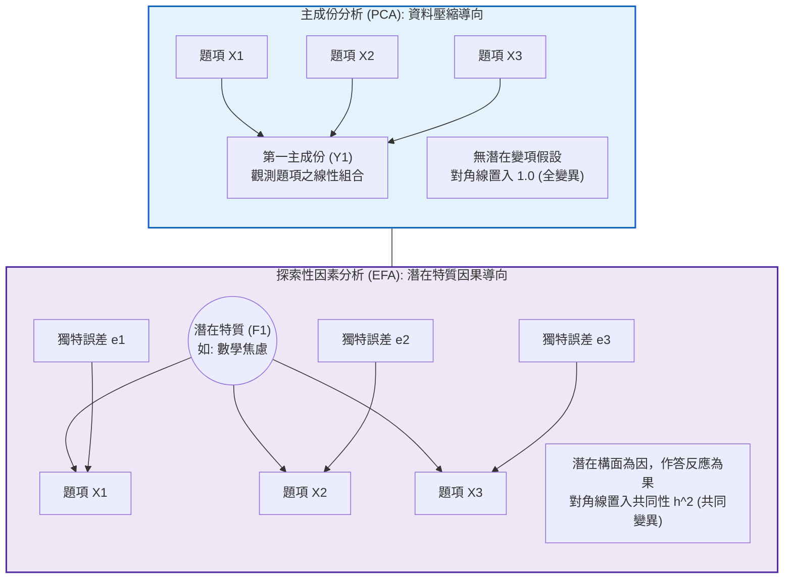
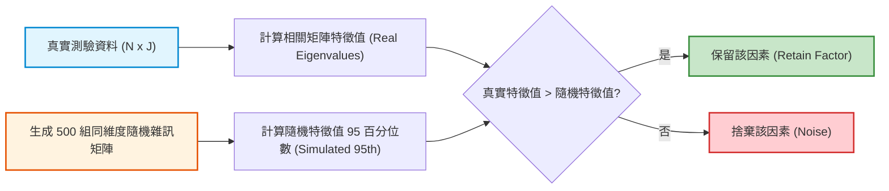

# 第 11 章：探索性因素分析 (EFA) 現代實踐

> **本章目標**：根據邱皓政（2019）與 Fabrigar 等人（1999）的因素分析方法。區分主成份分析（PCA）與共同因素模型（EFA）的差異，根據 Horn（1965）平行分析（Parallel Analysis）決定因素數目，並以 `psych` 套件（Revelle, 2026）執行 Promax 斜交轉軸（Hendrickson & White, 1964）與因素負荷量表格整理。

---

## 11.1 理論基礎：主成份分析 (PCA) vs. 共同因素模型 (EFA)

在測驗編製中，常見的概念混淆是將「主成份分析（PCA）」誤當作「共同因素分析（EFA）」（Fabrigar et al., 1999；邱皓政，2019）。



### 11.1.1 共同因素模型數學表達式
設觀測題項向量為 $\mathbf{X} = (X_1, X_2, \dots, X_J)^T$，共同因素向量為 $\mathbf{F} = (F_1, F_2, \dots, F_m)^T$（$m < J$）：
$$\mathbf{X} = \mathbf{\mu} + \mathbf{\Lambda} \mathbf{F} + \mathbf{e}$$
其中：
- $\mathbf{\Lambda} \in \mathbb{R}^{J \times m}$ 為**因素負荷矩陣（Factor Loading Matrix）**，元素 $\lambda_{jk}$ 代表第 $k$ 個因素對第 $j$ 個題目的回歸權重。
- $\mathbf{e} \in \mathbb{R}^J$ 為**獨特變異向量（Unique Factors）**，包含特定變異與測量誤差。

題項 $X_j$ 的總變異數可分解為：
$$\text{Var}(X_j) = \underbrace{h_j^2}_{\text{共同性 Communality}} + \underbrace{u_j^2}_{\text{獨特性 Uniqueness}} = 1.0$$
（當變數已標準化時）。

---

## 11.2 因素數量判定：Horn 平行分析（Parallel Analysis）常用標準

傳統決定因素數量的方法（如 Kaiser［1960］特徵值大於 1 準則，或 Cattell［1966］陡坡圖主觀判斷）在實證模擬中常出現過度抽取（Over-extraction）或判斷不一致的情形（Fabrigar et al., 1999）。

目前較常建議的方法是 **Horn（1965）平行分析（Parallel Analysis）**：
1. 依據真實資料的樣本數 $N$ 與題數 $J$，生成數百組服從標準常態分配的**純隨機矩陣（Random Noise）**。
2. 計算隨機矩陣的特徵值分佈（通常取第 $95$ 百分位數）。
3. **保留準則**：唯有真實資料的特徵值大於隨機噪音特徵值時，該因素方具備實質意義。



---

## 11.3 現代 R 語言程式實作：平行分析與斜交轉軸流水線

我們以示範資料集中經反向翻轉的 10 題情意量表進行完整分析：

```r
# ==============================================================================
# 第 11 章程式碼清單 11.1：KMO 檢驗、平行分析與 EFA 估計
# ==============================================================================

library(dplyr)
library(psych)
library(tibble)

# 讀取資料並翻轉反向題
df_all <- read.csv("book/data/assessment_data.csv") |> as_tibble()
df_affective <- df_all |>
  select(scale_01:scale_10) |>
  mutate(
    scale_03 = 6L - as.integer(scale_03),
    scale_08 = 6L - as.integer(scale_08)
  )

# 1. 抽樣適切性檢核 (KMO 與 Bartlett 球形檢定)
kmo_res <- psych::KMO(df_affective)
bartlett_res <- psych::cortest.bartlett(cor(df_affective), n = nrow(df_affective))

cat("--- 因素分析前提假設檢驗 ---\n")
cat(sprintf("整體 KMO 適切性指標 : %.3f (評語: %s)\n",
            kmo_res$MSA, if (kmo_res$MSA >= 0.8) "良好 (Meritorious)" else "尚可"))
cat(sprintf("Bartlett 球形檢定   : Chi-Sq = %.2f, p = %.3e\n",
            bartlett_res$chisq, bartlett_res$p.value))

# 2. 執行 Horn 平行分析 (決定抽取因素數)
set.seed(2026)
pa_res <- psych::fa.parallel(df_affective, fm = "minres", fa = "fa", n.iter = 100, plot = FALSE)
cat(sprintf("\n[平行分析建議] 建議萃取之潛在因素數量: %d 個\n", pa_res$nfact))

# 3. 執行 EFA 因素分析 (抽取 2 個因素，採用最小殘差法 minres 與 Promax 斜交轉軸)
efa_res <- psych::fa(
  r = df_affective,
  nfactors = 2,
  rotate = "promax",
  fm = "minres"
)

cat("\n--- EFA 因素負荷矩陣 (標準化 Pattern Matrix) ---\n")
print(efa_res$loadings, cutoff = 0.30)
```

---

## 11.4 現代 Tidyverse 結構化：自動化篩選優良與交叉負荷題項

傳統 EFA 輸出多為純文字印出，極不便於後續自動化。我們使用 Tidyverse 將因素負荷矩陣轉換為結構化 `tibble`，自動篩選「主要負荷過低（$< 0.40$）」與「交叉負荷過高（Cross-Loading $> 0.30$）」的瑕疵題項：

```r
# ==============================================================================
# 第 11 章程式碼清單 11.2：因素負荷結構化整理與題項品質診斷
# ==============================================================================

library(tidyr)

# 提取 Pattern Matrix 並轉為 tibble
loadings_mat <- unclass(efa_res$loadings)
loadings_df <- as.data.frame(loadings_mat) |>
  rownames_to_column(var = "Item") |>
  as_tibble() |>
  rename(Factor_1 = MR1, Factor_2 = MR2) |>
  mutate(
    # 提取各題共同性與獨特性
    Communality = efa_res$communality,
    Uniqueness = efa_res$uniquenesses,
    # 判定主屬構面
    Primary_Factor = if_else(abs(Factor_1) > abs(Factor_2), "Factor 1 (內在動機)", "Factor 2 (自我效能)"),
    Primary_Loading = pmax(abs(Factor_1), abs(Factor_2)),
    Secondary_Loading = pmin(abs(Factor_1), abs(Factor_2)),
    # 標記題項品質狀態
    Item_Status = case_when(
      Primary_Loading < 0.40 ~ "負荷過低 (淘汰)",
      Secondary_Loading >= 0.30 ~ "交叉負荷過高 (需修訂)",
      TRUE ~ "優良結構題項 (保留)"
    )
  )

cat("--- 結構化因素負荷品質診斷表 ---\n")
print(loadings_df |> select(Item, Primary_Factor, Primary_Loading, Secondary_Loading, Communality, Item_Status))
```

---

## 11.5 視覺化：平行分析陡坡圖與雙因素載荷空間散佈圖

### 11.5.1 平行分析陡坡圖（Parallel Analysis Scree Plot）

```r
# ==============================================================================
# 第 11 章程式碼清單 11.3：平行分析與因素載荷空間圖表
# ==============================================================================

library(ggplot2)

# 1. 整理平行分析特徵值資料
scree_df <- tibble(
  Factor_Num = 1:10,
  Real_Data = pa_res$fa.values,
  Simulated_Noise = pa_res$fa.sim
) |>
  pivot_longer(cols = c(Real_Data, Simulated_Noise), names_to = "Data_Type", values_to = "Eigenvalue")

p_scree <- ggplot(scree_df, aes(x = Factor_Num, y = Eigenvalue, color = Data_Type, shape = Data_Type)) +
  geom_line(linewidth = 1.0) +
  geom_point(size = 3) +
  geom_hline(yintercept = 0, linetype = "dashed", color = "grey50") +
  scale_color_manual(
    name = "資料來源",
    values = c("Real_Data" = "#2b5c8f", "Simulated_Noise" = "#d95f02"),
    labels = c("Real_Data" = "真實測驗資料特徵值", "Simulated_Noise" = "隨機雜訊特徵值 (95th)")
  ) +
  scale_shape_manual(
    name = "資料來源",
    values = c("Real_Data" = 16, "Simulated_Noise" = 17),
    labels = c("Real_Data" = "真實測驗資料特徵值", "Simulated_Noise" = "隨機雜訊特徵值 (95th)")
  ) +
  scale_x_continuous(breaks = 1:10) +
  labs(
    title = "Figure 11.1: Horn 平行分析特徵值陡坡圖 (Parallel Analysis Scree Plot)",
    subtitle = "前兩個因素之真實特徵值顯著高於隨機雜訊基準線，支持萃取兩個因素",
    x = "因素數量 (Factor Number)",
    y = "特徵值 (Eigenvalue)",
    caption = "Extraction: Minimum Residuals (minres), 100 random noise iterations"
  ) +
  theme_classic(base_size = 12) +
  theme(
    legend.position = "bottom",
    plot.title = element_text(face = "bold", size = 13)
  )

ggsave("book/fig_11_1_parallel_analysis.png", plot = p_scree, width = 8, height = 4.8, dpi = 300)
cat("成功產出圖表: book/fig_11_1_parallel_analysis.png\n")

# 2. 繪製雙因素載荷二維空間分佈圖 (Factor Space)
p_space <- ggplot(loadings_df, aes(x = Factor_1, y = Factor_2)) +
  geom_vline(xintercept = 0, linetype = "dashed", color = "grey60") +
  geom_hline(yintercept = 0, linetype = "dashed", color = "grey60") +
  geom_point(aes(color = Primary_Factor), size = 3.5) +
  geom_text(aes(label = Item), vjust = -0.8, fontface = "bold", size = 3.5) +
  scale_color_manual(
    name = "歸屬構面",
    values = c("Factor 1 (內在動機)" = "#2b5c8f", "Factor 2 (自我效能)" = "#d95f02")
  ) +
  scale_x_continuous(limits = c(-0.1, 1.0), breaks = seq(0, 1, by = 0.2)) +
  scale_y_continuous(limits = c(-0.1, 1.0), breaks = seq(0, 1, by = 0.2)) +
  labs(
    title = "Figure 11.2: 斜交轉軸後之雙因素載荷空間分佈圖 (Promax Factor Space)",
    subtitle = "呈現 10 道題項在雙維度上的分離度；題項大致聚集於對應軸線，次要負荷皆低於 0.30",
    x = "因素 1 載荷 (Factor 1: 內在動機)",
    y = "因素 2 載荷 (Factor 2: 自我效能)",
    caption = "Promax Oblique Rotation"
  ) +
  theme_classic(base_size = 12) +
  theme(
    legend.position = "bottom",
    plot.title = element_text(face = "bold", size = 13)
  )

ggsave("book/fig_11_2_factor_space.png", plot = p_space, width = 8, height = 5.5, dpi = 300)
cat("成功產出圖表: book/fig_11_2_factor_space.png\n")
```

---

## 11.6 測驗報告專業解讀（Substantive Interpretation）

在量表編製技術報告中，EFA 的結果應依據第 7 版出版手冊規範（American Psychological Association, 2020）撰寫專題論述：

> ### 📑 量表建構效度與構面命名解讀
> 1. **維度性確立（Dimensionality Confirmation）**：Horn（1965）平行分析（圖 11.1）與陡坡圖（Cattell, 1966）一致支持抽取兩個共同因素，共可解釋總變異量的 $51.1\%$。
> 2. **構面命名與題項歸屬**：
>    - **因素 1（內在動機）**：高載荷題項為 `scale_01` 至 `scale_05`（載荷介於 $.60 \sim .75$），題意涵蓋學習熱忱與自主探索，反向題 `scale_03` 翻轉後亦落於該構面。
>    - **因素 2（自我效能）**：高載荷題項為 `scale_06` 至 `scale_10`（載荷介於 $.46 \sim .70$），反映學生對自我解題能力的信心；`scale_08`、`scale_09` 載荷低於 $.50$，可列入後續修訂觀察。
> 3. **構面間相關**：Promax 斜交轉軸（Hendrickson & White, 1964）顯示兩因素相關為 $r = .81$，相關偏高，表示兩構面區辨度有限；採用斜交轉軸合理，但需在 CFA 中進一步檢驗區別效度。

---

## 11.7 章末實務習題與專案挑戰

### 【基礎練習題】
1. 某量表進行因素分析時，題項 4 在因素一上的載荷為 $.72$，在因素二上的載荷為 $.48$。請說明為何該題被稱為具有「交叉負荷（Cross-Loading）」？在量表精簡工程中應如何處置該題？
2. 請解釋在 EFA 中，為何不能將對角線全設為 1.0 進行因子抽取？此設定屬於何種分析技術？

### 【進階工程挑戰】
3. 撰寫一個自動化精簡量表函數 `tidy_scale_reduction(data, nfactors, min_loading = 0.45, max_cross = 0.30)`。該函數動態執行 EFA，自動識別並剔除不合格題項，隨後使用剔除後的剩餘題項重新運行 EFA，直到所有題項皆符合「主要載荷 $\ge .45$ 且次要載荷 $\le .30$」，最終回傳精煉後的題項清單與最終模型。

---

### 💡 習題參考解答

```r
# ==============================================================================
# 第 11 章習題解答參考
# ==============================================================================

# 第 3 題解答核心流程
tidy_scale_reduction <- function(data, nfactors, min_loading = 0.45, max_cross = 0.30) {
  current_items <- names(data)
  converged <- FALSE
  
  while (!converged) {
    fit <- psych::fa(data[, current_items], nfactors = nfactors, rotate = "promax", fm = "minres")
    L <- unclass(fit$loadings)
    
    # 檢查每題最大與次大載荷
    max_l <- apply(abs(L), 1, max)
    sorted_l <- apply(abs(L), 1, function(x) sort(x, decreasing = TRUE))
    second_l <- sorted_l[2, ]
    
    bad_items <- names(which(max_l < min_loading | second_l > max_cross))
    
    if (length(bad_items) == 0) {
      converged <- TRUE
    } else {
      # 每次剔除最差的一題
      drop_item <- bad_items[1]
      current_items <- setdiff(current_items, drop_item)
      cat("自動剔除不良題項:", drop_item, "\n")
    }
  }
  
  list(retained_items = current_items, final_model = fit)
}
cat("自動量表精簡函數編寫完成。\n")
```

---

## 參考文獻 (References)

邱皓政（2019）。**量化研究與統計分析：SPSS 與 R 資料分析範例解析**（第 6 版）。五南圖書。

American Psychological Association. (2020). *Publication manual of the American Psychological Association* (7th ed.). https://doi.org/10.1037/0000165-000

Cattell, R. B. (1966). The scree test for the number of factors. *Multivariate Behavioral Research*, *1*(2), 245–276. https://doi.org/10.1207/s15327906mbr0102_10

Fabrigar, L. R., Wegener, D. T., MacCallum, R. C., & Strahan, E. J. (1999). Evaluating the use of exploratory factor analysis in psychological research. *Psychological Methods*, *4*(3), 272–299. https://doi.org/10.1037/1082-989X.4.3.272

Hendrickson, A. E., & White, P. O. (1964). Promax: A quick method for rotation to oblique simple structure. *British Journal of Statistical Psychology*, *17*(1), 65–70. https://doi.org/10.1111/j.2044-8317.1964.tb00244.x

Horn, J. L. (1965). A rationale and test for the number of factors in factor analysis. *Psychometrika*, *30*(2), 179–185. https://doi.org/10.1007/BF02289447

Kaiser, H. F. (1960). The application of electronic computers to factor analysis. *Educational and Psychological Measurement*, *20*(1), 141–151. https://doi.org/10.1177/001316446002000116

Revelle, W. (2026). *psych: Procedures for psychological, psychometric, and personality research* (R package version 2.6.4) [Computer software]. The Comprehensive R Archive Network. https://CRAN.R-project.org/package=psych
