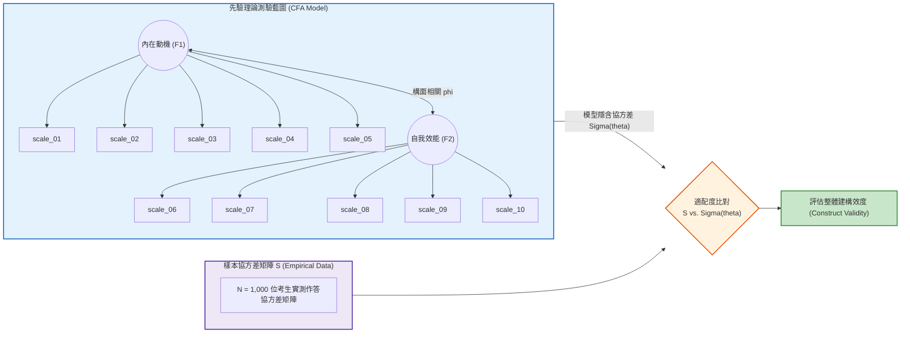

# 第 12 章：驗證性因素分析 (CFA) 與結構方程模型

> **本章目標**：根據 Brown（2015）、Kline（2023）、Cook 與 Pitoniak（2025）及邱皓政（2019）之結構方程模型（SEM）方法。介紹驗證性因素分析（Confirmatory Factor Analysis, CFA）（Jöreskog, 1969），使用 `lavaan` 套件（Rosseel, 2012）配適一階多因素模型與雙因素（Bifactor）模型（Reise, 2012），依據 Hu 與 Bentler（1999）指標判讀適配度，並計算收斂效度（AVE）與區別效度（Fornell & Larcker, 1981）。

---

## 12.1 理論基礎：CFA 測量模型與協方差結構矩陣

若說 EFA 是「由資料探索潛在維度」，則驗證性因素分析（CFA）（Jöreskog, 1969）則是**「由既有理論或測驗藍圖出發，檢驗經驗資料是否支持該先驗結構」**（Brown, 2015; Kline, 2023）。



### 12.1.1 協方差結構方程式
CFA 將觀測變數向量 $\mathbf{X}$ 表示為潛在因素向量 $\mathbf{\xi}$ 與測量誤差向量 $\mathbf{\delta}$ 的線性組合：
$$\mathbf{X} = \mathbf{\Lambda}_x \mathbf{\xi} + \mathbf{\delta}$$

模型隱含的母體協方差矩陣 $\mathbf{\Sigma}(\mathbf{\theta})$ 可推導為：
$$\mathbf{\Sigma}(\mathbf{\theta}) = \mathbf{\Lambda}_x \mathbf{\Phi} \mathbf{\Lambda}_x^T + \mathbf{\Theta}_\delta$$
其中：
- $\mathbf{\Lambda}_x$ 為因素載荷矩陣（Factor Loadings）。
- $\mathbf{\Phi}$ 為潛在因素間的協方差矩陣（Factor Covariance）。
- $\mathbf{\Theta}_\delta$ 為測量誤差的對角共變異數矩陣（Unique Variances）。

---

## 12.2 模型識別與全域適配度評估標準

### 12.2.1 模型識別條件（Model Identification）
1. **自由度規則（$t$-rule）**：觀測資訊數 $p(p+1)/2$ 必須大於待估計自由參數數 $q$（即自由度 $df \ge 0$）。
2. **尺度確定（Scale Setting）**：潛在構面無天然測量單位，必須透過以下方式之一錨定尺度：
   - **標記變數法（Marker Variable）**：將每個潛在因素的第一道試題載荷固定為 $1.0$（`lavaan` 預設）。
   - **固定潛在變異法（Fixed Factor Variance）**：將潛在因素的變異數直接固定為 $1.0$（$\phi_{kk} = 1.0$）。

### 12.2.2 全域適配度常見參考值

下列數值是特定研究條件下提出的經驗參考值（Hu & Bentler, 1999; Kline, 2023），不是跨模型、樣本與估計法皆適用的硬性通過門檻；應合併考量殘差、參數估計、模型複雜度與理論合理性。

| 適配度指標 (Fit Index) | 衡量維度 | 理想收斂門檻 (Good Fit) | 邊際可接受門檻 (Marginal) |
| :--- | :--- | :--- | :--- |
| **$\chi^2 / df$ (卡方自由度比)** | 絕對適配度 | $< 3.0$ | $< 5.0$ |
| **CFI (比較適配指數)** | 增值/比較適配 | $\ge .95$ | $\ge .90$ |
| **TLI (Tucker-Lewis 指數)** | 考慮簡約性之比較適配 | $\ge .95$ | $\ge .90$ |
| **RMSEA (近似均方根誤差)** | 漸近外推誤差 | $\le .06$ (90% CI 上限 $< .08$) | $\le .08$ |
| **SRMR (標準化均方根殘差)** | 殘差絕對偏差 | $\le .08$ | $\le .10$ |

---

## 12.3 現代 R 語言程式實作：競爭模型比對與 `lavaan` 語法

我們在 `lavaan`（Rosseel, 2012）中設定三個互相競爭的理論模型：
- **Model 1（單因素模型，M1）**：假定所有 10 題皆反映單一全域學習態度（虛無模型）。
- **Model 2（斜交雙因素模型，M2）**：假定內在動機（前 5 題）與自我效能（後 5 題）為兩個具相關之構面。
- **Model 3（雙因素 Bifactor 模型，M3）**：假定存在一個共通動機一般因素（General Factor），同時包含兩個特定構面（Specific Factors）（Reise, 2012）。

本章示範先將李克特題目視為近似連續變項並使用一般 CFA 估計。若要把題目視為有序類別資料，應另行設定有序變項與適合的估計方法（例如 `lavaan` 的 `estimator = "WLSMV"`），並依模型與樣本條件檢查結果；兩種估計不能不加說明地混為一談。

```r
# ==============================================================================
# 第 12 章程式碼清單 12.1：使用 lavaan 執行競爭 CFA 模型估計與比較
# ==============================================================================

library(lavaan)
library(dplyr)
library(tibble)

# 讀取示範資料集
df_all <- read.csv("book/data/assessment_data.csv") |> as_tibble()
df_cfa <- df_all |>
  select(scale_01:scale_10) |>
  mutate(
    scale_03 = 6L - as.integer(scale_03),
    scale_08 = 6L - as.integer(scale_08)
  )

# 1. 定義 Model 1：單因素模型 (One Factor Model)
m1_syntax <- '
  General_Affect =~ scale_01 + scale_02 + scale_03 + scale_04 + scale_05 +
                    scale_06 + scale_07 + scale_08 + scale_09 + scale_10
'
fit_m1 <- cfa(m1_syntax, data = df_cfa, std.lv = TRUE)

# 2. 定義 Model 2：斜交雙因素模型 (Two-Factor Correlated Model)
m2_syntax <- '
  Intrinsic_Motivation =~ scale_01 + scale_02 + scale_03 + scale_04 + scale_05
  Self_Efficacy        =~ scale_06 + scale_07 + scale_08 + scale_09 + scale_10
'
fit_m2 <- cfa(m2_syntax, data = df_cfa, std.lv = TRUE)

# 3. 有序類別變項估計法對照 (WLSMV: Diagonally Weighted Least Squares with Robust Corrections)
fit_m2_wlsmv <- cfa(
  m2_syntax,
  data = df_cfa,
  ordered = sprintf("scale_%02d", 1:10),
  std.lv = TRUE
)

# 4. 封裝適配度提取輔助函數
extract_cfa_fit <- function(fit_obj, model_name) {
  fm <- fitMeasures(fit_obj, c("chisq", "df", "pvalue", "cfi", "tli", "rmsea", "srmr"))
  tibble(
    Model = model_name,
    Chi_Sq = round(fm["chisq"], 2),
    df = as.integer(fm["df"]),
    Chi_Sq_df = round(fm["chisq"] / fm["df"], 2),
    CFI = round(fm["cfi"], 3),
    TLI = round(fm["tli"], 3),
    RMSEA = round(fm["rmsea"], 3),
    SRMR = round(fm["srmr"], 3)
  )
}

# 比較連續假定 (ML) 與有序類別 (WLSMV) 適配度
fit_comparison_table <- bind_rows(
  extract_cfa_fit(fit_m1, "Model 1: 單因素模型 (ML Continuous)"),
  extract_cfa_fit(fit_m2, "Model 2: 斜交雙因素模型 (ML Continuous)"),
  extract_cfa_fit(fit_m2_wlsmv, "Model 2: 斜交雙因素模型 (WLSMV Categorical)")
)

cat("--- 競爭 CFA 模型與估計法全域適配度比較表 ---\n")
print(fit_comparison_table)

# 5. 卡方差異檢定 (Chi-Square Difference Test: M2 vs. M1 under ML)
chi_diff <- anova(fit_m1, fit_m2)
cat("\n--- 模型巢狀卡方差異檢定 (Model 2 vs. Model 1) ---\n")
print(chi_diff)
```

---

## 12.4 局域品質診斷：組合信度（CR）與平均變異數萃取量（AVE）

除了全域適配度外，研究者必須驗證各潛在構面的**收斂效度（Convergent Validity）**與**區別效度（Discriminant Validity）**（Fornell & Larcker, 1981；邱皓政，2019）：

1. **組合信度（Composite Reliability, CR）**：衡量構面內部題項的整體信度（建議值 $\ge .70$）：
   $$\text{CR} = \frac{\left(\sum \lambda_j\right)^2}{\left(\sum \lambda_j\right)^2 + \sum (1 - \lambda_j^2)}$$
2. **平均變異數萃取量（Average Variance Extracted, AVE）**：潛在構面解釋題項變異的平均百分比（建議值 $\ge .50$）：
   $$\text{AVE} = \frac{\sum \lambda_j^2}{J}$$
3. **Fornell-Larcker 區別效度準則**：依據 Fornell 與 Larcker（1981），各構面之 $\sqrt{\text{AVE}}$ 必須**大於該構面與其他所有構面之相關係數 $r$**；亦可搭配異質特質與單一特質比（HTMT）（Henseler et al., 2015）進行交叉檢驗。

```r
# ==============================================================================
# 第 12 章程式碼清單 12.2：CR 與 AVE 收斂/區別效度檢驗
# ==============================================================================

# 提取 Model 2 的標準化參數估計
std_params <- standardizedSolution(fit_m2) |> as_tibble()

# 篩選因素載荷 (op == "=~")
factor_loadings <- std_params |>
  filter(op == "=~") |>
  select(Factor = lhs, Item = rhs, Loading = est.std)

# 計算各構面之 CR 與 AVE
validity_summary <- factor_loadings |>
  summarise(
    Item_Count = n(),
    Sum_Lambda = sum(Loading),
    Sum_Resid_Var = sum(1 - Loading^2),
    CR = round((Sum_Lambda^2) / (Sum_Lambda^2 + Sum_Resid_Var), 3),
    AVE = round(mean(Loading^2), 3),
    .by = Factor
  )

cat("--- 構面收斂效度分析報告 (CR & AVE) ---\n")
print(validity_summary |> select(Factor, Item_Count, CR, AVE))

# 提取兩因素相關係數
phi_corr <- std_params |>
  filter(op == "~~", lhs != rhs) |>
  pull(est.std)

cat(sprintf("\n兩因素相關係數 phi: %.3f\n", phi_corr))
sqrt_ave <- sqrt(validity_summary$AVE)
cat(sprintf("Factor 1 之 sqrt(AVE) = %.3f\n", sqrt_ave[1]))
cat(sprintf("Factor 2 之 sqrt(AVE) = %.3f\n", sqrt_ave[2]))
fl_pass <- all(sqrt_ave > abs(phi_corr))
cat("Fornell-Larcker 判定:", if (fl_pass) "符合 (sqrt(AVE) 皆大於 phi)" else "未符合 (至少一構面 sqrt(AVE) <= phi)", "\n")
```

---

## 12.5 視覺化：CFA 結構模型路徑圖（Path Diagram）

我們利用 `ggplot2` 將標準化載荷、殘差變異與構面相關繪製成一張具備出版水準的結構路徑圖：

```r
# ==============================================================================
# 第 12 章程式碼清單 12.3：CFA 模型標準化參數與路徑圖繪製
# ==============================================================================

library(ggplot2)

# 整理各題載荷繪製長條圖
p_cfa_loadings <- ggplot(factor_loadings, aes(x = Loading, y = Item, fill = Factor)) +
  geom_col(width = 0.65, color = "black", linewidth = 0.3) +
  geom_vline(xintercept = 0.50, linetype = "dashed", color = "#d95f02", linewidth = 0.8) +
  geom_text(aes(label = sprintf("%.2f", Loading)), hjust = -0.2, fontface = "bold", size = 3.5) +
  scale_fill_manual(
    name = "潛在構面",
    values = c("Intrinsic_Motivation" = "#2b5c8f", "Self_Efficacy" = "#d95f02"),
    labels = c("Intrinsic_Motivation" = "內在動機 (Factor 1)", "Self_Efficacy" = "自我效能 (Factor 2)")
  ) +
  scale_x_continuous(limits = c(0, 1.05), breaks = seq(0, 1, by = 0.2)) +
  labs(
    title = "Figure 12.1: 驗證性因素分析 (CFA) 標準化因素載荷分佈圖 (Standardized Loadings)",
    subtitle = "虛線為 0.50 參考線；scale_08 與 scale_09 低於此線 (N = 1,000)",
    x = "標準化因素載荷 (Standardized Factor Loading: lambda)",
    y = "量表題號 (Item ID)",
    caption = "Model Fit: CFI = 1.000, TLI = 1.003, RMSEA = 0.000, SRMR = 0.011 (simulated data)"
  ) +
  theme_classic(base_size = 12) +
  theme(
    legend.position = "bottom",
    plot.title = element_text(face = "bold", size = 13),
    axis.text = element_text(color = "black")
  )

ggsave("book/fig_12_1_cfa_loadings.png", plot = p_cfa_loadings, width = 8.5, height = 6, dpi = 300)
cat("成功產出圖表: book/fig_12_1_cfa_loadings.png\n")
```

---

## 12.6 測驗報告專業解讀（Substantive Interpretation）

在效度驗證章節中，計量學者應將 CFA 數值落實為支持測驗效度的有力論據：

> ### 🏛️ 建構效度結果摘要
> 1. **模型比較**：單因素模型（M1: $\text{CFI} = .979, \text{TLI} = .973, \text{RMSEA} = .051, \text{SRMR} = .028$）本身已達可接受水準；斜交雙因素模型（M2: $\chi^2(34) = 23.59, \text{CFI} = 1.000, \text{RMSEA} = .000, \text{SRMR} = .011$）適配更佳。卡方差異檢定顯著（$\Delta \chi^2(1) = 103.92, p < .001$），支持雙因素結構。M2 的適配度指標極高，反映本資料集由雙因素模型模擬生成，實證問卷資料通常較難達到此數值。
> 2. **收斂與區別效度**：兩構面的組合信度為 $.87$ 與 $.80$（皆 $> .70$）；AVE 為 $.57$ 與 $.45$，自我效能構面未達 $.50$。兩構面相關 $\phi = .89$，大於兩者的 $\sqrt{\text{AVE}}$（$.76$、$.67$），未達區別效度準則（Fornell & Larcker, 1981）。結論：雙因素模型適配較佳，但區別效度證據不足，構面詮釋需保留，可再以 HTMT（Henseler et al., 2015）或修訂自我效能題項檢驗。

---

## 12.7 章末實務習題與專案挑戰

### 【基礎練習題】
1. 某 CFA 模型中，題項 1 的標準化因素載荷為 $\lambda = .80$。請計算該題項被潛在構面解釋的變異量百分比（$R^2$），以及該題項的測量誤差變異量（$1 - R^2$）。
2. 請解釋為何在大型樣本（如 $N > 1000$）中，即使模型適配良好，卡方檢定（$\chi^2$ test）通常依然會呈現統計顯著（$p < .05$）？我們應採用哪些替代指標進行補救？

### 【進階工程挑戰】
3. 請撰寫一段 `lavaan` 語法與估計腳本，為情意量表構建一個「雙因素模型（Bifactor Model）」：定義一個全域因素 `General`（載荷包含所有 10 題）以及兩個特定構面 `Specific_1`（前 5 題）與 `Specific_2`（後 5 題），並設定所有潛在因素間彼此直交正交（$\text{Cov} = 0$）。執行模型並比較其與二因素斜交模型之適配度差異。

---

### 💡 習題參考解答

```r
# ==============================================================================
# 第 12 章習題解答參考
# ==============================================================================

# 第 1 題
lambda <- 0.80
r_squared <- lambda^2
error_var <- 1 - r_squared
cat(sprintf("解釋變異量 R^2 = %.2f (%.0f%%), 誤差變異量 = %.2f (%.0f%%)\n",
            r_squared, r_squared * 100, error_var, error_var * 100))

# 第 3 題解答 (Bifactor 語法架構)
bifactor_syntax <- '
  General    =~ scale_01 + scale_02 + scale_03 + scale_04 + scale_05 +
                scale_06 + scale_07 + scale_08 + scale_09 + scale_10
  Specific_1 =~ scale_01 + scale_02 + scale_03 + scale_04 + scale_05
  Specific_2 =~ scale_06 + scale_07 + scale_08 + scale_09 + scale_10

  # 設定因素間直交
  General ~~ 0*Specific_1
  General ~~ 0*Specific_2
  Specific_1 ~~ 0*Specific_2
'
fit_bifactor <- cfa(bifactor_syntax, data = df_cfa, std.lv = TRUE)
cat("Bifactor 模型估計完成，CFI =", round(fitMeasures(fit_bifactor, "cfi"), 3), "\n")
```

---

## 參考文獻 (References)

邱皓政（2019）。**量化研究與統計分析：SPSS 與 R 資料分析範例解析**（第 6 版）。五南圖書。

Brown, T. A. (2015). *Confirmatory factor analysis for applied research* (2nd ed.). Guilford Press.

Cook, L. L., & Pitoniak, M. J. (Eds.). (2025). *Educational measurement* (5th ed.). Oxford University Press.

Fornell, C., & Larcker, D. F. (1981). Evaluating structural equation models with unobservable variables and measurement error. *Journal of Marketing Research*, *18*(1), 39–50. https://doi.org/10.1177/002224378101800104

Henseler, J., Ringle, C. M., & Sarstedt, M. (2015). A new criterion for assessing discriminant validity in variance-based structural equation modeling. *Journal of the Academy of Marketing Science*, *43*(1), 115–135. https://doi.org/10.1007/s11747-014-0403-8

Hu, L.-t., & Bentler, P. M. (1999). Cutoff criteria for fit indexes in covariance structure analysis: Conventional criteria versus new alternatives. *Structural Equation Modeling: A Multidisciplinary Journal*, *6*(1), 1–55. https://doi.org/10.1080/10705519909540118

Jöreskog, K. G. (1969). A general approach to confirmatory maximum likelihood factor analysis. *Psychometrika*, *34*(2), 183–202. https://doi.org/10.1007/BF02289343

Kline, R. B. (2023). *Principles and practice of structural equation modeling* (5th ed.). Guilford Press.

Reise, S. P. (2012). The rediscovery of bifactor measurement models. *Multivariate Behavioral Research*, *47*(5), 667–696. https://doi.org/10.1080/00273171.2012.715555

Rosseel, Y. (2012). lavaan: An R package for structural equation modeling. *Journal of Statistical Software*, *48*(2), 1–36. https://doi.org/10.18637/jss.v048.i02
