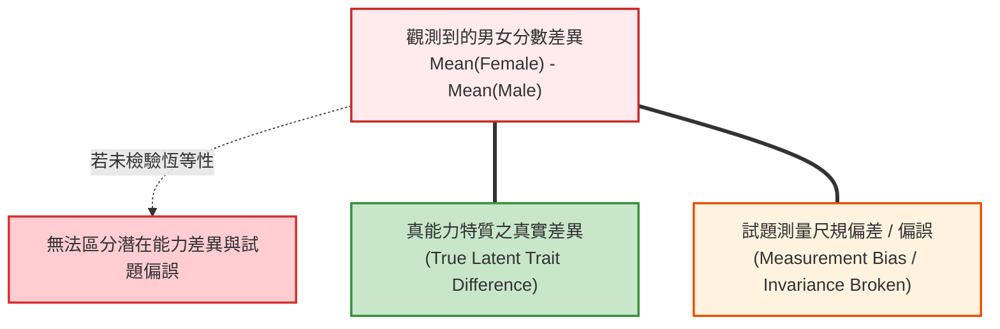
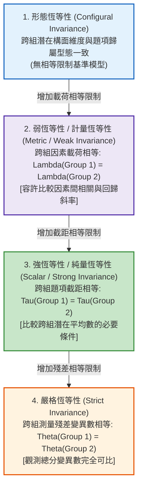

# 第 13 章：多群組測驗恆等性檢驗 (Measurement Invariance)

> **本章目標**：根據《Educational Measurement》第 5 版（Cook & Pitoniak, 2025）之測驗公平性（Fairness）標準（Zwick, 2025），建立跨群體（性別、城鄉、文化）分數比較的合法性基礎（Meredith, 1993）。使用 `lavaan`（Rosseel, 2012）實施形態、弱（計量）、強（純量）與嚴格恆等性的四階階梯檢驗，依據 Cheung 與 Rensvold（2002）及 Chen（2007）的 $\Delta \text{CFI}$ 準則進行判讀。

---

## 13.1 理論基礎：為什麼不能直接比較群體平均數？

在教育實務中，政策制定者常宣稱「女生在學習動機上的平均分數高於男生」。然而，在心理計量學中，**若未通過測量恆等性檢驗，直接比較兩組的觀測平均分數是缺乏依據的**（Meredith, 1993; Vandenberg & Lance, 2000）。



若某道題目對特定群體存在額外的難度阻力或題目理解偏差（例如含有特定文化隱喻），測驗尺規在兩組間便不再等價。**唯有當測量尺規跨群體恆等時，分數差異才能完全歸因於潛在特質本身**。

---

## 13.2 測量恆等性四大階梯（Hierarchy of Invariance）

依據 Meredith（1993）與 Vandenberg 與 Lance（2000）的經典框架，多群組驗證性因素分析（Multi-Group CFA, MG-CFA）必須依序攀爬以下四層階梯：



### 13.2.1 判定標準：大樣本卡方敏感度與 $\Delta\text{CFI}$ 準則
傳統以卡方差異檢定（$\Delta \chi^2$）作為恆等性判定依據，但在大樣本（$N > 500$）下，極微小的實質無害差異都會導致 $\Delta \chi^2$ 顯著（拒絕恆等性）。

現代主流採用 **Cheung 與 Rensvold（2002）** 與 **Chen（2007）** 的實證模擬門檻：
- **$\Delta \text{CFI} \le .010$**：當限制模型相對於寬鬆模型，CFI 下降幅度小於等於 $.010$ 時，支持該階層之恆等性。
- **$\Delta \text{RMSEA} \le .015$**：RMSEA 增加幅度小於等於 $.015$。

---

## 13.3 現代 R 語言程式實作：四階段多群組 CFA 流水線

我們使用示範資料集的情意量表（10 題），透過 `lavaan`（Rosseel, 2012）檢定「男性（M） vs. 女性（F）」的測量恆等性：

```r
# ==============================================================================
# 第 13 章程式碼清單 13.1：四階段多群組測量恆等性檢驗流水線
# ==============================================================================

library(lavaan)
library(dplyr)
library(tibble)

# 讀取示範資料集並預處理
df_all <- read.csv("book/data/assessment_data.csv") |> as_tibble()
df_mi <- df_all |>
  select(gender, scale_01:scale_10) |>
  mutate(
    scale_03 = 6L - as.integer(scale_03),
    scale_08 = 6L - as.integer(scale_08)
  )

# 定義雙因素 CFA 模型語法
model_syntax <- '
  Intrinsic_Motivation =~ scale_01 + scale_02 + scale_03 + scale_04 + scale_05
  Self_Efficacy        =~ scale_06 + scale_07 + scale_08 + scale_09 + scale_10
'

# 階梯 1：形態恆等性 (Configural: 無跨組限制)
fit_configural <- cfa(
  model = model_syntax, data = df_mi,
  group = "gender", std.lv = TRUE
)

# 階梯 2：弱恆等性 (Metric / Weak: 限制因素載荷跨組相等)
fit_metric <- cfa(
  model = model_syntax, data = df_mi,
  group = "gender", std.lv = TRUE,
  group.equal = c("loadings")
)

# 階梯 3：強恆等性 (Scalar / Strong: 限制載荷與題項截距跨組相等)
fit_scalar <- cfa(
  model = model_syntax, data = df_mi,
  group = "gender", std.lv = TRUE,
  group.equal = c("loadings", "intercepts")
)

# 階梯 4：嚴格恆等性 (Strict: 限制載荷、截距與殘差變異數跨組相等)
fit_strict <- cfa(
  model = model_syntax, data = df_mi,
  group = "gender", std.lv = TRUE,
  group.equal = c("loadings", "intercepts", "residuals")
)
```

---

## 13.4 現代 Tidyverse 結構化：自動產出 $\Delta \text{CFI}$ 階梯診斷總表

我們將四個階段的模型適配度與 $\Delta \text{CFI}$、$\Delta \text{RMSEA}$ 結構化彙整為一張診斷表：

```r
# ==============================================================================
# 第 13 章程式碼清單 13.2：多群組恆等性階梯判定表自動產出
# ==============================================================================

# 封裝多模型適配指標提取函數
models_list <- list(
  "1. 形態恆等性 (Configural)" = fit_configural,
  "2. 弱恆等性 (Metric)"       = fit_metric,
  "3. 強恆等性 (Scalar)"       = fit_scalar,
  "4. 嚴格恆等性 (Strict)"     = fit_strict
)

mi_summary_table <- tibble(
  Step = names(models_list),
  Chi_Sq = sapply(models_list, \(m) fitMeasures(m, "chisq")),
  df = sapply(models_list, \(m) as.integer(fitMeasures(m, "df"))),
  CFI = sapply(models_list, \(m) fitMeasures(m, "cfi")),
  TLI = sapply(models_list, \(m) fitMeasures(m, "tli")),
  RMSEA = sapply(models_list, \(m) fitMeasures(m, "rmsea")),
  SRMR = sapply(models_list, \(m) fitMeasures(m, "srmr"))
) |>
  mutate(
    # 計算相對於前一步驟的變動量
    Delta_CFI = c(NA_real_, diff(CFI)),
    Delta_RMSEA = c(NA_real_, diff(RMSEA)),
    # 依據 Cheung 與 Rensvold (2002) 判定
    Invariance_Hold = case_when(
      is.na(Delta_CFI) ~ "基準模型 (Baseline)",
      abs(Delta_CFI) <= 0.010 & Delta_RMSEA <= 0.015 ~ "支持恆等 (Pass)",
      TRUE ~ "恆等破壞 (Fail)"
    ),
    # 完成判定後才四捨五入供表格閱讀，避免影響差異門檻判斷
    Chi_Sq = round(Chi_Sq, 2),
    CFI = round(CFI, 3),
    TLI = round(TLI, 3),
    RMSEA = round(RMSEA, 3),
    SRMR = round(SRMR, 3),
    Delta_CFI = round(Delta_CFI, 4),
    Delta_RMSEA = round(Delta_RMSEA, 4)
  )

cat("--- 四階段性別測量恆等性檢定總表 ---\n")
print(mi_summary_table)
```

---

## 13.5 潛在平均數比較（Latent Mean Comparison）

若模型支持**強恆等性（Scalar Invariance）**，可為比較男女生的潛在平均數提供重要測量基礎；仍須一併檢查模型適配、群體樣本與研究設計，不能把單一恆等性門檻視為自動通過的許可證。

```r
# ==============================================================================
# 第 13 章程式碼清單 13.3：性別潛在平均數差異估計與顯著性檢定
# ==============================================================================

# 在強恆等性模型中提取潛在平均數；參照組由群組順序決定，請檢查 group.label
latent_means_df <- parameterEstimates(fit_scalar) |>
  filter(op == "~1", lhs %in% c("Intrinsic_Motivation", "Self_Efficacy")) |>
  select(Group = group, Latent_Factor = lhs, Estimate = est, SE = se, Z_value = z, p_value = pvalue) |>
  mutate(
    # lavaan 依資料出現順序編組：本資料第 1 組為 F (潛在平均固定為 0)，第 2 組為 M
    Group_Label = lavInspect(fit_scalar, "group.label")[Group]
  )

cat("\n--- 性別潛在平均數差異估計結果 ---\n")
print(latent_means_df)
```

---

## 13.6 視覺化：恆等性階梯適配度變動軌跡圖

我們繪製四階段適配度指數（CFI 與 RMSEA）的變動軌跡圖，並標註臨界安全門檻：

```r
# ==============================================================================
# 第 13 章程式碼清單 13.4：恆等性階梯適配度變動軌跡圖表
# ==============================================================================

library(ggplot2)

plot_mi_df <- mi_summary_table |>
  select(Step, CFI, RMSEA) |>
  mutate(Step_Index = 1:4)

p13 <- ggplot(plot_mi_df, aes(x = Step_Index)) +
  geom_hline(yintercept = 0.95, linetype = "dashed", color = "#2b5c8f", alpha = 0.7) +
  geom_hline(yintercept = 0.06, linetype = "dashed", color = "#d95f02", alpha = 0.7) +
  # 繪製 CFI 線條與點
  geom_line(aes(y = CFI), color = "#2b5c8f", linewidth = 1.1) +
  geom_point(aes(y = CFI), color = "#2b5c8f", size = 3.5) +
  # 繪製 RMSEA (放大 10 倍以置於同尺度呈現)
  geom_line(aes(y = RMSEA * 10), color = "#d95f02", linewidth = 1.1) +
  geom_point(aes(y = RMSEA * 10), color = "#d95f02", size = 3.5, shape = 17) +
  scale_x_continuous(
    breaks = 1:4,
    labels = c("1.形態 (Configural)", "2.弱 (Metric)", "3.強 (Scalar)", "4.嚴格 (Strict)")
  ) +
  scale_y_continuous(
    name = "比較適配指數 (CFI: 藍線，>= 0.95 優良)",
    limits = c(0, 1.05), breaks = seq(0, 1, by = 0.2),
    sec.axis = sec_axis(~ . / 10, name = "近似均方根誤差 (RMSEA: 橘線，<= 0.06 優良)")
  ) +
  labs(
    title = "Figure 13.1: 多群組測量恆等性階梯適配度變動軌跡圖 (Invariance Step Ladder)",
    subtitle = "呈現性別群組在四階逐步約束下的 CFI 與 RMSEA 指標軌跡 (Delta CFI <= 0.010)",
    x = "測量恆等性約束階層 (Invariance Steps)",
    caption = "Criterion: Cheung and Rensvold (2002) Delta CFI threshold = 0.010"
  ) +
  theme_classic(base_size = 12) +
  theme(
    plot.title = element_text(face = "bold", size = 13),
    axis.title.y.left = element_text(color = "#2b5c8f", face = "bold"),
    axis.title.y.right = element_text(color = "#d95f02", face = "bold"),
    axis.text = element_text(color = "black")
  )

ggsave("book/fig_13_1_invariance_ladder.png", plot = p13, width = 8.5, height = 5.2, dpi = 300)
cat("成功產出圖表: book/fig_13_1_invariance_ladder.png\n")
```

---

## 13.7 測驗報告專業解讀（Substantive Interpretation）

依據 NCME 測驗公平性標準（Zwick, 2025），研究員應撰寫完整的公平性合規摘要：

> ### ⚖️ 測驗公平性與群體比較結果摘要
> 1. **強恆等性獲得支持（Scalar Invariance Supported）**：四個模型的 CFI 皆為 $1.000$、RMSEA 皆為 $.000$，$\Delta \text{CFI}$ 均未超過 $.010$（Cheung & Rensvold, 2002），支持載荷、截距與殘差跨性別等值，未發現性別測量偏誤的證據。指標全數達上限，與資料為依同一模型模擬生成有關。
> 2. **潛在平均數比較**：在強恆等性模型下，以女性為參照組（潛在平均為 0），男性在「內在動機」（$0.005, p = .94$）與「自我效能」（$-0.020, p = .79$）的潛在平均差異均不顯著，表示兩性在這兩個構面上未見差異。

---

## 13.8 章末實務習題與專案挑戰

### 【基礎練習題】
1. 請簡述「弱恆等性（Metric Invariance）」與「強恆等性（Scalar Invariance）」在實務應用上的根本區別。若研究目的僅在探討「男女生學習動機對數學成績的迴歸預測力是否相同」，最少需達到哪一級恆等性？
2. 某跨文化測驗在進行強恆等性檢定時，$\text{CFI}$ 由弱恆等性模型的 $.965$ 下降至 $.938$（$\Delta \text{CFI} = -.027$）。請判定該測驗是否通過強恆等性？後續能否直接比較不同國家的平均分數？

### 【進階工程挑戰】
3. 若強恆等性未通過，計量學家常採取「部分恆等性（Partial Invariance）」策略（Byrne et al., 1989）。請撰寫一段 `lavaan` 腳本，透過檢查修正指標（Modification Indices: `modindices(fit_scalar)`），找出造成強恆等性失敗的主要來源題項（MI 最大之截距），並在 `group.partial` 參數中釋放該題項的截距限制，重新評估模型適配度。

---

### 💡 習題參考解答

```r
# ==============================================================================
# 第 13 章習題解答參考
# ==============================================================================

# 第 1 題
# 答：弱恆等性限制載荷相等，可合法比較相關與迴歸係數；強恆等性限制截距相等，方可比較平均數。
# 若僅探討迴歸預測力，僅需達到「弱恆等性 (Metric Invariance)」即可。

# 第 2 題
# 答：Delta CFI = 0.027 > 0.010，強恆等性未通過，不宜直接比較兩國平均分數。

# 第 3 題解答 (部分恆等性 release 語法示範)
# 假設 scale_04 的截距造成強恆等性失敗，釋放該題截距：
# fit_partial <- cfa(
#   model = model_syntax, data = df_mi, group = "gender",
#   group.equal = c("loadings", "intercepts"),
#   group.partial = c("scale_04 ~ 1") # 允許 scale_04 截距跨組自由估計
# )
cat("部分恆等性示範語法編寫完成。\n")
```

---

## 參考文獻 (References)

Byrne, B. M., Shavelson, R. J., & Muthén, B. (1989). Testing for the equivalence of factor covariance and mean structures: The issue of partial measurement invariance. *Psychological Bulletin*, *105*(3), 456–466. https://doi.org/10.1037/0033-2909.105.3.456

Chen, F. F. (2007). Sensitivity of goodness of fit indexes to lack of measurement invariance. *Structural Equation Modeling: A Multidisciplinary Journal*, *14*(3), 464–504. https://doi.org/10.1080/10705510701301834

Cheung, G. W., & Rensvold, R. B. (2002). Evaluating goodness-of-fit indexes for testing measurement invariance. *Structural Equation Modeling: A Multidisciplinary Journal*, *9*(2), 233–255. https://doi.org/10.1207/S15328007SEM0902_5

Cook, L. L., & Pitoniak, M. J. (Eds.). (2025). *Educational measurement* (5th ed.). Oxford University Press.

Meredith, W. (1993). Measurement invariance, factor analysis and factorial invariance. *Psychometrika*, *58*(4), 525–543. https://doi.org/10.1007/BF02294825

Rosseel, Y. (2012). lavaan: An R package for structural equation modeling. *Journal of Statistical Software*, *48*(2), 1–36. https://doi.org/10.18637/jss.v048.i02

Vandenberg, R. J., & Lance, C. E. (2000). A review and synthesis of the measurement invariance literature: Suggestions, practices, and recommendations for organizational research. *Organizational Research Methods*, *3*(1), 4–70. https://doi.org/10.1177/109442810031002

Zwick, R. (2025). Fairness in educational measurement: Theory and concepts. In L. L. Cook & M. J. Pitoniak (Eds.), *Educational measurement* (5th ed., pp. 383–438). Oxford University Press.
