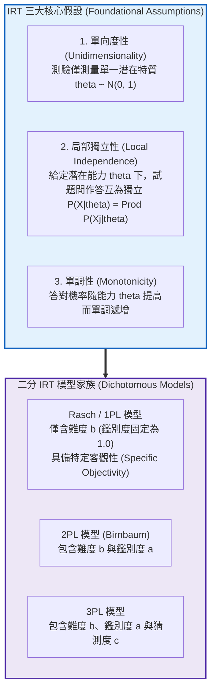

# 第 14 章：單向度二分試題 IRT 模型 (Rasch / 1PL / 2PL / 3PL)

> **本章目標**：介紹**試題反應理論（Item Response Theory, IRT）**（Lord, 1980; 陳新豐, 2021）與《Educational Measurement》第 5 版之評量資料建模標準（Cai et al., 2025; Cook & Pitoniak, 2025）。根據 Rasch（1960）與 Birnbaum（1968）推導 1PL、2PL 與 3PL 數學模型及邊際最大概似估計（MMLE）（Bock & Aitkin, 1981）。使用 `mirt` 套件（Chalmers, 2012）進行模型估計與比較、檢驗局部獨立性（Yen, 1984），並繪製人題分佈圖（Wright Map）。

---

## 14.1 理論基礎：從 CTT 到 IRT 的典範轉移

古典測驗理論（CTT）的試題指標與總分會受受試者及測驗組成影響。IRT 在模型假設、適配與量尺連結均合理時，具有**參數不變性的理論性質**（Lord, 1980; Cai et al., 2025）；這不是無條件保證：
1. **試題參數的樣本不變性**：在模型適配且量尺妥善連結時，試題參數理論上不應因受試者樣本改變而改變。
2. **能力估計的試題不變性**：在模型適配與共同量尺成立時，能力估計理論上不應因所施測題目組合改變而改變。



---

## 14.2 二分 IRT 四大數學模型公式

設受試者潛在特質為 $\theta \in (-\infty, +\infty)$，第 $j$ 題的作答反應為 $X_j \in \{0, 1\}$：

### 14.2.1 1PL / Rasch 模型
Rasch（1960）提出，答對機率僅取決於「人能力 $\theta$ 與題難度 $b_j$ 之差」：
$$P(X_j = 1 \mid \theta) = \frac{e^{D(\theta - b_j)}}{1 + e^{D(\theta - b_j)}} = \frac{1}{1 + e^{-D(\theta - b_j)}}$$
- 在嚴格 Rasch 模型中，$D = 1.0$ 且所有試題鑑別度 $a_j \equiv 1.0$。

### 14.2.2 2PL 模型（雙參數邏輯斯模型）
Birnbaum（1968）引入**試題鑑別度參數 $a_j$**，允許試題具有不同斜率：
$$P(X_j = 1 \mid \theta) = \frac{1}{1 + e^{-D a_j (\theta - b_j)}}$$
- $a_j$（鑑別度）：反映試題對不同能力受試者的敏感度（曲線拐點處的切線斜率），一般介於 $0.5 \sim 2.5$。
- $b_j$（難度）：答對機率剛好為 $.50$ 時所對應的能力值 $\theta$。
- $D = 1.702$（尺度常數，使邏輯斯曲線與累積常態分佈曲線之最大絕對偏差小於 $.01$）。

### 14.2.3 3PL 模型（三參數邏輯斯模型）
針對選擇題中低能力考生的隨機猜測現象，Birnbaum（1968）引入**偽猜測參數（Pseudo-guessing Parameter, $c_j$）**：
$$P(X_j = 1 \mid \theta) = c_j + (1 - c_j) \frac{1}{1 + e^{-D a_j (\theta - b_j)}}$$
- 當 $\theta \to -\infty$ 時，答對機率下限收斂於 $c_j$（通常約為 $.20 \sim .25$）。

---

## 14.3 現代 R 語言程式實作：使用 `mirt` 進行多模型擬合與比較

我們使用 `mirt` 套件（Chalmers, 2012），以邊際最大概似法（MMLE-EM 演算法）（Bock & Aitkin, 1981）對 15 道認知題進行模型估計：

```r
# ==============================================================================
# 第 14 章程式碼清單 14.1：使用 mirt 擬合 Rasch、2PL 與 3PL 模型
# ==============================================================================

library(mirt)
library(dplyr)
library(tibble)

# 讀取示範資料集
df_all <- read.csv("book/data/assessment_data.csv") |> as_tibble()
df_cog <- df_all |> select(item_01:item_15)

# 1. 擬合 Rasch 模型 (itemtype = "Rasch")
fit_rasch <- mirt(df_cog, model = 1, itemtype = "Rasch", verbose = FALSE)

# 2. 擬合 2PL 模型 (itemtype = "2PL")
fit_2pl <- mirt(df_cog, model = 1, itemtype = "2PL", verbose = FALSE)

# 3. 擬合 3PL 模型 (itemtype = "3PL")
fit_3pl <- mirt(df_cog, model = 1, itemtype = "3PL", verbose = FALSE)

# 4. 比較三模型之全域適配度指標 (AIC, BIC, Log-Likelihood)
model_comp <- anova(fit_rasch, fit_2pl, fit_3pl)
cat("--- IRT 競爭模型全域適配度比較 (Rasch vs 2PL vs 3PL) ---\n")
print(model_comp)
```

---

## 14.4 參數提取與局部獨立性檢驗（Yen's $Q_3$）

### 14.4.1 提取 2PL 試題參數並整理為整潔 `tibble`

```r
# ==============================================================================
# 第 14 章程式碼清單 14.2：提取 IRT 試題參數與殘差局部獨立性檢定
# ==============================================================================

# 提取 2PL 試題參數 (Traditional IRT Metric: a, b)
params_2pl <- coef(fit_2pl, IRTpars = TRUE, simplify = TRUE)$items |>
  as.data.frame() |>
  rownames_to_column(var = "Item") |>
  as_tibble() |>
  select(Item, a, b, g, u) |>
  rename(Discrimination_a = a, Difficulty_b = b, Guessing_c = g)

cat("--- 2PL 試題參數清單 (前 6 題) ---\n")
print(head(params_2pl, 6))

# 檢驗局部獨立性 (Yen's Q3 統計量)
# 殘差相關應普遍 < 0.20，若有題對 > 0.20 則違反局部獨立性
q3_mat <- residuals(fit_2pl, type = "Q3", verbose = FALSE)
q3_upper <- q3_mat[upper.tri(q3_mat)]
q3_max <- max(abs(q3_upper), na.rm = TRUE)
cat(sprintf("\nYen's Q3 殘差相關絕對值最大值: %.3f，平均值: %.3f\n",
            q3_max, mean(q3_upper, na.rm = TRUE)))
cat("判定:", if (q3_max < 0.20) "所有題對 |Q3| < 0.20" else "有題對 |Q3| >= 0.20，需檢查該題對內容", "\n")
```

---

## 14.5 視覺化：人題分佈圖（Wright Map）

人題分佈圖（Wright Map / Item-Person Map）是 IRT 常用的視覺化工具，它將**考生的能力分佈（$\theta$）**與**試題的難度分佈（$b$）**對齊在同一個等距量尺上：

```r
# ==============================================================================
# 第 14 章程式碼清單 14.3：純 Tidyverse + ggplot2 繪製 Wright Map
# ==============================================================================

library(ggplot2)
library(patchwork)

# 1. 估計全體考生的潛在特質能力值 theta (EAP 法)
theta_estimates <- fscores(fit_2pl, method = "EAP")[, 1]
person_df <- tibble(Theta = theta_estimates)

# 2. 上方面板：受試者能力分佈密度與直方圖
p_person <- ggplot(person_df, aes(x = Theta)) +
  geom_histogram(aes(y = after_stat(density)), bins = 35, fill = "#2b5c8f", color = "white", alpha = 0.8) +
  geom_density(color = "#d95f02", linewidth = 1.0) +
  scale_x_continuous(breaks = -3:3) +
  coord_cartesian(xlim = c(-3.5, 3.5)) +
  labs(
    title = "Figure 14.1: 試題反應理論人題分佈圖 (Wright Map / Item-Person Map)",
    subtitle = "上方面板: 考生潛在特質能力分佈 (Theta)；下方面板: 15 道題目難度位置 (b)",
    x = "",
    y = "考生密度"
  ) +
  theme_classic(base_size = 11) +
  theme(
    plot.title = element_text(face = "bold", size = 13),
    axis.text.x = element_blank(),
    axis.ticks.x = element_blank()
  )

# 3. 下方面板：試題難度階梯分佈圖
item_diff_sorted <- params_2pl |>
  arrange(Difficulty_b) |>
  mutate(Item_Rank = row_number())

p_item <- ggplot(item_diff_sorted, aes(x = Difficulty_b, y = Item_Rank)) +
  geom_vline(xintercept = 0, linetype = "dashed", color = "grey60") +
  geom_point(color = "#d95f02", size = 3) +
  geom_text(aes(label = Item), vjust = -0.7, size = 3.2, fontface = "bold") +
  scale_x_continuous(breaks = -3:3) +
  coord_cartesian(xlim = c(-3.5, 3.5)) +
  scale_y_continuous(breaks = NULL) +
  labs(
    x = "潛在特質與難度共同量尺 (Logit Metric: Theta & b)",
    y = "試題階梯 (Items)",
    caption = "Source: 2PL IRT Model via mirt (MMLE-EM Estimation, N = 1,000)"
  ) +
  theme_classic(base_size = 11) +
  theme(axis.line.y = element_blank())

# 4. 使用 patchwork 垂直拼接
p_wright_map <- p_person / p_item + plot_layout(heights = c(1.2, 1.0))

ggsave("book/fig_14_1_wright_map.png", plot = p_wright_map, width = 8.5, height = 6.5, dpi = 300)
cat("成功產出圖表: book/fig_14_1_wright_map.png\n")
```

---

## 14.6 測驗報告專業解讀（Substantive Interpretation）

依據 NCME 評量工程標準，Wright Map 提供了題庫靶向性（Targeting）的關鍵證據：

> ### 🎯 題庫適配性（Targeting）診斷結論
> 1. **模型選定**：2PL 的 AIC（13520.6）與 BIC（13667.8）皆低於 Rasch（13623.0、13701.5），概似比檢定 $\chi^2(14) = 130.43, p < .001$，表示各題鑑別度不相等，本資料以 2PL 較適合。此外，根據 Yen（1984）的 $Q_3$ 指標，殘差相關最大絕對值為 $.205$，略高於 $.20$，該題對需檢查內容是否相依。
> 2. **人題對齊度診斷**：如圖 14.1 所示，考生能力分佈中心約在 $\theta = 0.0$，試題難度 $b$ 分佈在 $[-1.77, +1.73]$ 之間，涵蓋約 $95\%$ 考生的能力估計範圍（$[-2.00, 1.71]$），未見明顯地板或天花板效應。
> 3. **高階篩選補強建議**：在 $\theta > 2.0$ 的高能力端沒有試題。若本測驗欲用於數理資優甄選，命題小組應增補難度 $b \in [2.0, 2.5]$ 的高難度、高鑑別度試題。

---

## 14.7 章末實務習題與專案挑戰

### 【基礎練習題】
1. 某 2PL 試題之參數為：鑑別度 $a = 1.2$，難度 $b = 0.5$（常數 $D = 1.702$）。請精確計算：能力為 $\theta = 0.5$、$\theta = 1.5$ 與 $\theta = -0.5$ 的三位考生，答對該題的理論機率分別為何？
2. 在 3PL 模型中，若某題之猜測參數為 $c = .25$，當考生能力極低（$\theta = -4.0$）時，其答對機率為何？這與 2PL 模型有何本質不同？

### 【進階工程挑戰】
3. 撰寫一個名為 `calc_test_targeting(person_thetas, item_difficulties)` 的自動化題庫靶向診斷函數。輸入受試者能力向量與試題難度向量，計算「人題平均差距（$\bar{\theta} - \bar{b}$）」、試題未能覆蓋的考生百分比（極端低分與極端高分），並自動產出文字化題庫補強建議。

---

### 💡 習題參考解答

```r
# ==============================================================================
# 第 14 章習題解答參考
# ==============================================================================

# 第 1 題 (2PL 機率計算)
calc_p_2pl <- function(theta, a, b, D = 1.702) {
  1 / (1 + exp(-D * a * (theta - b)))
}
cat(sprintf("theta = 0.5 (在難度點上) 機率: %.4f (剛好 50%%)\n", calc_p_2pl(0.5, 1.2, 0.5)))
cat(sprintf("theta = 1.5 機率: %.4f\n", calc_p_2pl(1.5, 1.2, 0.5)))
cat(sprintf("theta = -0.5 機率: %.4f\n", calc_p_2pl(-0.5, 1.2, 0.5)))

# 第 3 題解答核心
calc_test_targeting <- function(person_thetas, item_difficulties) {
  mean_diff <- mean(person_thetas) - mean(item_difficulties)
  min_b <- min(item_difficulties)
  max_b <- max(item_difficulties)
  floor_rate <- mean(person_thetas < min_b)
  ceiling_rate <- mean(person_thetas > max_b)
  
  tibble::tibble(
    Mean_Targeting_Gap = round(mean_diff, 3),
    Floor_Rate_Percent = round(floor_rate * 100, 1),
    Ceiling_Rate_Percent = round(ceiling_rate * 100, 1),
    Status = if_else(abs(mean_diff) <= 0.3, "靶向性優良", "測驗偏易或偏難")
  )
}
cat("題庫靶向性診斷函數編寫完成。\n")
```

---

## 參考文獻 (References)

陳新豐（2021）。**R 語言：量表編製、統計分析與試題反應理論**（第 2 版）。五南圖書。

Birnbaum, A. (1968). Some latent trait models and their use in inferring an examinee's ability. In F. M. Lord & M. R. Novick (Eds.), *Statistical theories of mental test scores* (pp. 397–479). Addison-Wesley.

Bock, R. D., & Aitkin, M. (1981). Marginal maximum likelihood estimation of item parameters: Application of an EM algorithm. *Psychometrika*, *46*(4), 443–459. https://doi.org/10.1007/BF02293801

Cai, L., Hansen, M., Jeon, M., & Edwards, M. C. (2025). Modeling data from educational assessments. In L. L. Cook & M. J. Pitoniak (Eds.), *Educational measurement* (5th ed., pp. 655–734). Oxford University Press.

Chalmers, R. P. (2012). mirt: A multidimensional item response theory package for the R environment. *Journal of Statistical Software*, *48*(6), 1–29. https://doi.org/10.18637/jss.v048.i06

Cook, L. L., & Pitoniak, M. J. (Eds.). (2025). *Educational measurement* (5th ed.). Oxford University Press.

Lord, F. M. (1980). *Applications of item response theory to practical testing problems*. Lawrence Erlbaum Associates.

Rasch, G. (1960). *Probabilistic models for some intelligence and attainment tests*. Danish Institute for Educational Research.

Yen, W. M. (1984). Effects of local item dependence on the fit and equating performance of the three-parameter logistic model. *Applied Psychological Measurement*, *8*(2), 125–145. https://doi.org/10.1177/014662168400800201
