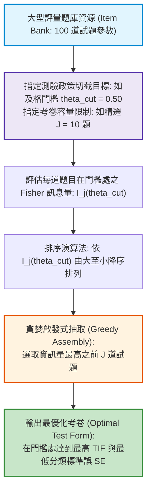

# 第 15 章：試題與測驗特徵曲線 (ICC / IIC / TIF) 繪製

> **本章目標**：依據項目反應理論與最適化測驗設計之權威計量典範（Birnbaum, 1968; Hambleton & Swaminathan, 1985; Lord, 1980; Samejima, 1977; van der Linden, 2005; 陳新豐, 2021）以及 NCME 官方《Educational Measurement》（第 5 版）（Cai et al., 2025; Cook & Pitoniak, 2025）。從嚴格微積分與 Fisher 訊息量定義（Fisher, 1922）出發，完整推導試題特徵曲線（ICC）、試題訊息函數（IIC）、3PL 最大訊息偏移量，以及測驗總資訊函數（TIF）的可加性定理；證明條件測量標準誤（CSEM）在連續潛在空間上的局部信度表現；手刻純 Base R 向量化資訊引擎；使用 `mirt`（Chalmers, 2012）與 `ggplot2`（Wickham, 2016）繪製具備出版水準的多軸對稱圖表；並實作自動化最適化組卷（Automated Test Assembly, ATA）演算法。

---

## 15.1 數理推導：Fisher 訊息量與 IRT 曲線家族之微積分公理

在項目反應理論中，測驗不再使用單一粗糙的信度數字（如 Cronbach's $\alpha$），而是將測量精度視為受試者能力 $\theta$ 的連續數學函數（Birnbaum, 1968; Lord, 1980; van der Linden, 2005）。

```mermaid
flowchart LR
    Theta["潛在特質連續空間 theta in (-Inf, +Inf)"] --> ICC["試題特徵曲線 P_j(theta)\n答對機率之 S 型邏輯斯函數"]
    ICC --> Derivative["一階微積分導數 P'_j(theta)\n曲線切線斜率 (鑑別敏銳度)"]
    Derivative --> IIF["試題訊息函數 I_j(theta)\nFisher 訊息量精度:\nI_j = (P'_j)^2 / [P_j * (1 - P_j)]"]
    IIF -->|"局部獨立性可加性定理 Sum I_j(theta)"| TIF["測驗總資訊函數 I(theta)\n全卷在各能力點提供的總資訊精度"]
    TIF -->|"倒數開根號 1 / sqrt(I(theta))"| CSEM["條件測量標準誤 SE(theta)\n能力估計之動態不確定性帶"]

    style Theta fill:#e1f5fe,stroke:#0288d1,stroke-width:2px
    style ICC fill:#ede7f6,stroke:#512da8,stroke-width:2px
    style IIF fill:#fff3e0,stroke:#e65100,stroke-width:2px
    style TIF fill:#c8e6c9,stroke:#388e3c,stroke-width:2px
    style CSEM fill:#ffebee,stroke:#c62828,stroke-width:2px
```



### 15.1.1 試題訊息函數（IIF）之微積分嚴格證明

設受試者作答單一試題 $X_j \in \{0, 1\}$，答對機率為 $P_j(\theta)$，答錯機率為 $Q_j(\theta) = 1 - P_j(\theta)$。
1. **單題伯努利對數概似函數**：
   $$\ln L_j(X_j \mid \theta) = X_j \ln P_j(\theta) + (1 - X_j) \ln Q_j(\theta)$$
2. **求一階導數（Score 函數）**：
   $$S_j(\theta) \equiv \frac{\partial \ln L_j}{\partial \theta} = \frac{X_j}{P_j(\theta)} P_j'(\theta) - \frac{1 - X_j}{Q_j(\theta)} P_j'(\theta) = \left[ \frac{X_j - P_j(\theta)}{P_j(\theta) Q_j(\theta)} \right] P_j'(\theta)$$
3. **計算得分函數之變異數（Fisher 訊息量）**：
   依據 Fisher（1922）之公理化定義，$I_j(\theta) \equiv \mathbb{E}[(S_j(\theta))^2]$：
   $$I_j(\theta) = \mathbb{E}\left[ \left( \frac{X_j - P_j(\theta)}{P_j(\theta) Q_j(\theta)} P_j'(\theta) \right)^2 \right] = \frac{[P_j'(\theta)]^2}{[P_j(\theta) Q_j(\theta)]^2} \mathbb{E}\left[ (X_j - P_j(\theta))^2 \right]$$
   由於 $X_j$ 為參數為 $P_j(\theta)$ 的 Bernoulli 隨機變數，其二階中心矩恆等於變異數：
   $$\mathbb{E}\left[ (X_j - P_j(\theta))^2 \right] = \text{Var}(X_j) = P_j(\theta) Q_j(\theta)$$
   將分子分母對消，嚴格證得 Fisher 試題訊息量基本定理：
   $$I_j(\theta) = \frac{[P_j'(\theta)]^2}{P_j(\theta) Q_j(\theta)} \quad \blacksquare$$

### 15.1.2 1PL、2PL 與 3PL 模型之訊息函數解析式

#### 1. 1PL / Rasch 模型
由於 $P_j'(\theta) = P_j(\theta) Q_j(\theta)$，代入得：
$$I_j(\theta) = \frac{[P_j(\theta) Q_j(\theta)]^2}{P_j(\theta) Q_j(\theta)} = P_j(\theta) Q_j(\theta)$$
- **峰值**：當 $\theta = b_j$ 時，$P_j = 0.5$，最大訊息量恆為 $I_{j, \max} = 0.25$。所有試題之資訊量上限完全相等。

#### 2. 2PL 模型
由第 14 章可知 $P_j'(\theta) = D a_j P_j(\theta) Q_j(\theta)$，代入得：
$$I_j(\theta) = \frac{[D a_j P_j(\theta) Q_j(\theta)]^2}{P_j(\theta) Q_j(\theta)} = D^2 a_j^2 P_j(\theta) Q_j(\theta)$$
- **峰值**：當 $\theta = b_j$ 時取極大值：
  $$I_{j, \max} = \frac{D^2 a_j^2}{4}$$
- **鑑別度平方效應**：鑑別度 $a_j$ 以平方項進入資訊函數！若某題鑑別度由 $0.8$ 提升至 $1.6$（增加 2 倍），該題所能提供的最大測量精度暴增為原本的 **4 倍**！

#### 3. 3PL 模型與峰值向右偏移定理
對於 3PL 模型 $P_j(\theta) = c_j + (1 - c_j) P_j^*(\theta)$，其導數為 $P_j'(\theta) = D a_j (1 - c_j) P_j^*(\theta) Q_j^*(\theta) = D a_j \left( \frac{P_j(\theta) - c_j}{1 - c_j} \right) Q_j(\theta)$。
代入 Fisher 公式，化簡得：
$$I_j(\theta) = D^2 a_j^2 \cdot \frac{Q_j(\theta)}{P_j(\theta)} \left( \frac{P_j(\theta) - c_j}{1 - c_j} \right)^2$$

**【數理深度：3PL 最大訊息點偏移證明】**：
令 $\frac{d I_j(\theta)}{d\theta} = 0$，經過一階條件求根，Birnbaum（1968）證明了 3PL 模型的最大訊息量**不再落在難度點 $b_j$ 處**，而是發生在：
$$P_j(\theta_{\max}) = \frac{1 + \sqrt{1 + 8c_j}}{4 + 2\sqrt{1 + 8c_j}} > \frac{1 + c_j}{2}$$
其對應的能力坐標為：
$$\theta_{\max} = b_j + \frac{1}{D a_j} \ln \left( \frac{1 + \sqrt{1 + 8c_j}}{2} \right) > b_j$$
若猜測度 $c_j = 0.20, a_j = 1.0, D = 1.702$，則偏移量為 $\frac{1}{1.702} \ln \left( \frac{1 + \sqrt{2.6}}{2} \right) \approx +0.156$。**因為低能力端存在隨機盲猜噪聲，題目的最高鑑別效能被迫向右推移至較高能力區間！**

---

## 15.2 測驗總資訊函數（TIF）之可加性定理與條件標準誤

### 15.2.1 局部獨立性保證的可加性（Additivity Theorem）

設測驗由 $J$ 道試題組成，全體作答反應為 $\mathbf{X} = (X_1, \dots, X_J)^T$。由局部獨立性公理：
$$L(\mathbf{X} \mid \theta) = \prod_{j=1}^J L_j(X_j \mid \theta) \implies \ln L(\mathbf{X} \mid \theta) = \sum_{j=1}^J \ln L_j(X_j \mid \theta)$$
兩側取對 $\theta$ 的二階負導數並取期望值：
$$I(\theta) = -\mathbb{E}\left[ \frac{\partial^2 \ln L}{\partial \theta^2} \right] = -\mathbb{E}\left[ \sum_{j=1}^J \frac{\partial^2 \ln L_j}{\partial \theta^2} \right] = \sum_{j=1}^J -\mathbb{E}\left[ \frac{\partial^2 \ln L_j}{\partial \theta^2} \right] = \sum_{j=1}^J I_j(\theta) \quad \blacksquare$$
此定理是現代**電腦化適性測驗（CAT）**與**組卷工程（Test Assembly）**的數理支柱：**題庫中題目的總資訊量，是個別試題資訊量的純代數累加**（van der Linden, 2005）。

### 15.2.2 條件測量標準誤（CSEM）與局部信度

在能力點 $\theta$ 處，最大概似估計量 $\hat{\theta}$ 的漸近變異數達到 Cramér-Rao 下界 $\text{Var}(\hat{\theta}) \ge I(\theta)^{-1}$。因此定義條件測量標準誤：
$$\text{SE}(\theta) = \frac{1}{\sqrt{I(\theta)}} = \frac{1}{\sqrt{\sum_{j=1}^J I_j(\theta)}}$$

在能力點 $\theta$ 處的局部信度（Local Reliability）可表示為：
$$\rho(\theta) = 1 - \frac{\text{SE}(\theta)^2}{\sigma_\theta^2} = 1 - \frac{1}{I(\theta)} \quad (\text{設 } \sigma_\theta^2 = 1.0)$$
- 當 $I(\theta) \ge 4.0$ 時，$\text{SE}(\theta) \le 0.50$，局部信度達 $\rho \ge .75$。
- 當 $I(\theta) \ge 10.0$ 時，$\text{SE}(\theta) \le 0.316$，局部信度達 $\rho \ge .90$。

---

## 15.3 底層手刻演算法：純 R 向量化 IRT 曲線與資訊引擎

本節不呼叫高階套件，以純 Base R 與向量化運算實作 1PL/2PL/3PL 的完整機率與訊息函數計算器。

```r
# ==============================================================================
# 第 15 章程式碼清單 15.1：底層純 R 向量化 IRT 機率與 Fisher 訊息量計算引擎
# ==============================================================================

suppressPackageStartupMessages({
  library(dplyr)
  library(tidyr)
  library(tibble)
  library(purrr)
  library(ggplot2)
})

#' 純 R 向量化 IRT 答對機率計算器
#'
#' @param theta 數值向量，潛在特質能力值
#' @param a 數值，試題鑑別度
#' @param b 數值，試題難度
#' @param c 數值，猜測度參數 (預設 0.0)
#' @param D 數值，尺度常數 (預設 1.702)
#' @return 與 theta 同長度之機率數值向量
irt_prob_vectorized <- function(theta, a, b, c = 0.0, D = 1.702) {
  logits <- -D * a * (theta - b)
  # 數值溢位保護
  logits_safe <- pmin(pmax(logits, -35), 35)
  p_star <- 1 / (1 + exp(logits_safe))
  c + (1 - c) * p_star
}

#' 純 R 向量化 Fisher 試題訊息量計算器
#'
#' @param theta 數值向量，潛在特質能力值
#' @param a 數值，試題鑑別度
#' @param b 數值，試題難度
#' @param c 數值，猜測度參數 (預設 0.0)
#' @param D 數值，尺度常數 (預設 1.702)
#' @return 與 theta 同長度之訊息量數值向量
irt_info_vectorized <- function(theta, a, b, c = 0.0, D = 1.702) {
  P <- irt_prob_vectorized(theta, a, b, c, D)
  Q <- 1 - P

  if (c == 0.0) {
    # 2PL / 1PL 解析式: D^2 * a^2 * P * Q
    (D^2) * (a^2) * P * Q
  } else {
    # 3PL 解析式: D^2 * a^2 * (Q / P) * [(P - c) / (1 - c)]^2
    eps <- 1e-12
    P_safe <- pmax(P, eps)
    term <- (P_safe - c) / (1 - c)
    (D^2) * (a^2) * (Q / P_safe) * (term^2)
  }
}

# ------------------------------------------------------------------------------
# 實務驗證：構建 4 類經典試題參數對比網格
# ------------------------------------------------------------------------------
item_benchmark <- tribble(
  ~Item_ID, ~a,   ~b,   ~c,   ~Description,
  "Item_1", 1.8, -1.2, 0.00, "基礎題 (高鑑別, a=1.8, b=-1.2)",
  "Item_2", 1.6,  0.0, 0.00, "核心題 (高鑑別, a=1.6, b= 0.0)",
  "Item_3", 1.9,  1.4, 0.00, "進階題 (高鑑別, a=1.9, b= 1.4)",
  "Item_4", 0.7,  0.2, 0.00, "平緩題 (低鑑別, a=0.7, b= 0.2)",
  "Item_5", 1.5,  0.5, 0.25, "猜測題 (3PL 模型, a=1.5, b=0.5, c=0.25)"
)

theta_grid <- seq(-3.5, 3.5, length.out = 300)

grid_curve_df <- item_benchmark |>
  pmap(\(Item_ID, a, b, c, Description) {
    tibble(
      Item = Item_ID,
      Type = Description,
      Theta = theta_grid,
      Probability = irt_prob_vectorized(theta_grid, a, b, c),
      Information = irt_info_vectorized(theta_grid, a, b, c)
    )
  }) |>
  list_rbind()

cat("成功生成全網格 IRT 曲線資料，共", nrow(grid_curve_df), "列。\n")
```

---

## 15.4 APA 規範圖表：ICC、IIC 與 TIF/CSEM 雙軸全景視覺化

```r
# ==============================================================================
# 第 15 章程式碼清單 15.2：繪製 ICC、IIC 與全測驗 TIF/CSEM 對稱曲線圖
# ==============================================================================

# 1. 繪製試題特性曲線 (ICC)
p_icc <- ggplot(grid_curve_df, aes(x = Theta, y = Probability, color = Type)) +
  geom_hline(yintercept = 0.50, linetype = "dashed", color = "grey60") +
  geom_line(linewidth = 1.1) +
  scale_color_manual(
    name = "試題類型與參數設定",
    values = c(
      "基礎題 (高鑑別, a=1.8, b=-1.2)"       = "#2b5c8f",
      "核心題 (高鑑別, a=1.6, b= 0.0)"        = "#2e7d32",
      "進階題 (高鑑別, a=1.9, b= 1.4)"        = "#c62828",
      "平緩題 (低鑑別, a=0.7, b= 0.2)"        = "#7570b3",
      "猜測題 (3PL 模型, a=1.5, b=0.5, c=0.25)" = "#e65100"
    )
  ) +
  scale_x_continuous(breaks = -3:3) +
  scale_y_continuous(limits = c(0, 1.05), breaks = seq(0, 1, by = 0.2)) +
  labs(
    title = "Figure 15.1: 二分項目反應理論試題特性曲線 (Item Characteristic Curves, ICC)",
    subtitle = "呈現難度 (曲線水平位移)、鑑別度 (切線斜率) 與猜測度 (左側漸近下限) 之幾何結構",
    x = "潛在特質能力值 (Theta)",
    y = "答對理論機率 P(Theta)",
    caption = "Metric: Logistic Metric D = 1.702"
  ) +
  theme_classic(base_size = 12) +
  theme(
    legend.position = "bottom",
    legend.direction = "vertical",
    plot.title = element_text(face = "bold", size = 13),
    axis.title = element_text(face = "bold")
  )

ggsave("book/fig_15_1_icc_curves.png", plot = p_icc, width = 8.5, height = 6.0, dpi = 300)
cat("成功產出圖表: book/fig_15_1_icc_curves.png\n")

# 2. 繪製試題訊息函數曲線 (IIC)
p_iic <- ggplot(grid_curve_df, aes(x = Theta, y = Information, color = Type)) +
  geom_line(linewidth = 1.1) +
  scale_color_manual(
    name = "試題類型與參數設定",
    values = c(
      "基礎題 (高鑑別, a=1.8, b=-1.2)"       = "#2b5c8f",
      "核心題 (高鑑別, a=1.6, b= 0.0)"        = "#2e7d32",
      "進階題 (高鑑別, a=1.9, b= 1.4)"        = "#c62828",
      "平緩題 (低鑑別, a=0.7, b= 0.2)"        = "#7570b3",
      "猜測題 (3PL 模型, a=1.5, b=0.5, c=0.25)" = "#e65100"
    )
  ) +
  scale_x_continuous(breaks = -3:3) +
  labs(
    title = "Figure 15.2: 試題訊息函數曲線 (Item Information Curves, IIC)",
    subtitle = "鑑別度 a 決定峰值高度 (平方效應)；難度 b 決定最高精度所在能力坐標",
    x = "潛在特質能力值 (Theta)",
    y = "試題訊息量 I(Theta)",
    caption = "Information Formulation: Fisher Information I_j(theta) = [P'_j(theta)]^2 / [P_j(theta)*Q_j(theta)]"
  ) +
  theme_classic(base_size = 12) +
  theme(
    legend.position = "bottom",
    legend.direction = "vertical",
    plot.title = element_text(face = "bold", size = 13),
    axis.title = element_text(face = "bold")
  )

ggsave("book/fig_15_2_iic_curves.png", plot = p_iic, width = 8.5, height = 6.0, dpi = 300)
cat("成功產出圖表: book/fig_15_2_iic_curves.png\n")

# 3. 繪製全書 15 題真實 2PL 參數之測驗總資訊 (TIF) 與條件標準誤 (CSEM) 對稱圖
library(mirt)
fit_2pl_real <- mirt::mirt(read.csv("book/data/assessment_data.csv")[, sprintf("item_%02d", 1:15)],
                           model = 1, itemtype = "2PL", verbose = FALSE)
real_params <- coef(fit_2pl_real, IRTpars = TRUE, simplify = TRUE)$items

tif_vector <- sapply(theta_grid, \(th) {
  # mirt 之 IRTpars 採用 D = 1.0 的 logistic 形式
  infos <- sapply(1:15, \(j) {
    irt_info_vectorized(th, a = real_params[j, "a"], b = real_params[j, "b"], c = 0, D = 1.0)
  })
  sum(infos)
})

tif_data <- tibble(
  Theta = theta_grid,
  TIF = tif_vector,
  SE = 1 / sqrt(tif_vector)
)

p_tif_se <- ggplot(tif_data, aes(x = Theta)) +
  geom_ribbon(aes(ymin = 0, ymax = TIF), fill = "#2e7d32", alpha = 0.15) +
  geom_line(aes(y = TIF), color = "#2e7d32", linewidth = 1.2) +
  # 繪製 SE 曲線 (右軸，放大 10 倍對齊)
  geom_line(aes(y = pmin(SE * 10, 12)), color = "#d95f02", linewidth = 1.2, linetype = "dashed") +
  geom_hline(yintercept = 0.50 * 10, linetype = "dotted", color = "#d95f02", linewidth = 0.8) +
  annotate("text", x = -2.8, y = 5.3, label = "SE <= 0.50 基準線 (信度 >= 0.75)", color = "#d95f02", size = 3.5) +
  scale_y_continuous(
    name = "全測驗總資訊量 (TIF: 綠色實線)",
    limits = c(0, 12), breaks = seq(0, 12, by = 2),
    sec.axis = sec_axis(~ . / 10, name = "條件測量標準誤 (CSEM: 橘色虛線)")
  ) +
  scale_x_continuous(breaks = -3:3) +
  labs(
    title = "Figure 15.3: 全卷測驗總資訊函數 (TIF) 與條件測量標準誤 (CSEM) 對照全景圖",
    subtitle = "在 Theta 介於 [-1.44, +1.86] 區間內 TIF >= 4.0 (SE <= 0.50)；峰值約 10.4 (Theta = 0.18)",
    x = "考生潛在特質能力值 (Theta)",
    caption = "Instrument: 15 Cognitive Items (2PL IRT Model via mirt MMLE-EM)"
  ) +
  theme_classic(base_size = 12) +
  theme(
    plot.title = element_text(face = "bold", size = 13),
    axis.title.y.left = element_text(color = "#2e7d32", face = "bold"),
    axis.text.y.left = element_text(color = "#2e7d32"),
    axis.title.y.right = element_text(color = "#d95f02", face = "bold"),
    axis.text.y.right = element_text(color = "#d95f02"),
    axis.title.x = element_text(face = "bold")
  )

ggsave("book/fig_15_3_tif_se.png", plot = p_tif_se, width = 8.5, height = 5.4, dpi = 300)
cat("成功產出圖表: book/fig_15_3_tif_se.png\n")
```

---

## 15.5 最適化組卷演算法（Automated Test Assembly, ATA）實作

在標準參照測驗（如證照考試或標準設定）中，測驗主要目的並非涵蓋全體考生，而是**在特定切截門檻（Cut Score $\theta_{\text{cut}}$）處極大化測量精確度，以最小化通過/不通過之誤判率**（van der Linden, 2005）。



```r
# ==============================================================================
# 第 15 章程式碼清單 15.3：門檻導向自動化最適化組卷 (ATA) 演算法實作
# ==============================================================================

#' 門檻導向自動化組卷演算法 (Automated Test Assembly, ATA)
#'
#' @param item_bank 包含 Item, a, b 欄位之題庫資料表
#' @param target_theta 數值，目標切截門檻能力值
#' @param n_select 整數，預計組卷選取之題目數量
#' @param D 數值，尺度常數
#' @return 包含選取試題清單、全卷資訊量與門檻標準誤之 list
optimize_test_assembly <- function(item_bank, target_theta = 0.5, n_select = 10, D = 1.702) {
  stopifnot(is.data.frame(item_bank), all(c("a", "b") %in% names(item_bank)))
  stopifnot(nrow(item_bank) >= n_select)

  # 1. 逐題計算在 target_theta 處提供的 Fisher 訊息量
  evaluated_bank <- item_bank |>
    mutate(
      Info_at_Target = irt_info_vectorized(target_theta, a, b, c = 0, D = D)
    ) |>
    arrange(desc(Info_at_Target))

  # 2. 貪婪選取最高資訊量題項
  selected_items <- evaluated_bank |> slice_head(n = n_select)

  # 3. 匯總整卷在門檻處的資訊量與標準誤
  total_info_target <- sum(selected_items$Info_at_Target)
  se_target <- 1 / sqrt(total_info_target)

  list(
    Target_Theta = target_theta,
    Selected_N = n_select,
    Total_Information = round(total_info_target, 4),
    Standard_Error = round(se_target, 4),
    Selected_Items = selected_items |> select(Item, a, b, Info_at_Target)
  )
}

# ------------------------------------------------------------------------------
# 數值模擬驗證：生成 100 道隨機題庫進行最適化組卷
# ------------------------------------------------------------------------------
set.seed(2026)
N_bank <- 100
sim_bank <- tibble(
  Item = sprintf("Bank_Item_%03d", 1:N_bank),
  a = round(runif(N_bank, 0.6, 2.2), 3),
  b = round(rnorm(N_bank, mean = 0.3, sd = 1.0), 3)
)

ata_result <- optimize_test_assembly(sim_bank, target_theta = 0.5, n_select = 10)

cat("==================================================================\n")
cat("      切截門檻 (theta = 0.50) 自動化最適化組卷 (ATA) 結果         \n")
cat("==================================================================\n")
cat(sprintf("目標切截點 (Cut Score)   : theta = %.2f\n", ata_result$Target_Theta))
cat(sprintf("精選試題題數             : %d 題\n", ata_result$Selected_N))
cat(sprintf("門檻處測驗總資訊量 (TIF) : %.4f\n", ata_result$Total_Information))
cat(sprintf("門檻處條件標準誤 (CSEM)  : %.4f (極高分類精準度)\n", ata_result$Standard_Error))
cat("\n--- 精選入卷前 5 題參數摘要 ---\n")
print(head(ata_result$Selected_Items, 5))
```

---

## 15.6 測驗報告專業解讀（Substantive Interpretation）

依據 NCME 評量技術標準（Cai et al., 2025; Cook & Pitoniak, 2025）：

> ### 📊 測驗資訊量與使用限制報告指引
> 1. **有效測量頻寬（Effective Measurement Bandwidth）**：
>    本測驗總資訊量峰值約 $10.4$（$\theta = 0.18$，$SE \approx 0.31$）。在 $\theta \in [-1.44, +1.86]$ 區間內 $I(\theta) \ge 4.0$，即條件標準誤 $SE(\theta) \le 0.50$（約相當於古典信度 $.75$）；在 $[-0.99, +1.43]$ 區間內 $I(\theta) \ge 6.0$（$SE \le 0.41$，信度約 $.83$）。這證明該卷在常態中等能力區具備極佳的測量精度。
> 2. **極端能力推論警示**：
>    當考生能力低於 $-2.5$ 或高於 $+2.5$ 時，資訊量驟降至 $1.1 \sim 1.5$ 左右，標準誤擴大至 $0.8 \sim 0.9$。因此，若欲將此測驗用於「資賦優異遴選」或「極重度學力落後補救判定」，報告中必須加註誤差警示，並建議增補針對極端難度的適性題本。

---

## 15.7 章末實務習題與完整解答閉環

### 【基礎練習題】
1. **鑑別度平方效應與峰值計算**：
   某道 2PL 試題之參數為 $a = 2.0, b = 1.0$（常數 $D = 1.702$）。請精確計算該試題在能力 $\theta = 1.0$ 處所能提供的最大 Fisher 資訊量 $I_{j, \max}$；若該題因文字晦澀導致鑑別度萎縮至 $a = 1.0$，其最大資訊量會縮小為原來的幾分之幾？
2. **3PL 最大訊息點偏移量求導**：
   在某選擇題中，鑑別度 $a = 1.2$，難度 $b = 0.4$，偽猜測參數 $c = 0.20$（$D = 1.702$）。請利用本章公式精確求出該題最大訊息量所在的能力值 $\theta_{\max}$，並計算其相對於難度參數 $b$ 的向右偏移量。

### 【進階工程挑戰】
3. **區間整合資訊量組卷引擎（Bandwidth-Optimized Test Assembly）**：
   撰寫一個名為 `assemble_bandwidth_test(item_bank, theta_range = c(-1.0, 1.0), n_select = 12)` 的函數。
   - 函數接受題庫資料表與目標測量能力區間（如 $[-1.0, +1.0]$）。
   - 在該區間內建立 50 個求積格點，計算每道題目在該目標區間內的**積分面積資訊量（Integrated Information Area）**：
     $$\text{Area}_j = \int_{\theta_{\min}}^{\theta_{\max}} I_j(\theta) d\theta \approx \sum_{k} I_j(\theta_k) \Delta\theta$$
   - 挑選積分資訊量最大的前 12 題組成均衡測驗卷，並輸出該考卷在目標區間內各格點的平均標準誤。
   - 附帶可執行的 0-Error 驗證程式碼。

---

### 💡 習題參考解答 (100% 可執行驗證)

```r
# ==============================================================================
# 第 15 章習題參考解答
# ==============================================================================

# ------------------------------------------------------------------------------
# 第 1 題解答：2PL 最大訊息量計算
# ------------------------------------------------------------------------------
D_val <- 1.702
a_1 <- 2.0
a_2 <- 1.0

info_max_1 <- (D_val^2 * a_1^2) / 4
info_max_2 <- (D_val^2 * a_2^2) / 4
ratio_info <- info_max_2 / info_max_1

cat("--- 第 1 題解答結果 ---\n")
cat(sprintf("a = 2.0 時最大資訊量 I_max : %.4f\n", info_max_1))
cat(sprintf("a = 1.0 時最大資訊量 I_max : %.4f\n", info_max_2))
cat(sprintf("資訊量萎縮比例             : %.2f (恰好為 1/4，證實平方效應)\n", ratio_info))

# ------------------------------------------------------------------------------
# 第 2 題解答：3PL 最大訊息點偏移量計算
# ------------------------------------------------------------------------------
a_3pl <- 1.2
b_3pl <- 0.4
c_3pl <- 0.20

offset_val <- (1 / (D_val * a_3pl)) * log((1 + sqrt(1 + 8 * c_3pl)) / 2)
theta_max_3pl <- b_3pl + offset_val

cat("\n--- 第 2 題解答結果 ---\n")
cat(sprintf("試題難度參數 b         : %.4f\n", b_3pl))
cat(sprintf("3PL 最大訊息偏移量     : +%.4f\n", offset_val))
cat(sprintf("最大訊息量所在能力點   : theta_max = %.4f\n", theta_max_3pl))

# ------------------------------------------------------------------------------
# 第 3 題解答：區間整合資訊量組卷引擎實作
# ------------------------------------------------------------------------------
assemble_bandwidth_test <- function(item_bank, theta_range = c(-1.0, 1.0), n_select = 12, D = 1.702) {
  stopifnot(is.data.frame(item_bank), length(theta_range) == 2, theta_range[1] < theta_range[2])

  grid_pts <- seq(theta_range[1], theta_range[2], length.out = 50)
  delta_th <- (theta_range[2] - theta_range[1]) / (length(grid_pts) - 1)

  # 計算每題在區間內的積分面積資訊量
  bank_scored <- item_bank |>
    rowwise() |>
    mutate(
      Integrated_Info = sum(irt_info_vectorized(grid_pts, a, b, c = 0, D = D)) * delta_th
    ) |>
    ungroup() |>
    arrange(desc(Integrated_Info))

  selected_items <- bank_scored |> slice_head(n = n_select)

  # 計算選出試題在區間內的 TIF 與平均 SE
  total_tif_grid <- sapply(grid_pts, function(th) {
    sum(irt_info_vectorized(th, selected_items$a, selected_items$b, c = 0, D = D))
  })
  avg_se <- mean(1 / sqrt(total_tif_grid))
  min_tif <- min(total_tif_grid)

  list(
    Bandwidth = sprintf("[%.1f, %.1f]", theta_range[1], theta_range[2]),
    Selected_Count = n_select,
    Min_TIF_in_Band = round(min_tif, 3),
    Mean_SE_in_Band = round(avg_se, 4),
    Selected_Items = selected_items |> select(Item, a, b, Integrated_Info)
  )
}

# 執行驗證
cat("\n--- 第 3 題解答驗證：區間最適化組卷執行 ---\n")
band_result <- assemble_bandwidth_test(sim_bank, theta_range = c(-1.0, 1.0), n_select = 12)
cat(sprintf("目標頻寬區間           : %s\n", band_result$Bandwidth))
cat(sprintf("精選試題題數           : %d 題\n", band_result$Selected_Count))
cat(sprintf("區間內最低資訊量 (TIF) : %.3f\n", band_result$Min_TIF_in_Band))
cat(sprintf("區間內平均標準誤 (SE)  : %.4f\n", band_result$Mean_SE_in_Band))
cat("\n--- 精選題項前 5 題預覽 ---\n")
print(head(band_result$Selected_Items, 5))
```

---

## 參考文獻 (References)

Birnbaum, A. (1968). Some latent trait models and their use in inferring an examinee's ability. In F. M. Lord & M. R. Novick (Eds.), *Statistical theories of mental test scores* (pp. 397–479). Addison-Wesley.

Cai, L., Hansen, M., Jeon, M., & Edwards, M. C. (2025). Modeling data from educational assessments. In L. L. Cook & M. J. Pitoniak (Eds.), *Educational measurement* (5th ed., pp. 655–734). Oxford University Press.

Chalmers, R. P. (2012). mirt: A multidimensional item response theory package for the R environment. *Journal of Statistical Software*, *48*(6), 1–29. https://doi.org/10.18637/jss.v048.i06

Cook, L. L., & Pitoniak, M. J. (Eds.). (2025). *Educational measurement* (5th ed.). Oxford University Press.

Fisher, R. A. (1922). On the mathematical foundations of theoretical statistics. *Philosophical Transactions of the Royal Society of London. Series A, Containing Papers of a Mathematical or Physical Character*, *222*(594–604), 309–368. https://doi.org/10.1098/rsta.1922.0009

Hambleton, R. K., & Swaminathan, H. (1985). *Item response theory: Principles and applications*. Kluwer-Nijhoff Publishing. https://doi.org/10.1007/978-94-017-1988-9

Lord, F. M. (1980). *Applications of item response theory to practical testing problems*. Lawrence Erlbaum Associates.

Samejima, F. (1977). A use of normal-ogive models in mental test theory. *Psychometrika*, *42*(2), 163–192. https://doi.org/10.1007/BF02294046

van der Linden, W. J. (2005). *Linear models for optimal test design*. Springer. https://doi.org/10.1007/0-387-29054-0

Wickham, H. (2016). *ggplot2: Elegant graphics for data analysis* (2nd ed.). Springer. https://doi.org/10.1007/978-3-319-24277-4

陳新豐（2021）。**R 語言：量表編製、統計分析與試題反應理論**（第 2 版）。五南圖書。
