# 第 15 章：試題與測驗特徵曲線 (ICC / IIC / TIF) 繪製

> **本章目標**：介紹試題反應理論的主要函數圖形：**試題特徵曲線（ICC）**、**試題訊息函數（IIC）**與**測驗總資訊函數（TIF）**（Birnbaum, 1968; Lord, 1980）。根據 Fisher（1922）訊息量推導 IRT 中的可加性與條件測量標準誤 $SE(\theta) = 1/\sqrt{I(\theta)}$（Cai et al., 2025），並結合 `mirt`（Chalmers, 2012）與 `ggplot2`（Wickham, 2016）繪製各類曲線。

---

## 15.1 理論基礎：IRT 曲線家族的微積分推導

在 IRT 中，每一道試題與整個測驗的計量屬性，可由一組連續數學函數表示（Birnbaum, 1968; Lord, 1980; 陳新豐, 2021）。

```mermaid
flowchart LR
    Theta["潛在特質能力 theta in (-3, +3)"] --> ICC["試題特徵曲線 P_j(theta)\n答對機率之 S 型邏輯斯曲線"]
    ICC --> Derivative["求一階導數 P'_j(theta)\n曲線切線斜率 (鑑別能力)"]
    Derivative --> IIF["試題訊息函數 I_j(theta)\n單題在各能力點提供的測量精度"]
    IIF -->|"局部獨立性可加性 Sum I_j(theta)"| TIF["測驗總資訊函數 I(theta)\n全卷整體訊息量分佈"]
    TIF -->|"取倒數開根號 1 / sqrt(I(theta))"| CSEM["條件測量標準誤 SE(theta)\n能力連續尺度上的誤差帶"]

    style Theta fill:#e1f5fe,stroke:#0288d1,stroke-width:2px
    style ICC fill:#ede7f6,stroke:#512da8,stroke-width:2px
    style IIF fill:#fff3e0,stroke:#e65100,stroke-width:2px
    style TIF fill:#c8e6c9,stroke:#388e3c,stroke-width:2px
    style CSEM fill:#ffebee,stroke:#c62828,stroke-width:2px
```



### 15.1.1 2PL 試題訊息函數（Item Information Function, IIF）推導
依據 Fisher（1922）訊息量定義，第 $j$ 題在能力點 $\theta$ 處提供的資訊量 $I_j(\theta)$ 為（Lord, 1980）：
$$I_j(\theta) = \frac{[P_j'(\theta)]^2}{P_j(\theta) Q_j(\theta)}$$
其中 $Q_j(\theta) = 1 - P_j(\theta)$。對 2PL 模型 $P_j(\theta) = \frac{1}{1 + e^{-D a_j (\theta - b_j)}}$ 微分：
$$P_j'(\theta) = D a_j P_j(\theta) Q_j(\theta)$$
代入得極簡公式：
$$I_j(\theta) = D^2 a_j^2 P_j(\theta) Q_j(\theta)$$

- **最大訊息量峰值**：當 $\theta = b_j$ 時，$P_j = Q_j = .50$，訊息量達到最高峰：
  $$I_{j, \max} = \frac{D^2 a_j^2}{4}$$
- 試題鑑別度 $a_j$ 是平方項，意味著**鑑別度提升一倍，試題提供的資訊量為原本的四倍。**

### 15.1.2 測驗總資訊函數（TIF）與可加性定理
基於局部獨立性假定，全體 $J$ 道試題的測驗總資訊函數 $I(\theta)$ 等於各題資訊量之直接代數和（Birnbaum, 1968）：
$$I(\theta) = \sum_{j=1}^J I_j(\theta)$$

考生潛在能力的條件估計標準誤（CSEM）與總資訊函數呈現反比關係：
$$SE(\theta) = \frac{1}{\sqrt{I(\theta)}}$$

---

## 15.2 現代 R 語言程式實作：純數學函數定義與整潔網格資料生成

我們使用純 R 語法定義 2PL 的數學函數，並在 $\theta \in [-3.5, 3.5]$ 區間內建立 500 個連續評估點：

```r
# ==============================================================================
# 第 15 章程式碼清單 15.1：IRT 曲線數學向量化函數與資料生成
# ==============================================================================

library(dplyr)
library(tidyr)
library(tibble)
library(purrr)

# 1. 定義 2PL 機率函數與訊息函數 (純向量化)
prob_2pl <- function(theta, a, b, D = 1.702) {
  1 / (1 + exp(-D * a * (theta - b)))
}

info_2pl <- function(theta, a, b, D = 1.702) {
  P <- prob_2pl(theta, a, b, D)
  (D^2) * (a^2) * P * (1 - P)
}

# 2. 定義 4 道具代表性的試題參數 (對照不同難度與鑑別度)
item_samples <- tribble(
  ~Item,     ~a,   ~b,   ~Label,
  "Item_A",  1.6, -1.2, "容易題・高鑑別 (a = 1.6, b = -1.2)",
  "Item_B",  1.5,  0.0, "中等題・高鑑別 (a = 1.5, b =  0.0)",
  "Item_C",  1.7,  1.3, "困難題・高鑑別 (a = 1.7, b =  1.3)",
  "Item_D",  0.7,  0.2, "中等題・低鑑別 (a = 0.7, b =  0.2)"
)

# 3. 建立密集能力格點 (-3.5 到 +3.5)
theta_grid <- seq(-3.5, 3.5, length.out = 300)

# 4. 生成長型整潔繪圖資料表
curve_data <- item_samples |>
  pmap(\(Item, a, b, Label) {
    tibble(
      Item = Item,
      Label = Label,
      Theta = theta_grid,
      Probability = prob_2pl(theta_grid, a, b),
      Information = info_2pl(theta_grid, a, b)
    )
  }) |>
  list_rbind()

cat("已生成 IRT 曲線網格資料，總行數:", nrow(curve_data), "\n")
```

---

## 15.3 視覺化：試題特徵曲線（ICC）與訊息曲線（IIC）

我們繪製四道代表性試題的 S 型 ICC 曲線與鐘形 IIC 曲線：

```r
# ==============================================================================
# 第 15 章程式碼清單 15.2：ICC 與 IIC 圖表繪製
# ==============================================================================

library(ggplot2)

# 1. 繪製試題特徵曲線 (ICC)
p_icc <- ggplot(curve_data, aes(x = Theta, y = Probability, color = Label)) +
  geom_hline(yintercept = 0.50, linetype = "dashed", color = "grey60") +
  geom_line(linewidth = 1.1) +
  scale_color_manual(
    name = "試題類型與參數",
    values = c(
      "容易題・高鑑別 (a = 1.6, b = -1.2)" = "#2b5c8f",
      "中等題・高鑑別 (a = 1.5, b =  0.0)" = "#2e7d32",
      "困難題・高鑑別 (a = 1.7, b =  1.3)" = "#c62828",
      "中等題・低鑑別 (a = 0.7, b =  0.2)" = "#7570b3"
    )
  ) +
  scale_x_continuous(breaks = -3:3) +
  scale_y_continuous(breaks = seq(0, 1, by = 0.2)) +
  labs(
    title = "Figure 15.1: 2PL 試題特徵曲線 (Item Characteristic Curves, ICC)",
    subtitle = "呈現不同難度 (曲線左右平移) 與鑑別度 (切線斜率陡峭度) 之 S 型機率函數",
    x = "潛在特質能力值 (Theta)",
    y = "答對理論機率 P(Theta)",
    caption = "Metric: Logistic Metric D = 1.702"
  ) +
  theme_classic(base_size = 12) +
  theme(
    legend.position = "bottom",
    legend.direction = "vertical",
    plot.title = element_text(face = "bold", size = 13)
  )

ggsave("book/fig_15_1_icc_curves.png", plot = p_icc, width = 8.5, height = 5.8, dpi = 300)
cat("成功產出圖表: book/fig_15_1_icc_curves.png\n")

# 2. 繪製試題訊息函數曲線 (IIC)
p_iic <- ggplot(curve_data, aes(x = Theta, y = Information, color = Label)) +
  geom_line(linewidth = 1.1) +
  scale_color_manual(
    name = "試題類型與參數",
    values = c(
      "容易題・高鑑別 (a = 1.6, b = -1.2)" = "#2b5c8f",
      "中等題・高鑑別 (a = 1.5, b =  0.0)" = "#2e7d32",
      "困難題・高鑑別 (a = 1.7, b =  1.3)" = "#c62828",
      "中等題・低鑑別 (a = 0.7, b =  0.2)" = "#7570b3"
    )
  ) +
  scale_x_continuous(breaks = -3:3) +
  labs(
    title = "Figure 15.2: 2PL 試題訊息函數曲線 (Item Information Curves, IIC)",
    subtitle = "鑑別度決定峰值高度 (a 平方項)；難度決定峰值所在之能力位置",
    x = "潛在特質能力值 (Theta)",
    y = "試題訊息量 I(Theta)",
    caption = "Peak Information = (D * a)^2 / 4 at theta = b"
  ) +
  theme_classic(base_size = 12) +
  theme(
    legend.position = "bottom",
    legend.direction = "vertical",
    plot.title = element_text(face = "bold", size = 13)
  )

ggsave("book/fig_15_2_iic_curves.png", plot = p_iic, width = 8.5, height = 5.8, dpi = 300)
cat("成功產出圖表: book/fig_15_2_iic_curves.png\n")
```

---

## 15.4 測驗總資訊函數（TIF）與條件標準誤（CSEM）雙軸對稱圖

在全測驗層次，我們整合全書 15 道認知題的實際參數，繪製測驗總資訊量與條件標準誤曲線：

```r
# ==============================================================================
# 第 15 章程式碼清單 15.3：全測驗總資訊函數 (TIF) 與條件標準誤雙軸圖
# ==============================================================================

# 讀取第 14 章估計好的 15 題 2PL 參數
library(mirt)
fit_2pl_real <- mirt(read.csv("book/data/assessment_data.csv")[, sprintf("item_%02d", 1:15)],
                     model = 1, itemtype = "2PL", verbose = FALSE)
real_params <- coef(fit_2pl_real, IRTpars = TRUE, simplify = TRUE)$items

# 累加計算 15 題在格點上的總資訊量
# 注意：mirt 的 IRTpars 採 D = 1 的 logistic metric，代入公式時須設 D = 1
tif_vector <- sapply(theta_grid, \(th) {
  infos <- sapply(1:15, \(j) {
    info_2pl(th, real_params[j, "a"], real_params[j, "b"], D = 1)
  })
  sum(infos)
})

tif_df <- tibble(
  Theta = theta_grid,
  TIF = tif_vector,
  SE = 1 / sqrt(tif_vector)
)

# 繪製 TIF 與 SE 雙軸鏡像圖
p_tif_se <- ggplot(tif_df, aes(x = Theta)) +
  # 繪製 TIF 曲線 (左軸: 綠色)
  geom_line(aes(y = TIF), color = "#2e7d32", linewidth = 1.2) +
  geom_ribbon(aes(ymin = 0, ymax = TIF), fill = "#2e7d32", alpha = 0.15) +
  # 繪製 SE 曲線 (右軸: 橘色，放大 10 倍以對齊，並用 pmin 截斷顯示上限)
  geom_line(aes(y = pmin(SE * 10, 12)), color = "#d95f02", linewidth = 1.2, linetype = "dashed") +
  # 標記測量區間參考線 (SE <= 0.50)
  geom_hline(yintercept = 0.50 * 10, linetype = "dotted", color = "#d95f02") +
  scale_y_continuous(
    name = "測驗總資訊量 (TIF: 綠線實心)",
    limits = c(0, 12),
    sec.axis = sec_axis(~ . / 10, name = "條件測量標準誤 (CSEM / SE: 橘線虛線)")
  ) +
  scale_x_continuous(breaks = -3:3) +
  labs(
    title = "Figure 15.3: 全卷測驗總資訊函數 (TIF) 與條件測量標準誤 (CSEM) 對照圖",
    subtitle = "Theta 約在 [-1.44, +1.86] 時資訊量 >= 4 (SE <= 0.50)；峰值約 10.4 (Theta = 0.18)",
    x = "潛在特質能力值 (Theta)",
    caption = "Total Test: 15 Cognitive Items (2PL Model)"
  ) +
  theme_classic(base_size = 12) +
  theme(
    plot.title = element_text(face = "bold", size = 13),
    axis.title.y.left = element_text(color = "#2e7d32", face = "bold"),
    axis.text.y.left = element_text(color = "#2e7d32"),
    axis.title.y.right = element_text(color = "#d95f02", face = "bold"),
    axis.text.y.right = element_text(color = "#d95f02")
  )

ggsave("book/fig_15_3_tif_se.png", plot = p_tif_se, width = 8.5, height = 5.2, dpi = 300)
cat("成功產出圖表: book/fig_15_3_tif_se.png\n")
```

---

## 15.5 測驗報告專業解讀（Substantive Interpretation）

依據 NCME 評量技術標準（Cai et al., 2025; Cook & Pitoniak, 2025），TIF 是驗證測驗用途（Test Purpose）的核心判準：

> ### 📈 測驗資訊量與使用限制報告
> 1. **有效測量範圍（Effective Measurement Bandwidth）**：本測驗總資訊量峰值約 $10.4$（$\theta = 0.18$，$SE \approx 0.31$）。在 $\theta \in [-1.44, +1.86]$ 區間內 $I(\theta) \ge 4$，即 $SE(\theta) \le 0.50$（約相當於信度 $.75$）；在 $[-0.99, +1.43]$ 區間內 $I(\theta) \ge 6$（$SE \le 0.41$）。測量精度集中於中等能力區。
> 2. **極端能力推論警告**：當考生能力低於 $-2.5$ 或高於 $+2.5$ 時，資訊量約為 $1.1 \sim 1.5$，標準誤約 $0.8 \sim 0.9$。因此，若欲將此測驗用於「資優篩選」或「極重度學力落後鑑定」，需增編對應難度的試題。

---

## 15.6 章末實務習題與專案挑戰

### 【基礎練習題】
1. 某道試題之參數為 $a = 2.0, b = 1.0$（常數 $D = 1.702$）。請計算該試題在能力 $\theta = 1.0$ 處所能提供的最大資訊量 $I_{j, \max}$，並比較若鑑別度降為 $a = 1.0$ 時，其最大資訊量萎縮為多少？
2. 請解釋為何在 3PL 模型中，最大訊息量所在的難度點 $\theta_{\max}$ 不再剛好等於難度參數 $b$，而是略微向右偏移？

### 【進階工程挑戰】
3. 撰寫一個名為 `optimize_test_assembly(item_bank, target_theta = 0.5, n_select = 10)` 的自動化組卷演算法。輸入包含 100 道試題參數的題庫，演算法自動選取在特定切截門檻（如 $\theta = 0.5$）處資訊量累加最大的前 10 道試題，並回傳這份「專門用於切截門檻判定」之最優考卷的總資訊量與標準誤。

---

### 💡 習題參考解答

```r
# ==============================================================================
# 第 15 章習題解答參考
# ==============================================================================

# 第 1 題
D <- 1.702
info_max_1 <- (D^2 * 2.0^2) / 4
info_max_2 <- (D^2 * 1.0^2) / 4
cat(sprintf("a = 2.0 時最大訊息量: %.3f\n", info_max_1))
cat(sprintf("a = 1.0 時最大訊息量: %.3f (為原來的 1/4)\n", info_max_2))

# 第 3 題解答核心
optimize_test_assembly <- function(item_bank, target_theta = 0.5, n_select = 10) {
  item_bank |>
    mutate(
      Info_at_Target = info_2pl(target_theta, a, b)
    ) |>
    arrange(desc(Info_at_Target)) |>
    slice_head(n = n_select)
}
cat("最佳化組卷演算法函數編寫完成。\n")
```

---

## 參考文獻 (References)

陳新豐（2021）。**R 語言：量表編製、統計分析與試題反應理論**（第 2 版）。五南圖書。

Birnbaum, A. (1968). Some latent trait models and their use in inferring an examinee's ability. In F. M. Lord & M. R. Novick (Eds.), *Statistical theories of mental test scores* (pp. 397–479). Addison-Wesley.

Cai, L., Hansen, M., Jeon, M., & Edwards, M. C. (2025). Modeling data from educational assessments. In L. L. Cook & M. J. Pitoniak (Eds.), *Educational measurement* (5th ed., pp. 655–734). Oxford University Press.

Chalmers, R. P. (2012). mirt: A multidimensional item response theory package for the R environment. *Journal of Statistical Software*, *48*(6), 1–29. https://doi.org/10.18637/jss.v048.i06

Cook, L. L., & Pitoniak, M. J. (Eds.). (2025). *Educational measurement* (5th ed.). Oxford University Press.

Fisher, R. A. (1922). On the mathematical foundations of theoretical statistics. *Philosophical Transactions of the Royal Society of London. Series A, Containing Papers of a Mathematical or Physical Character*, *222*(594–604), 309–368. https://doi.org/10.1098/rsta.1922.0009

Lord, F. M. (1980). *Applications of item response theory to practical testing problems*. Lawrence Erlbaum Associates.

Wickham, H. (2016). *ggplot2: Elegant graphics for data analysis* (2nd ed.). Springer. https://doi.org/10.1007/978-3-319-24277-4
