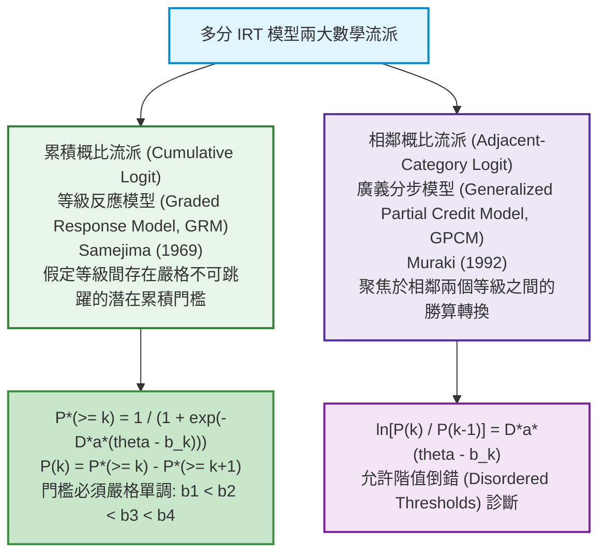

# 第 16 章：多分試題 IRT 模型 (GRM / GPCM) 與評定量表分析

> **本章目標**：根據《Educational Measurement》第 5 版（Cook & Pitoniak, 2025）之多分試題計量章節（Cai et al., 2025; 陳新豐, 2021）。介紹適用於李克特量表與部分給分題的 IRT 模型：**等級反應模型（GRM）**（Samejima, 1969）與**廣義分步評分模型（GPCM）**（Masters, 1982; Muraki, 1992）。說明階值門檻（Thresholds）的單調性與階值倒錯（Disordered Thresholds）成因，並以 `mirt`（Chalmers, 2012）繪製類別反應曲線（CRC）。

---

## 16.1 理論基礎：多分 IRT 模型的兩大數學流派

在心理量表（如李克特 5 點量表：$1 \sim 5$ 分）或申論題階梯評分規準（$0, 1, 2, 3$ 分）中，作答反應不再是單純的 $0/1$，而是具備有序等級特性的**多分反應（Polytomous Response）**（Cai et al., 2025; Samejima, 1969; Muraki, 1992）。



### 16.1.1 等級反應模型（Graded Response Model, GRM）
Samejima（1969）提出的 GRM 是李克特量表常用的模型。對於具有 $K$ 個有序等級（$k = 1, 2, \dots, K$）的題項，包含 $K - 1$ 個潛在階值門檻參數 $b_{j1} < b_{j2} < \dots < b_{j, K-1}$。
1. **累積超越機率（Cumulative Probability）**：受試者得分大於等於等級 $k$ 的機率為：
   $$P_{jk}^*(\theta) = P(X_j \ge k \mid \theta) = \frac{1}{1 + e^{-D a_j (\theta - b_{jk})}}$$
   其中邊界定義為 $P_{j1}^*(\theta) \equiv 1.0$，$P_{j, K+1}^*(\theta) \equiv 0.0$。
2. **特定等級作答機率（Category Probability）**：剛好落在等級 $k$ 的機率等於兩相鄰累積機率之差：
   $$P_{jk}(\theta) = P_{jk}^*(\theta) - P_{j, k+1}^*(\theta)$$

---

## 16.2 評量實務情境：階值單調性與階值倒錯（Threshold Disorder）

在五點李克特量表（1:非常不同意、2:不同意、3:普通、4:同意、5:非常同意）中，理想情況下，隨著考生特質 $\theta$ 從負無窮大增加到正無窮大，各選項的優勢區間應當依序顯現。在分步評分模型（PCM）（Masters, 1982）與廣義分步評分模型（GPCM）（Muraki, 1992）中，相鄰等級門檻並未強制單調遞增。

若在實測中發現**階值倒錯（如 $b_2 > b_3$）**，通常反映出實務設計缺陷：
- 選項文字標籤定義模糊（例如「不同意」與「普通」在受試者心中界線混淆）。
- 選項過多（例如 7 點或 9 點量表超出了受試者認知分辨的極限）。

---

## 16.3 現代 R 語言程式實作：使用 `mirt` 擬合 GRM 與 GPCM 模型並進行比較

我們使用示範資料集的情意量表 10 題（`scale_01` 至 `scale_10`，已翻轉反向題），以 `mirt`（Chalmers, 2012）擬合累積概比流派之 GRM（Samejima, 1969）與相鄰概比流派之 GPCM（Muraki, 1992），並比較兩者適配度：

```r
# ==============================================================================
# 第 16 章程式碼清單 16.1：使用 mirt 擬合與比較等級反應模型 (GRM) 及分步評分模型 (GPCM)
# ==============================================================================

library(mirt)
library(dplyr)
library(tibble)

# 讀取示範資料集
df_all <- read.csv("book/data/assessment_data.csv") |> as_tibble()
df_poly <- df_all |>
  select(scale_01:scale_10) |>
  mutate(
    scale_03 = 6L - as.integer(scale_03),
    scale_08 = 6L - as.integer(scale_08)
  )

# 1. 擬合累積概比模型：等級反應模型 (itemtype = "graded")
fit_grm <- mirt(df_poly, model = 1, itemtype = "graded", verbose = FALSE)

# 2. 擬合相鄰概比模型：廣義分步評分模型 (itemtype = "gpcm")
fit_gpcm <- mirt(df_poly, model = 1, itemtype = "gpcm", verbose = FALSE)

# 3. 兩模型全域適配度指標比較 (AIC, BIC, Log-Likelihood)
model_comp_poly <- anova(fit_grm, fit_gpcm)
cat("--- 多分 IRT 競爭模型比較 (GRM vs. GPCM) ---\n")
print(model_comp_poly)

# 4. 提取 GRM 傳統 IRT 尺度參數 (a, b1, b2, b3, b4)
grm_params <- coef(fit_grm, IRTpars = TRUE, simplify = TRUE)$items |>
  as.data.frame() |>
  rownames_to_column(var = "Item") |>
  as_tibble() |>
  select(Item, a, b1, b2, b3, b4)

cat("\n--- 10 題情意量表 GRM 參數清單 (鑑別度 a 與四個階值門檻 b) ---\n")
print(grm_params, n = 10)
```

---

## 16.4 視覺化：類別反應特徵曲線（CRC）與階值跨度圖

### 16.4.1 繪製單題類別反應特徵曲線（Category Response Curves, CRC）

類別反應曲線直觀展示考生在不同能力 $\theta$ 下，選擇五個不同等級的理論機率：

```r
# ==============================================================================
# 第 16 章程式碼清單 16.2：GRM 類別反應曲線 (CRC) 繪圖
# ==============================================================================

library(ggplot2)
library(tidyr)

# 挑選第 1 題 (scale_01: 學習樂趣) 繪製 CRC
p1_params <- grm_params |> filter(Item == "scale_01")
a_val <- p1_params$a
b_vals <- c(p1_params$b1, p1_params$b2, p1_params$b3, p1_params$b4)

# 建立能力格點並計算 5 個等級之機率
th_seq <- seq(-3.5, 3.5, length.out = 300)

# 累積超越機率 P*(>= k)
p_star <- matrix(0, nrow = length(th_seq), ncol = 6)
p_star[, 1] <- 1.0 # P*(>= 1) = 1
for (k in 1:4) {
  # mirt 的 IRTpars 採 D = 1 metric
  p_star[, k + 1] <- 1 / (1 + exp(-a_val * (th_seq - b_vals[k])))
}
p_star[, 6] <- 0.0 # P*(>= 6) = 0

# 各等級機率 P(k) = P*(k) - P*(k+1)
crc_mat <- matrix(0, nrow = length(th_seq), ncol = 5)
for (k in 1:5) {
  crc_mat[, k] <- p_star[, k] - p_star[, k + 1]
}

crc_df <- as.data.frame(crc_mat) |>
  as_tibble() |>
  rename(
    "等級 1: 非常不同意" = V1,
    "等級 2: 不同意"     = V2,
    "等級 3: 普通"       = V3,
    "等級 4: 同意"       = V4,
    "等級 5: 非常同意"   = V5
  ) |>
  mutate(Theta = th_seq) |>
  pivot_longer(cols = -Theta, names_to = "Category", values_to = "Probability")

# 繪製 CRC 曲線圖
p_crc <- ggplot(crc_df, aes(x = Theta, y = Probability, color = Category)) +
  geom_line(linewidth = 1.1) +
  scale_color_manual(
    name = "李克特反應等級",
    values = c(
      "等級 1: 非常不同意" = "#d73027",
      "等級 2: 不同意"     = "#fc8d59",
      "等級 3: 普通"       = "#fee090",
      "等級 4: 同意"       = "#91bfdb",
      "等級 5: 非常同意"   = "#4575b4"
    )
  ) +
  scale_x_continuous(breaks = -3:3) +
  scale_y_continuous(limits = c(0, 1), breaks = seq(0, 1, by = 0.2)) +
  labs(
    title = "Figure 16.1: 等級反應模型 (GRM) 類別反應特徵曲線 (Category Response Curves, CRC)",
    subtitle = "題項 scale_01 (學習樂趣): 呈現五個等級隨潛在學習動機 Theta 增加之機率更替歷程",
    x = "潛在特質能力值 (Theta: 學習動機)",
    y = "各等級作答機率 P(X = k | Theta)",
    caption = sprintf("GRM Parameters (D = 1): a = %.2f, b = %s", a_val, paste(sprintf("%.2f", b_vals), collapse = ", "))
  ) +
  theme_classic(base_size = 12) +
  theme(
    legend.position = "bottom",
    plot.title = element_text(face = "bold", size = 13)
  )

ggsave("book/fig_16_1_grm_crc.png", plot = p_crc, width = 8.5, height = 5.5, dpi = 300)
cat("成功產出圖表: book/fig_16_1_grm_crc.png\n")
```

### 16.4.2 繪製 10 題階值門檻跨度水平點圖

```r
# ==============================================================================
# 第 16 章程式碼清單 16.3：全量表階值門檻跨度分佈圖
# ==============================================================================

threshold_long <- grm_params |>
  select(Item, b1:b4) |>
  pivot_longer(cols = b1:b4, names_to = "Threshold", values_to = "Value") |>
  mutate(Item = factor(Item, levels = rev(sprintf("scale_%02d", 1:10))))

p_thresh <- ggplot(threshold_long, aes(x = Value, y = Item)) +
  geom_vline(xintercept = 0, linetype = "dashed", color = "grey60") +
  geom_line(color = "grey70", linewidth = 1.2) + # 連接同題之門檻線段
  geom_point(aes(color = Threshold), size = 3.5) +
  scale_color_brewer(
    name = "階值門檻",
    palette = "Set1",
    labels = c("b1: 門檻 1 (1->2)", "b2: 門檻 2 (2->3)", "b3: 門檻 3 (3->4)", "b4: 門檻 4 (4->5)")
  ) +
  scale_x_continuous(breaks = -3:3) +
  labs(
    title = "Figure 16.2: 10 道情意量表題項 GRM 階值門檻跨度圖 (Threshold Range Plot)",
    subtitle = "所有題項之門檻點皆呈現嚴格單調遞增 (b1 < b2 < b3 < b4)，無階值倒錯現象",
    x = "潛在特質尺度 (Logit Metric: Theta)",
    y = "量表題號 (Item ID)",
    caption = "Source: Graded Response Model via mirt (N = 1,000)"
  ) +
  theme_classic(base_size = 12) +
  theme(
    legend.position = "bottom",
    plot.title = element_text(face = "bold", size = 13),
    axis.text = element_text(color = "black")
  )

ggsave("book/fig_16_2_threshold_range.png", plot = p_thresh, width = 8.5, height = 6, dpi = 300)
cat("成功產出圖表: book/fig_16_2_threshold_range.png\n")
```

---

## 16.5 測驗報告專業解讀（Substantive Interpretation）

依據多分 IRT 診斷，量表設計專家應針對選項有效性提出決策：

> ### 📋 量表選項階梯診斷指南
> 1. **選項區辨度（Category Functioning）**：以 `scale_01`（$a = 2.29$；$b = -1.30, -0.48, 0.46, 1.30$）為例，五個等級在能力軸上各有機率最高的區間，未見被其他等級完全覆蓋的冗餘等級，支持採用五點計分。
> 2. **門檻單調性與跨度覆蓋**：如圖 16.2 所示，10 道題目的門檻介於 $[-1.81, +1.84]$，相鄰門檻間距約 $0.8 \sim 1.2$ logit，皆單調遞增，未見階值倒錯。

---

## 16.6 章末實務習題與專案挑戰

### 【基礎練習題】
1. 某李克特 4 點量表題項之 GRM 參數為：$a = 1.5, b_1 = -1.0, b_2 = 0.0, b_3 = 1.0$。請計算當考生能力 $\theta = 0.0$ 時，該生選擇「等級 2」與「等級 3」的理論機率分別為多少？
2. 在 GPCM 模型中，若某題估計出的階值門檻為 $b_1 = -0.5, b_2 = 0.8, b_3 = 0.3$，出現了 $b_2 > b_3$ 的現象。此現象稱為何者？在實務上應如何調整量表選項？

### 【進階工程挑戰】
3. 撰寫一個自動化階值倒錯診斷函數 `diagnose_threshold_disorder(grm_model)`。輸入擬合好的 `mirt` 多分模型，自動提取全體題目的門檻參數，檢驗每一題是否滿足 $b_1 < b_2 < \dots < b_{K-1}$，若發現倒錯立即標記題號與倒錯階層，並輸出改善建議報告。

---

### 💡 習題參考解答

```r
# ==============================================================================
# 第 16 章習題解答參考
# ==============================================================================

# 第 1 題
prob_star <- function(th, a, b) 1 / (1 + exp(-1.702 * a * (th - b)))
p_s1 <- 1.0
p_s2 <- prob_star(0, 1.5, -1.0)
p_s3 <- prob_star(0, 1.5, 0.0)
p_s4 <- prob_star(0, 1.5, 1.0)
p_s5 <- 0.0

p_cat2 <- p_s2 - p_s3
p_cat3 <- p_s3 - p_s4
cat(sprintf("theta = 0 時選擇等級 2 機率: %.4f\n", p_cat2))
cat(sprintf("theta = 0 時選擇等級 3 機率: %.4f\n", p_cat3))

# 第 3 題解答核心
diagnose_threshold_disorder <- function(model_obj) {
  params <- coef(model_obj, IRTpars = TRUE, simplify = TRUE)$items
  b_cols <- grep("^b", colnames(params), value = TRUE)
  
  disorder_cases <- list()
  for (i in 1:nrow(params)) {
    b_vals <- params[i, b_cols]
    if (is.unsorted(b_vals)) {
      disorder_cases[[rownames(params)[i]]] <- b_vals
    }
  }
  
  if (length(disorder_cases) == 0) {
    cat("全體題項階值門檻皆單調遞增，無階值倒錯。\n")
  } else {
    cat("發現以下題項存在階值倒錯:\n")
    print(disorder_cases)
  }
}
cat("階值倒錯自動診斷函數編寫完成。\n")
```

---

## 參考文獻 (References)

陳新豐（2021）。**R 語言：量表編製、統計分析與試題反應理論**（第 2 版）。五南圖書。

Cai, L., Hansen, M., Jeon, M., & Edwards, M. C. (2025). Modeling data from educational assessments. In L. L. Cook & M. J. Pitoniak (Eds.), *Educational measurement* (5th ed., pp. 655–734). Oxford University Press.

Chalmers, R. P. (2012). mirt: A multidimensional item response theory package for the R environment. *Journal of Statistical Software*, *48*(6), 1–29. https://doi.org/10.18637/jss.v048.i06

Cook, L. L., & Pitoniak, M. J. (Eds.). (2025). *Educational measurement* (5th ed.). Oxford University Press.

Masters, G. N. (1982). A Rasch model for partial credit scoring. *Psychometrika*, *47*(2), 149–174. https://doi.org/10.1007/BF02296272

Muraki, E. (1992). A generalized partial credit model: Application of an EM algorithm. *Applied Psychological Measurement*, *16*(2), 159–176. https://doi.org/10.1177/014662169201600206

Samejima, F. (1969). Estimation of latent ability using a response pattern of graded scores. *Psychometrika Monograph Supplement*, *34*(4, Pt. 2), 1–100. https://doi.org/10.1007/BF03372160
