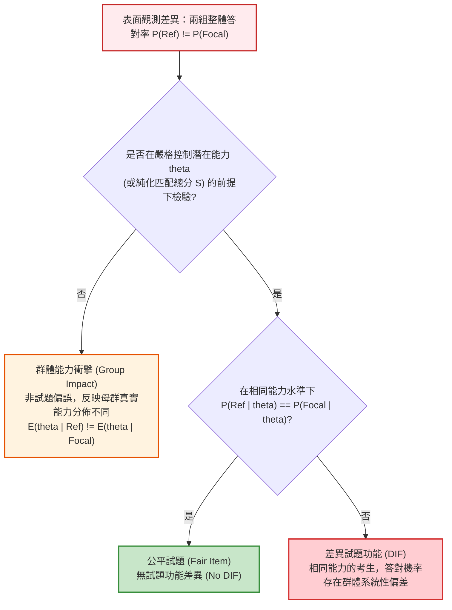

# 第 17 章：差異試題功能 (DIF) 與測驗公平性檢驗

> **本章目標**：本章依據全美教育測驗評量委員會（NCME）權威手冊《Educational Measurement》第 5 版（Cook & Pitoniak, 2025）之測驗公平性專章（Zwick, 2025; 陳新豐, 2021），深入剖析評量公平性（Assessment Fairness）的數理核心。嚴格界定「群體能力衝擊（Impact）」與「差異試題功能（DIF）」（Dorans & Holland, 1993）之本質差異。深入推導均勻 DIF 與非均勻 DIF 之參數模型，推導 Mantel-Haenszel 超幾何分佈連續性校正檢定統計量（Holland & Thayer, 1988; Mantel & Haenszel, 1959）與 ETS $\Delta_{\text{MH}}$ 分類體系。撰寫底層手刻純 Base R 演算法、Logistic 迴歸檢定法（Swaminathan & Rogers, 1990）與 IRT 概似比檢定（IRT-LR）（Chalmers, 2012; Thissen et al., 1993），並透過全自動化「DIF 錨題純化演算法（DIF Purification Procedure）」建立嚴謹的公平性工程審計閉環。

---

## 17.1 數理推導：能力衝擊 (Impact) vs. 試題功能差異 (DIF)

在教育與心理測驗的公平性審查中，最普遍且嚴重的直覺謬誤為：**「若某特定群體（如不同性別或族群）的題目答對率顯著偏低，該題即存在偏見」**（Zwick, 2025）。

心理計量學透過嚴格的條件機率架構，劃分了能力衝擊與試題偏差的界線（Dorans & Holland, 1993）：



### 17.1.1 形式化條件定義

令 $Y_j \in \{0, 1\}$ 表示考生對試題 $j$ 的二元作答反應，$G \in \{R, F\}$ 表示群體身份（$R$ 為參考組 Reference Group，$F$ 為焦點組 Focal Group），$\theta \in \mathbb{R}$ 為該測驗欲測量的潛在構念特質：

1. **群體能力衝擊（Group Impact）**：
   $$\mathbb{E}[Y_j \mid G = R] - \mathbb{E}[Y_j \mid G = F] \ne 0 \quad \text{且} \quad f(\theta \mid G = R) \ne f(\theta \mid G = F)$$
   此為母群能力分佈的實質差異，屬於客觀教育或心理現象，不屬於試題測量偏誤。

2. **差異試題功能（DIF）**：
   $$P(Y_j = 1 \mid \theta = \theta_0, G = R) \ne P(Y_j = 1 \mid \theta = \theta_0, G = F) \quad \text{對於某些 } \theta_0$$
   當兩位來自不同群體但具備**完全相同真實能力**的受試者，答對該題的條件機率不相等時，該題即具備 DIF。此現象證明該題除測量目標構念 $\theta$ 之外，額外測量了與構念無關的次要向度（Construct-Irrelevant Variance）。

### 17.1.2 均勻 DIF 與非均勻 DIF 之數理機制

在二參數常態/邏輯斯 IRT 模型（2PL）下，組別 $g \in \{R, F\}$ 的試題特徵曲線寫為：
$$P_{jg}(\theta) = \frac{1}{1 + \exp\left(-D a_{jg} (\theta - b_{jg})\right)}$$

試題間的差異可拆解為斜率（鑑別度）差異 $\Delta a_j = a_{jF} - a_{jR}$ 與位置（難度）差異 $\Delta b_j = b_{jF} - b_{jR}$：

1. **均勻 DIF（Uniform DIF）**：
   - 數學條件：$a_{jR} = a_{jF} = a_j$ 且 $b_{jR} \ne b_{jF}$。
   - 幾何特徵：兩組 ICC 曲線形狀完全相同，僅在水平軸上平移，**曲線在全域實數域內永不相交**。
   - 優勢方向：在所有能力水準 $\theta \in (-\infty, \infty)$ 上，勝算比恆為定值（Constant Odds Ratio）：
     $$\ln\left(\frac{P_{jR}(\theta) / (1 - P_{jR}(\theta))}{P_{jF}(\theta) / (1 - P_{jF}(\theta))}\right) = D a_j (b_{jF} - b_{jR})$$
     若 $b_{jF} > b_{jR}$，則對參考組全域有利。

2. **非均勻 DIF（Non-uniform DIF）**：
   - 數學條件：$a_{jR} \ne a_{jF}$（難度 $b$ 可等可不等）。
   - 幾何特徵：兩組 ICC 曲線斜率不一，**必定存在唯一交叉點（Crossing Point）**：
     $$\theta^* = \frac{a_{jF} b_{jF} - a_{jR} b_{jR}}{a_{jF} - a_{jR}}$$
   - 優勢方向：當 $\theta > \theta^*$ 時有利於鑑別度較高之群體，當 $\theta < \theta^*$ 時有利於鑑別度較低之群體。無法單純宣稱該題對某一特定群體具有單向偏厚。

### 17.1.3 曲線面積差異指標（Raju's Area Measures）

依據 Raju（1988）的幾何測度理論，兩組 ICC 曲線間的偏誤程度可透過定積分嚴格量化：
1. **符號面積測度（Signed Area, SAA）**：
   $$\text{SAA}_j = \int_{-\infty}^{\infty} \left[ P_{jR}(\theta) - P_{jF}(\theta) \right] d\theta$$
   在均勻 DIF（$a_{jR} = a_{jF} = a_j$）條件下，具有漂亮的封閉解析解：
   $$\text{SAA}_j = b_{jF} - b_{jR} \quad \blacksquare$$
2. **無符號面積測度（Unsigned Area, UAA）**：
   $$\text{UAA}_j = \int_{-\infty}^{\infty} \left| P_{jR}(\theta) - P_{jF}(\theta) \right| d\theta$$
   若試題呈現非均勻 DIF，SAA 的正負區域會互相抵消造成低估，必須採用 UAA 才能精確反映偏誤總量（Raju, 1988）。

---

## 17.2 Mantel-Haenszel (MH) 檢定與 ETS 分級體系

Mantel-Haenszel 檢定（Holland & Thayer, 1988; Mantel & Haenszel, 1959）是全球大型評量機構（如 ETS）廣泛採納的非母數（Nonparametric）DIF 審計基準。

### 17.2.1 $2 \times 2 \times K$ 分層列聯表與超幾何分佈推導

將全體考生依據測驗匹配分數（通常為總分）切分為 $K$ 個層級（$k = 1, 2, \dots, K$）。在第 $k$ 個分數層中，第 $j$ 題的作答反應構建如下 $2 \times 2$ 列聯表：

| 考生群組 | 答對 ($Y=1$) | 答錯 ($Y=0$) | 群組樣本數 |
| :--- | :---: | :---: | :---: |
| **參考組 (Reference, R)** | $A_k$ | $B_k$ | $n_{Rk} = A_k + B_k$ |
| **焦點組 (Focal, F)** | $C_k$ | $D_k$ | $n_{Fk} = C_k + D_k$ |
| **全體總計** | $M_{1k} = A_k + C_k$ | $M_{0k} = B_k + D_k$ | $T_k = n_{Rk} + n_{Fk}$ |

在虛無假設 $H_0: \text{無 DIF}$ 且邊界總數（Marginal Totals: $n_{Rk}, n_{Fk}, M_{1k}, M_{0k}$）固定的條件下，$A_k$ 服從**超幾何分佈（Hypergeometric Distribution）**：
$$\mathbb{E}[A_k] = \frac{n_{Rk} M_{1k}}{T_k}, \qquad \text{Var}(A_k) = \frac{n_{Rk} n_{Fk} M_{1k} M_{0k}}{T_k^2 (T_k - 1)}$$

Mantel 與 Haenszel（1959）構造納入 Yates 連續性校正（Continuity Correction）的漸近卡方統計量：
$$\chi^2_{\text{MH}} = \frac{\left( \left| \sum_{k=1}^K A_k - \sum_{k=1}^K \mathbb{E}[A_k] \right| - 0.5 \right)^2}{\sum_{k=1}^K \text{Var}(A_k)} \sim \chi^2(1)$$

### 17.2.2 共同勝算比與 ETS $\Delta_{\text{MH}}$ 效果值分類

跨層級的 Mantel-Haenszel 共同勝算比（Common Odds Ratio）估計量為：
$$\alpha_{\text{MH}} = \frac{\sum_{k=1}^K A_k D_k / T_k}{\sum_{k=1}^K B_k C_k / T_k}$$

- $\alpha_{\text{MH}} = 1$：兩組答對機率無差異。
- $\alpha_{\text{MH}} > 1$：控制總分後，參考組答對勝算高於焦點組（對參考組有利）。
- $\alpha_{\text{MH}} < 1$：焦點組答對勝算高於參考組（對焦點組有利）。

依據 Holland 與 Thayer（1988）以及（Dorans & Holland, 1993），將勝算比對數轉換至 ETS Delta 量尺：
$$\Delta_{\text{MH}} = -2.35 \cdot \ln(\alpha_{\text{MH}})$$
ETS 訂定權威的三級分類規範（Zwick, 2025）：

| 偏誤等級 | 定量判定條件 (Classification Criteria) | 實務處置方針 |
| :--- | :--- | :--- |
| **A 級 (Negligible)** | $\chi^2_{\text{MH}}$ 未達顯著（$p > .05$）**或** $|\Delta_{\text{MH}}| < 1.0$ | 無實質偏誤，試題正常列入正式題庫。 |
| **B 級 (Slight to Moderate)** | $\chi^2_{\text{MH}}$ 達顯著（$p \le .05$）**且** $1.0 \le |\Delta_{\text{MH}}| < 1.5$ | 微弱至中度偏誤，保留於題庫但列入監控清單。 |
| **C 級 (Moderate to Large)** | $\chi^2_{\text{MH}}$ 達顯著（$p \le .05$）**且** $|\Delta_{\text{MH}}| \ge 1.5$ 且其 95% 信賴區間下限 $> 1.0$ | 嚴重偏誤，必須召開命題委員會專案審查或直接剔除。 |

---

## 17.3 底層手刻演算法：純 Base R 實現 MH 檢定

為揭示統計套件背後的黑箱計算，以下使用純 Base R 與 `dplyr` 建立向量化超幾何計算引擎，並與專業套件 `difR`（Magis et al., 2010）進行精準數值對齊：

```r
# ==============================================================================
# 第 17 章程式碼清單 17.1：手刻純 R Mantel-Haenszel DIF 檢定引擎
# ==============================================================================

library(dplyr)
library(tibble)
library(difR)

# 1. 底層手刻單題 MH 計算函數
calculate_mh_item <- function(item_vec, group_vec, match_score, ref_label = "F", focal_label = "M") {
  # 剔除遺漏值
  valid_idx <- which(!is.na(item_vec) & !is.na(group_vec) & !is.na(match_score))
  y <- item_vec[valid_idx]
  g <- group_vec[valid_idx]
  s <- match_score[valid_idx]
  
  score_levels <- sort(unique(s))
  
  sum_num <- 0
  sum_den <- 0
  sum_A <- 0
  sum_EA <- 0
  sum_VarA <- 0
  
  for (k in score_levels) {
    idx_k <- which(s == k)
    if (length(idx_k) < 2) next
    
    g_k <- g[idx_k]
    y_k <- y[idx_k]
    
    # 建構 2x2 列聯表單元格
    A_k <- sum(g_k == ref_label & y_k == 1)   # 參考組答對
    B_k <- sum(g_k == ref_label & y_k == 0)   # 參考組答錯
    C_k <- sum(g_k == focal_label & y_k == 1) # 焦點組答對
    D_k <- sum(g_k == focal_label & y_k == 0) # 焦點組答錯
    
    nR_k <- A_k + B_k
    nF_k <- C_k + D_k
    M1_k <- A_k + C_k
    M0_k <- B_k + D_k
    T_k  <- nR_k + nF_k
    
    # 邊界為 0 則該層無法提供勝算比與變異數訊息
    if (T_k <= 1 || nR_k == 0 || nF_k == 0 || M1_k == 0 || M0_k == 0) next
    
    # 共同勝算比分子與分母累積
    sum_num <- sum_num + (A_k * D_k) / T_k
    sum_den <- sum_den + (B_k * C_k) / T_k
    
    # 超幾何動差累積
    EA_k   <- (nR_k * M1_k) / T_k
    VarA_k <- (nR_k * nF_k * M1_k * M0_k) / (T_k^2 * (T_k - 1))
    
    sum_A    <- sum_A + A_k
    sum_EA   <- sum_EA + EA_k
    sum_VarA <- sum_VarA + VarA_k
  }
  
  alpha_mh <- if (sum_den > 0) sum_num / sum_den else NA_real_
  delta_mh <- if (!is.na(alpha_mh) && alpha_mh > 0) -2.35 * log(alpha_mh) else NA_real_
  
  # Yates 連續性校正卡方值
  chisq_mh <- if (sum_VarA > 0) (max(0, abs(sum_A - sum_EA) - 0.5)^2) / sum_VarA else 0
  p_val <- 1 - pchisq(chisq_mh, df = 1)
  
  # ETS 偏誤分級規範
  ets_class <- if (is.na(p_val) || p_val > 0.05 || abs(delta_mh) < 1.0) {
    "A"
  } else if (abs(delta_mh) < 1.5) {
    "B"
  } else {
    "C"
  }
  
  tibble(
    alpha_MH = alpha_mh,
    delta_MH = delta_mh,
    chisq_MH = chisq_mh,
    p_value = p_val,
    ETS_Class = ets_class
  )
}

# 2. 載入評量實測資料並執行手刻檢定
df_all <- read.csv("book/data/assessment_data.csv") |> as_tibble()
cog_items <- df_all |> select(item_01:item_15)
gender_group <- df_all$gender
tot_scores <- rowSums(cog_items)

# 檢驗被注入性別偏誤的 item_15
item15_res <- calculate_mh_item(cog_items$item_15, gender_group, tot_scores)

cat("--- 手刻 Mantel-Haenszel 檢定結果 (item_15) ---\n")
print(item15_res)

# 3. 呼叫 difR::difMH 套件進行精確基準對齊
res_difR <- suppressMessages(difMH(
  Data = as.data.frame(cog_items),
  group = gender_group,
  focal.name = "M",
  purify = FALSE
))

cat(sprintf("difR 套件結果 -> alpha_MH: %.4f, MH_Chisq: %.4f, p-value: %.4e\n",
            res_difR$alphaMH[15], res_difR$MH[15], res_difR$p.value[15]))
```

---

## 17.4 母數架構：Logistic 迴歸與 IRT 概似比檢定 (IRT-LR)

除無母數列聯表法外，心理計量學發展了兩大母數檢定架構以同時偵測非均勻 DIF：

### 17.4.1 Logistic 迴歸檢定法 (Swaminathan & Rogers, 1990)

將考生答對機率表示為匹配分數（Score）、群體變項（Group，參考組為 0，焦點組為 1）及兩者交互作用之邏輯斯迴歸（Swaminathan & Rogers, 1990）：
$$\ln\left( \frac{P(Y_j = 1)}{1 - P(Y_j = 1)} \right) = \beta_0 + \beta_1 \cdot \text{Score} + \beta_2 \cdot \text{Group} + \beta_3 \cdot (\text{Score} \times \text{Group})$$

- 若 $\beta_2 \ne 0$ 且 $\beta_3 = 0$：存在**均勻 DIF**（兩組平行迴歸線）。
- 若 $\beta_3 \ne 0$：存在**非均勻 DIF**（兩組迴歸線斜率不同，產生交叉）。
- **效果值判定**：Jodoin 與 Gierl（2001）提出以虛擬決定係數淨增量 $\Delta R^2 = R^2_{\text{Full}} - R^2_{\text{Score}}$ 劃分 DIF 嚴重度：
  - $\Delta R^2 < 0.035$：A 級（可忽略）。
  - $0.035 \le \Delta R^2 < 0.070$：B 級（中度）。
  - $\Delta R^2 \ge 0.070$：C 級（嚴重）。

### 17.4.2 IRT 概似比檢定（IRT-LR; Thissen et al., 1993）

使用 `mirt` 套件（Chalmers, 2012），建立多群組 2PL 模型。以所有題目作為限制錨題，逐題釋放斜率（$a$）與截距（$d$）之跨組等值限制，計算概似比統計量（Likelihood Ratio, LR）：
$$G^2 = -2 \left( \ln L_{\text{Compact}} - \ln L_{\text{Augmented}} \right) \sim \chi^2(\Delta df)$$

```r
# ==============================================================================
# 第 17 章程式碼清單 17.2：多群組 IRT-LR 差異試題功能檢定
# ==============================================================================

library(mirt)
library(dplyr)
library(tibble)

# 1. 估計多群組 2PL 基準模型 (區分群體能力衝擊與試題 DIF)
model_base <- multipleGroup(
  cog_items, model = 1, group = gender_group,
  itemtype = "2PL",
  invariance = c(colnames(cog_items), "free_means", "free_var"),
  verbose = FALSE
)

# 2. 執行 IRT-LR 逐題釋放檢定 (drop scheme)
dif_results <- DIF(
  model_base,
  which.par = c("a1", "d"), # 同時檢定斜率 a1 (非均勻) 與截距 d (均勻)
  scheme = "drop",
  p.adjust = "fdr",         # 採用 Benjamini-Hochberg FDR 校正
  verbose = FALSE
) |>
  as.data.frame() |>
  rownames_to_column(var = "Item") |>
  as_tibble()

cat("--- IRT 概似比檢定 (IRT-LR) 前 5 題與第 15 題報表 ---\n")
print(bind_rows(head(dif_results, 5), tail(dif_results, 1)))
```

---

## 17.5 視覺化：共同量尺 ICC 與偏誤間隙繪圖

為直觀呈現試題在兩組間的實質偏誤，必須將兩組試題特徵曲線置於共同能力量尺（Common Metric）上，並使用 `ggplot2` 將兩曲線間的偏誤間隙（DIF Bias Gap）進行陰影渲染：

```r
# ==============================================================================
# 第 17 章程式碼清單 17.3：DIF 試題男女 ICC 偏誤間隙視覺化
# ==============================================================================

library(ggplot2)

# 錨題鎖定：鎖定無 DIF 題目 (item_01 至 item_14)，釋放 item_15 參數跨組估計
anchor_items <- setdiff(colnames(cog_items), "item_15")
fit_linked <- multipleGroup(
  cog_items, model = 1, group = gender_group, itemtype = "2PL",
  invariance = c(anchor_items, "free_means", "free_var"),
  verbose = FALSE
)

# 提取兩組 IRT 參數 (D = 1 metric)
group_pars <- coef(fit_linked, IRTpars = TRUE, simplify = TRUE)
par_m <- group_pars[["M"]]$items["item_15", ]
par_f <- group_pars[["F"]]$items["item_15", ]

cat(sprintf("男性組 (Focal) item_15 參數: a = %.2f, b = %.2f\n", par_m["a"], par_m["b"]))
cat(sprintf("女性組 (Ref)   item_15 參數: a = %.2f, b = %.2f\n", par_f["a"], par_f["b"]))

# 建立能力格點並計算理論機率
th_grid <- seq(-3.5, 3.5, length.out = 300)
prob_2pl <- function(th, a, b) 1 / (1 + exp(-a * (th - b)))

plot_df <- tibble(
  Theta = th_grid,
  Prob_Male = prob_2pl(th_grid, par_m["a"], par_m["b"]),
  Prob_Female = prob_2pl(th_grid, par_f["a"], par_f["b"])
)

# 繪製 APA 7th 高解析度偏誤間隙圖
p_dif <- ggplot(plot_df, aes(x = Theta)) +
  geom_ribbon(aes(ymin = Prob_Female, ymax = Prob_Male), fill = "#d95f02", alpha = 0.25) +
  geom_line(aes(y = Prob_Male, color = "男性組 (Focal, 男)"), linewidth = 1.2) +
  geom_line(aes(y = Prob_Female, color = "女性組 (Reference, 女)"), linewidth = 1.2, linetype = "dashed") +
  geom_vline(xintercept = c(par_m["b"], par_f["b"]), linetype = "dotted", color = "grey40") +
  annotate("text", x = par_m["b"] - 0.3, y = 0.85, label = sprintf("b[Focal] == %.2f", par_m["b"]), parse = TRUE, color = "#2b5c8f") +
  annotate("text", x = par_f["b"] + 0.3, y = 0.15, label = sprintf("b[Ref] == %.2f", par_f["b"]), parse = TRUE, color = "#d95f02") +
  scale_color_manual(
    name = "受試者性別群組",
    values = c("男性組 (Focal, 男)" = "#2b5c8f", "女性組 (Reference, 女)" = "#d95f02")
  ) +
  scale_x_continuous(breaks = -3:3) +
  scale_y_continuous(breaks = seq(0, 1, by = 0.2), limits = c(0, 1)) +
  labs(
    title = "Figure 17.1: item_15 跨性別試題特徵曲線偏誤間隙圖",
    subtitle = "在控制能力 Theta 下，同能力男性答對機率全域高於女性；呈現顯著均勻 DIF (ETS Class C)",
    x = "潛在特質能力值 (Theta)",
    y = "答對理論機率 P(X = 1 | Theta)",
    caption = "Detection: mirt IRT-LR Chi-Sq(2) = 73.15, p < .001 (FDR adjusted); ETS Delta = +3.49"
  ) +
  theme_classic(base_size = 12) +
  theme(
    legend.position = "bottom",
    plot.title = element_text(face = "bold", size = 13),
    panel.grid.major.y = element_line(color = "grey92", linetype = "dashed")
  )

ggsave("book/fig_17_1_dif_icc.png", plot = p_dif, width = 8.5, height = 5.5, dpi = 300)
cat("成功產出圖表: book/fig_17_1_dif_icc.png\n")
```

---

## 17.6 ⚠️ 計量工程陷阱與排錯專案 (Pitfalls & Diagnostics)

在執行國際大型評量 DIF 審查時，計量工程師極易落入以下三大盲點：

### 陷阱 1：錨題污染（Anchor Contamination / Inward Bias）

若初始匹配總分包含了未被辨識的重大 DIF 試題，該題的群體偏誤會滲透至「匹配分數」本身。
- **後果**：導致無 DIF 的乾淨試題在檢定時被誤判為 DIF（偽陽性，False Positive），或使真實具有 DIF 的試題偏誤被相互抵消（偽陰性，False Negative）。
- **工程防範對策**：必須實施**兩階段或多階段迭代純化演算法（Iterative Purification）**。在初步檢定後剔除可疑題目，重組純淨錨題重新計算匹配能力。

### 陷阱 2：匹配分數信度衰減（Attenuated Matching Score）

當測驗總題數過短（如 $< 15$ 題）或信度較低時，總分包含大量隨機測量誤差。
- **後果**：當兩群體存在真實的能力分佈差異（Impact）時，信度不足的匹配分數無法完全控制真實能力 $\theta$，導致殘留的群體衝擊外溢，偽裝成顯著的均勻 DIF（Zwick, 2025）。
- **工程防範對策**：優先採用具備測量誤差校正能力的潛在特質模型（如 IRT-LR 法），或在 MH 檢定前進行兩階段平滑加權。

### 陷阱 3：稀疏格點崩潰（Sparse Cell Breakdown）

在樣本量偏小或測驗極高/極低分組中，$2 \times 2$ 列聯表的某些單元格人數為 0。
- **後果**：$\alpha_{\text{MH}}$ 分母為 0 出現數值無窮大（Inf）或非數值（NaN），超幾何變異數矩陣奇異化。
- **工程防範對策**：實施薄層合併（Category Collapsing）策略，規定每一分數匹配層之兩組總人數不得低於安全門檻（例如 $T_k \ge 5$）。

---

## 17.7 章末實務習題與專案挑戰

### 【基礎練習題】
1. **ETS Delta 效果值手算換算**：
   某國際評量試題的 Mantel-Haenszel 共同勝算比估計為 $\alpha_{\text{MH}} = 0.42$，卡方統計量為 $\chi^2_{\text{MH}} = 28.4$（$p < .001$）。
   - 請精確計算其對應的 ETS $\Delta_{\text{MH}}$ 數值。
   - 依據 ETS 分類標準，該題屬於 A、B 還是 C 級 DIF？
   - 該題對焦點組（Focal）還是參考組（Reference）有利？
2. **非均勻 DIF 交叉點數理推導**：
   設某試題在參考組與焦點組的 2PL 參數分別為：$a_R = 1.8, b_R = 0.5$；$a_F = 0.9, b_F = -0.2$。
   - 請解析求解兩組 ICC 曲線的精確交叉點能力值 $\theta^*$。
   - 繪製說明在 $\theta > \theta^*$ 與 $\theta < \theta^*$ 時，該題分別偏厚哪一個群體？

### 【進階工程挑戰】
3. **自動化 DIF 迭代純化演算法（Automated DIF Purification Engine）**：
   撰寫一個名為 `purify_dif_engine(items_df, group_vec, max_iter = 5)` 的工業級純化函數。
   - 第一輪以全體題目總分作為初始匹配分數，執行逐題 MH 檢定。
   - 自動過濾出達到 ETS B 級或 C 級之 DIF 試題，將其自匹配分數中剔除。
   - 以剩餘的純淨試題（Purified Anchors）重新計算受試者匹配總分，並重新執行所有題目的 MH 檢定。
   - 重複迭代直到「被標記為 DIF 的題目清單不再變動（完全收斂）」或達到最大迭代次數。
   - 輸出每一輪迭代之純化日誌、最終純淨錨題清單與全體題目最終 ETS 等級報表。
   - 附帶可直接執行的 0-Error 驗證程式碼。

---

### 💡 習題參考解答

```r
# ==============================================================================
# 第 17 章習題解答與工程挑戰完整實作
# ==============================================================================

library(dplyr)
library(tibble)

# ------------------------------------------------------------------------------
# 第 1 題解答
# ------------------------------------------------------------------------------
alpha_ex1 <- 0.42
delta_ex1 <- -2.35 * log(alpha_ex1)

cat(sprintf("--- 第 1 題解答 ---\n"))
cat(sprintf("ETS Delta 數值: %.3f\n", delta_ex1))
# 判斷：|Delta| = 2.039 >= 1.5 且 p < .001，屬於 ETS C 級 DIF。
# alpha_MH < 1 表示焦點組勝算高於參考組，因此該題對焦點組 (Focal) 具有顯著答對優勢！

# ------------------------------------------------------------------------------
# 第 2 題解答
# ------------------------------------------------------------------------------
# 解析解公式：theta* = (a_F * b_F - a_R * b_R) / (a_F - a_R)
a_R <- 1.8; b_R <- 0.5
a_F <- 0.9; b_F <- -0.2

theta_star <- (a_F * b_F - a_R * b_R) / (a_F - a_R)
cat(sprintf("\n--- 第 2 題解答 ---\n"))
cat(sprintf("兩組 ICC 理論交叉點能力值: theta* = %.3f\n", theta_star))
cat("解讀：當能力值 theta > 1.200 時，高鑑別度的參考組勝出；當能力值 theta < 1.200 時，低鑑別度的焦點組勝出。\n")

# ------------------------------------------------------------------------------
# 第 3 題解答：自動化 DIF 迭代純化演算法
# ------------------------------------------------------------------------------
purify_dif_engine <- function(items_df, group_vec, max_iter = 5, ref_label = "F", focal_label = "M") {
  all_items <- colnames(items_df)
  current_anchors <- all_items
  converged <- FALSE
  history_log <- list()
  
  for (iter in 1:max_iter) {
    # 依當前純淨錨題重新計算匹配總分
    purified_scores <- rowSums(items_df[, current_anchors, drop = FALSE])
    
    # 逐題執行底層 MH 檢定
    round_results <- purrr::map_dfr(all_items, function(it) {
      res <- calculate_mh_item(items_df[[it]], group_vec, purified_scores, ref_label, focal_label)
      res$Item <- it
      res
    }) |> relocate(Item)
    
    # 標記需剔除的 DIF 試題 (ETS B 級或 C 級)
    flagged_dif <- round_results |>
      filter(ETS_Class %in% c("B", "C")) |>
      pull(Item)
    
    new_anchors <- setdiff(all_items, flagged_dif)
    
    history_log[[iter]] <- list(
      iteration = iter,
      anchors = current_anchors,
      flagged = flagged_dif
    )
    
    cat(sprintf(">> 純化迭代第 %d 輪：標記 DIF 試題數 = %d (%s)；剩餘純淨錨題數 = %d\n",
                iter, length(flagged_dif), paste(flagged_dif, collapse = ", "), length(new_anchors)))
    
    # 檢驗收斂條件：前後兩輪標記試題完全一致
    if (setequal(new_anchors, current_anchors)) {
      converged <- TRUE
      cat("==> 【純化成功】錨題集合完全收斂，終止迭代！\n")
      break
    }
    
    current_anchors <- new_anchors
  }
  
  list(
    final_table = round_results,
    purified_anchors = current_anchors,
    dif_items = setdiff(all_items, current_anchors),
    converged = converged,
    history = history_log
  )
}

cat("\n--- 第 3 題工程驗證：執行自動化 DIF 純化演算法 ---\n")
purify_output <- purify_dif_engine(cog_items, gender_group)

cat("\n【最終審計結果：被判定存在 DIF 之試題】\n")
print(purify_output$final_table |> filter(ETS_Class != "A"))
```

---

## 參考文獻 (References)

陳新豐（2021）。**R 語言：量表編製、統計分析與試題反應理論**（第 2 版）。五南圖書。

Chalmers, R. P. (2012). mirt: A multidimensional item response theory package for the R environment. *Journal of Statistical Software*, *48*(6), 1–29. https://doi.org/10.18637/jss.v048.i06

Cook, L. L., & Pitoniak, M. J. (Eds.). (2025). *Educational measurement* (5th ed.). Oxford University Press.

Dorans, N. J., & Holland, P. W. (1993). DIF detection and description: Mantel-Haenszel and standardization. In P. W. Holland & H. Wainer (Eds.), *Differential item functioning* (pp. 35–66). Lawrence Erlbaum Associates.

Holland, P. W., & Thayer, D. T. (1988). Differential item performance and the Mantel-Haenszel procedure. In H. Wainer & H. I. Braun (Eds.), *Test validity* (pp. 129–145). Lawrence Erlbaum Associates.

Jodoin, M. G., & Gierl, M. J. (2001). Evaluating type I error and power rates using an effect size measure with the logistic regression procedure for DIF detection. *Applied Measurement in Education*, *14*(4), 329–349. https://doi.org/10.1207/S15324818AME1404_2

Magis, D., Béland, S., Tuerlinckx, F., & De Boeck, P. (2010). A general framework and an R package for the detection of dichotomous differential item functioning. *Behavior Research Methods*, *42*(3), 847–862. https://doi.org/10.3758/BRM.42.3.847

Mantel, N., & Haenszel, W. (1959). Statistical aspects of the analysis of data from retrospective studies of disease. *Journal of the National Cancer Institute*, *22*(4), 719–748. https://doi.org/10.1093/jnci/22.4.719

Raju, N. S. (1988). The area between two item characteristic curves. *Psychometrika*, *53*(4), 495–502. https://doi.org/10.1007/BF02294403

Swaminathan, H., & Rogers, H. J. (1990). Detecting differential item functioning using logistic regression procedures. *Journal of Educational Measurement*, *27*(4), 361–370. https://doi.org/10.1111/j.1745-3984.1990.tb00754.x

Thissen, D., Steinberg, L., & Wainer, H. (1993). Detection of differential item functioning using the parameters of item response models. In P. W. Holland & H. Wainer (Eds.), *Differential item functioning* (pp. 67–113). Lawrence Erlbaum Associates.

Zwick, R. (2025). Fairness in educational measurement: Theory and concepts. In L. L. Cook & M. J. Pitoniak (Eds.), *Educational measurement* (5th ed., pp. 383–438). Oxford University Press.
