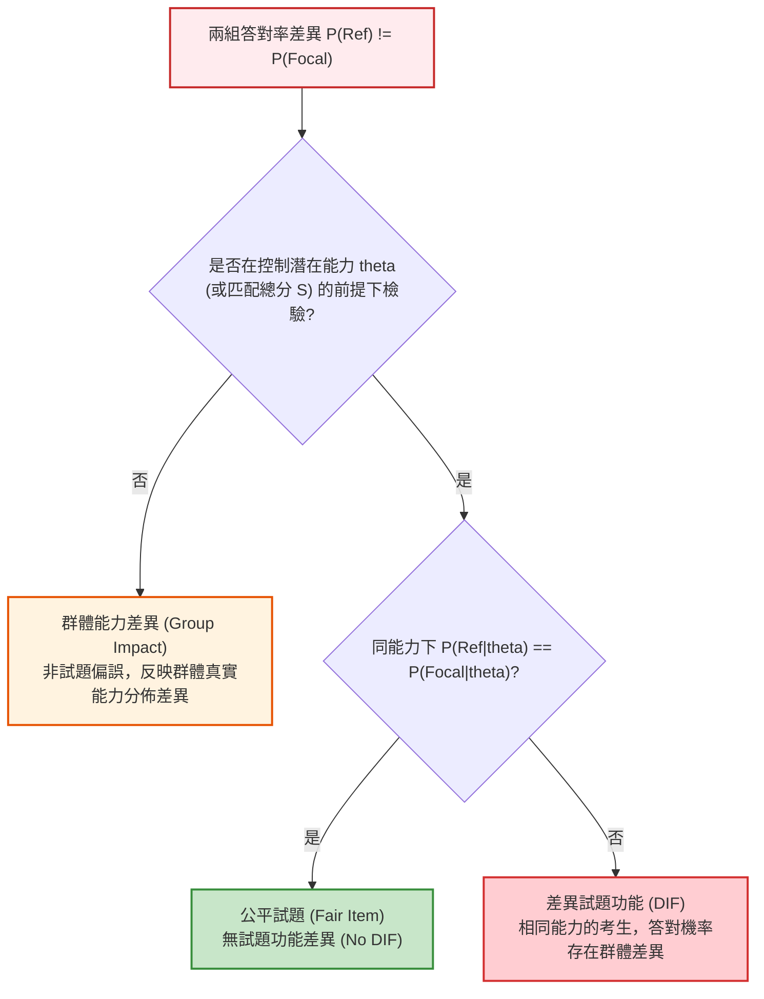

# 第 17 章：差異試題功能 (DIF) 與測驗公平性檢驗

> **本章目標**：根據《Educational Measurement》第 5 版（Cook & Pitoniak, 2025）之測驗公平性章節（Zwick, 2025; 陳新豐, 2021）。嚴格劃分「能力衝擊（Impact）」與「試題功能差異（DIF）」（Dorans & Holland, 1993）。掌握均勻 DIF 與非均勻 DIF 的數學機理，說明 Mantel-Haenszel（MH）檢定（Holland & Thayer, 1988; Mantel & Haenszel, 1959），使用 `difR` 套件（Magis et al., 2010）實作非母數 ETS 分類，運用 `mirt::DIF()`（Chalmers, 2012）進行現代概似比檢定（IRT-LR）（Thissen et al., 1993），並繪製兩組 ICC 偏誤間隙圖。

---

## 17.1 理論基礎：能力衝擊 (Impact) vs. 試題功能差異 (DIF)

在評量公平性（Assessment Fairness）審查中，常見的誤解是「某群體答對率低，就斷定該題存在偏見」（Zwick, 2025）。

心理計量學建立了嚴格的「能力控制」標準（Dorans & Holland, 1993; Holland & Thayer, 1988）：



### 17.1.1 兩類 DIF 型態
1. **均勻 DIF（Uniform DIF）**：在所有能力水準上，參考組（Reference Group, $R$）相對於焦點組（Focal Group, $F$）的優勢方向完全一致。在 2PL 模型中表現為**鑑別度相同（$a_R = a_F$），但難度不同（$b_R \ne b_F$）**，兩組 ICC 曲線平行不相交。
2. **非均勻 DIF（Non-uniform DIF）**：優勢方向隨能力高低而逆轉。在 2PL 模型中表現為**鑑別度不同（$a_R \ne a_F$）**，兩組 ICC 曲線在某個能力點發生交叉。

---

## 17.2 Mantel-Haenszel (MH) 檢定法與 ETS 效果值分類

Mantel-Haenszel 法（Holland & Thayer, 1988; Mantel & Haenszel, 1959）是大型測驗機構（如 ETS）常用的非母數 DIF 檢定方法。

將考生依據測驗總分切分為 $K$ 個能力匹配層（$k = 1, 2, \dots, K$）。在第 $k$ 層構建 $2 \times 2$ 作答列聯表：

| 組別 | 答對 (1) | 答錯 (0) | 總人數 |
| :--- | :---: | :---: | :---: |
| **參考組 (Reference)** | $A_k$ | $B_k$ | $n_{Rk}$ |
| **焦點組 (Focal)** | $C_k$ | $D_k$ | $n_{Fk}$ |
| **全體總計** | $M_{1k}$ | $M_{0k}$ | $T_k$ |

### 17.2.1 共同勝算比與 ETS 分類法
MH 共同勝算比（Common Odds Ratio, $\alpha_{\text{MH}}$）衡量整體優勢比（Mantel & Haenszel, 1959）：
$$\alpha_{\text{MH}} = \frac{\sum_{k=1}^K A_k D_k / T_k}{\sum_{k=1}^K B_k C_k / T_k}$$

依據 Holland 與 Thayer（1988）及 Dorans 與 Holland（1993），換算為 ETS $\Delta_{\text{MH}}$ 效果值指標：
$$\Delta_{\text{MH}} = -2.35 \cdot \ln(\alpha_{\text{MH}})$$

- **A 級（可忽略偏誤，Negligible）**：$\text{MH}$ 統計量未達顯著（$p > .05$）或 $|\Delta_{\text{MH}}| < 1.0$。
- **B 級（微弱至中度偏誤，Slight to Moderate）**：達到顯著且 $1.0 \le |\Delta_{\text{MH}}| < 1.5$。
- **C 級（嚴重偏誤，Moderate to Large）**：達到顯著且 $|\Delta_{\text{MH}}| \ge 1.5$（必須召集專家進行實質審查或直接剔除）。

### 17.2.2 程式實作：使用 `difR` 執行非母數 Mantel-Haenszel 檢定

我們使用 `difR` 套件（Magis et al., 2010）對 15 道認知題目進行 Mantel-Haenszel 檢定，以女性為參考組（Reference），男性為焦點組（Focal），並自動計算 ETS $\Delta_{\text{MH}}$ 與偏誤等級分類：

```r
# ==============================================================================
# 第 17 章程式碼清單 17.1：使用 difR 進行非母數 Mantel-Haenszel DIF 檢定
# ==============================================================================

library(difR)
library(dplyr)
library(tibble)

# 讀取示範資料集
df_all <- read.csv("book/data/assessment_data.csv") |> as_tibble()
cog_items <- df_all |> select(item_01:item_15)

# 執行 Mantel-Haenszel 檢定 (以男性為焦點組 M，女性為參考組 F)
res_mh <- suppressMessages(difMH(
  Data = as.data.frame(cog_items),
  group = df_all$gender,
  focal.name = "M",
  purify = FALSE
))

# 提取指標並計算 ETS Delta 效果值
alpha_mh <- res_mh$alphaMH
delta_mh <- -2.35 * log(alpha_mh)
ets_class <- ifelse(res_mh$p.value > 0.05 | abs(delta_mh) < 1.0, "A",
                    ifelse(abs(delta_mh) < 1.5, "B", "C"))

mh_summary <- tibble(
  Item = res_mh$names,
  MH_Chisq = round(res_mh$MH, 3),
  p_value = round(res_mh$p.value, 4),
  alpha_MH = round(alpha_mh, 3),
  delta_MH = round(delta_mh, 3),
  ETS_Class = ets_class
)

cat("--- Mantel-Haenszel (MH) 檢定與 ETS 分級結果 (前 4 題與第 15 題) ---\n")
print(bind_rows(head(mh_summary, 4), tail(mh_summary, 1)))
```

---

## 17.3 現代 R 語言程式實作：使用 `mirt::DIF()` 進行概似比檢定

我們以示範資料集中 15 道認知題為實施對象（以女性為參考組，男性為焦點組），依據 Thissen 等人（1993）提出的 IRT 概似比檢定（IRT-LR）並以 `mirt`（Chalmers, 2012）執行。在資料生成階段，我們預先在 `item_15` 人為注入了性別均勻 DIF（對男性顯著有利）。

```r
# ==============================================================================
# 第 17 章程式碼清單 17.2：使用 mirt 進行 IRT-LR 差異試題功能檢驗
# ==============================================================================

library(mirt)
library(dplyr)
library(tibble)

# 讀取示範資料集
df_all <- read.csv("book/data/assessment_data.csv") |> as_tibble()

cog_items <- df_all |> select(item_01:item_15)
gender_group <- df_all$gender

# 1. 擬合多群組 2PL 基準模型 (Constrained Baseline Model)
# 所有題目參數跨組相等；焦點組潛在平均與變異數自由估計 (區分能力衝擊與 DIF)
model_base <- multipleGroup(
  cog_items, model = 1, group = gender_group,
  itemtype = "2PL",
  invariance = c(colnames(cog_items), "free_means", "free_var"),
  verbose = FALSE
)

# 2. 執行 IRT-LR (Likelihood Ratio) DIF 檢定
# 逐題檢驗難度 (b) 與鑑別度 (a) 跨組約束是否造成概似值顯著惡化
dif_results <- DIF(
  model_base,
  which.par = c("a1", "d"), # 檢驗斜率 a1 與截距 d
  scheme = "drop",          # 逐題釋放跨組限制
  p.adjust = "fdr",         # 採用 FDR 多重比較校正
  verbose = FALSE
) |>
  as.data.frame() |>
  rownames_to_column(var = "Item") |>
  as_tibble()

cat("--- IRT 概似比檢定 (IRT-LR) DIF 檢驗結果 (前 6 題與最後 2 題) ---\n")
print(bind_rows(head(dif_results, 6), tail(dif_results, 2)))
```

---

## 17.4 視覺化：以共同量尺呈現 `item_15` 的群組 ICC

比較群組 ICC 前，必須先將兩組參數置於共同量尺。本例以 `item_01` 至 `item_14` 作為暫定錨題，限制其參數跨組相等，並釋放 `item_15` 的參數。實務上須先檢查錨題是否適切；若錨題本身有 DIF，群組曲線比較也會受影響。

```r
# ==============================================================================
# 第 17 章程式碼清單 17.3：DIF 試題男女 ICC 偏誤間隙繪圖
# ==============================================================================

library(ggplot2)

# 將其餘題目暫作共同錨題，在共同量尺上估計 item_15 的群組參數
anchor_items <- setdiff(colnames(cog_items), "item_15")
fit_dif_linked <- multipleGroup(
  cog_items, model = 1, group = gender_group, itemtype = "2PL",
  invariance = c(anchor_items, "free_means", "free_var"),
  verbose = FALSE
)
group_coefs <- coef(fit_dif_linked, IRTpars = TRUE, simplify = TRUE)
params_m <- group_coefs[["M"]]$items["item_15", ]
params_f <- group_coefs[["F"]]$items["item_15", ]

cat(sprintf("男性組 item_15 參數 -> a: %.2f, b: %.2f\n", params_m["a"], params_m["b"]))
cat(sprintf("女性組 item_15 參數 -> a: %.2f, b: %.2f\n", params_f["a"], params_f["b"]))

# 生成繪圖格點
th_grid <- seq(-3.5, 3.5, length.out = 300)
# mirt 的 IRTpars 採 D = 1 metric
prob_2pl <- function(th, a, b) 1 / (1 + exp(-a * (th - b)))

dif_plot_df <- tibble(
  Theta = th_grid,
  Prob_Male = prob_2pl(th_grid, params_m["a"], params_m["b"]),
  Prob_Female = prob_2pl(th_grid, params_f["a"], params_f["b"])
)

# 繪製兩組 ICC 與陰影偏誤差距帶 (Bias Gap)
p_dif <- ggplot(dif_plot_df, aes(x = Theta)) +
  # 填充兩曲線間的 DIF 偏誤區域
  geom_ribbon(aes(ymin = Prob_Female, ymax = Prob_Male), fill = "#d95f02", alpha = 0.25) +
  # 繪製男性與女性的 ICC 曲線
  geom_line(aes(y = Prob_Male, color = "男性組 (Male, Focal)"), linewidth = 1.2) +
  geom_line(aes(y = Prob_Female, color = "女性組 (Female, Reference)"), linewidth = 1.2, linetype = "dashed") +
  geom_vline(xintercept = c(params_m["b"], params_f["b"]), linetype = "dotted", color = "grey50") +
  scale_color_manual(
    name = "受試者性別群組",
    values = c("男性組 (Male, Focal)" = "#2b5c8f", "女性組 (Female, Reference)" = "#d95f02")
  ) +
  scale_x_continuous(breaks = -3:3) +
  scale_y_continuous(breaks = seq(0, 1, by = 0.2)) +
  labs(
    title = "Figure 17.1: item_15 性別群組試題特徵曲線比較",
    subtitle = "以 item_01 至 item_14 為暫定共同錨題；曲線差異須與參數檢定及錨題品質一併解讀",
    x = "潛在特質能力值 (Theta)",
    y = "答對理論機率 P(X = 1 | Theta)",
    caption = "Detection: mirt IRT-LR Chi-Sq(2) = 73.15, p < .001 (FDR adjusted)"
  ) +
  theme_classic(base_size = 12) +
  theme(
    legend.position = "bottom",
    plot.title = element_text(face = "bold", size = 13)
  )

ggsave("book/fig_17_1_dif_icc.png", plot = p_dif, width = 8.5, height = 5.5, dpi = 300)
cat("成功產出圖表: book/fig_17_1_dif_icc.png\n")
```

---

## 17.5 測驗報告專業解讀（Substantive Interpretation）

在測驗公平性審查報告中，DIF 的處置必須結合量化指標與質性內容審查：

> ### ⚖️ DIF 審查處置流程
> 1. **統計檢定結論**：IRT 概似比檢定標記 `item_15` 有顯著性別 DIF（$\chi^2(2) = 73.15$，FDR 校正後 $p < .001$），其餘題目未達本次多重比較後的顯著門檻。資料生成時只在 `item_15` 的難度參數注入群組差異；但樣本估計值可能受抽樣誤差影響，不能只憑兩參數聯合檢定就斷定為均勻 DIF。需分別檢驗難度與鑑別度差異，並確認錨題品質。ETS A/B/C 分級需以 MH 法的 $\Delta_{\text{MH}}$ 另行計算。
> 2. **試題內容審查（Content Review）**：統計結果只能標記可疑試題，成因需由學科專家與性別平等委員檢視題幹判斷。例如，若題幹涉及特定運動規則（如棒球戰術名詞），可能使具相關經驗的考生在同能力下較易答對。
> 3. **處置建議**：若內容審查確認存在與構念無關的偏誤來源，將 `item_15` 標記為修訂或淘汰題，不納入正式計分。

---

## 17.6 章末實務習題與專案挑戰

### 【基礎練習題】
1. 某試題的 Mantel-Haenszel 共同勝算比為 $\alpha_{\text{MH}} = 2.15$。請計算其對應的 ETS $\Delta_{\text{MH}}$ 指標，並判斷該題屬於 A 級、B 級還是 C 級偏誤？此題對哪一個群體具有答對優勢？
2. 請解釋為何非均勻 DIF（Non-uniform DIF）在 ICC 圖形上一定會出現交叉？此時能否單純宣稱該題對某一組有利？

### 【進階工程挑戰】
3. 撰寫一個自動化 DIF 純化演算法（DIF Purification Procedure）。在第一次篩選出顯著 DIF 試題後，自動將該題從配對總分或錨題中剔除，並使用剩餘的「純淨試題（Purified Items）」重新估計能力並進行第二輪 DIF 檢定，直到不再出現新的 DIF 試題為止。

---

### 💡 習題參考解答

```r
# ==============================================================================
# 第 17 章習題解答參考
# ==============================================================================

# 第 1 題
alpha_mh <- 2.15
delta_mh <- -2.35 * log(alpha_mh)
cat(sprintf("Delta_MH = %.3f\n", delta_mh))
# |Delta_MH| = 1.799 >= 1.5，屬於 ETS C 級 DIF
# alpha_mh > 1 表示參考組 (Reference) 相對佔優勢。

# 第 2 題
# 答：非均勻 DIF 鑑別度 a 不等，兩條不同斜率的 S 曲線必定交叉。
# 在交叉點左側某一組有利，右側另一組有利，無法斷定對特定群體具有單向優勢。
```

---

## 參考文獻 (References)

陳新豐（2021）。**R 語言：量表編製、統計分析與試題反應理論**（第 2 版）。五南圖書。

Chalmers, R. P. (2012). mirt: A multidimensional item response theory package for the R environment. *Journal of Statistical Software*, *48*(6), 1–29. https://doi.org/10.18637/jss.v048.i06

Cook, L. L., & Pitoniak, M. J. (Eds.). (2025). *Educational measurement* (5th ed.). Oxford University Press.

Dorans, N. J., & Holland, P. W. (1993). DIF detection and description: Mantel-Haenszel and standardization. In P. W. Holland & H. Wainer (Eds.), *Differential item functioning* (pp. 35–66). Lawrence Erlbaum Associates.

Holland, P. W., & Thayer, D. T. (1988). Differential item performance and the Mantel-Haenszel procedure. In H. Wainer & H. I. Braun (Eds.), *Test validity* (pp. 129–145). Lawrence Erlbaum Associates.

Mantel, N., & Haenszel, W. (1959). Statistical aspects of the analysis of data from retrospective studies of disease. *Journal of the National Cancer Institute*, *22*(4), 719–748. https://doi.org/10.1093/jnci/22.4.719

Magis, D., Béland, S., Tuerlinckx, F., & De Boeck, P. (2010). A general framework and an R package for the detection of dichotomous differential item functioning. *Behavior Research Methods*, *42*(3), 847–862. https://doi.org/10.3758/BRM.42.3.847

Thissen, D., Steinberg, L., & Wainer, H. (1993). Detection of differential item functioning using the parameters of item response models. In P. W. Holland & H. Wainer (Eds.), *Differential item functioning* (pp. 67–113). Lawrence Erlbaum Associates.

Zwick, R. (2025). Fairness in educational measurement: Theory and concepts. In L. L. Cook & M. J. Pitoniak (Eds.), *Educational measurement* (5th ed., pp. 383–438). Oxford University Press.
