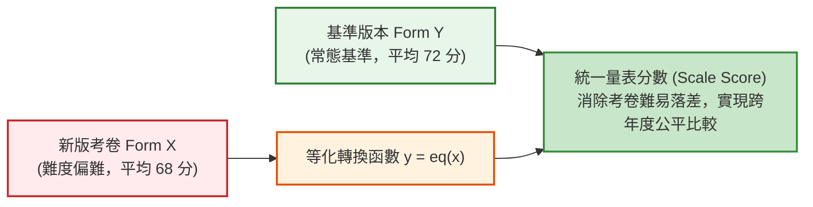
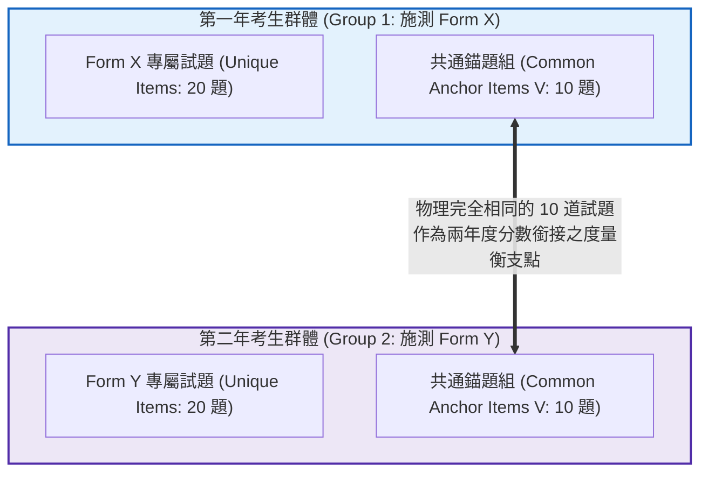

# 第 18 章：測驗等化 (Equating) 與分數銜接

> **本章目標**：根據《Educational Measurement》第 5 版（Cook & Pitoniak, 2025）之量尺化、等化與連結章節（Moses, 2025; Kolen & Brennan, 2014），說明不同測驗版本的分數連結與等化問題。除介紹單純群體線性與等百分位轉換外，進一步以 `equate` 套件（Albano, 2016）手刻實作非等價群體共同錨題（NEAT）架構下的鏈結線性等化（Chained Linear）、Tucker 線性等化與鏈結等百分位等化（Chained Equipercentile Equating），並以 Tidyverse（Wickham et al., 2019）進行等化函數視覺化對照。

---

## 18.1 理論基礎：測驗等化（Test Equating）的核心價值與基本性質

在升學考試、學力監測或國際大型評量（如 PISA、TIMSS）中，為了防止試題外洩，每一年施測的試卷版本必定不同。然而，**新卷與舊卷的平均難度不可能完全一致**。若直接以卷面原始得分分發，對拿到較難考卷的考生不公平（Kolen & Brennan, 2014; Moses, 2025）。

**測驗等化（Test Equating）**是一套將不同版本測驗分數映射至同一參考尺規（Reference Scale）的數學統計程序（Lord, 1980; Kolen & Brennan, 2014）。



### 18.1.1 等化的基本條件與性質
等化通常用於測量相同構念、設計為可互換的測驗版本（Dorans & Holland, 2000; Kolen & Brennan, 2014; Lord, 1980）；等化方法的前提與效果需依設計評估，不能以單一檢核表取代。常討論的性質包括：
1. **同一構念（Same Construct）**：兩份測驗應測量相同或足夠相近的構念，且分數用途相容。
2. **測量品質與精度**：需檢查兩份測驗的信度、資訊量與條件測量精度；不應簡化為「兩份信度必須相等」的通用公理。
3. **對稱性（Symmetry）**：等化方向互換時，轉換結果應符合相應方法所要求的對稱性（Dorans & Holland, 2000）：
   $$y = \text{eq}_{Y}(x) \iff x = \text{eq}_{X}(y)$$
4. **群體不變性（Population Invariance）**：在適當條件下，等化函數不應因所選樣本群體而大幅改變（Dorans & Holland, 2000）；需以資料檢查，而非預設成立。
5. **公平性（Equity）**：依據 Lord（1980）之等化公平性概念，施測版本不應使能力相當的考生因版本不同而受到系統性不利；須結合設計與實證證據判斷。

---

## 18.2 等化架構設計：非等價群體錨題設計（NEAT）

在大規模考試中，常採用的資料收集設計為**非等價群體共同錨題設計（Non-Equivalent groups with Anchor Test, NEAT）**（Kolen & Brennan, 2014; Moses, 2025）：



---

## 18.3 兩大等化數學模型推導

### 18.3.1 線性等化（Linear Equating）
假定兩份考卷的分數分佈形態相同，僅在平均數與標準差上存在線性平移與縮放。
將 $X$ 與 $Y$ 的標準化 $Z$ 分數強制相等：
$$\frac{x - \mu_X}{\sigma_X} = \frac{y - \mu_Y}{\sigma_Y} \implies y = l(x) = \frac{\sigma_Y}{\sigma_X} x + \left(\mu_Y - \frac{\sigma_Y}{\sigma_X} \mu_X\right)$$

### 18.3.2 等百分位等化（Equipercentile Equating）
當兩份考卷存在非線性偏態差異時，線性等化會引發端點截斷失真。等百分位等化要求**轉換後的分數在兩份考卷中具有完全相同的百分等級（Percentile Rank, PR）**：
$$F_X(x) = G_Y(y) \implies y = e(x) = G_Y^{-1}[F_X(x)]$$
其中 $F_X$ 為 Form X 的累積機率分佈函數，$G_Y^{-1}$ 為 Form Y 的累積反函數。

---

## 18.4 現代 R 語言程式實作：NEAT 架構下之鏈結與 Tucker 等化流水線

我們使用 R 語言的 `equate` 套件（Albano, 2016），模擬兩個不同學年度施測之考卷（Form X 與 Form Y，各包含 20 題專屬題與 10 題共通錨題 V，滿分 30 分）：
- **Form X 考生群體（年度 1）**：樣本數 $N = 1,000$，平均能力略高。
- **Form Y 基準群體（年度 2）**：樣本數 $N = 1,000$，平均能力略低，且試題難度偏難。

```r
# ==============================================================================
# 第 18 章程式碼清單 18.1：NEAT 共同錨題架構下之多方法等化流水線
# ==============================================================================

library(equate)
library(dplyr)
library(tibble)
library(tidyr)

set.seed(2026)
N_examinees <- 1000

# 1. 模擬兩年度不同能力水準之考生群體
theta_X <- rnorm(N_examinees, mean = 0.2, sd = 1.0) # 群體 1 能力略高
theta_Y <- rnorm(N_examinees, mean = -0.1, sd = 1.0) # 群體 2 能力略低

# 2. 模擬試題難度 (Form Y 專屬題較難，錨題 V 難度一致)
b_X_unique <- runif(20, min = -1.5, max = 1.5)
b_Y_unique <- runif(20, min = -1.0, max = 2.0)
b_Anchor_V <- runif(10, min = -1.2, max = 1.2)

# 3. 生成 0/1 作答反應函數
sim_responses <- function(theta, b) {
  p_mat <- 1 / (1 + exp(-outer(theta, b, "-")))
  matrix(rbinom(length(p_mat), size = 1, prob = p_mat), nrow = length(theta))
}

resp_X_u <- sim_responses(theta_X, b_X_unique)
resp_X_v <- sim_responses(theta_X, b_Anchor_V)
total_X  <- rowSums(resp_X_u) + rowSums(resp_X_v)
anchor_X <- rowSums(resp_X_v)

resp_Y_u <- sim_responses(theta_Y, b_Y_unique)
resp_Y_v <- sim_responses(theta_Y, b_Anchor_V)
total_Y  <- rowSums(resp_Y_u) + rowSums(resp_Y_v)
anchor_Y <- rowSums(resp_Y_v)

# 4. 構建二維聯合頻率表 (總分 0~30 分 x 錨題分 0~10 分)
freq_X <- freqtab(cbind(total_X, anchor_X), scales = list(0:30, 0:10))
freq_Y <- freqtab(cbind(total_Y, anchor_Y), scales = list(0:30, 0:10))

# 5. 執行三大 NEAT 經典等化模型
eq_chain_lin <- equate(freq_X, freq_Y, type = "linear", method = "chain")
eq_tucker_lin <- equate(freq_X, freq_Y, type = "linear", method = "tucker")
eq_chain_equi <- equate(freq_X, freq_Y, type = "equipercentile", method = "chain")

# 6. 整理分數轉換對照表 (抽取常態分數區間 10 ~ 25 分展示)
score_range <- 10:25
conversion_table <- tibble(
  Raw_Form_X = score_range,
  Chained_Linear = round(eq_chain_lin$concordance[score_range + 1, 2], 2),
  Tucker_Linear = round(eq_tucker_lin$concordance[score_range + 1, 2], 2),
  Chained_Equipercentile = round(eq_chain_equi$concordance[score_range + 1, 2], 2)
) |>
  mutate(
    Diff_Tucker_vs_Chain = round(Tucker_Linear - Chained_Linear, 2)
  )

cat("--- NEAT 共同錨題等化轉換對照表 (部分展示) ---\n")
print(conversion_table)
```

---

## 18.5 視覺化：等化轉換函數與恆等對角線對照圖

我們將 NEAT 鏈結線性等化曲線、Tucker 線性等化曲線、鏈結等百分位等化曲線與「無難度差異的 $y = x$ 恆等線」繪製成對照圖：

```r
# ==============================================================================
# 第 18 章程式碼清單 18.2：等化轉換函數曲線繪圖
# ==============================================================================

library(ggplot2)

plot_scores <- 5:28
equate_curves_df <- tibble(
  Raw_X = plot_scores,
  Chain_Linear = eq_chain_lin$concordance[plot_scores + 1, 2],
  Tucker_Linear = eq_tucker_lin$concordance[plot_scores + 1, 2],
  Chain_Equi = eq_chain_equi$concordance[plot_scores + 1, 2],
  Identity = plot_scores # y = x 恆等線
) |>
  pivot_longer(
    cols = c(Chain_Linear, Tucker_Linear, Chain_Equi, Identity),
    names_to = "Method",
    values_to = "Equated_Y"
  )

p18 <- ggplot(equate_curves_df, aes(x = Raw_X, y = Equated_Y, color = Method, linetype = Method)) +
  geom_line(linewidth = 1.1) +
  scale_color_manual(
    name = "等化方法",
    values = c(
      "Chain_Linear" = "#2b5c8f",
      "Tucker_Linear" = "#2e7d32",
      "Chain_Equi" = "#d95f02",
      "Identity" = "grey50"
    ),
    labels = c(
      "Chain_Linear" = "鏈結線性等化 (Chained Linear)",
      "Tucker_Linear" = "Tucker 線性等化 (Tucker Linear)",
      "Chain_Equi" = "鏈結等百分位等化 (Chained Equipercentile)",
      "Identity" = "恆等參考線 (y = x, 無難度差異)"
    )
  ) +
  scale_linetype_manual(
    name = "等化方法",
    values = c("Chain_Linear" = "solid", "Tucker_Linear" = "dashed", "Chain_Equi" = "longdash", "Identity" = "dotted"),
    labels = c(
      "Chain_Linear" = "鏈結線性等化 (Chained Linear)",
      "Tucker_Linear" = "Tucker 線性等化 (Tucker Linear)",
      "Chain_Equi" = "鏈結等百分位等化 (Chained Equipercentile)",
      "Identity" = "恆等參考線 (y = x, 無難度差異)"
    )
  ) +
  scale_x_continuous(breaks = seq(5, 28, by = 5)) +
  scale_y_continuous(breaks = seq(5, 28, by = 5)) +
  labs(
    title = "Figure 18.1: NEAT 共同錨題設計下之測驗分數等化轉換曲線對比圖",
    subtitle = "呈現新卷 Form X 透過 10 題共通錨題映射至基準卷 Form Y 之轉換軌跡 (N = 1,000 per group)",
    x = "新卷觀測原始分數 (Form X Raw Score)",
    y = "等化後等價量表分數 (Equated Scale Score: Form Y Metric)",
    caption = "Source: NEAT Equating Pipeline via equate package"
  ) +
  theme_classic(base_size = 12) +
  theme(
    legend.position = "bottom",
    plot.title = element_text(face = "bold", size = 13),
    axis.text = element_text(color = "black")
  )

ggsave("book/fig_18_1_equating_curves.png", plot = p18, width = 8.5, height = 5.5, dpi = 300)
cat("成功產出圖表: book/fig_18_1_equating_curves.png\n")
```

---

## 18.6 測驗報告專業解讀（Substantive Interpretation）

依據 NCME 評量技術規範，等化報告書必須公開揭露以下關鍵指標：

> ### 📜 測驗等化結果要點
> 1. **難度差異調整**：如圖 18.1 所示，兩條等化曲線在常見分數範圍內皆高於 $y = x$ 恆等線。線性等化的調整量隨分數遞減（30 分約 $+11.4$、90 分約 $+2.6$），因為 $\sigma_Y / \sigma_X < 1$。例如 Form X 獲得 65 分的考生，線性等化後約為 71.3 分，等百分位等化後為 72 分。
> 2. **極端端點平滑化處理**：在原始分接近滿分（$> 90$）或接近零分（$< 35$）時，線性等化可能外推至量尺範圍之外；實務上常採**對數線性平滑化（Log-linear Smoothing）**後的等百分位等化，並將量表分數截斷在合法範圍內。

---

## 18.7 章末實務習題與專案挑戰

### 【基礎練習題】
1. 某次新卷 Form X 的平均數為 $\mu_X = 60$，標準差 $\sigma_X = 10$；基準卷 Form Y 的平均數為 $\mu_Y = 70$，標準差 $\sigma_Y = 12$。請寫出將 Form X 分數等化為 Form Y 尺度的線性等化方程式，並計算某位在 Form X 獲得 75 分的考生，其等化後的量表分數是多少？
2. 請簡述在錨題設計（NEAT）中，錨題數量過少或品質不佳可能造成哪些問題。為何不宜將單一錨題比例當成所有測驗的通用門檻？

### 【進階工程挑戰】
3. 撰寫一個名為 `check_anchor_drift(item_params_year1, item_params_year2, drift_threshold = 0.30)` 的錨題漂移檢核函數。輸入兩年度共通錨題的 IRT 難度參數，計算每道錨題在兩年度間的難度落差（$|b_{j1} - b_{j2}|$），自動標記出發生顯著參數漂移（Anchor Drift）的不穩定錨題，並回傳剔除漂移題後的淨化錨題清單。

---

### 💡 習題參考解答

```r
# ==============================================================================
# 第 18 章習題解答參考
# ==============================================================================

# 第 1 題
slope <- 12 / 10
intercept <- 70 - slope * 60
cat(sprintf("線性等化方程式: y = %.2f * x + %.2f\n", slope, intercept))
x_score <- 75
y_equated <- slope * x_score + intercept
cat(sprintf("Form X 獲得 75 分 -> 等化後分數: %.2f 分\n", y_equated))

# 第 2 題
# 答：錨題過少或代表性不足，可能使等化不穩定、標準誤增加，並放大個別題目漂移的影響。
# 不存在可套用於所有測驗的固定比例；錨題數量與設計須依測驗長度、內容代表性、樣本及等化方法規劃。
```

---

## 參考文獻 (References)

Albano, A. D. (2016). equate: An R package for test equating. *Journal of Statistical Software*, *74*(8), 1–36. https://doi.org/10.18637/jss.v074.i08

Cook, L. L., & Pitoniak, M. J. (Eds.). (2025). *Educational measurement* (5th ed.). Oxford University Press.

Dorans, N. J., & Holland, P. W. (2000). Population invariance and the equatability of tests: Basic theory and the linear case. *Journal of Educational Measurement*, *37*(4), 281–306. https://doi.org/10.1111/j.1745-3984.2000.tb01088.x

Kolen, M. J., & Brennan, R. L. (2014). *Test equating, scaling, and linking: Methods and practices* (3rd ed.). Springer. https://doi.org/10.1007/978-1-4939-0317-7

Lord, F. M. (1980). *Applications of item response theory to practical testing problems*. Lawrence Erlbaum Associates.

Moses, T. (2025). Scaling, equating, and linking. In L. L. Cook & M. J. Pitoniak (Eds.), *Educational measurement* (5th ed., pp. 735–820). Oxford University Press.

Wickham, H., Averick, M., Bryan, J., Chang, W., McGowan, L. D., François, R., Grolemund, G., Hayes, A., Henry, L., Hester, J., Kuhn, M., Pedersen, T. L., Miller, E., Bache, S. M., Müller, K., Ooms, J., Robinson, D., Seidel, D. P., Spinu, V., ... Yutani, H. (2019). Welcome to the tidyverse. *Journal of Open Source Software*, *4*(43), Article 1686. https://doi.org/10.21105/joss.01686
