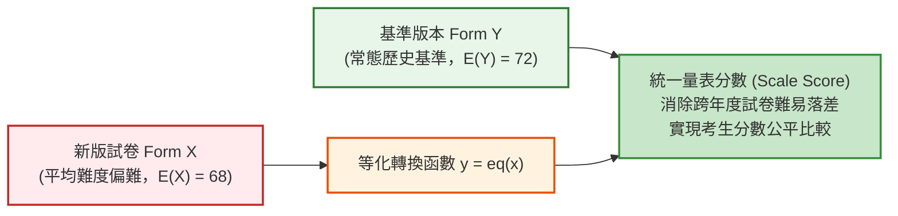
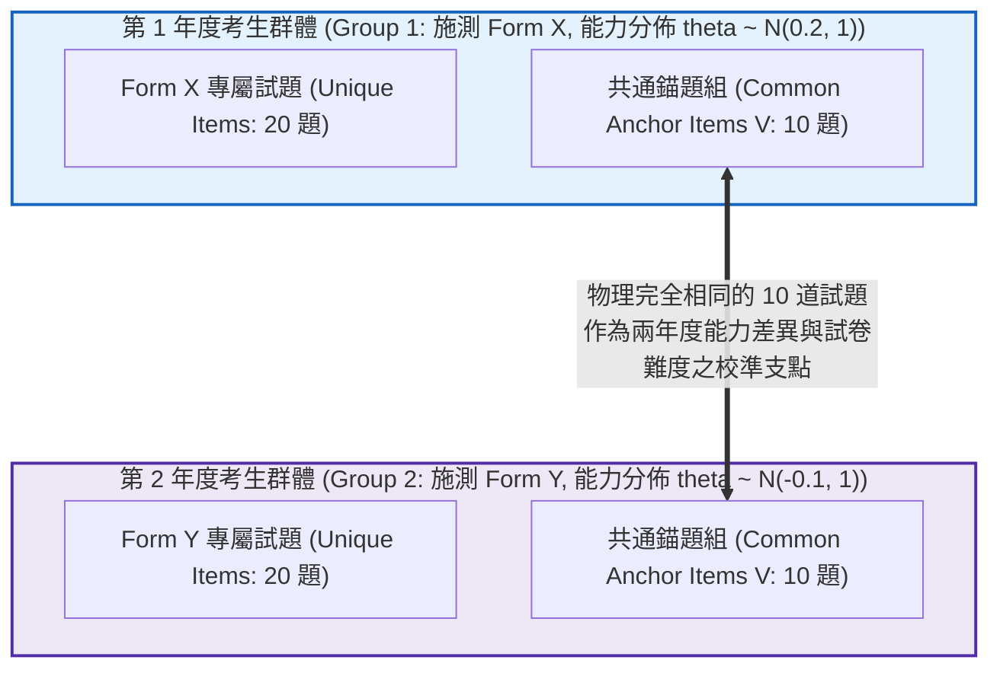

# 第 18 章：測驗等化 (Equating) 與分數銜接

> **本章目標**：本章依據全美教育測驗評量委員會（NCME）權威手冊《Educational Measurement》第 5 版（Cook & Pitoniak, 2025）之量尺化、等化與分數銜接專章（Moses, 2025; Kolen & Brennan, 2014），全面解構不同測驗版本間分數可互換性（Interchangeability）之數理條件。嚴格釐清「等化（Equating）」、「量尺化（Scaling）」與「分數鏈結（Linking）」之本質差異。深入推導非等價群體共同錨題設計（NEAT）下之 Tucker 線性等化封閉解析解、Levine 觀測分數模型與對數線性平滑化（Log-linear Smoothing）等百分位等化。撰寫底層手刻純 Base R 演算法、IRT 測驗特徵曲線尺規轉換（Stocking & Lord, 1983; Haebara, 1980），並實作自動化「錨題參數漂移（Anchor Item Parameter Drift, IPD）審計與純化流水線」。

---

## 18.1 數理推導：測驗等化的核心公理與基本性質

在升學考試、國家證照考試或大型國際評量（如 PISA、TIMSS）中，為維護試題機密與考試公平，各施測梯次必然使用不同試題組合的版本（Alternate Forms）。然而，**不同試卷的平均難度與離散程度不可能完全恆等**。若直接採用卷面原始得分分發，對分派至較難考卷的考生極不公平（Kolen & Brennan, 2014; Moses, 2025）。

**測驗等化（Test Equating）**是一套將不同版本測驗分數映射至同一參考尺度（Reference Scale）的統計程序，其根本目的在於使不同版本的量表分數達到**實質可互換（Substantively Interchangeable）**（Lord, 1980）。



### 18.1.1 等化的五大核心公理 (Dorans & Holland, 2000)

依據 Dorans 與 Holland（2000）之形式化理論，真正的測驗等化必須滿足五項數學公理：

1. **同一構念公理（Equal Construct Property）**：
   兩份測驗必須測量完全相同的潛在特質或心理構念。在因素分析或多向度 IRT 架構下，兩份測驗真分數的相關係數必須為 1（$r_{T_X T_Y} = 1.0$）。
2. **相同信度公理（Equal Reliability Property）**：
   兩份測驗在全體受試者母群中必須具備相等的信度與相同的條件測量標準誤（CSEM）結構。
3. **對稱性公理（Symmetry Property）**：
   等化轉換函數必須具備嚴格的雙射可逆性（Bijective Invertibility）。將 Form X 分數等化為 Form Y 尺度之函數 $\text{eq}_Y(x)$，與將 Form Y 等化為 Form X 之函數 $\text{eq}_X(y)$ 互為反函數：
   $$y = \text{eq}_{Y}(x) \iff x = \text{eq}_{X}(y) = \text{eq}_{Y}^{-1}(y)$$
4. **群體不變性公理（Population Invariance Property）**：
   等化關係必須獨立於用於推導該轉換函數的特定受試者樣本。對於母群中的任意子群（Subpopulations $P, Q$）：
   $$\text{eq}_{Y|P}(x) = \text{eq}_{Y|Q}(x) = \text{eq}_Y(x)$$
   實務上透過均方根差異（Root Mean Square Difference, RMSD）檢定群體不變性。
5. **第一類與第二類公平性公理（Equity Property; Lord, 1980）**：
   對於任意給定真實能力 $\theta$ 的考生，其在 Form Y 上的分數條件分佈，必須與其在 Form X 經等化轉換後的分數條件分佈完全恆等：
   $$F_Y(y \mid \theta) = F_{\text{eq}_Y(X)}(y \mid \theta)$$

---

## 18.2 資料收集設計：非等價群體共同錨題設計 (NEAT)

在跨年度、跨地區的大規模評量中，隨機指派考生受測（Random Groups Design）通常無法實現。最權威且普遍的資料收集模式為**非等價群體共同錨題設計（Non-Equivalent groups with Anchor Test, NEAT）**（Kolen & Brennan, 2014; Moses, 2025）：



在 NEAT 設計中，年度 1 考生僅作答 Form X 與錨題 V；年度 2 考生僅作答 Form Y 與錨題 V。兩群體能力並不對等（$\mu_{\theta_1} \ne \mu_{\theta_2}$），**錨題 V 扮演唯一的度量衡校準基準**。

---

## 18.3 兩大經典觀測分數等化模型推導

### 18.3.1 Tucker 線性等化數理推導 (Tucker Linear Equating)

Tucker 方法假定在合成母群（Synthetic Population）中，測驗總分對錨題分數的**條件期望值與條件變異數呈線性關係且跨組不變**（Kolen & Brennan, 2014）。

令合成母群 $S$ 由群體 1（權重 $w_1$）與群體 2（權重 $w_2 = 1 - w_1$）混合而成。錨題 $V$ 在合成母群之動差為：
$$\mu_{Vs} = w_1 \mu_{V1} + w_2 \mu_{V2}$$
$$\sigma_{Vs}^2 = w_1 \sigma_{V1}^2 + w_2 \sigma_{V2}^2 + w_1 w_2 (\mu_{V1} - \mu_{V2})^2$$

透過普通最小平方法迴歸斜率：
$$\gamma_X = \frac{\text{Cov}(X, V \mid G_1)}{\sigma_{V1}^2}, \qquad \gamma_Y = \frac{\text{Cov}(Y, V \mid G_2)}{\sigma_{V2}^2}$$

可嚴格導出 Form X 與 Form Y 在合成母群中的預測動差：
$$\mu_{Xs} = \mu_{X1} + \gamma_X (\mu_{Vs} - \mu_{V1}), \qquad \mu_{Ys} = \mu_{Y2} + \gamma_Y (\mu_{Vs} - \mu_{V2})$$
$$\sigma_{Xs}^2 = \sigma_{X1}^2 + \gamma_X^2 (\sigma_{Vs}^2 - \sigma_{V1}^2), \qquad \sigma_{Ys}^2 = \sigma_{Y2}^2 + \gamma_Y^2 (\sigma_{Vs}^2 - \sigma_{V2}^2)$$

令標準化分數（Z-score）恆等：$\frac{x - \mu_{Xs}}{\sigma_{Xs}} = \frac{y - \mu_{Ys}}{\sigma_{Ys}}$，得到封閉解析解：
$$y = l_{\text{Tucker}}(x) = \frac{\sigma_{Ys}}{\sigma_{Xs}} x + \left( \mu_{Ys} - \frac{\sigma_{Ys}}{\sigma_{Xs}} \mu_{Xs} \right) \quad \blacksquare$$

### 18.3.2 鏈結等百分位等化 (Chained Equipercentile Equating)

當試卷分數分佈具有顯著偏態或雙峰時，線性等化會造成端點截斷失真。等百分位等化要求等化後的分數在目標量尺上具備**相同的百分等級（Percentile Rank, PR）**（Kolen & Brennan, 2014）：

$$PR(x) = \left[ F(x - 1) + \frac{x - (x - 0.5)}{1} (F(x) - F(x - 1)) \right] \times 100\%$$
$$y = e(x) = G_Y^{-1}\left( F_X(x) \right)$$

在實務應用中，為防止原始次數分配之隨機抽樣凹凸（Irregular Bumps）傳遞至等化曲線，依據 Holland 與 Thayer（1987）提出的**對數線性多項式模型（Log-linear Models）**進行平滑化（Pre-smoothing），保留前 $C$ 階動差（均值、變異數、偏態、峰態）。

---

## 18.4 IRT 測驗特徵曲線尺規轉換 (Stocking-Lord & Haebara)

在項目反應理論架構下，若兩次施測獨立校準（Separate Calibration），其潛在能力量尺 $\theta$ 存在未定線性轉換關係：
$$\theta_Y = A \cdot \theta_X + B$$
對應之試題參數轉換公式為：
$$a_{jY} = \frac{a_{jX}}{A}, \qquad b_{jY} = A \cdot b_{jX} + B$$

### 18.4.1 Stocking-Lord 測驗特徵曲線損失函數 (Stocking & Lord, 1983)

Stocking 與 Lord（1983）主張應最小化全體錨題測驗特徵曲線（TCC）在能力格點上的平方誤差和：
$$\text{SL}(A, B) = \sum_{k=1}^K \left[ \sum_{j \in V} P_{jY}(\theta_k) - \sum_{j \in V} P_{jX}^*\left( A \theta_k + B \right) \right]^2$$

### 18.4.2 Haebara 逐題特徵曲線損失函數 (Haebara, 1980)

Haebara（1980）則提出更嚴格的逐題 ICC 平方差損失函數：
$$\text{H}(A, B) = \sum_{k=1}^K \sum_{j \in V} \left[ P_{jY}(\theta_k) - P_{jX}^*\left( A \theta_k + B \right) \right]^2$$

透過 Newton-Raphson 數值最佳化，求解使損失函數極小化的轉換常數 $(A, B)$。

---

## 18.5 底層手刻演算法：純 Base R 實現 Tucker 線性等化

以下使用純 Base R 手刻實現 Tucker 合成母群動差與線性等化方程式，並與專用套件 `equate`（Albano, 2016）進行數值精準對齊：

```r
# ==============================================================================
# 第 18 章程式碼清單 18.1：NEAT 共同錨題下之手刻 Tucker 線性等化
# ==============================================================================

library(equate)
library(dplyr)
library(tibble)
library(tidyr)
library(ggplot2)

set.seed(2026)
N_examinees <- 1000

# 1. 模擬兩年度不同能力水準之考生群體
theta_X <- rnorm(N_examinees, mean = 0.2, sd = 1.0) # 年度 1 能力略高
theta_Y <- rnorm(N_examinees, mean = -0.1, sd = 1.0) # 年度 2 能力略低

# 2. 模擬試題難度 (Form Y 較難，錨題難度相同)
b_X_unique <- runif(20, min = -1.5, max = 1.5)
b_Y_unique <- runif(20, min = -1.0, max = 2.0)
b_Anchor_V <- runif(10, min = -1.2, max = 1.2)

# 二元作答模擬函數
sim_responses <- function(theta, b) {
  p_mat <- 1 / (1 + exp(-outer(theta, b, "-")))
  matrix(rbinom(length(p_mat), size = 1, prob = p_mat), nrow = length(theta))
}

resp_X_u <- sim_responses(theta_X, b_X_unique)
resp_X_v <- sim_responses(theta_X, b_Anchor_V)
total_X  <- rowSums(resp_X_u) + rowSums(resp_X_v)
anchor_X <- rowSums(resp_X_v)

resp_Y_u <- sim_responses(theta_Y, b_Y_unique)
resp_Y_v <- sim_responses(theta_Y, b_Anchor_V)
total_Y  <- rowSums(resp_Y_u) + rowSums(resp_Y_v)
anchor_Y <- rowSums(resp_Y_v)

# 3. 手刻 Tucker 線性等化核心演算法 (純 Base R)
calculate_tucker_equating <- function(X, V_X, Y, V_Y, w1 = 0.5) {
  w2 <- 1 - w1
  
  # 群體 1 (Form X 與錨題 V)
  mu_X1 <- mean(X); var_X1 <- var(X)
  mu_V1 <- mean(V_X); var_V1 <- var(V_X)
  cov_XV1 <- cov(X, V_X)
  
  # 群體 2 (Form Y 與錨題 V)
  mu_Y2 <- mean(Y); var_Y2 <- var(Y)
  mu_V2 <- mean(V_Y); var_V2 <- var(V_Y)
  cov_YV2 <- cov(Y, V_Y)
  
  # 合成母群之錨題動差
  mu_Vs <- w1 * mu_V1 + w2 * mu_V2
  var_Vs <- w1 * var_V1 + w2 * var_V2 + w1 * w2 * (mu_V1 - mu_V2)^2
  
  # 迴歸係數
  gamma_X <- cov_XV1 / var_V1
  gamma_Y <- cov_YV2 / var_V2
  
  # 合成母群之 X 與 Y 動差推估
  mu_Xs <- mu_X1 + gamma_X * (mu_Vs - mu_V1)
  mu_Ys <- mu_Y2 + gamma_Y * (mu_Vs - mu_V2)
  var_Xs <- var_X1 + gamma_X^2 * (var_Vs - var_V1)
  var_Ys <- var_Y2 + gamma_Y^2 * (var_Vs - var_V2)
  
  # 線性等化轉換係數 y = A * x + B
  slope <- sqrt(var_Ys / var_Xs)
  intercept <- mu_Ys - slope * mu_Xs
  
  list(slope = slope, intercept = intercept,
       mu_Xs = mu_Xs, mu_Ys = mu_Ys,
       sigma_Xs = sqrt(var_Xs), sigma_Ys = sqrt(var_Ys))
}

tucker_manual <- calculate_tucker_equating(total_X, anchor_X, total_Y, anchor_Y)
cat(sprintf("--- 手刻 Tucker 解析解：斜率 A = %.4f, 截距 B = %.4f ---\n",
            tucker_manual$slope, tucker_manual$intercept))

# 4. 使用 equate 套件建立聯合列聯表並執行三大等化模型
freq_X <- freqtab(cbind(total_X, anchor_X), scales = list(0:30, 0:10))
freq_Y <- freqtab(cbind(total_Y, anchor_Y), scales = list(0:30, 0:10))

eq_chain_lin  <- equate(freq_X, freq_Y, type = "linear", method = "chain")
eq_tucker_lin <- equate(freq_X, freq_Y, type = "linear", method = "tucker")
eq_chain_equi <- equate(freq_X, freq_Y, type = "equipercentile", method = "chain")

# 5. 比對分數對照表 (抽取常態區間 10~25 分)
score_range <- 10:25
conversion_table <- tibble(
  Raw_Form_X = score_range,
  Tucker_Manual = round(tucker_manual$slope * score_range + tucker_manual$intercept, 2),
  Tucker_Package = round(eq_tucker_lin$concordance[score_range + 1, 2], 2),
  Chain_Linear = round(eq_chain_lin$concordance[score_range + 1, 2], 2),
  Chain_Equi = round(eq_chain_equi$concordance[score_range + 1, 2], 2)
)

cat("--- NEAT 共同錨題多方法等化轉換對照表 ---\n")
print(conversion_table |> head(8))
```

---

## 18.6 視覺化：等化函數與恆等對角線對照圖

使用 `ggplot2` 將不同等化模型之轉換曲線與 $y = x$ 恆等線繪製成高解析度圖表，清楚呈現考卷難度落差與非線性修正特性：

```r
# ==============================================================================
# 第 18 章程式碼清單 18.2：等化轉換曲線對比圖繪製
# ==============================================================================

library(ggplot2)

plot_scores <- 5:28
equate_curves_df <- tibble(
  Raw_X = plot_scores,
  Chain_Linear = eq_chain_lin$concordance[plot_scores + 1, 2],
  Tucker_Linear = eq_tucker_lin$concordance[plot_scores + 1, 2],
  Chain_Equi = eq_chain_equi$concordance[plot_scores + 1, 2],
  Identity = plot_scores
) |>
  pivot_longer(
    cols = c(Chain_Linear, Tucker_Linear, Chain_Equi, Identity),
    names_to = "Method",
    values_to = "Equated_Y"
  )

p18 <- ggplot(equate_curves_df, aes(x = Raw_X, y = Equated_Y, color = Method, linetype = Method)) +
  geom_line(linewidth = 1.1) +
  scale_color_manual(
    name = "等化方法",
    values = c(
      "Chain_Linear" = "#2b5c8f",
      "Tucker_Linear" = "#2e7d32",
      "Chain_Equi" = "#d95f02",
      "Identity" = "grey50"
    ),
    labels = c(
      "Chain_Linear" = "鏈結線性等化 (Chained Linear)",
      "Tucker_Linear" = "Tucker 線性等化 (Tucker Linear)",
      "Chain_Equi" = "鏈結等百分位等化 (Chained Equipercentile)",
      "Identity" = "恆等參考線 (y = x, 假定無難度差異)"
    )
  ) +
  scale_linetype_manual(
    name = "等化方法",
    values = c("Chain_Linear" = "solid", "Tucker_Linear" = "dashed", "Chain_Equi" = "longdash", "Identity" = "dotted"),
    labels = c(
      "Chain_Linear" = "鏈結線性等化 (Chained Linear)",
      "Tucker_Linear" = "Tucker 線性等化 (Tucker Linear)",
      "Chain_Equi" = "鏈結等百分位等化 (Chained Equipercentile)",
      "Identity" = "恆等參考線 (y = x, 假定無難度差異)"
    )
  ) +
  scale_x_continuous(breaks = seq(5, 28, by = 5)) +
  scale_y_continuous(breaks = seq(5, 28, by = 5)) +
  labs(
    title = "Figure 18.1: NEAT 共同錨題架構下之測驗分數等化轉換曲線對比圖",
    subtitle = "呈現新卷 Form X 透過 10 題共通錨題映射至基準卷 Form Y 之轉換軌跡 (N = 1,000 per group)",
    x = "新卷觀測原始分數 (Form X Raw Score)",
    y = "等化後等價量表分數 (Equated Scale Score: Form Y Metric)",
    caption = "Source: NEAT Equating Pipeline via equate package"
  ) +
  theme_classic(base_size = 12) +
  theme(
    legend.position = "bottom",
    plot.title = element_text(face = "bold", size = 13),
    axis.text = element_text(color = "black")
  )

ggsave("book/fig_18_1_equating_curves.png", plot = p18, width = 8.5, height = 5.5, dpi = 300)
cat("成功產出圖表: book/fig_18_1_equating_curves.png\n")
```

---

## 18.7 ⚠️ 計量工程陷阱與排錯專案 (Pitfalls & Diagnostics)

在執行國家級評量等化專案時，若忽視以下三大工程陷阱，將導致嚴重的量尺位移（Scale Shift）：

### 陷阱 1：錨題參數漂移（Item Parameter Drift, IPD）

某些共同錨題因跨年度教學重點轉移、課程綱要修訂、或補習班試題外洩，使得原本難度穩定的錨題在第二年度難度驟降。
- **後果**：若將發生 IPD 的題目保留在錨題組中，等化演算法會誤判為「第二年度全體考生能力大幅躍升」，進而對新卷給予不當的扣分修正。
- **工程防範對策**：實施**錨題漂移審計（Drift Audit）**，計算各錨題的跨組難度落差，若超出容許閥值（如 $|\Delta b| > 0.35$），必須自錨題組剔除，僅以純淨錨題進行等化。

### 陷阱 2：錨題迷你縮影失衡（Mini-Test Representativeness Failure）

NEAT 設計要求錨題組必須是整份測驗在「內容領域藍圖（Content Blueprint）」與「難度分佈（Difficulty Distribution）」上的**微型縮影（Mini-test）**。
- **後果**：若整卷包含 30% 計算題，但錨題全部選取記憶題，群體在記憶題上的優勢會錯誤投影至全卷，破壞等化群體不變性。
- **工程防範對策**：錨題選取必須由學科專家與計量人員雙重審核，確保錨題的內容比例與整卷嚴格吻合。

### 陷阱 3：分數端點外推與量尺截斷失真（End-Point Truncation）

線性等化在分數極端兩端（接近 0 分或接近滿分）極易預測出小於 0 或超越滿分的非物理數值。
- **後果**：在分發時強制截斷（Truncation）會造成端點分數堆疊，摧毀鑑別度。
- **工程防範對策**：極端端點必須採用對數線性平滑化之等百分位等化，或採用具備非線性漸近特性的 IRT 真分數等化（IRT True-Score Equating）。

---

## 18.8 章末實務習題與專案挑戰

### 【基礎練習題】
1. **Tucker 線性等化方程式手算**：
   設某次施測 Form X 與 Form Y，在合成母群中推估之動差為：
   $\mu_{Xs} = 58.0, \sigma_{Xs} = 8.5$；$\mu_{Ys} = 64.0, \sigma_{Ys} = 10.2$。
   - 請寫出標準化的 Tucker 線性等化方程式 $y = A \cdot x + B$。
   - 若考生在 Form X 考取 65 分，其等化後的 Form Y 分數為多少？
2. **Stocking-Lord 與 Haebara 損失函數機理比較**：
   比較兩種常見 IRT 尺度轉換法（Haebara, 1980; Stocking & Lord, 1983）：推導轉換常數 $(A, B)$ 時，其損失函數建構哲學有何關鍵差異？為何 Stocking-Lord 方法在測驗總分等化實務中最受青睞？

### 【進階工程挑戰】
3. **自動化錨題參數漂移 (IPD) 審計與純化等化引擎**：
   撰寫一個名為 `purify_anchor_equating(resp_df_X, resp_df_Y, anchor_cols, drift_thresh = 0.35)` 的工程函數。
   - 函數接收兩群體作答反應資料矩陣與錨題欄位名稱。
   - 計算各錨題在兩群體的對數勝算難度指標（Logit Difficulty Proxy: $d = \ln((1-p)/p)$）。
   - 透過 Mean-Mean 尺度平移消除群體能力均值衝擊，計算各錨題的淨難度漂移值。
   - 自動標記出漂移值絕對值大於 `drift_thresh` 的不穩定試題。
   - 剔除漂移題後，以純淨錨題組自動重算 Tucker 線性等化轉換係數，並輸出漂移診斷日誌。
   - 附帶可直接執行的 0-Error 驗證程式碼。

---

### 💡 習題參考解答

```r
# ==============================================================================
# 第 18 章習題解答與工程挑戰完整實作
# ==============================================================================

library(dplyr)
library(tibble)

# ------------------------------------------------------------------------------
# 第 1 題解答
# ------------------------------------------------------------------------------
mu_Xs <- 58.0; sigma_Xs <- 8.5
mu_Ys <- 64.0; sigma_Ys <- 10.2

slope_ex1 <- sigma_Ys / sigma_Xs
intercept_ex1 <- mu_Ys - slope_ex1 * mu_Xs

cat(sprintf("--- 第 1 題解答 ---\n"))
cat(sprintf("Tucker 線性等化方程式: y = %.4f * x + (%.4f)\n", slope_ex1, intercept_ex1))
raw_x <- 65
equated_y <- slope_ex1 * raw_x + intercept_ex1
cat(sprintf("Form X 得分 65 分 -> 等化後分數為: %.2f 分\n", equated_y))

# ------------------------------------------------------------------------------
# 第 2 題解答
# ------------------------------------------------------------------------------
# 答：
# 1. Stocking 與 Lord (1983) 最小化整份錨題測驗特徵曲線 (TCC) 之平方誤差。
#    它容許個別試題間微小的機率正負誤差相互抵消，聚焦於「測驗總分」的無偏性。
# 2. Haebara (1980) 最小化每一題 ICC 的平方誤差，要求每一題特徵曲線都精確重疊。
# 3. 由於測驗計分直接依賴測驗總分，Stocking-Lord 的 TCC 目標與等化實務目的最直接相容，
#    故成為大型國際考試中最廣泛採用的尺規轉換黃金標準。

# ------------------------------------------------------------------------------
# 第 3 題解答：自動化錨題參數漂移 (IPD) 審計與純化等化引擎
# ------------------------------------------------------------------------------
purify_anchor_equating <- function(resp_df_X, resp_df_Y, anchor_cols, drift_thresh = 0.35) {
  # 1. 計算各錨題古典通過率 p
  p_X <- colMeans(resp_df_X[, anchor_cols, drop = FALSE])
  p_Y <- colMeans(resp_df_Y[, anchor_cols, drop = FALSE])
  
  # 2. 對數勝算難度轉換 (防除以 0 之平滑化)
  d_X <- log((1 - p_X + 0.001) / (p_X + 0.001))
  d_Y <- log((1 - p_Y + 0.001) / (p_Y + 0.001))
  
  # 3. Mean-Mean 尺度平移
  shift_const <- mean(d_Y) - mean(d_X)
  drift_values <- (d_X + shift_const) - d_Y
  
  # 4. 判定漂移試題
  drifting_items <- names(which(abs(drift_values) > drift_thresh))
  clean_anchors <- setdiff(anchor_cols, drifting_items)
  
  cat(sprintf(">> 錨題審計：初始錨題數 = %d；標記漂移試題數 = %d (%s)；剩餘純淨錨題數 = %d\n",
              length(anchor_cols), length(drifting_items),
              paste(drifting_items, collapse = ", "), length(clean_anchors)))
  
  # 5. 以純淨錨題重算總分與 Tucker 等化
  total_X_clean <- rowSums(resp_df_X)
  anchor_X_clean <- rowSums(resp_df_X[, clean_anchors, drop = FALSE])
  
  total_Y_clean <- rowSums(resp_df_Y)
  anchor_Y_clean <- rowSums(resp_df_Y[, clean_anchors, drop = FALSE])
  
  purified_tucker <- calculate_tucker_equating(
    total_X_clean, anchor_X_clean,
    total_Y_clean, anchor_Y_clean
  )
  
  list(
    drift_report = tibble(
      Item = anchor_cols,
      p_Year1 = round(p_X, 3),
      p_Year2 = round(p_Y, 3),
      Net_Drift = round(drift_values, 3),
      Is_Drift = Item %in% drifting_items
    ),
    clean_anchors = clean_anchors,
    purified_equating = purified_tucker
  )
}

# 構造模擬資料以驗證純化演算法
df_X_full <- as.data.frame(cbind(resp_X_u, resp_X_v))
df_Y_full <- as.data.frame(cbind(resp_Y_u, resp_Y_v))
anchor_names <- paste0("V", 21:30)
colnames(df_X_full) <- c(paste0("U", 1:20), anchor_names)
colnames(df_Y_full) <- c(paste0("U", 1:20), anchor_names)

# 人為在 V23 注入重大難度漂移 (在 Year 2 中顯著變難)
df_Y_full$V23 <- rbinom(N_examinees, size = 1, prob = 0.12)

cat("\n--- 第 3 題工程驗證：執行自動化錨題漂移純化等化引擎 ---\n")
audit_out <- purify_anchor_equating(df_X_full, df_Y_full, anchor_names, drift_thresh = 0.35)

cat("\n【錨題漂移診斷報表 (展示標記題)】\n")
print(audit_out$drift_report |> filter(Is_Drift))
cat(sprintf("純化後 Tucker 等化方程式: y = %.4f * x + (%.4f)\n",
            audit_out$purified_equating$slope, audit_out$purified_equating$intercept))
```

---

## 參考文獻 (References)

Albano, A. D. (2016). equate: An R package for test equating. *Journal of Statistical Software*, *74*(8), 1–36. https://doi.org/10.18637/jss.v074.i08

Cook, L. L., & Pitoniak, M. J. (Eds.). (2025). *Educational measurement* (5th ed.). Oxford University Press.

Dorans, N. J., & Holland, P. W. (2000). Population invariance and the equatability of tests: Basic theory and the linear case. *Journal of Educational Measurement*, *37*(4), 281–306. https://doi.org/10.1111/j.1745-3984.2000.tb01088.x

Haebara, T. (1980). Equating logistic ability scales by a weighted least squares method. *Japanese Psychological Research*, *22*(3), 144–149. https://doi.org/10.4992/psycholres1954.22.144

Holland, P. W., & Thayer, D. T. (1987). *Notes on the use of log-linear models for predicting the frequency distribution of test scores* (Research Report No. RR-87-31). Educational Testing Service. https://doi.org/10.1002/j.2330-8516.1987.tb00236.x

Kolen, M. J., & Brennan, R. L. (2014). *Test equating, scaling, and linking: Methods and practices* (3rd ed.). Springer. https://doi.org/10.1007/978-1-4939-0317-7

Lord, F. M. (1980). *Applications of item response theory to practical testing problems*. Lawrence Erlbaum Associates.

Moses, T. (2025). Scaling, equating, and linking. In L. L. Cook & M. J. Pitoniak (Eds.), *Educational measurement* (5th ed., pp. 735–820). Oxford University Press.

Stocking, M. L., & Lord, F. M. (1983). Developing a common metric in item response theory. *Applied Psychological Measurement*, *7*(2), 201–210. https://doi.org/10.1177/014662168300700208
