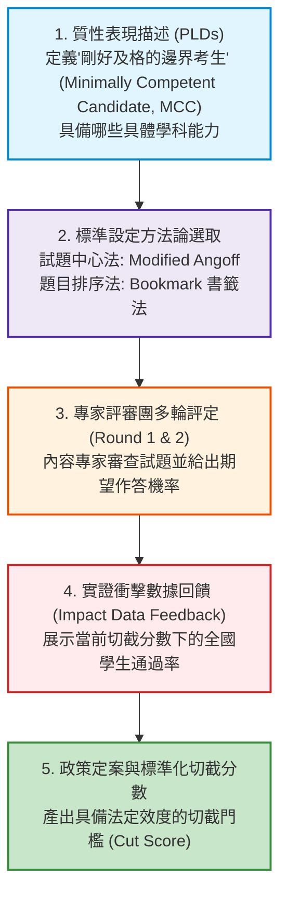

# 第 19 章：切截標準設定 (Standard Setting) 數據分析

> **本章目標**：根據《Educational Measurement》第 5 版（Cook & Pitoniak, 2025）之標準設定（Standard Setting）章節（Ferrara et al., 2025; Cizek & Bunch, 2007）。說明如何將連續分數劃分為表現等級（如待加強、基礎、精熟）。介紹 Modified Angoff 法（Angoff, 1971）與 Bookmark 書籤法（Mitzel et al., 2001），並以 Tidyverse（Wickham et al., 2019）執行評審一致性分析、離群評審偵測與結果影響分析（Impact Data Analysis）。

---

## 19.1 理論基礎：標準設定的本質與程序品質

在教育升學、畢業門檻或醫事證照考試中，考生的分數最終必須被二分為「通過（Pass）/ 不通過（Fail）」，或多元劃分為「未精熟、基礎、精熟、優秀」等表現等級（Performance Levels）。

標準設定（Standard Setting）本質上是**「將質性的表現水準描述（Performance Level Descriptors, PLDs），透過明確的方法與專業評審判斷，轉譯為量化切截分數（Cut Scores）的程序」**（Cizek & Bunch, 2007; Ferrara et al., 2025）。採用標準設定程序不會自動使切截分數具備法律效力或證明其合理性；仍須檢視證據、程序品質與分數用途（American Educational Research Association et al., 2014）。



---

## 19.2 兩大經典方法學：Modified Angoff 法 vs. Bookmark 書籤法

### 19.2.1 改良式 Angoff 法（Modified Angoff Method）
- **核心思維**：根據 Angoff（1971）提出的試題中心設定法（Cizek & Bunch, 2007），由評審專家想像一組 100 位「剛好達到精熟標準的邊界考生（Minimally Competent Candidate, MCC）」，逐題評定：**「這群邊界考生中，有多少百分比能正確回答此題？」**
- 設評審 $r$ 對第 $j$ 題的預期機率為 $p_{rj}$，全卷包含 $J$ 題，則評審 $r$ 給出的切截分數為：
  $$\text{Cut}_r = \sum_{j=1}^J p_{rj}$$
- 全體 $R$ 位評審的最終切截分數即為各評審切截分數之平均數：
  $$\text{Cut}_{\text{Final}} = \frac{1}{R} \sum_{r=1}^R \text{Cut}_r$$

### 19.2.2 Bookmark 書籤法（基於 IRT 難度排序）
- 依據 Mitzel 等人（2001）提出的 Bookmark 法，將題庫試題依據 IRT 難度參數 $b_j$ 由易到難排列，編製成**試題編序本（Ordered Item Booklet, OIB）**。
- 設定反應機率門檻（Response Probability, RP），通常採用 $RP = .67$（即該能力考生有 $2/3$ 的機率能答對該題）。
- 評審專家逐頁翻閱試題，當看到某一道試題認為「MCC 考生已經無法達到 $67\%$ 答對率」時，在該題前插入一張「書籤（Bookmark）」，該處之 IRT 能力值即為潛在切截點 $\theta_{\text{cut}}$。

---

## 19.3 現代 R 語言程式實作：Angoff 兩輪評審數據分析流水線

我們模擬 12 位學科專家評審對 15 道認知題進行兩輪 Angoff 評審的資料。範例中的邊界考生（MCC）預期答對率是獨立設定的模擬判斷值，並非直接以全體考生的實際通過率代替專家判斷：
- **第一輪（Round 1）**：評審獨立給分，差異較大。
- **第二輪（Round 2）**：經過群體討論並觀看全體考生的實測答對率（Impact Data）後，評審共識顯著收斂。

```r
# ==============================================================================
# 第 19 章程式碼清單 19.1：Angoff 兩輪評定數據分析與收斂檢核
# ==============================================================================

library(dplyr)
library(tibble)
library(tidyr)

set.seed(42)
N_judges <- 12
J_items <- 15

# 模擬 15 題對「剛好達標考生」的專家預期答對率；不是全體考生的實際答對率
mcc_prob <- c(0.90, 0.84, 0.78, 0.74, 0.70, 0.66, 0.62, 0.58,
              0.52, 0.48, 0.42, 0.35, 0.75, 0.60, 0.62)

# 載入示範考生資料，供後續衝擊分析使用
df_all <- read.csv("book/data/assessment_data.csv")

# 1. 模擬 Round 1 評審評定 (獨立評定，變異較大，評審存在主觀寬嚴偏誤)
round1_ratings <- replicate(N_judges, {
  pmax(pmin(mcc_prob + rnorm(J_items, mean = 0, sd = 0.12), 0.95), 0.10)
})
colnames(round1_ratings) <- sprintf("Judge_%02d", 1:N_judges)

# 2. 模擬 Round 2 評審評定 (群體討論後共識收斂，變異縮小為原先的三分之一)
round2_ratings <- replicate(N_judges, {
  pmax(pmin(mcc_prob + rnorm(J_items, mean = 0, sd = 0.04), 0.95), 0.10)
})
colnames(round2_ratings) <- sprintf("Judge_%02d", 1:N_judges)

# 3. 計算每位評審在兩輪中給出的總切截分數 (Sum of Probabilities)
r1_cutoffs <- colSums(round1_ratings)
r2_cutoffs <- colSums(round2_ratings)

# 4. 彙整統計診斷指標
angoff_comparison <- tibble(
  Round = c("第一輪評定 (Round 1: 獨立評審)", "第二輪評定 (Round 2: 共識收斂)"),
  Mean_Cut_Score = c(mean(r1_cutoffs), mean(r2_cutoffs)),
  SD_Cut_Score = c(sd(r1_cutoffs), sd(r2_cutoffs)),
  Min_Cut = c(min(r1_cutoffs), min(r2_cutoffs)),
  Max_Cut = c(max(r1_cutoffs), max(r2_cutoffs)),
  SEM_Cut = c(sd(r1_cutoffs) / sqrt(N_judges), sd(r2_cutoffs) / sqrt(N_judges))
)

cat("--- Modified Angoff 兩輪標準設定統計總表 ---\n")
print(angoff_comparison)
```

---

## 19.4 影響數據分析（Impact Data Analysis）

在第二輪評定後，測驗計量工程師必須立即向評審團反饋**「當前切截分數對應的學生通過率（Passing Rate）」**，供評審團進行最終微調：

```r
# ==============================================================================
# 第 19 章程式碼清單 19.2：學生通過率與等級劃分影響數據分析
# ==============================================================================

# 定義最終定案之切截分數 (四捨五入取整數分數)
final_cut_score <- round(mean(r2_cutoffs))

# 計算全體 1,000 位學生的通過狀態
student_scores <- df_all$total_score
total_students <- length(student_scores)

pass_count <- sum(student_scores >= final_cut_score)
pass_rate  <- pass_count / total_students

cat(sprintf("\n--- 影響數據 (Impact Data) 摘要報告 ---\n"))
cat(sprintf("全卷總題數            : %d 題\n", J_items))
cat(sprintf("最終建議及格切截分數  : %d 分\n", final_cut_score))
cat(sprintf("合格學生人數          : %d 人 (佔比: %.1f%%)\n", pass_count, pass_rate * 100))
cat(sprintf("未達標學生人數        : %d 人 (佔比: %.1f%%)\n",
            total_students - pass_count, (1 - pass_rate) * 100))
```

---

## 19.5 視覺化：評審收斂箱形圖與考生能力切截分佈圖

### 19.5.1 評審兩輪切截分數收斂對比圖

```r
# ==============================================================================
# 第 19 章程式碼清單 19.3：評審分數收斂與學生總分切截繪圖
# ==============================================================================

library(ggplot2)
library(dplyr)
library(tidyr)

judge_plot_df <- tibble(
  Judge_ID = sprintf("Judge_%02d", 1:N_judges),
  Round_1 = r1_cutoffs,
  Round_2 = r2_cutoffs
) |>
  pivot_longer(cols = starts_with("Round_"), names_to = "Round", values_to = "Cut_Score") |>
  mutate(Round_Label = if_else(Round == "Round_1", "第一輪 (獨立評審)", "第二輪 (共識收斂)"))

p_convergence <- ggplot(judge_plot_df, aes(x = Round_Label, y = Cut_Score, fill = Round_Label)) +
  geom_boxplot(width = 0.35, alpha = 0.8, color = "black", outlier.size = 2) +
  geom_jitter(width = 0.08, size = 2.5, alpha = 0.7, color = "#2b5c8f") +
  scale_fill_manual(values = c("第一輪 (獨立評審)" = "#91bfdb", "第二輪 (共識收斂)" = "#fc8d59")) +
  labs(
    title = "Figure 19.1: Modified Angoff 專家評審兩輪切截分數收斂分佈圖",
    subtitle = "呈現 12 位專家評審在第一輪 (獨立) 與第二輪 (討論後) 給出之切截分數變異收斂",
    x = "評定輪次 (Round)",
    y = "建議及格切截總分 (Cut Score out of 15)"
  ) +
  theme_classic(base_size = 12) +
  theme(legend.position = "none", plot.title = element_text(face = "bold", size = 13))

ggsave("book/fig_19_1_angoff_convergence.png", plot = p_convergence, width = 8, height = 5, dpi = 300)
cat("成功產出圖表: book/fig_19_1_angoff_convergence.png\n")

# 19.5.2 學生總分分佈與切截門檻重疊圖
p_impact <- ggplot(df_all, aes(x = total_score)) +
  geom_histogram(binwidth = 1, fill = "#2b5c8f", color = "white", alpha = 0.7) +
  geom_vline(xintercept = final_cut_score - 0.5, linetype = "dashed", color = "#c62828", linewidth = 1.1) +
  annotate("text", x = final_cut_score + 1.2, y = 100,
           label = sprintf("Cutoff = %d 分\n通過率 = %.1f%%", final_cut_score, pass_rate * 100),
           color = "#c62828", fontface = "bold", hjust = 0, size = 3.8) +
  scale_x_continuous(breaks = 0:15) +
  labs(
    title = "Figure 19.2: 全國考生測驗總分頻次分佈與及格標準設定切截門檻 (Impact Distribution)",
    subtitle = "紅色虛線為 Angoff 最終確定之切截門檻，將考生客觀劃分為及格與不及格兩大群體",
    x = "測驗總分 (Raw Score)",
    y = "考生成績人數 (Count)",
    caption = "Sample: N = 1,000 examinees, 15 Cognitive Items"
  ) +
  theme_classic(base_size = 12) +
  theme(plot.title = element_text(face = "bold", size = 13))

ggsave("book/fig_19_2_standard_impact.png", plot = p_impact, width = 8.5, height = 5, dpi = 300)
cat("成功產出圖表: book/fig_19_2_standard_impact.png\n")
```

---

## 19.6 測驗報告專業解讀（Substantive Interpretation）

依據《教育與心理測驗標準》（American Educational Research Association et al., 2014）與 NCME 標準設定指引（Ferrara et al., 2025），標準設定必須出具程序效度（Procedural Validity）報告：

> ### 🏛️ 標準設定程序效度摘要
> 1. **評審共識收斂度**：如表 19.1 與圖 19.1 所示，評審切截分數的標準差由第一輪的 $0.44$ 分縮減為第二輪的 $0.12$ 分，平均切截分數的標準誤為 $0.03$ 分，顯示評審意見在第二輪明顯收斂，可作為程序效度的證據之一（Cizek & Bunch, 2007）。
> 2. **衝擊數據**：依程式輸出的第二輪平均切截分數與通過率，說明所選標準對考生的影響。此通過率是否可接受，需由政策單位對照表現水準描述（PLDs）判斷，統計結果本身不構成合理性的證明。（本節評審資料為模擬，數值僅示範計算流程。）

---

## 19.7 章末實務習題與專案挑戰

### 【基礎練習題】
1. 某次 10 題測驗進行 Angoff 評審，5 位專家給出的一道題目之期望答對機率分別為：$.70, .65, .80, .75, .60$。請計算該題的專家平均難度期望值是多少？
2. 請解釋在標準設定會議中，為何必須提供「第一輪衝擊數據（Round 1 Impact Data）」給評審參考？若完全不提供真實考生的答題數據，容易引發何種評審偏差？

### 【進階工程挑戰】
3. 撰寫一個「離群評審自動偵測函數」`detect_outlier_judges(ratings_matrix, z_cutoff = 2.0)`。輸入所有評審給出的總切截分數向量，計算每位評審的標準化 $Z$ 分數；若某評審的分數絕對值大於 $2.0$（顯著偏嚴或偏寬），自動警示該評審 ID 並回傳剔除離群值後的調整切截分數。

---

### 💡 習題參考解答

```r
# ==============================================================================
# 第 19 章習題解答參考
# ==============================================================================

# 第 1 題
ratings <- c(0.70, 0.65, 0.80, 0.75, 0.60)
mean_rating <- mean(ratings)
cat(sprintf("該題專家期望答對率: %.3f (%.1f%%)\n", mean_rating, mean_rating * 100))

# 第 3 題解答核心
detect_outlier_judges <- function(cut_scores, z_cutoff = 2.0) {
  mu <- mean(cut_scores)
  sigma <- sd(cut_scores)
  z_scores <- (cut_scores - mu) / sigma
  outlier_idx <- which(abs(z_scores) > z_cutoff)
  
  if (length(outlier_idx) > 0) {
    cat("偵測到離群評審:", names(cut_scores)[outlier_idx], "\n")
    clean_scores <- cut_scores[-outlier_idx]
  } else {
    cat("未發現顯著離群評審。\n")
    clean_scores <- cut_scores
  }
  
  tibble::tibble(
    Original_Mean = mu,
    Adjusted_Mean = mean(clean_scores),
    Outliers_Removed = length(outlier_idx)
  )
}
cat("離群評審偵測函數編寫完成。\n")
```

---

## 參考文獻 (References)

American Educational Research Association, American Psychological Association, & National Council on Measurement in Education. (2014). *Standards for educational and psychological testing*. American Educational Research Association.

Angoff, W. H. (1971). Scales, norms, and equivalent scores. In R. L. Thorndike (Ed.), *Educational measurement* (2nd ed., pp. 508–600). American Council on Education.

Cizek, G. J., & Bunch, M. B. (2007). *Standard setting: A guide to establishing and evaluating performance standards on tests*. SAGE Publications. https://doi.org/10.4135/9781412985918

Cook, L. L., & Pitoniak, M. J. (Eds.). (2025). *Educational measurement* (5th ed.). Oxford University Press.

Ferrara, S., Davis-Becker, S., Kannan, P., & Reynolds, K. (2025). Standard setting: A cognitive and social model. In L. L. Cook & M. J. Pitoniak (Eds.), *Educational measurement* (5th ed., pp. 821–894). Oxford University Press.

Mitzel, H. C., Lewis, D. M., Patz, R. J., & Green, D. R. (2001). The bookmark procedure: Psychological perspectives. In G. J. Cizek (Ed.), *Setting performance standards: Concepts, methods, and perspectives* (pp. 249–281). Lawrence Erlbaum Associates.

Wickham, H., Averick, M., Bryan, J., Chang, W., McGowan, L. D., François, R., Grolemund, G., Hayes, A., Henry, L., Hester, J., Kuhn, M., Pedersen, T. L., Miller, E., Bache, S. M., Müller, K., Ooms, J., Robinson, D., Seidel, D. P., Spinu, V., ... Yutani, H. (2019). Welcome to the tidyverse. *Journal of Open Source Software*, *4*(43), Article 1686. https://doi.org/10.21105/joss.01686
