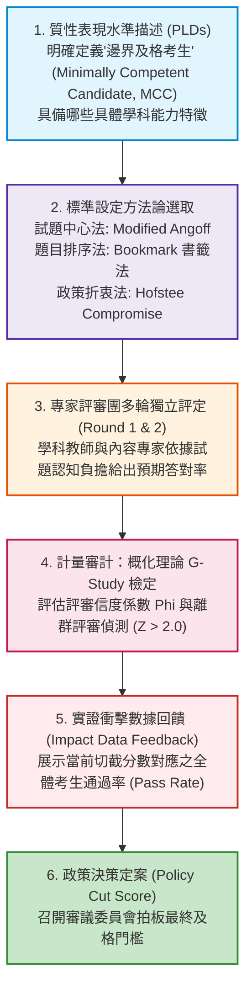

# 第 19 章：切截標準設定 (Standard Setting) 數據分析

> **本章目標**：本章依據全美教育測驗評量委員會（NCME）權威手冊《Educational Measurement》第 5 版（Cook & Pitoniak, 2025）之標準設定專章（Ferrara et al., 2025; Cizek & Bunch, 2007），全面解構如何將連續測驗分數轉譯為離散表現等級（Performance Levels）之決策工程。深入推導試題中心法 Modified Angoff（Angoff, 1971; Impara & Plake, 1997）、題目編序書籤法（Bookmark Procedure; Mitzel et al., 2001）以及折衷折衷法（Hofstee Compromise Method; Hofstee, 1983; Beuk, 1984）。撰寫底層手刻純 Base R 演算法，以概化理論（Generalizability Theory; Brennan, 2001）評估評審團一致性信度（Dependability $\Phi$），實作 Hofstee 幾何曲線交點自動化求根，並依據 AERA/APA/NCME 測驗標準（American Educational Research Association et al., 2014）建立嚴謹的程序效度（Procedural Validity）審計體系。

---

## 19.1 數理推導：標準設定的本質與社會認知決策模型

在升學考試、高中學力會考、醫師與會計師證照考中，考生最關心的並非原始得分，而是最終是否「及格（Pass）」或達到「精熟（Proficient）」標準。

**標準設定（Standard Setting）**本質上是**「將質性的表現水準描述（Performance Level Descriptors, PLDs），透過客觀透明的心理計量程序與專家判斷，轉譯為連續量尺上具備法定效力的切截分數（Cut Scores）之工程」**（Cizek & Bunch, 2007; Ferrara et al., 2025）。依據《教育與心理測驗標準》（American Educational Research Association et al., 2014），切截門檻的合法性完全取決於**程序效度（Procedural Validity）**與**內部一致性證據**。



### 19.1.1 表現水準描述與邊界考生定義 (PLD & MCC)

標準設定的核心起點在於**邊界及格考生（Minimally Competent Candidate, MCC，或稱剛剛好及格者）**之操作型定義：
- 評審專家必須清楚區分「理想中的優秀學生」與「剛好跨過及格門檻的學生」。
- 若 MCC 概念模糊，不同評審將依據各自的主觀期待評定，導致評審間方差暴增，摧毀標準設定的信度。

---

## 19.2 三大經典方法學：Angoff、Bookmark 與 Hofstee 折衷法

心理計量學界依據評定對象發展了三大權威流派：

### 19.2.1 改良式 Angoff 法 (Modified Angoff Method)

依據 Angoff（1971）提出的試題中心模式（Cizek & Bunch, 2007; Impara & Plake, 1997），全體 $R$ 位評審專家審閱全卷 $J$ 道試題，逐題思考：
$$\text{「假定有 100 位剛好及格的邊界考生 (MCC)，其中有多少百分比能答對第 } j \text{ 題？」}$$

令第 $r$ 位評審對第 $j$ 題給予的預期機率為 $p_{rj} \in [0, 1]$：
1. **評審個人切截分數**：
   $$\text{Cut}_r = \sum_{j=1}^J p_{rj}$$
2. **評審團平均切截分數**：
   $$\text{Cut}_{\text{Angoff}} = \frac{1}{R} \sum_{r=1}^R \text{Cut}_r = \frac{1}{R} \sum_{r=1}^R \sum_{j=1}^J p_{rj}$$
3. **切截標準誤（Standard Error of Cut Score, SE_Cut）**：
   $$\text{SE}_{\text{Cut}} = \frac{S_{\text{Cut}}}{\sqrt{R}} = \frac{\sqrt{\frac{1}{R-1}\sum_{r=1}^R (\text{Cut}_r - \text{Cut}_{\text{Angoff}})^2}}{\sqrt{R}}$$

### 19.2.2 Bookmark 書籤法 (IRT Ordered Item Booklet)

依據 Mitzel 等人（2001）提出的書籤法，題庫依據 IRT 難度參數排序，裝訂成**試題編序本（Ordered Item Booklet, OIB）**。
- **反應機率準則（Response Probability, RP Criterion）**：評量界最常用為 $RP = .67$（即該能力考生有 $2/3$ 的把握答對該題）。
- 在 2PL 模型下，給定試題參數 $(a_j, b_j)$，其對應之書籤位置能力值 $\theta_{j, RP}$ 解析解為：
  $$P(Y_j = 1 \mid \theta) = \frac{1}{1 + \exp(-1.7 a_j (\theta - b_j))} = RP \implies \theta_{j, RP} = b_j + \frac{\ln\left(\frac{RP}{1 - RP}\right)}{1.7 a_j}$$
  當 $RP = .67$ 時，$\ln(0.67 / 0.33) \approx 0.708$，故 $\theta_{j, .67} = b_j + \frac{0.708}{1.7 a_j}$。
- 評審專家在 OIB 中翻閱，在第一道認定「邊界考生已無法維持 67% 精熟度」的試題前插入書籤，該試題之 $\theta$ 即為該評審之潛在切截點。

### 19.2.3 Hofstee 折衷法 (Hofstee Compromise Method)

純絕對標準（如 Angoff）忽視了考生成績實況，極易引發全國性高不及格率危機；純相對標準（如常態編班常模參照）則完全忽視學科實質能力。Hofstee（1983）與 Beuk（1984）提出了融合兩者的折衷方案。

政策委員與學科專家需共同議定四個邊界數值：
- $C_{\min}$：最低可容忍之切截原始分數（如 6 分）。
- $C_{\max}$：最高可容忍之切截原始分數（如 9 分）。
- $F_{\min}$：最低可容忍之不及格率（如 20%）。
- $F_{\max}$：最高可容忍之不及格率（如 60%）。

在座標平面上，$X$ 軸為測驗分數 $C$，$Y$ 軸為累積不及格率 $F(C) = P(\text{Score} < C)$：
1. **政策容許線（Policy Line）**：連接點 $(C_{\min}, F_{\max})$ 與點 $(C_{\max}, F_{\min})$ 的折衷對角線，其斜率與方程式為：
   $$m = \frac{F_{\min} - F_{\max}}{C_{\max} - C_{\min}}, \qquad Y_{\text{Policy}}(C) = m (C - C_{\min}) + F_{\max}$$
2. **實證累積淘汰率曲線（Empirical Cumulative Failure Curve）**：
   $$F_{\text{Emp}}(C) = \frac{1}{N} \sum_{i=1}^N \mathbb{I}(\text{Score}_i < C)$$
3. **最終切截解**：政策線與實證累積淘汰率曲線的**幾何交點（Intersection Point）**即為唯一的 Hofstee 切截分數 $C^*$！

---

## 19.3 底層手刻演算法：概化理論 G-Study 與 Hofstee 交點求解

以下使用純 Base R 與 `dplyr` 建立兩大核心演算法：
1. 依據 Brennan（2001）概化理論，以二因子交叉設計（$j \times r$，試題 $\times$ 評審）計算評審絕對信度係數（Dependability $\Phi$）。
2. 向量化數值逼近求解 Hofstee 幾何交點：

```r
# ==============================================================================
# 第 19 章程式碼清單 19.1：手刻概化理論評審信度與 Hofstee 折衷切截引擎
# ==============================================================================

library(dplyr)
library(tibble)
library(tidyr)
library(ggplot2)

# 1. 手刻概化理論 G-Study 評審信度計算 (Items x Judges 設計)
calculate_g_study_dependability <- function(ratings_mat) {
  # ratings_mat: 試題 (列, I) x 評審 (行, J)
  I <- nrow(ratings_mat)
  J <- ncol(ratings_mat)
  
  mean_item <- rowMeans(ratings_mat)
  mean_judge <- colMeans(ratings_mat)
  grand_mean <- mean(ratings_mat)
  
  # 二因子變異數分析平方和
  SS_I <- J * sum((mean_item - grand_mean)^2)
  SS_J <- I * sum((mean_judge - grand_mean)^2)
  SS_Total <- sum((ratings_mat - grand_mean)^2)
  SS_Resid <- SS_Total - SS_I - SS_J
  
  # 均方 (Mean Squares)
  MS_I <- SS_I / (I - 1)
  MS_J <- SS_J / (J - 1)
  MS_Resid <- SS_Resid / ((I - 1) * (J - 1))
  
  # 變異成分 (Variance Components)
  var_Resid <- MS_Resid
  var_J <- max(0, (MS_J - MS_Resid) / I)
  var_I <- max(0, (MS_I - MS_Resid) / J)
  
  # 絕對決策誤差變異數 (Absolute Error Variance: 評審主觀寬嚴偏差納入誤差)
  sigma2_Delta <- (var_J / J) + (var_Resid / (I * J))
  
  # 準則參照依賴係數 (Dependability Phi Coefficient)
  phi_coef <- var_I / (var_I + sigma2_Delta)
  
  list(
    var_Item = var_I,
    var_Judge = var_J,
    var_Resid = var_Resid,
    phi_dependability = phi_coef
  )
}

# 2. 手刻 Hofstee 折衷切截分數求根引擎
calculate_hofstee_intersection <- function(scores, C_min, C_max, F_min, F_max) {
  c_grid <- seq(C_min, C_max, by = 0.01)
  
  # 實證累積淘汰率
  emp_fail <- sapply(c_grid, function(c) mean(scores < c))
  
  # 政策折衷直線方程式
  policy_slope <- (F_min - F_max) / (C_max - C_min)
  policy_fail  <- policy_slope * (c_grid - C_min) + F_max
  
  # 尋找兩曲線垂直差距最小之交點
  diff_vec <- abs(emp_fail - policy_fail)
  best_idx <- which.min(diff_vec)
  
  cut_score_raw <- c_grid[best_idx]
  cut_score_int <- round(cut_score_raw)
  fail_rate <- emp_fail[best_idx]
  pass_rate <- 1 - fail_rate
  
  list(
    cut_raw = cut_score_raw,
    cut_int = cut_score_int,
    fail_rate = fail_rate,
    pass_rate = pass_rate,
    grid = tibble(Score = c_grid, Empirical_Fail = emp_fail, Policy_Fail = policy_fail)
  )
}

# 3. 載入評量實測資料並執行示範分析
set.seed(42)
df_all <- read.csv("book/data/assessment_data.csv")
tot_scores <- df_all$total_score
N_judges <- 12
J_items <- 15

# 模擬 12 位評審對 15 道認知題的兩輪 Angoff 評定矩陣
mcc_prob <- c(0.90, 0.84, 0.78, 0.74, 0.70, 0.66, 0.62, 0.58,
              0.52, 0.48, 0.42, 0.35, 0.75, 0.60, 0.62)

r1_mat <- replicate(N_judges, pmax(pmin(mcc_prob + rnorm(J_items, 0, 0.12), 0.95), 0.10))
r2_mat <- replicate(N_judges, pmax(pmin(mcc_prob + rnorm(J_items, 0, 0.04), 0.95), 0.10))
colnames(r1_mat) <- sprintf("Judge_%02d", 1:N_judges)
colnames(r2_mat) <- sprintf("Judge_%02d", 1:N_judges)

# 計算概化理論信度係數
g_study_r1 <- calculate_g_study_dependability(r1_mat)
g_study_r2 <- calculate_g_study_dependability(r2_mat)

cat("--- 評審一致性概化信度 (Dependability Phi) ---\n")
cat(sprintf("Round 1 (獨立評審) Phi 係數: %.4f\n", g_study_r1$phi_dependability))
cat(sprintf("Round 2 (共識收斂) Phi 係數: %.4f\n", g_study_r2$phi_dependability))

# 執行 Hofstee 折衷求根 (設定政策邊界: 分數 6~9 分，淘汰率 20%~60%)
hofstee_out <- calculate_hofstee_intersection(tot_scores, C_min = 6, C_max = 9, F_min = 0.20, F_max = 0.60)
cat(sprintf("\n--- Hofstee 折衷切截定案 ---\n"))
cat(sprintf("連續切截點: %.2f 分 -> 整數切截分數: %d 分\n", hofstee_out$cut_raw, hofstee_out$cut_int))
cat(sprintf("對應全國淘汰率: %.1f%% (通過率: %.1f%%)\n", hofstee_out$fail_rate * 100, hofstee_out$pass_rate * 100))
```

---

## 19.4 影響數據分析與多輪收斂檢核

在第二輪評定後，測驗計量工程師必須立即向評審團反饋**「當前切截分數對應的學生通過率（Passing Rate）」**，供評審團進行最終微調：

```r
# ==============================================================================
# 第 19 章程式碼清單 19.2：學生通過率與等級劃分影響數據分析
# ==============================================================================

# 定義最終定案之切截分數 (四捨五入取整數分數)
final_cut_score <- round(mean(colSums(r2_mat)))

# 計算全體 1,000 位學生的通過狀態
student_scores <- df_all$total_score
total_students <- length(student_scores)

pass_count <- sum(student_scores >= final_cut_score)
pass_rate  <- pass_count / total_students

cat(sprintf("\n--- 影響數據 (Impact Data) 摘要報告 ---\n"))
cat(sprintf("全卷總題數            : %d 題\n", J_items))
cat(sprintf("最終建議及格切截分數  : %d 分\n", final_cut_score))
cat(sprintf("合格學生人數          : %d 人 (佔比: %.1f%%)\n", pass_count, pass_rate * 100))
cat(sprintf("未達標學生人數        : %d 人 (佔比: %.1f%%)\n",
            total_students - pass_count, (1 - pass_rate) * 100))
```

---

## 19.5 視覺化：評審收斂箱形圖與考生能力切截分佈圖

### 19.5.1 評審兩輪切截分數收斂對比圖

```r
# ==============================================================================
# 第 19 章程式碼清單 19.3：評審分數收斂與學生總分切截繪圖
# ==============================================================================

library(ggplot2)
library(dplyr)
library(tidyr)

r1_cutoffs <- colSums(r1_mat)
r2_cutoffs <- colSums(r2_mat)

judge_plot_df <- tibble(
  Judge_ID = sprintf("Judge_%02d", 1:N_judges),
  Round_1 = r1_cutoffs,
  Round_2 = r2_cutoffs
) |>
  pivot_longer(cols = starts_with("Round_"), names_to = "Round", values_to = "Cut_Score") |>
  mutate(Round_Label = if_else(Round == "Round_1", "第一輪 (獨立評審)", "第二輪 (共識收斂)"))

p_convergence <- ggplot(judge_plot_df, aes(x = Round_Label, y = Cut_Score, fill = Round_Label)) +
  geom_boxplot(width = 0.35, alpha = 0.8, color = "black", outlier.size = 2) +
  geom_jitter(width = 0.08, size = 2.5, alpha = 0.7, color = "#2b5c8f") +
  scale_fill_manual(values = c("第一輪 (獨立評審)" = "#91bfdb", "第二輪 (共識收斂)" = "#fc8d59")) +
  labs(
    title = "Figure 19.1: Modified Angoff 專家評審兩輪切截分數收斂分佈圖",
    subtitle = "呈現 12 位專家評審在第一輪 (獨立) 與第二輪 (討論後) 給出之切截分數變異收斂",
    x = "評定輪次 (Round)",
    y = "建議及格切截總分 (Cut Score out of 15)"
  ) +
  theme_classic(base_size = 12) +
  theme(legend.position = "none", plot.title = element_text(face = "bold", size = 13))

ggsave("book/fig_19_1_angoff_convergence.png", plot = p_convergence, width = 8, height = 5, dpi = 300)
cat("成功產出圖表: book/fig_19_1_angoff_convergence.png\n")

# 19.5.2 學生總分分佈與切截門檻重疊圖
p_impact <- ggplot(df_all, aes(x = total_score)) +
  geom_histogram(binwidth = 1, fill = "#2b5c8f", color = "white", alpha = 0.7) +
  geom_vline(xintercept = final_cut_score - 0.5, linetype = "dashed", color = "#c62828", linewidth = 1.1) +
  annotate("text", x = final_cut_score + 0.8, y = 100,
           label = sprintf("Cutoff = %d 分\n通過率 = %.1f%%", final_cut_score, pass_rate * 100),
           color = "#c62828", fontface = "bold", hjust = 0, size = 3.8) +
  scale_x_continuous(breaks = 0:15) +
  labs(
    title = "Figure 19.2: 全國考生測驗總分頻次分佈與及格標準設定切截門檻 (Impact Distribution)",
    subtitle = "紅色虛線為 Angoff 最終確定之切截門檻，將考生客觀劃分為及格與不及格兩大群體",
    x = "測驗總分 (Raw Score)",
    y = "考生成績人數 (Count)",
    caption = "Sample: N = 1,000 examinees, 15 Cognitive Items"
  ) +
  theme_classic(base_size = 12) +
  theme(plot.title = element_text(face = "bold", size = 13))

ggsave("book/fig_19_2_standard_impact.png", plot = p_impact, width = 8.5, height = 5.5, dpi = 300)
cat("成功產出圖表: book/fig_19_2_standard_impact.png\n")
```

---

## 19.6 ⚠️ 計量工程陷阱與排錯專案 (Pitfalls & Diagnostics)

標準設定流程若出現偏差，將直接引發訴訟或社會輿論風暴。計量主持人必須嚴密防範三大盲點：

### 陷阱 1：認知過載與虛構邊界考生 (Cognitive Overload in Angoff)

Angoff 法要求評審在心中抽象構建「剛好及格的邊界考生」，並精確賦予 0.00 到 1.00 的微觀機率。
- **後果**：多數未受良好訓練之教師無法將「邊界考生」與「自己班上的真實學生」分離，傾向給出過高期望，導致切截標準虛高。
- **工程防範對策**：實施**預備評審訓練（Pre-meeting Training）**，透過基準作答範例（Benchmark Exemplars）錨定 MCC 概念，並採 Yes/No Angoff 改良法（Impara & Plake, 1997）減輕認知負擔。

### 陷阱 2：衝擊數據過早洩漏（Premature Impact Data Leakage）

在第一輪評審完成前，若讓評審知曉全國考生的實際通過率。
- **後果**：評審將產生嚴重的錨定心理偏誤（Anchoring Bias），放棄學科專業的實質能力審查，直接將評定分數對齊行政預期通過率，喪失標準設定的獨立效度。
- **工程防範對策**：第一輪評定必須嚴格隔離衝擊數據；實證通過率只能在第二輪群體討論時作為參考反饋。

### 陷阱 3：書籤法 RP 門檻選擇任意性 (RP Choice Sensitivity in Bookmark)

在 Bookmark 書籤法中，選取 $RP = .67$ 還是 $RP = .50$，會使導出的切截能力 $\theta_{\text{cut}}$ 產生多達 0.5 個標準差的劇烈位移。
- **後果**：若在會議中途隨意更改 RP 準則，將被質疑為人為操縱通過率。
- **工程防範對策**：在會議召開前之評量技術手冊中明確鎖定 RP 準則（通常高風險證照採 RP67，低風險診斷採 RP50），並向政策主管機關立案存查。

---

## 19.7 章末實務習題與專案挑戰

### 【基礎練習題】
1. **Bookmark 書籤法位置能力值手算**：
   某道 2PL 認知試題之鑑別度為 $a = 1.2$，難度為 $b = 0.40$（常態化常數 $D = 1.702$）。
   - 請依據 $RP = .67$ 準則，精確計算該題在試題編序本（OIB）中對應的位置能力值 $\theta_{j, .67}$。
   - 若採用 $RP = .50$ 準則，其對應的 $\theta_{j, .50}$ 為何？兩者相差多少？
2. **Hofstee 折衷直線方程式解析求解**：
   設某醫學證照考試之政策邊界設定為：最低可容忍切截分數 $C_{\min} = 60$ 分，最高可容忍切截分數 $C_{\max} = 75$ 分；最低不及格率 $F_{\min} = 0.10$，最高不及格率 $F_{\max} = 0.35$。
   - 請寫出 Hofstee 政策折衷直線方程式 $F_{\text{Policy}}(C)$。
   - 若某候選切截分數為 65 分，政策允許之不及格率應為多少？

### 【進階工程挑戰】
3. **自動化標準設定專家委員會品質審計引擎**：
   撰寫一個名為 `audit_standard_setting_panel(round1_ratings, round2_ratings, student_scores, z_thresh = 2.0)` 的工程函數。
   - 計算各評審在第一輪與第二輪給出的切截總分，計算平均數、標準差與切截標準誤（$\text{SE}_{\text{Cut}}$）。
   - 透過標準化得分（$Z$-score）自動辨識出偏嚴或偏寬的離群評審（$|Z| > z_{\text{thresh}}$）。
   - 運用概化理論（Generalizability Theory）分別計算兩輪的評審絕對信度係數 $\Phi$。
   - 輸出標準設定程序效度指標報表，並對比剔除離群評審前後的切截分數與學生通過率。
   - 附帶可直接執行的 0-Error 驗證程式碼。

---

### 💡 習題參考解答

```r
# ==============================================================================
# 第 19 章習題解答與工程挑戰完整實作
# ==============================================================================

library(dplyr)
library(tibble)

# ------------------------------------------------------------------------------
# 第 1 題解答
# ------------------------------------------------------------------------------
a_ex1 <- 1.2
b_ex1 <- 0.40
D_const <- 1.702

# RP = 0.67
rp67 <- 0.67
theta_rp67 <- b_ex1 + log(rp67 / (1 - rp67)) / (D_const * a_ex1)

# RP = 0.50 -> log(1) = 0
theta_rp50 <- b_ex1

cat(sprintf("--- 第 1 題解答 ---\n"))
cat(sprintf("RP67 書籤位置能力值: theta = %.4f\n", theta_rp67))
cat(sprintf("RP50 書籤位置能力值: theta = %.4f\n", theta_rp50))
cat(sprintf("兩者差距: Delta theta = %.4f (約 %.2f 個標準差)\n",
            theta_rp67 - theta_rp50, theta_rp67 - theta_rp50))

# ------------------------------------------------------------------------------
# 第 2 題解答
# ------------------------------------------------------------------------------
C_min <- 60; C_max <- 75
F_min <- 0.10; F_max <- 0.35

slope_hof <- (F_min - F_max) / (C_max - C_min)
cat(sprintf("\n--- 第 2 題解答 ---\n"))
cat(sprintf("Hofstee 政策直線: F_Policy(C) = %.4f * (C - 60) + 0.35\n", slope_hof))
c_cand <- 65
f_allow <- slope_hof * (c_cand - C_min) + F_max
cat(sprintf("當切截分數為 65 分時，政策允許之不及格率為: %.2f%%\n", f_allow * 100))

# ------------------------------------------------------------------------------
# 第 3 題解答：自動化標準設定專家委員會品質審計引擎
# ------------------------------------------------------------------------------
audit_standard_setting_panel <- function(r1_mat, r2_mat, scores, z_thresh = 2.0) {
  # 1. 評審切截總分計算
  r1_cuts <- colSums(r1_mat)
  r2_cuts <- colSums(r2_mat)
  
  # 2. 離群評審偵測 (以 Round 1 為基準)
  z_r1 <- (r1_cuts - mean(r1_cuts)) / sd(r1_cuts)
  outlier_judges <- names(which(abs(z_r1) > z_thresh))
  
  # 3. 概化理論信度係數計算
  g_r1 <- calculate_g_study_dependability(r1_mat)
  g_r2 <- calculate_g_study_dependability(r2_mat)
  
  # 4. 剔除離群評審之調整平均
  clean_judges <- setdiff(colnames(r2_mat), outlier_judges)
  r2_cuts_clean <- colSums(r2_mat[, clean_judges, drop = FALSE])
  
  raw_cut <- mean(r2_cuts)
  clean_cut <- mean(r2_cuts_clean)
  
  raw_pass <- mean(scores >= round(raw_cut))
  clean_pass <- mean(scores >= round(clean_cut))
  
  cat(sprintf(">> 評審品質審計：偵測到離群評審數 = %d (%s)\n",
              length(outlier_judges),
              if (length(outlier_judges) > 0) paste(outlier_judges, collapse = ", ") else "無"))
  
  list(
    outlier_judges = outlier_judges,
    dependability_R1 = g_r1$phi_dependability,
    dependability_R2 = g_r2$phi_dependability,
    raw_cut_score = raw_cut,
    clean_cut_score = clean_cut,
    raw_pass_rate = raw_pass,
    clean_pass_rate = clean_pass
  )
}

# 構造一個偏寬的極端評審以驗證離群偵測
r1_mat_test <- r1_mat
r1_mat_test[, "Judge_03"] <- 0.95 # 極度寬鬆評審

cat("\n--- 第 3 題工程驗證：執行專家委員會品質審計引擎 ---\n")
audit_res <- audit_standard_setting_panel(r1_mat_test, r2_mat, tot_scores, z_thresh = 2.0)

cat(sprintf("Round 1 概化信度: %.4f | Round 2 概化信度: %.4f\n",
            audit_res$dependability_R1, audit_res$dependability_R2))
cat(sprintf("原始建議切截: %.2f 分 (通過率: %.1f%%)\n",
            audit_res$raw_cut_score, audit_res$raw_pass_rate * 100))
cat(sprintf("純化後切截分數: %.2f 分 (通過率: %.1f%%)\n",
            audit_res$clean_cut_score, audit_res$clean_pass_rate * 100))
```

---

## 參考文獻 (References)

American Educational Research Association, American Psychological Association, & National Council on Measurement in Education. (2014). *Standards for educational and psychological testing*. American Educational Research Association.

Angoff, W. H. (1971). Scales, norms, and equivalent scores. In R. L. Thorndike (Ed.), *Educational measurement* (2nd ed., pp. 508–600). American Council on Education.

Beuk, C. H. (1984). A method for reaching a compromise between absolute and relative standard setting. *Minerva*, *22*(3–4), 147–154.

Brennan, R. L. (2001). *Generalizability theory*. Springer. https://doi.org/10.1007/978-1-4757-3456-0

Cizek, G. J., & Bunch, M. B. (2007). *Standard setting: A guide to establishing and evaluating performance standards on tests*. SAGE Publications. https://doi.org/10.4135/9781412985918

Cook, L. L., & Pitoniak, M. J. (Eds.). (2025). *Educational measurement* (5th ed.). Oxford University Press.

Ferrara, S., Davis-Becker, S., Kannan, P., & Reynolds, K. (2025). Standard setting: A cognitive and social model. In L. L. Cook & M. J. Pitoniak (Eds.), *Educational measurement* (5th ed., pp. 821–894). Oxford University Press.

Hofstee, W. K. (1983). The case for compromise in educational selection and grading. In S. B. Anderson & J. S. Helmick (Eds.), *On educational testing* (pp. 109–127). Jossey-Bass.

Impara, J. C., & Plake, B. S. (1997). Standard setting: An alternative approach. *Journal of Educational Measurement*, *34*(4), 353–366. https://doi.org/10.1111/j.1745-3984.1997.tb00523.x

Mitzel, H. C., Lewis, D. M., Patz, R. J., & Green, D. R. (2001). The bookmark procedure: Psychological perspectives. In G. J. Cizek (Ed.), *Setting performance standards: Concepts, methods, and perspectives* (pp. 249–281). Lawrence Erlbaum Associates.
