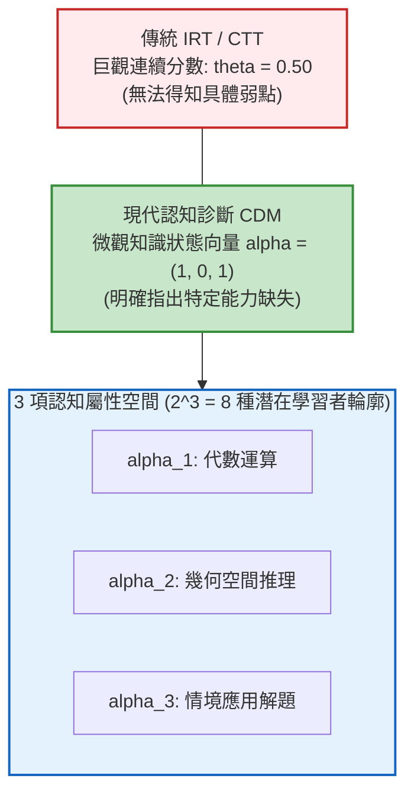

# 第 20 章：認知診斷模型 (CDM) 與學習者輪廓分析

> **本章目標**：根據《Educational Measurement》第 5 版（Cook & Pitoniak, 2025）之認知診斷評量與潛在變數建模章節（Cai et al., 2025; Rupp et al., 2010）。從巨觀分數（IRT $\theta$）跨入微觀知識點診斷（Skill Profile）。說明 Q 矩陣（Q-matrix）（Tatsuoka, 1983）設計哲學與 DINA 模型的失誤率 $s$ 及猜測率 $g$（de la Torre, 2009; Junker & Sijtsma, 2001）。使用 R 與 `CDM` 套件（George et al., 2016）產出個別學習者屬性掌握圖，作為補救教學的參考依據。

---

## 20.1 理論基礎：從巨觀能力到微觀認知屬性診斷

傳統 CTT 或 IRT 僅能告訴教師「小明考了 70 分，能力值 $\theta = 0.5$」，卻無法回答教學現場最關鍵的問題：**「小明到底哪一個數學觀念沒學會？應該補救代數、幾何還是情境應用？」**

**認知診斷模型（Cognitive Diagnostic Models, CDMs）**應運而生（Rupp et al., 2010; Cai et al., 2025）。它將測驗目標解構為 $K$ 個細粒度的離散認知屬性（Attributes, $\alpha = (\alpha_1, \alpha_2, \dots, \alpha_K)$，其中 $\alpha_k \in \{0, 1\}$ 表示「未掌握（0）」或「已掌握（1）」）。



---

## 20.2 Q 矩陣（Q-matrix）與 DINA 模型數學架構

### 20.2.1 Q 矩陣（Q-matrix）的定義
依據 Tatsuoka（1983），Q 矩陣是連結「試題」與「認知屬性」的橋樑，維度為 $J \times K$（$J$ 道試題，$K$ 項屬性）：
$$q_{jk} = \begin{cases} 1, & \text{作答第 } j \text{ 題必須掌握第 } k \text{ 個屬性} \\ 0, & \text{否則} \end{cases}$$

### 20.2.2 確定輸入雜訊及（DINA）模型
DINA（Deterministic Inputs, Noisy "And" Gate）（de la Torre, 2009; Junker & Sijtsma, 2001）是非補償性認知的代表模型：**考生唯有同時掌握該題所需的所有屬性，才具備答對該題的理想資格**。

1. **理想作答指標（Latent Ideal Response, $\eta_{ij}$）**：
   $$\eta_{ij} = \prod_{k=1}^K \alpha_{ik}^{q_{jk}} \in \{0, 1\}$$
2. **試題參數：失誤率 $s_j$ 與猜測率 $g_j$**：
   - **失誤率（Slip, $s_j$）**：已掌握全部所需技能（$\eta_{ij} = 1$），卻因粗心失誤答錯的機率：
     $$s_j = P(X_{ij} = 0 \mid \eta_{ij} = 1)$$
   - **猜測率（Guess, $g_j$）**：未完全掌握所需技能（$\eta_{ij} = 0$），卻憑運氣盲猜答對的機率：
     $$g_j = P(X_{ij} = 1 \mid \eta_{ij} = 0)$$
3. **DINA 作答機率函數**：
   $$P(X_{ij} = 1 \mid \mathbf{\alpha}_i) = (1 - s_j)^{\eta_{ij}} g_j^{1 - \eta_{ij}}$$

---

## 20.3 現代 R 語言程式實作：使用 `CDM` 套件擬合 DINA 模型

我們為 15 道認知題設計一個涵蓋 3 項核心認知屬性的 Q 矩陣，並以 `CDM` 套件（George et al., 2016）對示範資料進行估計：
- **屬性 1（Algebra）**：基礎代數運算
- **屬性 2（Geometry）**：幾何與空間推理
- **屬性 3（Modeling）**：情境建模與文字解題

> **資料限制**：隨附認知作答資料是依單一潛在能力的 2PL 模型生成，並非依本章三屬性 DINA 模型生成；此處的 Q 矩陣是教學示例，不代表已經過專家效度檢驗。估計結果只能用來演示套件操作，不能作為真實學生的認知診斷或補救教學依據。

```r
# ==============================================================================
# 第 20 章程式碼清單 20.1：建立 Q 矩陣並估計 DINA 認知診斷模型
# ==============================================================================

library(CDM)
library(dplyr)
library(tibble)

# 讀取示範資料集並轉為矩陣格式；保留 NA，避免把漏答誤當成答錯
df_all <- read.csv("book/data/assessment_data.csv") |> as_tibble()
cog_responses <- as.matrix(df_all[, sprintf("item_%02d", 1:15)])

# 1. 定義 15 題 x 3 屬性之專家先驗 Q 矩陣
q_matrix <- matrix(c(
  # 題號 | 代數 (A1) | 幾何 (A2) | 建模 (A3)
  1, 0, 0,  # item_01
  1, 0, 0,  # item_02
  0, 1, 0,  # item_03
  0, 1, 0,  # item_04
  0, 0, 1,  # item_05
  1, 1, 0,  # item_06: 代數 + 幾何
  1, 0, 1,  # item_07: 代數 + 建模
  0, 1, 1,  # item_08: 幾何 + 建模
  1, 0, 0,  # item_09
  0, 1, 0,  # item_10
  0, 0, 1,  # item_11
  1, 1, 1,  # item_12: 綜合困難題 (三項皆需)
  1, 0, 0,  # item_13
  0, 1, 0,  # item_14
  1, 0, 1   # item_15
), nrow = 15, ncol = 3, byrow = TRUE)

colnames(q_matrix) <- c("Algebra", "Geometry", "Modeling")
rownames(q_matrix) <- sprintf("item_%02d", 1:15)

cat("--- 認知診斷 Q 矩陣設定表 (部分展示) ---\n")
print(head(q_matrix, 6))

# 2. 擬合 DINA 模型 (EM 演算法)
fit_dina <- CDM::din(
  data = cog_responses,
  q.matrix = q_matrix,
  progress = FALSE
)

# 3. 提取試題參數 (失誤率 s 與猜測率 g)
item_params_dina <- tibble(
  Item = sprintf("item_%02d", 1:15),
  Slip_s = round(fit_dina$item$slip, 3),
  Guess_g = round(fit_dina$item$guess, 3),
  Discrimination_IDI = round(1 - fit_dina$item$slip - fit_dina$item$guess, 3) # 試題診斷鑑別度 (IDI)
)

cat("\n--- DINA 試題參數與診斷鑑別力 (IDI) 清單 (前 6 題) ---\n")
print(head(item_params_dina, 6))
```

---

## 20.4 個別學習者輪廓分析（Learner Profile Diagnostics）

認知診斷模型的主要用途是能為每位學生估計其後驗屬性掌握機率（Attribute Mastery Probabilities）：

```r
# ==============================================================================
# 第 20 章程式碼清單 20.2：提取個人化屬性掌握機率與典型學生篩選
# ==============================================================================

# 提取每位學生的屬性掌握 EAP 後驗機率矩陣
eap_probs <- IRT.factor.scores(fit_dina, type = "EAP")

# 依 EAP 結果挑選三種典型輪廓的學生 (以資料自動篩選，避免人工指定)
mastery <- eap_probs >= 0.50
idx_alg_only <- which(mastery[, 1] & !mastery[, 2])[1]   # 代數精熟、幾何未精熟
idx_geo_only <- which(!mastery[, 1] & mastery[, 2])[1]   # 幾何精熟、代數未精熟
idx_all      <- which(rowSums(mastery) == 3)[1]          # 三項皆精熟
target_idx <- c(idx_alg_only, idx_geo_only, idx_all)
target_idx <- target_idx[!is.na(target_idx)]              # 防禦: 某輪廓可能無人符合
student_diagnostics <- tibble(
  StudentID = df_all$student_id[target_idx],
  Algebra_Prob = round(eap_probs[target_idx, 1], 3),
  Geometry_Prob = round(eap_probs[target_idx, 2], 3),
  Modeling_Prob = round(eap_probs[target_idx, 3], 3),
  Total_Score = df_all$total_score[target_idx]
)

cat("--- 三位典型考生的認知屬性掌握機率診斷表 ---\n")
print(student_diagnostics)
```

---

## 20.5 視覺化：個人化認知屬性診斷條形圖與 IDI 散佈圖

### 20.5.1 個人化認知屬性掌握長條對比圖

```r
# ==============================================================================
# 第 20 章程式碼清單 20.3：個人學習者認知輪廓繪圖
# ==============================================================================

library(ggplot2)
library(tidyr)

student_plot_df <- student_diagnostics |>
  pivot_longer(
    cols = ends_with("_Prob"),
    names_to = "Attribute",
    values_to = "Mastery_Probability"
  ) |>
  mutate(
    Attribute = case_when(
      Attribute == "Algebra_Prob"  ~ "A1: 代數運算",
      Attribute == "Geometry_Prob" ~ "A2: 幾何推理",
      Attribute == "Modeling_Prob" ~ "A3: 情境應用",
      .default = Attribute
    ),
    Student_Label = sprintf("%s (總分: %d 分)", StudentID, Total_Score)
  )

p_profile <- ggplot(student_plot_df, aes(x = Attribute, y = Mastery_Probability, fill = Attribute)) +
  geom_col(width = 0.55, color = "black", linewidth = 0.3) +
  geom_hline(yintercept = 0.50, linetype = "dashed", color = "#c62828", linewidth = 0.8) +
  geom_text(aes(label = sprintf("%.1f%%", Mastery_Probability * 100)), vjust = -0.5, fontface = "bold", size = 3.2) +
  facet_wrap(~Student_Label) +
  scale_y_continuous(limits = c(0, 1.15), breaks = seq(0, 1, by = 0.2), labels = scales::percent_format()) +
  scale_fill_manual(values = c("A1: 代數運算" = "#2b5c8f", "A2: 幾何推理" = "#2e7d32", "A3: 情境應用" = "#d95f02")) +
  labs(
    title = "Figure 20.1: 學習者認知屬性掌握輪廓微觀診斷圖 (Cognitive Diagnostic Profile)",
    subtitle = "紅色虛線為 50% 精熟門檻；呈現不同學生的屬性掌握差異",
    x = "學科核心認知屬性 (Attributes)",
    y = "精熟掌握後驗機率 (Posterior Probability)",
    caption = "Model: DINA (Deterministic Inputs, Noisy 'And' gate), N = 1,000"
  ) +
  theme_classic(base_size = 11) +
  theme(
    legend.position = "none",
    strip.background = element_rect(fill = "#f0f0f0", color = "black"),
    strip.text = element_text(face = "bold", size = 11),
    plot.title = element_text(face = "bold", size = 13),
    axis.text.x = element_text(face = "bold", color = "black")
  )

ggsave("book/fig_20_1_cdm_profile.png", plot = p_profile, width = 9, height = 4.8, dpi = 300)
cat("成功產出圖表: book/fig_20_1_cdm_profile.png\n")

# 20.5.2 試題失誤率 (s) vs. 猜測率 (g) 診斷圖
p_sg <- ggplot(item_params_dina, aes(x = Guess_g, y = Slip_s)) +
  geom_point(aes(color = Discrimination_IDI), size = 4) +
  geom_text(aes(label = Item), vjust = -0.8, fontface = "bold", size = 3.5) +
  scale_color_viridis_c(name = "診斷鑑別力 (IDI: 1-s-g)", option = "plasma") +
  scale_x_continuous(limits = c(0, 0.90), breaks = seq(0, 0.8, by = 0.2)) +
  scale_y_continuous(limits = c(0, 0.90), breaks = seq(0, 0.8, by = 0.2)) +
  labs(
    title = "Figure 20.2: DINA 試題失誤率 (Slip: s) 與猜測率 (Guess: g) 品質散佈圖",
    subtitle = "點越靠近左下角 (低失誤、低猜測)，試題的認知診斷鑑別力 (IDI) 越高",
    x = "試題猜測率 (Guess: g)",
    y = "試題失誤率 (Slip: s)",
    caption = "Ideal Quality Criteria: s < 0.20 and g < 0.20"
  ) +
  theme_classic(base_size = 12) +
  theme(
    legend.position = "right",
    plot.title = element_text(face = "bold", size = 13)
  )

ggsave("book/fig_20_2_dina_parameters.png", plot = p_sg, width = 8.5, height = 5.5, dpi = 300)
cat("成功產出圖表: book/fig_20_2_dina_parameters.png\n")
```

---

## 20.6 測驗報告專業解讀（Substantive Interpretation）

在回饋教學現場的診斷手冊中，CDM 為差異化教學（Differentiated Instruction）提供了屬性層次的依據：

> ### 🎯 結果解讀與教學應用
> 1. **同分不同輪廓**：總分只反映整體表現；CDM 可區分「代數精熟、幾何未精熟」與「幾何精熟、代數未精熟」等不同輪廓，教師可據以安排不同的補救重點。實際比例與個案需以清單 20.2 的輸出為準；屬性機率接近 $.50$ 的學生分類不穩定，不宜單獨作為決策依據。
> 2. **試題品質與 Q 矩陣檢核**：本例 IDI 平均為 $.46$。容易題的猜測率偏高（如 `item_01` 的 $g = .74$），困難題的失誤率偏高（如 `item_12` 的 $s = .84$），反映本資料是以單向度 2PL 生成，而非依 Q 矩陣生成。實務上這類結果提示 Q 矩陣或模型設定需重新檢討，不能視為 Q 矩陣有效的證據。

---

## 20.7 章末實務習題與專案挑戰

### 【基礎練習題】
1. 某道試題之 Q 矩陣向量為 $\mathbf{q} = (1, 1, 0)$，其失誤率為 $s = .10$，猜測率為 $g = .20$。請計算兩位學生：小明具備屬性 $\mathbf{\alpha}_{\text{明}} = (1, 1, 0)$，小華具備屬性 $\mathbf{\alpha}_{\text{華}} = (1, 0, 1)$，各自答對該題的理論機率是多少？
2. 請解釋為何在 DINA 模型中，試題診斷鑑別力指標定義為 $\text{IDI} = 1 - s - g$？當 $\text{IDI} \le 0$ 時代表該題發生了何種嚴重品質問題？

### 【進階工程挑戰】
3. 撰寫一個自動化學習分組演算法 `cluster_learners_by_cdm(dina_model, threshold = 0.50)`。該演算法依據每位考生的微觀屬性向量（例如將機率大於等於 $.50$ 轉為 1，否則為 0），自動將全校考生分類至 $2^K = 8$ 種潛在學習型態（如全精熟組、代數薄弱組、幾何薄弱組等），並輸出各組人數統計與對應的教學介入建議清單。

---

### 💡 習題參考解答

```r
# ==============================================================================
# 第 20 章習題解答參考
# ==============================================================================

# 第 1 題
# 理想指標 eta = alpha_1^q1 * alpha_2^q2 * alpha_3^q3
# 小明: eta = 1^1 * 1^1 * 0^0 = 1 -> P = 1 - s = 1 - 0.10 = 0.90 (90%)
# 小華: eta = 1^1 * 0^1 * 1^0 = 0 -> P = g = 0.20 (20%)
cat("小明答對機率: 90%, 小華答對機率: 20%\n")

# 第 3 題解答核心
cluster_learners_by_cdm <- function(dina_model, threshold = 0.50) {
  post_probs <- dina_model$posterior.prob
  binary_mastery <- ifelse(post_probs >= threshold, "1", "0")
  pattern_strings <- apply(binary_mastery, 1, paste, collapse = "-")
  
  tibble::tibble(Skill_Pattern = pattern_strings) |>
    dplyr::count(Skill_Pattern, name = "Student_Count") |>
    dplyr::mutate(Percentage = round(Student_Count / sum(Student_Count) * 100, 1)) |>
    dplyr::arrange(desc(Student_Count))
}
cat("CDM 學習者分組演算法編寫完成。\n")
```

---

## 參考文獻 (References)

Cai, L., Hansen, M., Jeon, M., & Edwards, M. C. (2025). Modeling data from educational assessments. In L. L. Cook & M. J. Pitoniak (Eds.), *Educational measurement* (5th ed., pp. 655–734). Oxford University Press.

Cook, L. L., & Pitoniak, M. J. (Eds.). (2025). *Educational measurement* (5th ed.). Oxford University Press.

de la Torre, J. (2009). DINA model and parameter estimation: A didactic. *Journal of Educational and Behavioral Statistics*, *34*(1), 115–130. https://doi.org/10.3102/1076998607309474

George, A. C., Robitzsch, A., Kiefer, T., Groß, J., & Ünlü, A. (2016). The R package CDM for cognitive diagnosis models. *Journal of Statistical Software*, *74*(2), 1–24. https://doi.org/10.18637/jss.v074.i02

Junker, B. W., & Sijtsma, K. (2001). Cognitive assessment models with few assumptions, and connections with nonparametric item response theory. *Applied Psychological Measurement*, *25*(3), 258–272. https://doi.org/10.1177/01466210122032064

Rupp, A. A., Templin, J., & Henson, R. A. (2010). *Diagnostic measurement: Theory, methods, and applications*. Guilford Press.

Tatsuoka, K. K. (1983). Rule space: An approach for dealing with misconceptions based on item response theory. *Journal of Educational Measurement*, *20*(4), 345–354. https://doi.org/10.1111/j.1745-3984.1983.tb00212.x
