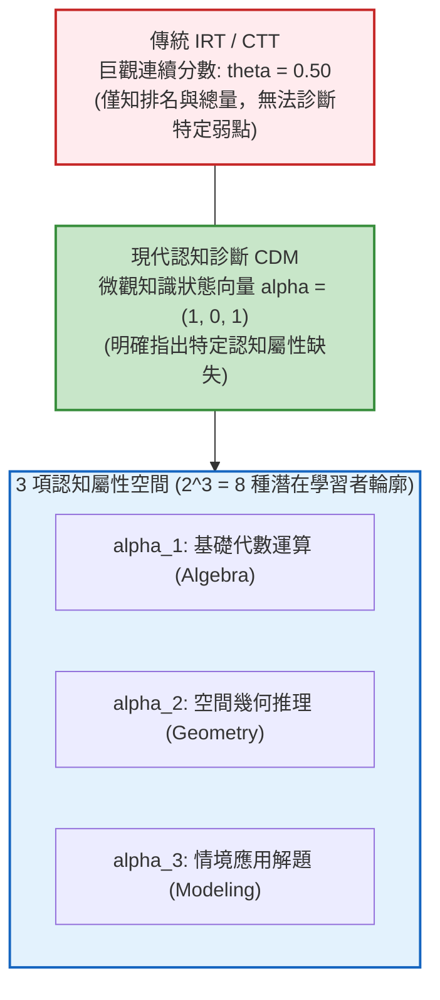

# 第 20 章：認知診斷模型 (CDM) 與學習者輪廓分析

> **本章目標**：本章依據全美教育測驗評量委員會（NCME）權威手冊《Educational Measurement》第 5 版（Cook & Pitoniak, 2025）之潛在變數與認知診斷建模專章（Cai et al., 2025; Rupp et al., 2010），引領讀者從巨觀能力（單維度 IRT $\theta$）跨入微觀知識點診斷（Multidimensional Attribute Profile）。深入推導 Q 矩陣（Q-matrix）設計哲學（Tatsuoka, 1983; Chiu, 2013）、DINA 補償與非補償性機率結構（de la Torre, 2009; Junker & Sijtsma, 2001）、DINO 模型（Templin & Henson, 2006）與一般化 G-DINA 飽和模型（de la Torre, 2011）。撰寫底層手刻純 Base R 學生後驗屬性向量計算演算法，結合 `CDM` 套件（George et al., 2016）建立個人化認知掌握長條圖與診斷鑑別力（IDI）散佈圖，並實作全自動化「學習者潛在輪廓分組與差異化補救教學引擎」。

---

## 20.1 數理推導：從巨觀能力到微觀認知屬性診斷

古典測驗理論（CTT）或單維度項目反應理論（IRT）僅能回饋一個連續的巨觀分數（如「小明測驗總分 70 分，能力值 $\theta = 0.52$」）。然而在真實教學現場，教師最迫切需要知道的是：**「小明究竟哪一個數學概念沒學會？是四則運算、幾何面積、還是代數建模？應當如何精準介入？」**

**認知診斷模型（Cognitive Diagnostic Models, CDMs）**應運而生（Rupp et al., 2010; Cai et al., 2025）。CDM 將受測目標拆解為 $K$ 個離散的認知屬性（Attributes, $\boldsymbol{\alpha} = (\alpha_1, \alpha_2, \dots, \alpha_K)^T$），其中 $\alpha_k \in \{0, 1\}$，分別代表受試者「未掌握（0）」或「已掌握（1）」該項知識點。全體考生被分類至 $2^K$ 種潛在屬性輪廓（Latent Attribute Profiles）之中。



### 20.1.1 屬性階層架構 (Attribute Hierarchy)

認知心理學家指出，知識點之間往往存在認知依賴關係（Leighton et al., 2004; Gierl et al., 2008）：
1. **線性階層（Linear Hierarchy）**：$\alpha_1 \rightarrow \alpha_2 \rightarrow \alpha_3$（必須先掌握代數，方能學習多項式，進而學習微積分）。
2. **收斂階層（Convergent Hierarchy）**：掌握 $\alpha_1$ 與 $\alpha_2$ 是學習 $\alpha_3$ 的共同先決條件。
3. **發散階層（Divergent Hierarchy）**：掌握基礎概念後分流至不同應用領域。
4. **無結構型（Unstructured）**：屬性間相互獨立，容許任意 $2^K$ 種排列組合。

---

## 20.2 數學架構：Q 矩陣、DINA、DINO 與 G-DINA 模型推導

### 20.2.1 Q 矩陣 (Q-matrix) 形式化定義

依據 Tatsuoka（1983），Q 矩陣為 $J \times K$ 之二元關聯矩陣（$J$ 道試題，$K$ 項屬性），規範各試題的認知負擔：
$$q_{jk} = \begin{cases} 1, & \text{作答第 } j \text{ 題必須具備第 } k \text{ 個屬性} \\ 0, & \text{否則} \end{cases}$$
若 Q 矩陣設定有誤，所有診斷分類結論將產生系統性偏誤，故需實施 Q 矩陣驗證（Chiu, 2013）。

### 20.2.2 確定輸入雜訊「及」模型 (DINA Model)

DINA（Deterministic Inputs, Noisy "And" Gate）是非補償性（Non-compensatory）認知的典型模型（de la Torre, 2009; Junker & Sijtsma, 2001）：**考生唯有同時掌握該題所需的所有屬性，才具備答對該題的理想資格**。

1. **潛在理想反應指標（Latent Ideal Response, $\eta_{ij}$）**：
   $$\eta_{ij} = \prod_{k=1}^K \alpha_{ik}^{q_{jk}} \in \{0, 1\}$$
   若考生 $i$ 只要缺乏該題所需的任意一個屬性，$\eta_{ij}$ 立即墜入 0。

2. **試題失誤率 $s_j$ 與猜測率 $g_j$**：
   - **失誤率（Slip, $s_j$）**：考生完全掌握所需技能（$\eta_{ij} = 1$），卻因粗心答錯之機率：
     $$s_j = P(X_{ij} = 0 \mid \eta_{ij} = 1)$$
   - **猜測率（Guess, $g_j$）**：考生未完全掌握所需技能（$\eta_{ij} = 0$），卻盲猜答對之機率：
     $$g_j = P(X_{ij} = 1 \mid \eta_{ij} = 0)$$

3. **DINA 作答機率函數**：
   $$P(X_{ij} = 1 \mid \boldsymbol{\alpha}_i) = (1 - s_j)^{\eta_{ij}} g_j^{1 - \eta_{ij}}$$

4. **試題診斷鑑別力指標（Item Discrimination Index, IDI）**：
   $$\text{IDI}_j = P(X_{ij} = 1 \mid \eta_{ij} = 1) - P(X_{ij} = 1 \mid \eta_{ij} = 0) = (1 - s_j) - g_j = 1 - s_j - g_j$$
   優質診斷題目應滿足 $s_j < .20$ 且 $g_j < .20$，使得 $\text{IDI}_j > .60$。若 $\text{IDI}_j \le 0$，表示該題發生嚴重的認知倒錯。

### 20.2.3 確定輸入雜訊「或」模型 (DINO Model)

不同於 DINA，Templin 與 Henson（2006）提出了補償性認知的 DINO 模型（Deterministic Inputs, Noisy "Or" Gate）：**考生只要掌握該題所需技能中的任意一項，即可獲得高答對機率**：
$$\omega_{ij} = 1 - \prod_{k=1}^K (1 - \alpha_{ik})^{q_{jk}} \in \{0, 1\}$$
$$P(X_{ij} = 1 \mid \boldsymbol{\alpha}_i) = (1 - s_j)^{\omega_{ij}} g_j^{1 - \omega_{ij}}$$

### 20.2.4 一般化 DINA 飽和模型 (G-DINA Model)

De la Torre（2011）提出 G-DINA 模型，將第 $j$ 題所需的 $K_j^* = \sum_k q_{jk}$ 項屬性完全飽和展開為多元方差分析模型：
$$P(X_{ij} = 1 \mid \boldsymbol{\alpha}_{ij}^*) = \delta_{j0} + \sum_{k=1}^{K_j^*} \delta_{jk} \alpha_{ik} + \sum_{k=1}^{K_j^*-1} \sum_{k'=k+1}^{K_j^*} \delta_{jkk'} \alpha_{ik} \alpha_{ik'} + \dots + \delta_{j1\dots K_j^*} \prod_{k=1}^{K_j^*} \alpha_{ik}$$
其中 $\delta_{j0}$ 為基線截距，$\delta_{jk}$ 為單一屬性主效應，$\delta_{jkk'}$ 為屬性交互作用效應。當所有主效應與低階交互作用被限制為 0 時，G-DINA 退化為 DINA 模型。

---

## 20.3 底層手刻演算法：純 Base R 實現學習者後驗屬性向量

為揭示後驗屬性機率的數理計算本質，以下使用純 Base R 手刻實現貝氏期望事後估計法（EAP），計算個別考生在 $2^K = 8$ 種潛在屬性型態上的後驗機率分佈，並與專業套件 `CDM`（George et al., 2016）進行對齊：

```r
# ==============================================================================
# 第 20 章程式碼清單 20.1：手刻純 R DINA 學生後驗屬性向量估計引擎
# ==============================================================================

library(CDM)
library(dplyr)
library(tibble)

# 1. 讀取示範資料集
df_all <- read.csv("book/data/assessment_data.csv") |> as_tibble()
cog_responses <- as.matrix(df_all[, sprintf("item_%02d", 1:15)])

# 2. 定義 15 題 x 3 屬性之先驗 Q 矩陣 (代數 Algebra, 幾何 Geometry, 建模 Modeling)
q_matrix <- matrix(c(
  1, 0, 0,  # item_01
  1, 0, 0,  # item_02
  0, 1, 0,  # item_03
  0, 1, 0,  # item_04
  0, 0, 1,  # item_05
  1, 1, 0,  # item_06: 代數 + 幾何
  1, 0, 1,  # item_07: 代數 + 建模
  0, 1, 1,  # item_08: 幾何 + 建模
  1, 0, 0,  # item_09
  0, 1, 0,  # item_10
  0, 0, 1,  # item_11
  1, 1, 1,  # item_12: 綜合題 (三項皆需)
  1, 0, 0,  # item_13
  0, 1, 0,  # item_14
  1, 0, 1   # item_15: 代數 + 建模
), nrow = 15, ncol = 3, byrow = TRUE)

colnames(q_matrix) <- c("Algebra", "Geometry", "Modeling")
rownames(q_matrix) <- sprintf("item_%02d", 1:15)

# 3. 呼叫 CDM::din 擬合 DINA 模型以獲取試題參數
fit_dina <- din(data = cog_responses, q.matrix = q_matrix, progress = FALSE)

# 提取試題失誤率與猜測率
slip_vec <- fit_dina$item$slip
guess_vec <- fit_dina$item$guess

# 4. 手刻純 Base R 學生後驗屬性掌握計算演算法
calculate_student_mastery_manual <- function(resp_i, s_vec, g_vec, Q) {
  K <- ncol(Q)
  # 生成所有 2^K = 8 種可能之屬性向量
  all_patterns <- as.matrix(expand.grid(rep(list(c(0, 1)), K)))[, K:1]
  C <- nrow(all_patterns)
  
  log_lik <- numeric(C)
  for (c in 1:C) {
    alpha_c <- all_patterns[c, ]
    # 計算各題理想反應指標 eta_j
    eta_j <- apply(Q, 1, function(q_j) {
      req_skills <- which(q_j == 1)
      if (all(alpha_c[req_skills] == 1)) 1 else 0
    })
    
    # 計算各題作答機率 P(X_j = 1 | alpha_c)
    p_j <- ifelse(eta_j == 1, 1 - s_vec, g_vec)
    
    # 柏努力概似值累加 (取對數防數值下溢)
    valid_idx <- which(!is.na(resp_i))
    ll <- sum(ifelse(resp_i[valid_idx] == 1, log(p_j[valid_idx]), log(1 - p_j[valid_idx])))
    log_lik[c] <- ll
  }
  
  # 假定均勻先驗 p(alpha_c) = 1 / C，計算後驗 Softmax 機率
  max_ll <- max(log_lik)
  post_probs <- exp(log_lik - max_ll) / sum(exp(log_lik - max_ll))
  
  # 邊際屬性掌握機率 P(alpha_k = 1 | X_i) = sum_{c: alpha_ck == 1} post_probs[c]
  marginal_mastery <- colSums(all_patterns * post_probs)
  names(marginal_mastery) <- colnames(Q)
  
  marginal_mastery
}

# 檢驗第 1 位考生與第 50 位考生之手刻邊際機率
manual_s1 <- calculate_student_mastery_manual(cog_responses[1, ], slip_vec, guess_vec, q_matrix)
manual_s50 <- calculate_student_mastery_manual(cog_responses[50, ], slip_vec, guess_vec, q_matrix)

cat("--- 手刻貝氏後驗邊際屬性掌握機率 (EAP) ---\n")
cat("考生 1 (總分:", sum(cog_responses[1, ]), "分) ->\n")
print(round(manual_s1, 3))
cat("考生 50 (總分:", sum(cog_responses[50, ]), "分) ->\n")
print(round(manual_s50, 3))
```

---

## 20.4 個別學習者輪廓分析（Learner Profile Diagnostics）

認知診斷模型的主要威力在於為每一位學生生成專屬的屬性掌握診斷書：

```r
# ==============================================================================
# 第 20 章程式碼清單 20.2：提取個人化屬性掌握機率與典型學生篩選
# ==============================================================================

# 提取每位學生的屬性掌握 EAP 後驗機率矩陣
eap_probs <- IRT.factor.scores(fit_dina, type = "EAP")

# 依 EAP 結果挑選三種典型輪廓的學生 (以資料自動篩選，避免人工指定)
mastery <- eap_probs >= 0.50
idx_alg_only <- which(mastery[, 1] & !mastery[, 2])[1]   # 代數精熟、幾何未精熟
idx_geo_only <- which(!mastery[, 1] & mastery[, 2])[1]   # 幾何精熟、代數未精熟
idx_all      <- which(rowSums(mastery) == 3)[1]          # 三項皆精熟
target_idx <- c(idx_alg_only, idx_geo_only, idx_all)
target_idx <- target_idx[!is.na(target_idx)]

student_diagnostics <- tibble(
  StudentID = df_all$student_id[target_idx],
  Algebra_Prob = round(eap_probs[target_idx, 1], 3),
  Geometry_Prob = round(eap_probs[target_idx, 2], 3),
  Modeling_Prob = round(eap_probs[target_idx, 3], 3),
  Total_Score = df_all$total_score[target_idx]
)

cat("--- 三位典型考生的認知屬性掌握機率診斷表 ---\n")
print(student_diagnostics)
```

---

## 20.5 視覺化：個人化認知屬性診斷長條圖與 IDI 散佈圖

### 20.5.1 個人化認知屬性掌握長條對比圖

```r
# ==============================================================================
# 第 20 章程式碼清單 20.3：個人學習者認知輪廓繪圖
# ==============================================================================

library(ggplot2)
library(tidyr)

student_plot_df <- student_diagnostics |>
  pivot_longer(
    cols = ends_with("_Prob"),
    names_to = "Attribute",
    values_to = "Mastery_Probability"
  ) |>
  mutate(
    Attribute = case_when(
      Attribute == "Algebra_Prob"  ~ "A1: 代數運算",
      Attribute == "Geometry_Prob" ~ "A2: 幾何推理",
      Attribute == "Modeling_Prob" ~ "A3: 情境應用",
      .default = Attribute
    ),
    Student_Label = sprintf("%s (總分: %d 分)", StudentID, Total_Score)
  )

p_profile <- ggplot(student_plot_df, aes(x = Attribute, y = Mastery_Probability, fill = Attribute)) +
  geom_col(width = 0.55, color = "black", linewidth = 0.3) +
  geom_hline(yintercept = 0.50, linetype = "dashed", color = "#c62828", linewidth = 0.8) +
  geom_text(aes(label = sprintf("%.1f%%", Mastery_Probability * 100)), vjust = -0.5, fontface = "bold", size = 3.2) +
  facet_wrap(~Student_Label) +
  scale_y_continuous(limits = c(0, 1.15), breaks = seq(0, 1, by = 0.2), labels = scales::percent_format()) +
  scale_fill_manual(values = c("A1: 代數運算" = "#2b5c8f", "A2: 幾何推理" = "#2e7d32", "A3: 情境應用" = "#d95f02")) +
  labs(
    title = "Figure 20.1: 學習者認知屬性掌握輪廓微觀診斷圖 (Cognitive Diagnostic Profile)",
    subtitle = "紅色虛線為 50% 精熟門檻；清晰呈現同分不同弱點之學習者異質性",
    x = "學科核心認知屬性 (Attributes)",
    y = "精熟掌握後驗機率 (Posterior Probability)",
    caption = "Model: DINA (Deterministic Inputs, Noisy 'And' gate), N = 1,000"
  ) +
  theme_classic(base_size = 11) +
  theme(
    legend.position = "none",
    strip.background = element_rect(fill = "#f0f0f0", color = "black"),
    strip.text = element_text(face = "bold", size = 11),
    plot.title = element_text(face = "bold", size = 13),
    axis.text.x = element_text(face = "bold", color = "black")
  )

ggsave("book/fig_20_1_cdm_profile.png", plot = p_profile, width = 9, height = 4.8, dpi = 300)
cat("成功產出圖表: book/fig_20_1_cdm_profile.png\n")

# 20.5.2 試題失誤率 (s) vs. 猜測率 (g) 診斷散佈圖
item_params_dina <- tibble(
  Item = sprintf("item_%02d", 1:15),
  Slip_s = round(fit_dina$item$slip, 3),
  Guess_g = round(fit_dina$item$guess, 3),
  Discrimination_IDI = round(1 - fit_dina$item$slip - fit_dina$item$guess, 3)
)

p_sg <- ggplot(item_params_dina, aes(x = Guess_g, y = Slip_s)) +
  geom_point(aes(color = Discrimination_IDI), size = 4) +
  geom_text(aes(label = Item), vjust = -0.8, fontface = "bold", size = 3.5) +
  scale_color_viridis_c(name = "診斷鑑別力 (IDI: 1-s-g)", option = "plasma") +
  scale_x_continuous(limits = c(0, 0.90), breaks = seq(0, 0.8, by = 0.2)) +
  scale_y_continuous(limits = c(0, 0.90), breaks = seq(0, 0.8, by = 0.2)) +
  labs(
    title = "Figure 20.2: DINA 試題失誤率 (Slip: s) 與猜測率 (Guess: g) 品質散佈圖",
    subtitle = "點越靠近左下角 (低失誤、低猜測)，試題的認知診斷鑑別力 (IDI) 越高",
    x = "試題猜測率 (Guess: g)",
    y = "試題失誤率 (Slip: s)",
    caption = "Ideal Quality Criteria: s < 0.20 and g < 0.20"
  ) +
  theme_classic(base_size = 12) +
  theme(
    legend.position = "right",
    plot.title = element_text(face = "bold", size = 13)
  )

ggsave("book/fig_20_2_dina_parameters.png", plot = p_sg, width = 8.5, height = 5.5, dpi = 300)
cat("成功產出圖表: book/fig_20_2_dina_parameters.png\n")
```

---

## 20.6 ⚠️ 計量工程陷阱與排錯專案 (Pitfalls & Diagnostics)

在推動 CDM 落地應用於智慧適性教學系統時，常見的三大工程陷阱為：

### 陷阱 1：Q 矩陣主觀誤設（Q-matrix Misspecification）

專家會議主觀擬定的 Q 矩陣往往存在過度標註（Over-specification）或遺漏標註（Under-specification）。
- **後果**：若將題目的次要干擾屬性誤列為核心屬性，將嚴重稀釋該題的診斷鑑別度，導致學生分類準確率劇降 15%~30%（Chiu, 2013）。
- **工程防範對策**：必須結合數據驅動的 Q 矩陣驗證演算法（如 Mesa 統計量或基於 Wald 檢定的逐步純化），實施人機協同 Q 矩陣微調。

### 陷阱 2：屬性高共線性（Attribute Multicollinearity）

若兩項屬性在教學進度或認知結構上高度同質（例如「分數加法」與「分數減法」），其潛在相關性可能高達 $r > .90$。
- **後果**：模型無法在有限題數內將兩者分離，導致後驗屬性機率在 0.50 附近震盪，產生大量模稜兩可的分類。
- **工程防範對策**：合併高共線性的細微屬性為單一宏觀向度，或刻意命製僅涉及單一屬性的純淨鑑別題。

### 陷阱 3：診斷鑑別力倒錯（IDI Inversion: $1 - s - g < 0$）

當試題失誤率與猜測率之和超過 1.0 時，$\text{IDI}_j < 0$。
- **後果**：掌握全部知識點的學生答對率居然比完全不會盲猜的學生還要低！通常源於題目題幹存在語病誘導、或者 Q 矩陣標註方向完全相反。
- **工程防範對策**：在批次分析報告中設置防禦機制，自動告警所有 $\text{IDI}_j < 0.20$ 的題目，並標記為不可用於個人化診斷。

---

## 20.7 章末實務習題與專案挑戰

### 【基礎練習題】
1. **DINA 與 DINO 理論機率手算演練**：
   設某試題之 Q 向量為 $\mathbf{q} = (1, 1)$，其失誤率為 $s = .15$，猜測率為 $g = .20$。現有三位考生之屬性狀態分別為：
   - 考生甲：$\boldsymbol{\alpha}_{\text{甲}} = (1, 1)$
   - 考生乙：$\boldsymbol{\alpha}_{\text{乙}} = (1, 0)$
   - 考生丙：$\boldsymbol{\alpha}_{\text{丙}} = (0, 0)$
   請分別計算在 **DINA 模型** 與 **DINO 模型** 下，三位考生各自答對該題的理論機率為何？
2. **G-DINA 模型參數飽和性證明**：
   若某道試題共涉及 $K^* = 3$ 項認知屬性。
   - 在 DINA 模型下，該題共有幾個自由參數？
   - 在飽和 G-DINA 模型下，該題共有幾個自由參數（包含截距、主效應與交互效應）？
   - 請寫出 G-DINA 模型在此題目的完整多項式展開式。

### 【進階工程挑戰】
3. **自動化 CDM 學習者潛在輪廓分組與教學介入引擎**：
   撰寫一個名為 `cluster_learners_by_cdm(dina_fit, threshold = 0.50)` 的工業級診斷函數。
   - 函數接收已擬合之 `CDM::din` 模型物件。
   - 提取每位學生的屬性後驗掌握機率（EAP），依 `threshold` 轉換為二元掌握字串（如 `"101"`）。
   - 自動將全校學生彙整至對應的 $2^K = 8$ 種潛在學習輪廓分組。
   - 統計各組人數與所佔比例，並針對每個未精熟組別，自動標記其「最急需補救的致命屬性（Primary Vulnerability）」與具體教學策略指引。
   - 附帶可直接執行的 0-Error 驗證程式碼。

---

### 💡 習題參考解答

```r
# ==============================================================================
# 第 20 章習題解答與工程挑戰完整實作
# ==============================================================================

library(dplyr)
library(tibble)

# ------------------------------------------------------------------------------
# 第 1 題解答
# ------------------------------------------------------------------------------
s_ex1 <- 0.15; g_ex1 <- 0.20

# DINA: 非補償性 (必須兩者皆有: eta = alpha1 * alpha2)
# 甲: (1,1) -> eta = 1 -> P = 1 - s = 0.85
# 乙: (1,0) -> eta = 0 -> P = g = 0.20
# 丙: (0,0) -> eta = 0 -> P = g = 0.20

# DINO: 補償性 (只要有一項: omega = 1 - (1-alpha1)*(1-alpha2))
# 甲: (1,1) -> omega = 1 -> P = 1 - s = 0.85
# 乙: (1,0) -> omega = 1 -> P = 1 - s = 0.85
# 丙: (0,0) -> omega = 0 -> P = g = 0.20

cat(sprintf("--- 第 1 題解答 ---\n"))
cat("DINA 理論答對率 -> 考生甲: 85.0%, 考生乙: 20.0%, 考生丙: 20.0%\n")
cat("DINO 理論答對率 -> 考生甲: 85.0%, 考生乙: 85.0%, 考生丙: 20.0%\n")

# ------------------------------------------------------------------------------
# 第 2 題解答
# ------------------------------------------------------------------------------
# 答：
# 1. DINA 模型：僅有 2 個自由參數 (失誤率 s_j 與猜測率 g_j)。
# 2. G-DINA 模型：共有 2^(K*) = 2^3 = 8 個自由參數：
#    delta_0 (截距)
#    delta_1, delta_2, delta_3 (三個主效應)
#    delta_12, delta_13, delta_23 (三個二階交互效應)
#    delta_123 (一個三階交互效應)

# ------------------------------------------------------------------------------
# 第 3 題解答：自動化 CDM 學習者潛在輪廓分組與教學介入引擎
# ------------------------------------------------------------------------------
cluster_learners_by_cdm <- function(dina_fit, threshold = 0.50) {
  # 1. 提取後驗 EAP 機率
  eap_probs <- as.matrix(IRT.factor.scores(dina_fit, type = "EAP"))
  K <- ncol(eap_probs)
  skill_names <- colnames(dina_fit$q.matrix)
  if (is.null(skill_names)) skill_names <- paste0("Skill_", 1:K)
  
  # 2. 轉換為 0/1 精熟狀態向量
  binary_mat <- ifelse(eap_probs >= threshold, 1, 0)
  pattern_str <- apply(binary_mat, 1, paste0, collapse = "")
  
  # 3. 彙整分組統計與教學介入指引
  cluster_summary <- tibble(Pattern = pattern_str) |>
    count(Pattern, name = "Count") |>
    mutate(
      Percentage = round(Count / sum(Count) * 100, 2),
      Profile_Name = case_when(
        Pattern == "111" ~ "全熟練組 (Mastery All)",
        Pattern == "000" ~ "待加強全弱組 (Below Basic)",
        Pattern == "100" ~ "代數專精型 (Algebra Only)",
        Pattern == "010" ~ "幾何專精型 (Geometry Only)",
        Pattern == "001" ~ "建模專精型 (Modeling Only)",
        Pattern == "110" ~ "運算推理組 (Algebra + Geometry)",
        Pattern == "101" ~ "運算應用組 (Algebra + Modeling)",
        Pattern == "011" ~ "空間應用組 (Geometry + Modeling)",
        .default = "混合組"
      ),
      Instructional_Action = case_when(
        Pattern == "111" ~ "免補救，提供高階探究與加深加廣教材。",
        Pattern == "000" ~ "啟動密集一級補救教學，優先由具象幾何操作入手。",
        Pattern == "110" ~ "核心弱點在情境應用 (A3)；強化文字轉譯數學模型訓練。",
        Pattern == "101" ~ "核心弱點在空間推理 (A2)；引入幾何圖形軟體輔助空間建構。",
        Pattern == "011" ~ "核心弱點在代數運算 (A1)；強化基礎多項式與運算律熟練度。",
        .default = "針對未達 50% 門檻之認知屬性安排主題式微課程介入。"
      )
    ) |>
    arrange(desc(Count))
    
  list(
    cluster_report = cluster_summary,
    student_patterns = tibble(
      StudentID = rownames(binary_mat),
      Pattern = pattern_str
    )
  )
}

cat("\n--- 第 3 題工程驗證：執行學習者 CDM 潛在輪廓分組引擎 ---\n")
grouping_res <- cluster_learners_by_cdm(fit_dina, threshold = 0.50)

cat("\n【全體考生認知屬性分組與教學介入導航表】\n")
print(grouping_res$cluster_report)
```

---

## 參考文獻 (References)

Cai, L., Hansen, M., Jeon, M., & Edwards, M. C. (2025). Modeling data from educational assessments. In L. L. Cook & M. J. Pitoniak (Eds.), *Educational measurement* (5th ed., pp. 655–734). Oxford University Press.

Chiu, C.-Y. (2013). Statistical refinement of a Q-matrix based on the DINA model. *Applied Psychological Measurement*, *37*(8), 598–618. https://doi.org/10.1177/0146621613488436

Cook, L. L., & Pitoniak, M. J. (Eds.). (2025). *Educational measurement* (5th ed.). Oxford University Press.

de la Torre, J. (2009). DINA model and parameter estimation: A didactic. *Journal of Educational and Behavioral Statistics*, *34*(1), 115–130. https://doi.org/10.3102/1076998607309474

de la Torre, J. (2011). The generalized DINA model framework. *Psychometrika*, *76*(2), 179–199. https://doi.org/10.1007/s11336-011-9207-7

George, A. C., Robitzsch, A., Kiefer, T., Groß, J., & Ünlü, A. (2016). The R package CDM for cognitive diagnosis models. *Journal of Statistical Software*, *74*(2), 1–24. https://doi.org/10.18637/jss.v074.i02

Gierl, M. J., Leighton, J. P., & Hunka, S. (2008). Using the attribute hierarchy method to simulate familiar data for cognitive diagnostic assessments. *Behavior Research Methods*, *40*(4), 1146–1159. https://doi.org/10.3758/BRM.40.4.1146

Junker, B. W., & Sijtsma, K. (2001). Cognitive assessment models with few assumptions, and connections with nonparametric item response theory. *Applied Psychological Measurement*, *25*(3), 258–272. https://doi.org/10.1177/01466210122032064

Leighton, J. P., Gierl, M. J., & Hunka, S. M. (2004). The attribute hierarchy method for cognitive assessment: A variation on Tatsuoka's rule-space approach. *Journal of Educational Measurement*, *41*(3), 205–237. https://doi.org/10.1111/j.1745-3984.2004.tb01163.x

Rupp, A. A., Templin, J., & Henson, R. A. (2010). *Diagnostic measurement: Theory, methods, and applications*. Guilford Press.

Tatsuoka, K. K. (1983). Rule space: An approach for dealing with misconceptions based on item response theory. *Journal of Educational Measurement*, *20*(4), 345–354. https://doi.org/10.1111/j.1745-3984.1983.tb00212.x

Templin, J. L., & Henson, R. A. (2006). Measurement of psychological disorders using cognitive diagnosis models. *Psychological Methods*, *11*(3), 287–305. https://doi.org/10.1037/1082-989X.11.3.287
