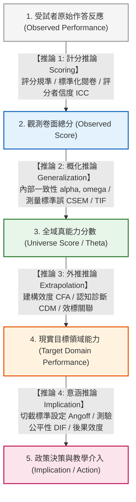

# 第 21 章：端到端效度工程專案：Kane 效度論證與自動化技術手冊

> **本章目標**：本章整合前 20 章的方法，根據《Educational Measurement》第 5 版（Cook & Pitoniak, 2025）之效度驗證章節（Lane & Marion, 2025），依據 Kane（2006）與 Kane（2013）的**基於論證效度架構（Argument-Based Validity Framework）**，串聯計分（Scoring）、概化（Generalization）、外推（Extrapolation）與意涵決策（Implication）四個推論環節，以 Tidyverse（Wickham et al., 2019）彙整技術報告指標。程式輸出僅為證據摘要與檢核示範，不能由固定門檻自動判定測驗「有效」。

---

## 21.1 理論基礎：Kane 基於論證的效度架構（IUA）

在現代心理計量學中，效度（Validity）不再被視為測驗工具本身的固有物理屬性，而是**「對測驗分數之特定詮釋與使用的支持論證（An argument supporting proposed interpretations and uses）」**（Kane, 2006; Kane, 2013; Lane & Marion, 2025）。

《教育與心理測驗標準》（American Educational Research Association et al., 2014）整理了效度證據的相關要求；Kane（2006）與 Kane（2013）的**詮釋與使用論證（Interpretation/Use Argument, IUA）**則是組織分數詮釋與使用論證的一種重要架構，並非唯一可採用的效度架構。以下四個推論環節用來示範本章的分析安排：



---

## 21.2 Kane 四大推論鏈條的實證證據矩陣

每一條推論鏈皆包含明確的**保證假定（Warrant）**，並對應本書前 20 章所實作的具體計量程式模組：

| 推論鏈條 (Inference) | 核心保證假定 (Warrant) | 潛在威脅與反論 (Counter-arguments) | 支撐計量技術與書中章節 |
| :--- | :--- | :--- | :--- |
| **1. 計分 (Scoring)** | 作答評分客觀公正，評分規則被忠實執行 | 評分者主觀偏差、題意模糊 | 評分者一致性 ICC、防禦性閱卷引擎（第 3, 10 章） |
| **2. 概化 (Generalization)** | 觀測分數能有效代表該學科領域的真分數 | 抽樣誤差過大、題數不足、信度偏低 | McDonald's $\omega$、CSEM、IRT 總資訊量 TIF（第 10, 15 章） |
| **3. 外推 (Extrapolation)** | 測驗分數能準確外推至真實世界的學力表現 | 構面受污染（Construct Irrelevant Variance） | 現代 EFA、多構面 CFA、認知診斷 CDM（第 11, 12, 20 章） |
| **4. 意涵 (Implication)** | 切截分數合理，使用該分數所作之決策利大於弊 | 評審標準隨意、試題對弱勢族群偏誤 | Modified Angoff 標準設定、IRT-LR DIF 檢定（第 17, 19 章） |

---

## 21.3 現代 R 語言程式實作：自動化 Kane 效度論證技術工程管線

我們將全書貫穿使用的 1,000 位考生資料庫（包含 15 題二分認知題與 10 題情意量表），結合 `psych`（Revelle, 2026）、`lavaan`（Rosseel, 2012）、`mirt`（Chalmers, 2012）與 `gt`（Iannone et al., 2026），整合為單一端到端證據摘要函數 `generate_kane_validity_report()`。下列門檻僅供示範程式流程，不是通用標準；信度、模型適配、通過率與 DIF 均須依預定分數詮釋與用途、資料品質及其他質性／公平性證據共同判讀（American Educational Research Association et al., 2014; Lane & Marion, 2025）。

```r
# ==============================================================================
# 第 21 章程式碼清單 21.1：端到端 Kane 效度論證自動化工程流水線
# ==============================================================================

library(dplyr)
library(tibble)
library(purrr)
library(psych)
library(lavaan)
library(mirt)
library(gt)

#' 端到端 Kane 效度論證自動化生成引擎
#'
#' @param data 測驗綜合資料框
#' @return 包含四大推論鏈指標的結構化效度報告表
generate_kane_validity_report <- function(data) {
  cat(">>> 開始執行 Kane 效度論證四大推論鏈自動化檢驗...\n")

  cog_cols <- sprintf("item_%02d", 1:15)
  cog_df <- data[, cog_cols]
  total_scores <- data$total_score

  # ----------------------------------------------------------------------------
  # 鏈條 1：計分推論 (Scoring Inference)
  # ----------------------------------------------------------------------------
  item_p <- colMeans(cog_df, na.rm = TRUE)
  mean_difficulty <- mean(item_p)
  valid_cases_pct <- mean(complete.cases(cog_df)) * 100

  # ----------------------------------------------------------------------------
  # 鏈條 2：概化推論 (Generalization Inference)
  # ----------------------------------------------------------------------------
  alpha_val <- psych::alpha(cog_df, warnings = FALSE)$total$raw_alpha
  # 本資料以單一認知構面示範；只使用 omega.tot，單因子下不解讀 omega_h。
  omega_val <- suppressWarnings(psych::omega(cog_df, nfactors = 1, plot = FALSE)$omega.tot)
  sem_val <- sd(total_scores, na.rm = TRUE) * sqrt(1 - alpha_val)

  # ----------------------------------------------------------------------------
  # 鏈條 3：外推推論 (Extrapolation / Construct Validity)
  # ----------------------------------------------------------------------------
  # 執行 CFA 雙因素檢定情意量表
  scale_df <- data |>
    select(scale_01:scale_10) |>
    mutate(scale_03 = 6L - as.integer(scale_03), scale_08 = 6L - as.integer(scale_08))

  cfa_syntax <- '
    Intrinsic =~ scale_01 + scale_02 + scale_03 + scale_04 + scale_05
    Efficacy  =~ scale_06 + scale_07 + scale_08 + scale_09 + scale_10
  '
  fit_cfa <- lavaan::cfa(cfa_syntax, data = scale_df, std.lv = TRUE)
  cfi_val <- fitMeasures(fit_cfa, "cfi")
  rmsea_val <- fitMeasures(fit_cfa, "rmsea")

  # ----------------------------------------------------------------------------
  # 鏈條 4：意涵推論 (Implication / Fairness & Decision)
  # ----------------------------------------------------------------------------
  # 檢驗性別 DIF 題數 (以概似比檢定)
  mg_model <- multipleGroup(cog_df, model = 1, group = data$gender, itemtype = "2PL",
                            invariance = c(colnames(cog_df), "free_means", "free_var"),
                            verbose = FALSE)
  dif_table <- DIF(mg_model, which.par = c("a1", "d"), scheme = "drop",
                   p.adjust = "fdr", verbose = FALSE)
  dif_flagged_count <- sum(dif_table$adj_p < 0.05, na.rm = TRUE)
  pass_rate <- mean(total_scores >= 8, na.rm = TRUE) * 100

  # 彙整結構化四大推論鏈指標
  tibble(
    Inference_Link = c(
      "1. 計分推論 (Scoring)",
      "1. 計分推論 (Scoring)",
      "2. 概化推論 (Generalization)",
      "2. 概化推論 (Generalization)",
      "2. 概化推論 (Generalization)",
      "3. 外推推論 (Extrapolation)",
      "3. 外推推論 (Extrapolation)",
      "4. 意涵推論 (Implication)",
      "4. 意涵推論 (Implication)"
    ),
    Psychometric_Metric = c(
      "有效完整作答率 (Valid Completion Rate)",
      "試題平均通過率 (Mean Difficulty P)",
      "全卷信度 Cronbach's alpha",
      "全域結構信度 McDonald's omega_t",
      "全域測量標準誤 (Global SEM)",
      "驗證性因素分析比較適配指數 (CFI)",
      "近似均方根誤差 (RMSEA)",
      "及格通過率 (Impact Passing Rate, Cut = 8)",
      "顯著差異試題功能偏誤題數 (DIF Items Flagged)"
    ),
    Observed_Value = c(
      sprintf("%.1f%%", valid_cases_pct),
      sprintf("%.3f", mean_difficulty),
      sprintf("%.3f", alpha_val),
      sprintf("%.3f", omega_val),
      sprintf("%.2f 分", sem_val),
      sprintf("%.3f", cfi_val),
      sprintf("%.3f", rmsea_val),
      sprintf("%.1f%%", pass_rate),
      sprintf("%d 題", dif_flagged_count)
    ),
    Evaluation_Standard = c(
      ">= 90.0%", "0.40 ~ 0.70", ">= 0.80", ">= 0.85", "<= 2.0 分",
      ">= 0.950", "<= 0.060", "由政策單位依 PLDs 判斷", "0 題"
    ),
    # 僅檢視是否達到程式示範值，不代表效度判定
    Reference_Check = c(
      if (valid_cases_pct >= 90) "達示範值" else "未達示範值",
      if (mean_difficulty >= 0.40 && mean_difficulty <= 0.70) "達示範值" else "未達示範值",
      if (alpha_val >= 0.80) "達示範值" else "未達示範值",
      if (omega_val >= 0.85) "達示範值" else "未達示範值",
      if (sem_val <= 2.0) "達示範值" else "未達示範值",
      if (cfi_val >= 0.95) "達示範值" else "未達示範值",
      if (rmsea_val <= 0.06) "達示範值" else "未達示範值",
      "需依用途判斷",
      if (dif_flagged_count == 0) "未檢出訊號；仍須審查" else "需內容審查"
    )
  )
}

# 執行驗證
df_all <- read.csv("book/data/assessment_data.csv") |> as_tibble()
kane_summary <- generate_kane_validity_report(df_all)

cat("\n--- Kane 效度論證綜合檢驗總表 ---\n")
print(kane_summary)
```

---

## 21.4 報表：`gt` 輸出技術手冊效度證據矩陣（Table 21.1）

```r
# ==============================================================================
# 第 21 章程式碼清單 21.2：使用 gt 產出標準化技術手冊效度總表 (Table 21.1)
# ==============================================================================

table_21_1 <- kane_summary |>
  gt(groupname_col = "Inference_Link") |>
  tab_header(
    title = md("**Table 21.1**"),
    subtitle = md("*Kane 基於論證效度架構 (IUA) 技術檢驗綜合矩陣表 (N = 1,000)*")
  ) |>
  cols_label(
    Psychometric_Metric = "計量指標 (Metric)",
    Observed_Value = "實測觀測值",
    Evaluation_Standard = "國際規範標準門檻",
    Reference_Check = "示範門檻檢核（非效度結論）"
  ) |>
  tab_style(
    style = cell_text(weight = "bold", color = "#2e7d32"),
    locations = cells_body(
      columns = Reference_Check,
      rows = Reference_Check == "達示範值"
    )
  ) |>
  tab_style(
    style = cell_text(weight = "bold", color = "#d95f02"),
    locations = cells_body(
      columns = Reference_Check,
      rows = Reference_Check != "達示範值"
    )
  ) |>
  tab_source_note(
    source_note = md("門檻僅為程式示範值，並非通用規準或效度結論；各推論鏈須結合用途、內容審查及其他證據判讀。")
  )

# 儲存 HTML 報表
gtsave(table_21_1, "book/table_21_1_validity_matrix.html")
cat("成功產出報表: book/table_21_1_validity_matrix.html\n")
```

---

## 21.5 視覺化：全測驗品質診斷多面板綜合儀表板

我們整合四項計量維度（分數分佈、測驗資訊量、因素結構、公平性），使用 `patchwork` 繪製**綜合技術診斷儀表板（Validity Dashboard）**：

```r
# ==============================================================================
# 第 21 章程式碼清單 21.3：全測驗端到端效度工程綜合儀表板繪製
# ==============================================================================

library(ggplot2)
library(patchwork)

# 1. Panel A: 總分分佈與切截門檻
pA <- ggplot(df_all, aes(x = total_score)) +
  geom_histogram(binwidth = 1, fill = "#2b5c8f", color = "white", alpha = 0.8) +
  geom_vline(xintercept = 7.5, linetype = "dashed", color = "#c62828", linewidth = 1) +
  labs(title = "Panel A: 總分分佈與及格切截門檻 (Scoring)", x = "總分", y = "人數") +
  theme_classic(base_size = 10)

# 2. Panel B: IRT 測驗總資訊函數 (Generalization)，由 2PL 模型實際計算
fit_2pl_dash <- mirt::mirt(df_all[, sprintf("item_%02d", 1:15)], model = 1, itemtype = "2PL", verbose = FALSE)
th_seq <- seq(-3, 3, length.out = 100)
info_seq <- mirt::testinfo(fit_2pl_dash, matrix(th_seq))
pB <- ggplot(tibble(Theta = th_seq, Info = info_seq), aes(x = Theta, y = Info)) +
  geom_line(color = "#2e7d32", linewidth = 1.1) +
  geom_ribbon(aes(ymin = 0, ymax = Info), fill = "#2e7d32", alpha = 0.2) +
  labs(title = "Panel B: IRT 測驗總資訊函數 TIF (Generalization)", x = "能力 (Theta)", y = "資訊量") +
  theme_classic(base_size = 10)

# 3. Panel C: 模擬真值 (latent_ability, latent_motivation) 散佈圖，實務資料以估計分數替代 (Extrapolation)
pC <- ggplot(df_all, aes(x = latent_ability, y = latent_motivation)) +
  geom_point(alpha = 0.35, color = "#7570b3") +
  geom_smooth(method = "lm", color = "#d95f02", se = FALSE) +
  labs(title = "Panel C: 認知能力與學習動機關聯 (Extrapolation)", x = "認知能力", y = "情意動機") +
  theme_classic(base_size = 10)

# 4. Panel D: 性別通過率對比 (Implication / Fairness)
pD <- df_all |>
  mutate(Pass = total_score >= 8) |>
  count(gender, Pass) |>
  group_by(gender) |>
  mutate(Rate = n / sum(n)) |>
  filter(Pass) |>
  ggplot(aes(x = gender, y = Rate, fill = gender)) +
  geom_col(width = 0.5, color = "black", linewidth = 0.3) +
  geom_text(aes(label = sprintf("%.1f%%", Rate * 100)), vjust = -0.5, fontface = "bold", size = 3) +
  scale_y_continuous(limits = c(0, 1), labels = scales::percent_format()) +
  scale_fill_manual(values = c("F" = "#d95f02", "M" = "#2b5c8f")) +
  labs(title = "Panel D: 性別通過率對照 (Implication)", x = "性別", y = "及格通過率") +
  theme_classic(base_size = 10) +
  theme(legend.position = "none")

# 5. 整合為 2x2 儀表板
p_dashboard <- (pA + pB) / (pC + pD) +
  plot_annotation(
    title = "Figure 21.1: 標準化測驗 Kane 效度論證端到端工程技術儀表板 (Validity Dashboard)",
    subtitle = "整合計分、概化、外推與意涵四大推論鏈之全景計量證據 (N = 1,000, 15 Cognitive + 10 Affective)",
    caption = "R 4.5+ / Tidyverse",
    theme = theme(
      plot.title = element_text(face = "bold", size = 13),
      plot.subtitle = element_text(color = "grey30", size = 10)
    )
  )

ggsave("book/fig_21_1_validity_dashboard.png", plot = p_dashboard, width = 9.5, height = 7, dpi = 300)
cat("成功產出圖表: book/fig_21_1_validity_dashboard.png\n")
```

---

## 21.6 全書總結與技術報告結論（Conclusion & Future Directions）

歷經 21 章由淺入深、由底層程式邏輯到進階計量模型，本書以 Tidyverse 串接了心理計量分析的主要流程。

> ### 現代測驗統計程式設計之六項原則
> 1. **資料整潔為先（Tidy Data First）**：長表繪圖、寬表建模，善用 `pivot_*` 與 `.by` 分組，減少 Base R 下標拼貼。
> 2. **計算邏輯（Computational Thinking）**：理解記憶體指向、三值邏輯、布林短路求值與矩陣物理本質，自定義純函數並加入防禦性檢查。
> 3. **數理推論基礎（Probability）**：從二項分配、常態分配與最大概似估計（MLE）出發，為複雜模型提供數學基礎。
> 4. **測驗理論與方法選擇**：古典測驗（CTT）、試題反應理論（IRT）、結構方程模型（SEM）、測驗等化與標準設定依序銜接；適用前提與判讀依據須由具體文獻支持。
> 5. **測驗公平性（Fairness）**：跨群體比較前必須檢定多群組測量恆等性（Scalar Invariance）與差異試題功能（DIF），防範試題文化偏見。
> 6. **基於論證的效度導向（Validity by Argument）**：每一次程式呼叫與統計輸出，最終都用於支持或檢驗分數詮釋與使用的合理性。

---

## 21.7 全書實踐大作業（Capstone Challenge）

請讀者利用隨書附帶的原始碼，嘗試將本書所有章節（第 1 ~ 21 章）透過 **Quarto CLI**（`quarto render`）動態編譯為一本包含互動式圖表、數學 KaTeX 公式排版與完整可複製代碼的 **Quarto 現代電子書（Quarto HTML/PDF Book）**，並部署至 GitHub Pages，分享您的成果。

---

## 參考文獻 (References)

American Educational Research Association, American Psychological Association, & National Council on Measurement in Education. (2014). *Standards for educational and psychological testing*. American Educational Research Association.

Chalmers, R. P. (2012). mirt: A multidimensional item response theory package for the R environment. *Journal of Statistical Software*, *48*(6), 1–29. https://doi.org/10.18637/jss.v048.i06

Cook, L. L., & Pitoniak, M. J. (Eds.). (2025). *Educational measurement* (5th ed.). Oxford University Press.

Iannone, R., Cheng, J., Schloerke, B., Hughes, E., Lauer, A., Seo, J., Brevoort, K., & Roy, O. (2026). *gt: Easily create presentation-ready display tables* (R package version 1.3.0) [Computer software]. The Comprehensive R Archive Network. https://CRAN.R-project.org/package=gt

Kane, M. T. (2006). Validation. In R. L. Brennan (Ed.), *Educational measurement* (4th ed., pp. 17–64). American Council on Education; Praeger.

Kane, M. T. (2013). Validating the interpretations and uses of test scores. *Journal of Educational Measurement*, *50*(1), 1–73. https://doi.org/10.1111/jedm.12000

Lane, S., & Marion, S. F. (2025). Validity and validation. In L. L. Cook & M. J. Pitoniak (Eds.), *Educational measurement* (5th ed., pp. 191–276). Oxford University Press.

Revelle, W. (2026). *psych: Procedures for psychological, psychometric, and personality research* (R package version 2.6.3) [Computer software]. Northwestern University. https://CRAN.R-project.org/package=psych

Rosseel, Y. (2012). lavaan: An R package for structural equation modeling. *Journal of Statistical Software*, *48*(2), 1–36. https://doi.org/10.18637/jss.v048.i02

Wickham, H., Averick, M., Bryan, J., Chang, W., McGowan, L. D., François, R., Grolemund, G., Hayes, A., Henry, L., Hester, J., Kuhn, M., Pedersen, T. L., Miller, E., Bache, S. M., Müller, K., Ooms, J., Robinson, D., Seidel, D. P., Spinu, V., ... Yutani, H. (2019). Welcome to the tidyverse. *Journal of Open Source Software*, *4*(43), Article 1686. https://doi.org/10.21105/joss.01686
