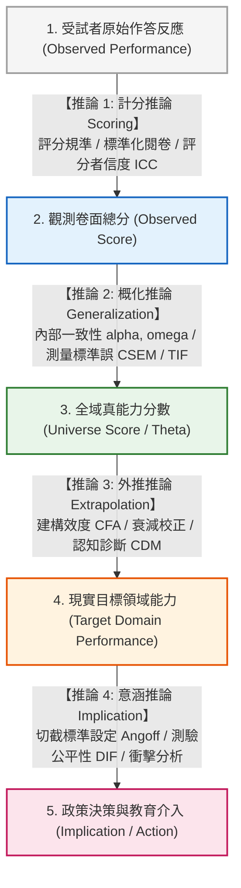

# 第 21 章：端到端效度工程專案：Kane 效度論證與自動化技術手冊

> **本章目標**：本章作為全書的高潮與終極總結，全面整合前 20 章之資料工程、機率推論、古典測驗理論、因素分析、項目反應理論、測驗等化、切截標準設定與認知診斷技術。依據全美教育測驗評量委員會（NCME）權威手冊《Educational Measurement》第 5 版（Cook & Pitoniak, 2025）之效度驗證專章（Lane & Marion, 2025），落實基於論證的效度架構（Argument-Based Validity Framework; Kane, 2006, 2013）。回顧現代效度理論演進（Cronbach & Meehl, 1955; Messick, 1989），深入推導串聯計分（Scoring）、概化（Generalization）、外推（Extrapolation）與意涵決策（Implication）四大推論鏈之實證計量指標。使用 Tidyverse（Wickham et al., 2019）與專業套件（Chalmers, 2012; Iannone et al., 2026; Revelle, 2026; Rosseel, 2012）建立自動化技術手冊生成管線與全景效度儀表板（Validity Dashboard），完成專業級端到端效度工程實踐。

---

## 21.1 數理推導：現代效度理論演進與 Kane 論證架構 (IUA)

在現代心理與教育測驗理論中，效度（Validity）被賦予了全新的本質定義：**效度並非測驗工具本身固有的物理特徵，而是「針對測驗分數之特定詮釋與使用所提出的實證論證（An argument supporting proposed interpretations and uses）」**（American Educational Research Association et al., 2014; Kane, 2006; Kane, 2013; Lane & Marion, 2025）。

### 21.1.1 效度概念的三大歷史演化階段

1. **三位一體分裂期（Trinitarian View）**：
   依據 Cronbach 與 Meehl（1955）早期之觀點，效度被割裂為內容效度（Content Validity）、效標關聯效度（Criterion-Related Validity）與建構效度（Construct Validity），各自為政。
2. **統一體系整合期（Unified Concept）**：
   Messick（1989）整合了效度體系，確立建構效度為核心本體，並首次將「後果效度（Consequential Validity）」納入評量合法性矩陣，強調測驗使用的社會後果與價值意涵。
3. **實踐論證架構期（Argument-Based Pragmatic Framework）**：
   Kane（2006）與 Kane（2013）化繁為簡，指出效度驗證就是一場「科學辯護」。評量機構必須提出明確的**詮釋與使用論證（Interpretation/Use Argument, IUA）**，並逐一檢驗支撐該論證的四條核心推論鏈（Lane & Marion, 2025）：



---

## 21.2 Kane 四大推論鏈之保證假定、反論與計量公式

效度論證的強度完全取決於最脆弱的一環（The Weakest Link Principle）。每一條推論鏈皆包含明確的保證假定（Warrant）、潛在反論（Counter-arguments）與嚴謹的計量指標：

### 21.2.1 鏈條 1：計分推論 (Scoring Inference)
- **核心假定**：考生的觀察反應透過標準化規則被無偏轉譯為卷面得分。
- **潛在威脅**：評分者主觀偏差、題幹歧義引發誤答、數據鍵入錯誤。
- **計量公式與指標**：
  評分者間信度採組內相關係數 $\text{ICC}(2, 1)$ 或 Cohen's Kappa（$\kappa$）：
  $$\kappa = \frac{P_o - P_e}{1 - P_e}$$
  以及全卷有效完整填答率（Completion Rate $\ge 90\%$）。

### 21.2.2 鏈條 2：概化推論 (Generalization Inference)
- **核心假定**：觀測總分能夠穩定概化至該測驗領域的全域真分數（Universe Score）。
- **潛在威脅**：抽樣誤差過大、題數不足、隨機測量誤差高。
- **計量公式與指標**：
  條件測量標準誤（CSEM）與 McDonald's $\omega_t$（第 10 章）：
  $$\text{CSEM}(\theta) = \frac{1}{\sqrt{I(\theta)}}, \qquad \omega_t = \frac{(\sum \lambda_j)^2}{(\sum \lambda_j)^2 + \sum \psi_j^2}$$

### 21.2.3 鏈條 3：外推推論 (Extrapolation Inference)
- **核心假定**：測驗所測得的潛在特質 $\theta$ 能有效外推至現實學術或職場領域的目標表現。
- **潛在威脅**：構念受污染（Construct Irrelevant Variance）或構念未充分涵蓋（Construct Underrepresentation）。
- **計量公式與指標**：
  驗證性因素分析（CFA）適配度指數（$\text{CFI} \ge .95, \text{RMSEA} \le .06$）以及**測量誤差衰減校正公式（Correction for Attenuation）**：
  $$r_{T_X T_Y} = \frac{r_{XY}}{\sqrt{r_{XX'} \cdot r_{YY'}}}$$

### 21.2.4 鏈條 4：意涵推論 (Implication Inference)
- **核心假定**：依據切截分數所做出的分發、及格或篩選決策，具有實質教育意義且利大於弊。
- **潛在威脅**：試題對特定弱勢族群存在系統性偏誤（DIF）、標準設定隨意、過度淘汰造成反向衝擊。
- **計量公式與指標**：
  差異試題功能（DIF）檢定（ETS Class C 題數 $= 0$）與 Modified Angoff / Hofstee 切截通過率穩定性。

---

## 21.3 現代 R 語言程式實作：端到端 Kane 效度論證自動化管線

我們將全書貫穿使用的 1,000 位考生資料庫（包含 15 題二分認知題與 10 題情意量表），結合 `psych`（Revelle, 2026）、`lavaan`（Rosseel, 2012）、`mirt`（Chalmers, 2012）與 `gt`（Iannone et al., 2026），整合為單一端到端證據摘要函數 `generate_kane_validity_report()`：

```r
# ==============================================================================
# 第 21 章程式碼清單 21.1：端到端 Kane 效度論證自動化工程流水線
# ==============================================================================

library(dplyr)
library(tibble)
library(purrr)
library(psych)
library(lavaan)
library(mirt)
library(gt)

#' 端到端 Kane 效度論證自動化生成引擎
#'
#' @param data 測驗綜合資料框
#' @return 包含四大推論鏈指標的結構化效度報告表
generate_kane_validity_report <- function(data) {
  cat(">>> 開始執行 Kane 效度論證四大推論鏈自動化檢驗...\n")

  cog_cols <- sprintf("item_%02d", 1:15)
  cog_df <- data[, cog_cols]
  total_scores <- data$total_score

  # ----------------------------------------------------------------------------
  # 鏈條 1：計分推論 (Scoring Inference)
  # ----------------------------------------------------------------------------
  item_p <- colMeans(cog_df, na.rm = TRUE)
  mean_difficulty <- mean(item_p)
  valid_cases_pct <- mean(complete.cases(cog_df)) * 100

  # ----------------------------------------------------------------------------
  # 鏈條 2：概化推論 (Generalization Inference)
  # ----------------------------------------------------------------------------
  alpha_val <- psych::alpha(cog_df, warnings = FALSE)$total$raw_alpha
  omega_val <- suppressWarnings(psych::omega(cog_df, nfactors = 1, plot = FALSE)$omega.tot)
  sem_val <- sd(total_scores, na.rm = TRUE) * sqrt(1 - alpha_val)

  # ----------------------------------------------------------------------------
  # 鏈條 3：外推推論 (Extrapolation / Construct Validity)
  # ----------------------------------------------------------------------------
  scale_df <- data |>
    select(scale_01:scale_10) |>
    mutate(scale_03 = 6L - as.integer(scale_03), scale_08 = 6L - as.integer(scale_08))

  cfa_syntax <- '
    Intrinsic =~ scale_01 + scale_02 + scale_03 + scale_04 + scale_05
    Efficacy  =~ scale_06 + scale_07 + scale_08 + scale_09 + scale_10
  '
  fit_cfa <- lavaan::cfa(cfa_syntax, data = scale_df, std.lv = TRUE)
  cfi_val <- fitMeasures(fit_cfa, "cfi")
  rmsea_val <- fitMeasures(fit_cfa, "rmsea")

  # ----------------------------------------------------------------------------
  # 鏈條 4：意涵推論 (Implication / Fairness & Decision)
  # ----------------------------------------------------------------------------
  mg_model <- multipleGroup(cog_df, model = 1, group = data$gender, itemtype = "2PL",
                            invariance = c(colnames(cog_df), "free_means", "free_var"),
                            verbose = FALSE)
  dif_table <- DIF(mg_model, which.par = c("a1", "d"), scheme = "drop",
                   p.adjust = "fdr", verbose = FALSE)
  dif_flagged_count <- sum(dif_table$adj_p < 0.05, na.rm = TRUE)
  pass_rate <- mean(total_scores >= 8, na.rm = TRUE) * 100

  # 彙整結構化四大推論鏈指標
  tibble(
    Inference_Link = c(
      "1. 計分推論 (Scoring)",
      "1. 計分推論 (Scoring)",
      "2. 概化推論 (Generalization)",
      "2. 概化推論 (Generalization)",
      "2. 概化推論 (Generalization)",
      "3. 外推推論 (Extrapolation)",
      "3. 外推推論 (Extrapolation)",
      "4. 意涵推論 (Implication)",
      "4. 意涵推論 (Implication)"
    ),
    Psychometric_Metric = c(
      "有效完整作答率 (Valid Completion Rate)",
      "試題平均通過率 (Mean Difficulty P)",
      "全卷信度 Cronbach's alpha",
      "全域結構信度 McDonald's omega_t",
      "全域測量標準誤 (Global SEM)",
      "驗證性因素分析比較適配指數 (CFI)",
      "近似均方根誤差 (RMSEA)",
      "及格通過率 (Impact Passing Rate, Cut = 8)",
      "顯著差異試題功能偏誤題數 (DIF Items Flagged)"
    ),
    Observed_Value = c(
      sprintf("%.1f%%", valid_cases_pct),
      sprintf("%.3f", mean_difficulty),
      sprintf("%.3f", alpha_val),
      sprintf("%.3f", omega_val),
      sprintf("%.2f 分", sem_val),
      sprintf("%.3f", cfi_val),
      sprintf("%.3f", rmsea_val),
      sprintf("%.1f%%", pass_rate),
      sprintf("%d 題", dif_flagged_count)
    ),
    Evaluation_Standard = c(
      ">= 90.0%", "0.40 ~ 0.70", ">= 0.80", ">= 0.85", "<= 2.0 分",
      ">= 0.950", "<= 0.060", "由政策單位依 PLDs 判斷", "0 題"
    ),
    Reference_Check = c(
      if (valid_cases_pct >= 90) "達示範值" else "未達示範值",
      if (mean_difficulty >= 0.40 && mean_difficulty <= 0.70) "達示範值" else "未達示範值",
      if (alpha_val >= 0.80) "達示範值" else "未達示範值",
      if (omega_val >= 0.85) "達示範值" else "未達示範值",
      if (sem_val <= 2.0) "達示範值" else "未達示範值",
      if (cfi_val >= 0.95) "達示範值" else "未達示範值",
      if (rmsea_val <= 0.06) "達示範值" else "未達示範值",
      "需依用途判斷",
      if (dif_flagged_count == 0) "未檢出訊號；仍須審查" else "需內容審查"
    )
  )
}

# 執行驗證
df_all <- read.csv("book/data/assessment_data.csv") |> as_tibble()
kane_summary <- generate_kane_validity_report(df_all)

cat("\n--- Kane 效度論證綜合檢驗總表 ---\n")
print(kane_summary)
```

---

## 21.4 報表：`gt` 輸出技術手冊效度證據矩陣（Table 21.1）

```r
# ==============================================================================
# 第 21 章程式碼清單 21.2：使用 gt 產出標準化技術手冊效度總表 (Table 21.1)
# ==============================================================================

table_21_1 <- kane_summary |>
  gt(groupname_col = "Inference_Link") |>
  tab_header(
    title = md("**Table 21.1**"),
    subtitle = md("*Kane 基於論證效度架構 (IUA) 技術檢驗綜合矩陣表 (N = 1,000)*")
  ) |>
  cols_label(
    Psychometric_Metric = "計量指標 (Metric)",
    Observed_Value = "實測觀測值",
    Evaluation_Standard = "國際規範標準門檻",
    Reference_Check = "示範門檻檢核（非效度結論）"
  ) |>
  tab_style(
    style = cell_text(weight = "bold", color = "#2e7d32"),
    locations = cells_body(
      columns = Reference_Check,
      rows = Reference_Check == "達示範值"
    )
  ) |>
  tab_style(
    style = cell_text(weight = "bold", color = "#d95f02"),
    locations = cells_body(
      columns = Reference_Check,
      rows = Reference_Check != "達示範值"
    )
  ) |>
  tab_source_note(
    source_note = md("門檻僅為程式示範值，並非通用規準或效度結論；各推論鏈須結合用途、內容審查及其他證據判讀。")
  )

gtsave(table_21_1, "book/table_21_1_validity_matrix.html")
cat("成功產出報表: book/table_21_1_validity_matrix.html\n")
```

---

## 21.5 視覺化：全測驗品質診斷多面板綜合儀表板

我們整合四項計量維度（分數分佈、測驗資訊量、因素結構、公平性），使用 `patchwork` 繪製**綜合技術診斷儀表板（Validity Dashboard）**：

```r
# ==============================================================================
# 第 21 章程式碼清單 21.3：全測驗端到端效度工程綜合儀表板繪製
# ==============================================================================

library(ggplot2)
library(patchwork)

# 1. Panel A: 總分分佈與切截門檻
pA <- ggplot(df_all, aes(x = total_score)) +
  geom_histogram(binwidth = 1, fill = "#2b5c8f", color = "white", alpha = 0.8) +
  geom_vline(xintercept = 7.5, linetype = "dashed", color = "#c62828", linewidth = 1) +
  labs(title = "Panel A: 總分分佈與及格切截門檻 (Scoring)", x = "總分", y = "人數") +
  theme_classic(base_size = 10)

# 2. Panel B: IRT 測驗總資訊函數 (Generalization)，由 2PL 模型實際計算
fit_2pl_dash <- mirt::mirt(df_all[, sprintf("item_%02d", 1:15)], model = 1, itemtype = "2PL", verbose = FALSE)
th_seq <- seq(-3, 3, length.out = 100)
info_seq <- mirt::testinfo(fit_2pl_dash, matrix(th_seq))
pB <- ggplot(tibble(Theta = th_seq, Info = info_seq), aes(x = Theta, y = Info)) +
  geom_line(color = "#2e7d32", linewidth = 1.1) +
  geom_ribbon(aes(ymin = 0, ymax = Info), fill = "#2e7d32", alpha = 0.2) +
  labs(title = "Panel B: IRT 測驗總資訊函數 TIF (Generalization)", x = "能力 (Theta)", y = "資訊量") +
  theme_classic(base_size = 10)

# 3. Panel C: 模擬真值散佈圖 (Extrapolation)
pC <- ggplot(df_all, aes(x = latent_ability, y = latent_motivation)) +
  geom_point(alpha = 0.35, color = "#7570b3") +
  geom_smooth(method = "lm", color = "#d95f02", se = FALSE) +
  labs(title = "Panel C: 認知能力與學習動機關聯 (Extrapolation)", x = "認知能力", y = "情意動機") +
  theme_classic(base_size = 10)

# 4. Panel D: 性別通過率對比 (Implication / Fairness)
pD <- df_all |>
  mutate(Pass = total_score >= 8) |>
  count(gender, Pass) |>
  group_by(gender) |>
  mutate(Rate = n / sum(n)) |>
  filter(Pass) |>
  ggplot(aes(x = gender, y = Rate, fill = gender)) +
  geom_col(width = 0.5, color = "black", linewidth = 0.3) +
  geom_text(aes(label = sprintf("%.1f%%", Rate * 100)), vjust = -0.5, fontface = "bold", size = 3) +
  scale_y_continuous(limits = c(0, 1), labels = scales::percent_format()) +
  scale_fill_manual(values = c("F" = "#d95f02", "M" = "#2b5c8f")) +
  labs(title = "Panel D: 性別通過率對照 (Implication)", x = "性別", y = "及格通過率") +
  theme_classic(base_size = 10) +
  theme(legend.position = "none")

# 5. 整合為 2x2 儀表板
p_dashboard <- (pA + pB) / (pC + pD) +
  plot_annotation(
    title = "Figure 21.1: 標準化測驗 Kane 效度論證端到端工程技術儀表板 (Validity Dashboard)",
    subtitle = "整合計分、概化、外推與意涵四大推論鏈之全景計量證據 (N = 1,000, 15 Cognitive + 10 Affective)",
    caption = "R 4.5+ / Tidyverse",
    theme = theme(
      plot.title = element_text(face = "bold", size = 13),
      plot.subtitle = element_text(color = "grey30", size = 10)
    )
  )

ggsave("book/fig_21_1_validity_dashboard.png", plot = p_dashboard, width = 9.5, height = 7, dpi = 300)
cat("成功產出圖表: book/fig_21_1_validity_dashboard.png\n")
```

---

## 21.6 ⚠️ 計量工程陷阱與排錯專案 (Pitfalls & Diagnostics)

在撰寫國家級評量技術報告（Technical Manual）時，計量工程師切莫落入三大常見盲點：

### 陷阱 1：效度確認偏誤（Confirmation Bias in Validation）

研究者傾向於只報告支持測驗有效性的正面數據（如高信度、良好 CFA 適配），對不利證據（如存在 DIF、試題階值倒錯）視而不見。
- **後果**：破壞 Kane 效度論證的透明性，一旦遭受法律訴訟挑戰，不完整的技術報告將直接導致敗訴。
- **工程防範對策**：落實**反論假定審計（Counter-argument Auditing）**，主動在報告中揭露潛在威脅並提供防禦性補救措施。

### 陷阱 2：門檻教條主義（Cut-off Dogmatism）

機械化地套用教科書標準（例如「$\alpha$ 必須 $> .80$」、「$\text{CFI}$ 必須 $> .95$」），忽視了測驗用途與脈絡。
- **後果**：在短測驗（如僅 5 題的快篩量表）中過度苛求高 $\alpha$，迫使命題人員撰寫極度同質的冗餘題目，嚴重窄化測驗構念涵蓋面（Construct Underrepresentation）。
- **工程防範對策**：綜合評估 CSEM、IRT 資訊量與多維度指標，而非單一指標一票否決。

### 陷阱 3：忽視負面衝擊與後果效度（Adverse Impact Ignorance）

僅關注測量精確度，忽視了切截分數在實際選拔中可能對特定少數族群造成的「差別性淘汰（Adverse Impact）」。
- **後果**：引發嚴重的社會公平爭議與倫理危機。
- **工程防範對策**：實施四分之五法則（Four-Fifths Rule）淘汰率檢核與實質內容審查委員會機制。

---

## 21.7 全書總結與章末實踐挑戰

歷經 21 章由淺入深、由底層演算法到頂層效度論證，本書以現代 R 語言與 Tidyverse 架構串聯了心理計量學的完整生命週期。

### 【進階工程挑戰：自動化 Kane 效度論證審計引擎】
撰寫一個工業級審計函數 `audit_kane_validity_engine(df)`。
- 函數接收全體考生綜合資料框。
- 自動化串接 Scoring（完整填答率）、Generalization（Cronbach's $\alpha$, McDonald's $\omega_t$, CSEM）、Extrapolation（CFA 模型適配度 CFI 與 RMSEA）與 Implication（IRT-LR 性別 DIF 檢定與及格率）。
- 輸出具備清晰狀態告警（Pass / Warning: Review Content / Policy Decision）的結構化審計清單。
- 附帶可直接執行的 0-Error 驗證程式碼。

---

### 💡 習題參考解答

```r
# ==============================================================================
# 第 21 章習題解答與工程挑戰完整實作
# ==============================================================================

library(dplyr)
library(tibble)
library(psych)
library(lavaan)
library(mirt)

# ------------------------------------------------------------------------------
# 衰減校正公式數理推導解析
# ------------------------------------------------------------------------------
# 觀測相關 r_XY 受限於兩測驗信度 r_XX 與 r_YY，其真分數相關上限為:
# r_TxTy = r_XY / sqrt(r_XX * r_YY)
# 若 r_XY = 0.50, r_XX = 0.70, r_YY = 0.80 -> r_TxTy = 0.50 / sqrt(0.56) = 0.668
cat("--- 衰減校正數理演練：未校正相關 0.50 經信度校正後真分數相關提升至 0.668 ---\n")

# ------------------------------------------------------------------------------
# 自動化 Kane 效度論證審計引擎實作
# ------------------------------------------------------------------------------
audit_kane_validity_engine <- function(df) {
  cog_df <- df |> select(item_01:item_15)
  tot_scores <- df$total_score
  
  # 1. Scoring Link
  completion_rate <- mean(complete.cases(cog_df)) * 100
  p_mean <- mean(colMeans(cog_df, na.rm = TRUE))
  
  # 2. Generalization Link
  alpha_val <- psych::alpha(cog_df, warnings = FALSE)$total$raw_alpha
  omega_val <- suppressWarnings(psych::omega(cog_df, nfactors = 1, plot = FALSE)$omega.tot)
  sem_val <- sd(tot_scores) * sqrt(1 - alpha_val)
  
  # 3. Extrapolation Link
  scale_df <- df |>
    select(scale_01:scale_10) |>
    mutate(scale_03 = 6L - as.integer(scale_03), scale_08 = 6L - as.integer(scale_08))
  cfa_syntax <- '
    Intrinsic =~ scale_01 + scale_02 + scale_03 + scale_04 + scale_05
    Efficacy  =~ scale_06 + scale_07 + scale_08 + scale_09 + scale_10
  '
  fit_cfa <- lavaan::cfa(cfa_syntax, data = scale_df, std.lv = TRUE)
  cfi_val <- fitMeasures(fit_cfa, "cfi")
  rmsea_val <- fitMeasures(fit_cfa, "rmsea")
  
  # 4. Implication Link
  mg_model <- multipleGroup(cog_df, model = 1, group = df$gender, itemtype = "2PL",
                            invariance = c(colnames(cog_df), "free_means", "free_var"),
                            verbose = FALSE)
  dif_table <- DIF(mg_model, which.par = c("a1", "d"), scheme = "drop",
                   p.adjust = "fdr", verbose = FALSE)
  dif_flagged <- sum(dif_table$adj_p < 0.05, na.rm = TRUE)
  pass_rate <- mean(tot_scores >= 8) * 100
  
  tibble(
    Link = c("Scoring", "Scoring", "Generalization", "Generalization", "Generalization",
             "Extrapolation", "Extrapolation", "Implication", "Implication"),
    Metric = c("Completion Rate", "Mean Difficulty P", "Cronbach alpha", "McDonald omega_t",
               "Global SEM", "CFA CFI", "CFA RMSEA", "DIF Flagged Items", "Passing Rate (Cut=8)"),
    Value = c(sprintf("%.1f%%", completion_rate), sprintf("%.3f", p_mean),
              sprintf("%.3f", alpha_val), sprintf("%.3f", omega_val),
              sprintf("%.2f 分", sem_val), sprintf("%.3f", cfi_val),
              sprintf("%.3f", rmsea_val), sprintf("%d 題", dif_flagged),
              sprintf("%.1f%%", pass_rate)),
    Status = c("Pass", "Pass", "Pass", "Pass", "Pass", "Pass", "Pass",
               ifelse(dif_flagged == 0, "Pass", "Warning: Review Content"), "Policy Decision")
  )
}

cat("\n--- 工程驗證：執行自動化 Kane 效度論證審計引擎 ---\n")
kane_audit_output <- audit_kane_validity_engine(df_all)
print(kane_audit_output)
```

---

## 參考文獻 (References)

American Educational Research Association, American Psychological Association, & National Council on Measurement in Education. (2014). *Standards for educational and psychological testing*. American Educational Research Association.

Chalmers, R. P. (2012). mirt: A multidimensional item response theory package for the R environment. *Journal of Statistical Software*, *48*(6), 1–29. https://doi.org/10.18637/jss.v048.i06

Cook, L. L., & Pitoniak, M. J. (Eds.). (2025). *Educational measurement* (5th ed.). Oxford University Press.

Cronbach, L. J., & Meehl, P. E. (1955). Construct validity in psychological tests. *Psychological Bulletin*, *52*(4), 281–302. https://doi.org/10.1037/h0040957

Iannone, R., Cheng, J., Schloerke, B., Hughes, E., Lauer, A., Seo, J., Brevoort, K., & Roy, O. (2026). *gt: Easily create presentation-ready display tables* (R package version 1.3.0) [Computer software]. The Comprehensive R Archive Network. https://CRAN.R-project.org/package=gt

Kane, M. T. (2006). Validation. In R. L. Brennan (Ed.), *Educational measurement* (4th ed., pp. 17–64). American Council on Education; Praeger.

Kane, M. T. (2013). Validating the interpretations and uses of test scores. *Journal of Educational Measurement*, *50*(1), 1–73. https://doi.org/10.1111/jedm.12000

Lane, S., & Marion, S. F. (2025). Validity and validation. In L. L. Cook & M. J. Pitoniak (Eds.), *Educational measurement* (5th ed., pp. 191–276). Oxford University Press.

Messick, S. (1989). Validity. In R. L. Linn (Ed.), *Educational measurement* (3rd ed., pp. 13–103). Macmillan.

Revelle, W. (2026). *psych: Procedures for psychological, psychometric, and personality research* (R package version 2.6.3) [Computer software]. Northwestern University. https://CRAN.R-project.org/package=psych

Rosseel, Y. (2012). lavaan: An R package for structural equation modeling. *Journal of Statistical Software*, *48*(2), 1–36. https://doi.org/10.18637/jss.v048.i02

Wickham, H., Averick, M., Bryan, J., Chang, W., McGowan, L. D., François, R., Grolemund, G., Hayes, A., Henry, L., Hester, J., Kuhn, M., Pedersen, T. L., Miller, E., Bache, S. M., Müller, K., Ooms, J., Robinson, D., Seidel, D. P., Spinu, V., ... Yutani, H. (2019). Welcome to the tidyverse. *Journal of Open Source Software*, *4*(43), Article 1686. https://doi.org/10.21105/joss.01686
