# 前言：全書總綱與設計哲學 {.unnumbered}

> **理論與實務並重・Tidyverse 典範・程式基礎・國際評量標準參照**

---

## 📖 設計哲學與教學願景

本書專為教育計量、心理測驗、社會科學研究者與資料科學家打造，旨在解決傳統測驗統計教學與實務中的四大痛點：
1. **重理論而輕程式**：傳統心理計量學書籍充斥繁雜矩陣推導，卻缺乏端到端的程式實作管線。
2. **依賴封閉軟體**：過度依賴 SPSS、BILOG-MG 等閉源商業軟體，無法融入現代可重複性研究（Reproducible Research）體系。
3. **語法老舊破碎**：現存 R 語言測驗教材多使用 Base R 舊式寫法（如矩陣下標 `[,]`、`subset()`、`apply()`），輸出結構鬆散，難以維護。
4. **缺乏程式設計邏輯與防禦性**：套件操作者往往缺乏基礎計算思維、布林邏輯、記憶體與資料型態安全意識，面對真實髒資料時頻繁報錯崩潰。

本書以 **「Tidy Psychometrics（整潔心理計量學）」** 為核心，採用：
- **程式風格依據**：Wickham 等人（2023）於《R for Data Science》（第 2 版）提出以原生管線（`|>`）、`dplyr 1.1+`（`.by` 分組語法）、`tibble` 與 `purrr 1.0+` 為主的現代語法；遇到矩陣運算或說明 R 基礎語法時，本書仍使用適當的 Base R 寫法（R Core Team, 2025）。
- **程式邏輯基礎**：洪錦魁與蔡桂宏（2021）系統整理了變數記憶體機制、布林真值表、因子（Factor）底層編碼、矩陣物理結構、控制流程（`for`/`while`）與防禦性設計（`tryCatch`、型態檢查）。
- **數理統計與計量實務基礎**：陳旭昇（2019）與 Ismay 等人（2025）建構了從二項分配、常態分配、概似函數（Likelihood）、最大概似估計（MLE）到重抽樣推論的統計架構；邱皓政（2019）與陳新豐（2021）則提供了量表編製、因素分析與試題反應理論的實務範例。
- **評量理論依據**：Cook 與 Pitoniak（2025）主編之《Educational Measurement》（第 5 版）、《Standards for Educational and Psychological Testing》（American Educational Research Association et al., 2014），以及第 7 版出版手冊規範（American Psychological Association, 2020）。

---

## 🗺️ 全書知識體系全景圖

```mermaid
flowchart TD
    subgraph Part1["第一卷：R 程式設計基礎與計算思維"]
        C1["第 1 章：R 語言核心運算與邏輯基石"] --> C2["第 2 章：測驗專用資料結構 (向量/因子/矩陣/串列)"]
        C2 --> C3["第 3 章：程式邏輯、流程控制與自適應演算法"]
        C3 --> C4["第 4 章：自訂函數設計與防禦性程式工程"]
    end

    subgraph Part2["第二卷：現代 Tidyverse 測驗資料工程"]
        C4 --> C5["第 5 章：測驗資料整潔化 (Tidy Data & Pivot)"]
        C5 --> C6["第 6 章：探索性資料分析與 APA 7th 視覺化"]
    end

    subgraph Part3["第三卷：機率推論與古典測驗理論 (CTT)"]
        C6 --> C7["第 7 章：機率論基石與隨機抽樣模擬"]
        C7 --> C8["第 8 章：最大概似法 (MLE) 與整潔統計推論"]
        C8 --> C9["第 9 章：古典測驗理論 (CTT) 與試題分析"]
        C9 --> C10["第 10 章：量表信度、CSEM 與評分一致性"]
    end

    subgraph Part4["第四卷：潛在構面與結構方程模型"]
        C10 --> C11["第 11 章：現代探索性因素分析 (EFA)"]
        C11 --> C12["第 12 章：驗證性因素分析 (CFA) 與 SEM"]
        C12 --> C13["第 13 章：多群組測驗恆等性檢驗 (Invariance)"]
    end

    subgraph Part5["第五卷：現代試題反應理論 (Modern IRT)"]
        C13 --> C14["第 14 章：二分 IRT 模型 (Rasch / 1PL / 2PL / 3PL)"]
        C14 --> C15["第 15 章：試題與測驗特徵曲線 (ICC/IIC/TIF)"]
        C15 --> C16["第 16 章：多分 IRT 模型 (GRM / GPCM)"]
        C16 --> C17["第 17 章：差異試題功能 (DIF) 與公平性"]
    end

    subgraph Part6["第六卷：評量工程實務：等化與標準設定"]
        C17 --> C18["第 18 章：測驗等化 (Equating) 與分數銜接"]
        C18 --> C19["第 19 章：切截標準設定 (Standard Setting)"]
    end

    subgraph Part7["第七卷：教育大數據與效度工程"]
        C19 --> C20["第 20 章：認知診斷模型 (CDM) 與學習輪廓"]
        C20 --> C21["第 21 章：Kane 效度論證端到端工程實戰"]
    end

    style Part1 fill:#e3f2fd,stroke:#1565c0,stroke-width:2px
    style Part2 fill:#e8f5e9,stroke:#2e7d32,stroke-width:2px
    style Part3 fill:#fff3e0,stroke:#e65100,stroke-width:2px
    style Part4 fill:#f3e5f5,stroke:#7b1fa2,stroke-width:2px
    style Part5 fill:#fbe9e7,stroke:#d84315,stroke-width:2px
    style Part6 fill:#e0f2f1,stroke:#00695c,stroke-width:2px
    style Part7 fill:#fce4ec,stroke:#c2185b,stroke-width:2px
```



---

## 🏛️ 建議章節教學元素（編輯檢核清單）

以下七項是編寫與審稿時可參考的教學元素，不代表 Springer 的正式規範，也不要求每章都以相同順序呈現。目前各章的落實程度不一，出版前仍需逐章檢核：
1. **理論基礎與數學公式（Foundation）**：推導數理統計與計量模型公式。
2. **評量實務情境（Assessment Scenario）**：以教育評量與心理測驗為情境錨定點。
3. **Tidyverse 現代程式實作（Tidy Pipeline）**：全書原生管線 `|>`，杜絕 Base R 下標拼貼。
4. **模型診斷與假設檢核（Diagnostics）**：檢核常態性、單向度、局部獨立性與適配度。
5. **視覺化與 APA 格式報表（Visualization & Tables）**：以 `ggplot2` 與 `gt` 產出圖表。
6. **測驗報告專業解讀（Substantive Interpretation）**：從計量數值轉譯為教學與決策建議。
7. **章末實務習題與專案挑戰（Hands-on Exercises）**：附有檢核碼的動手做練習。

---

## 🛠️ 開發與執行環境設定

本書所有範例均在以下環境執行測試：
- **R 版本**：R 4.2.0 或以上（推薦使用 R 4.5+，以支援完整原生管線 `|>` 與語法優化）。
- **核心套件清單**：

```r
# 安裝全書所需核心套件庫
install.packages(c(
  # 現代資料科學核心
  "tidyverse", "gt", "patchwork", "broom", "infer",
  # 心理計量與測驗統計專用
  "psych", "lavaan", "mirt", "sirt", "CDM", "equate", "difR"
))
```

- **全書統一示範資料集**：`book/data/assessment_data.csv`
  - 樣本數：$N = 1,000$ 位學生
  - 變項涵蓋：人口統計變項、15 題二分認知題（含預設 DIF 題）、10 題李克特五點量表（含反向題）、作答反應時間（RT）與學業落後預警標籤。

> **執行路徑提醒**：章節程式碼使用 `book/data/assessment_data.csv` 等相對路徑；請從包含 `book/` 資料夾的專案根目錄執行。各章程式碼區塊目前是 Markdown 範例，尚未組成可直接執行的 Quarto 書籍專案。

---

## 參考文獻 (References)

邱皓政（2019）。**量化研究與統計分析：SPSS 與 R 資料分析範例解析**（第 6 版）。五南圖書。

洪錦魁、蔡桂宏（2021）。**R 語言邁向 Big Data 之路：王者歸來**（第 2 版）。深智數位。

陳旭昇（2019）。**機率與統計推論：R 語言的應用**。東華書局。

陳新豐（2021）。**R 語言：量表編製、統計分析與試題反應理論**（第 2 版）。五南圖書。

American Educational Research Association, American Psychological Association, & National Council on Measurement in Education. (2014). *Standards for educational and psychological testing*. American Educational Research Association.

American Psychological Association. (2020). *Publication manual of the American Psychological Association* (7th ed.). https://doi.org/10.1037/0000165-000

Cook, L. L., & Pitoniak, M. J. (Eds.). (2025). *Educational measurement* (5th ed.). Oxford University Press.

Ismay, C., Kim, A. Y., & Valdivia, A. (2025). *Statistical inference via data science: A ModernDive into R and the tidyverse* (2nd ed.). Chapman and Hall/CRC.

R Core Team. (2025). *R: A language and environment for statistical computing*. R Foundation for Statistical Computing. https://www.R-project.org/

Wickham, H., Çetinkaya-Rundel, M., & Grolemund, G. (2023). *R for data science: Import, tidy, transform, visualize, and model data* (2nd ed.). O'Reilly Media.

---

*現在，請從第一卷第 1 章開始。*
